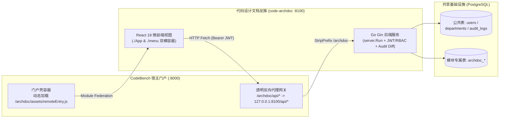

# 代码设计文档反推 (`code-archdoc`)

> 基于 CodeBench 微前端架构与 `code-common` 公共底座构建的 **代码设计文档反推** 业务子系统。

本项目严格遵循 **SDD (Spec-Driven Development，规范驱动开发) + TDD (Test-Driven Development，测试驱动开发)** 工程模式：
**「特性边界明确 (`01-features`) -> 架构与模型定稿 (`02-design`) -> 接口契约与任务拆解 (`03-api` & `04-tasks`) -> TDD 测试先行与分阶段交付」**

---

## 1. 系统架构与微前端拓扑 (System Topology)



---

## 2. 目录结构 (Repository Layout)

```text
code-archdoc/
├── docs/                # SDD + TDD 规范文档库 (00-prompt ~ 06-ops)
├── config/              # 配置加载与模块级元数据常量 (ModuleKey="archdoc", TablePrefix="archdoc_")
├── models/              # GORM 数据模型（统一使用 archdoc_ 表前缀隔离）
├── handlers/            # HTTP 控制器、RBAC 权限拦截、字段级审计与物理隔离单元测试
├── frontend/            # React 18 + Vite 5 + Module Federation 前端工程
├── scripts/             # 自动化构建与辅助脚本
├── Makefile             # 标准构建、测试与代码检查入口
├── AGENTS.md            # AI Agent 协作准则与架构红线
└── README.md            # 项目概览与 SDD+TDD 路线图
```

完整文档规范与分层索引请查阅 [`docs/README.md`](./docs/README.md)。

---

## 3. SDD + TDD 研发路线图 (Lifecycle Checklist)

- [x] **阶段一：特性清单与边界明确** (`docs/01-features/`)
  - [x] [`01-feature-matrix.md`](./docs/01-features/01-feature-matrix.md)（v0.3.1 基线：W1/W2 P0 收敛、项目群协同 `D-01~D-04`、`F-01~F-27`、`SC-01~SC-13` 与 `Non-Goals`）
- [x] **阶段二：系统架构、领域引擎与数据模型设计** (`docs/02-design/`, `docs/05-adr/`)
  - [x] [`01-system-architecture.md`](./docs/02-design/01-system-architecture.md) ~ [`05-database-schema.md`](./docs/02-design/05-database-schema.md)（五专篇系统架构、16 张 `archdoc_*` 模型与 `ADR-01~03`）
- [x] **阶段三：API、数据模型契约冻结与 TDD 任务分解** (`docs/03-api/`, `docs/04-tasks/`)
  - [x] [`01-http-api-contract.md`](./docs/03-api/01-http-api-contract.md)（全量 54 条 HTTP/SSE 接口契约、三层 RBAC 矩阵、错误码与审计规范）
  - [x] [`02-data-model-and-dto-contract.md`](./docs/03-api/02-data-model-and-dto-contract.md)（16 表索引不变量、12 组 JSONB Schema、状态机、仓储接口与 TypeScript 类型字典）
  - [x] [`01-roadmap.md`](./docs/04-tasks/01-roadmap.md)（W1 `M1~M4` + W2 `M5~M6` + 交付 `M7` 依赖拓扑、W1 Exit Gate 与 TDD 质量门禁）
  - [x] [`02-m1`](./docs/04-tasks/02-m1-domain-model-and-api.md) ~ [`08-m7`](./docs/04-tasks/08-m7-portal-integration-and-delivery.md)（7 份详细 TDD Milestone 作战卡与自动化验收标准）
- [ ] **阶段四：TDD 编码实施与运维交付验证** (`docs/06-ops/`)
  - [ ] 按 `M1 -> M7` 严格遵循 Red-Green-Refactor 执行编码实施与全链路交付
  - [ ] [`01-verification-and-deployment-guide.md`](./docs/06-ops/01-verification-and-deployment-guide.md)（联调测试与生产部署手册）

---

## 4. 快速开始与常用命令

```bash
# 1. 生成本地配置文件（确保 database 与 auth.jwt_secret 与 code-bench 保持一致）
cp config.yaml.example config.yaml

# 2. 安装前端依赖、执行静态检查、运行单测并打包单二进制
make install && make lint && make test && make build

# 3. 启动服务（默认监听 :8100）
./code-archdoc-server
```
