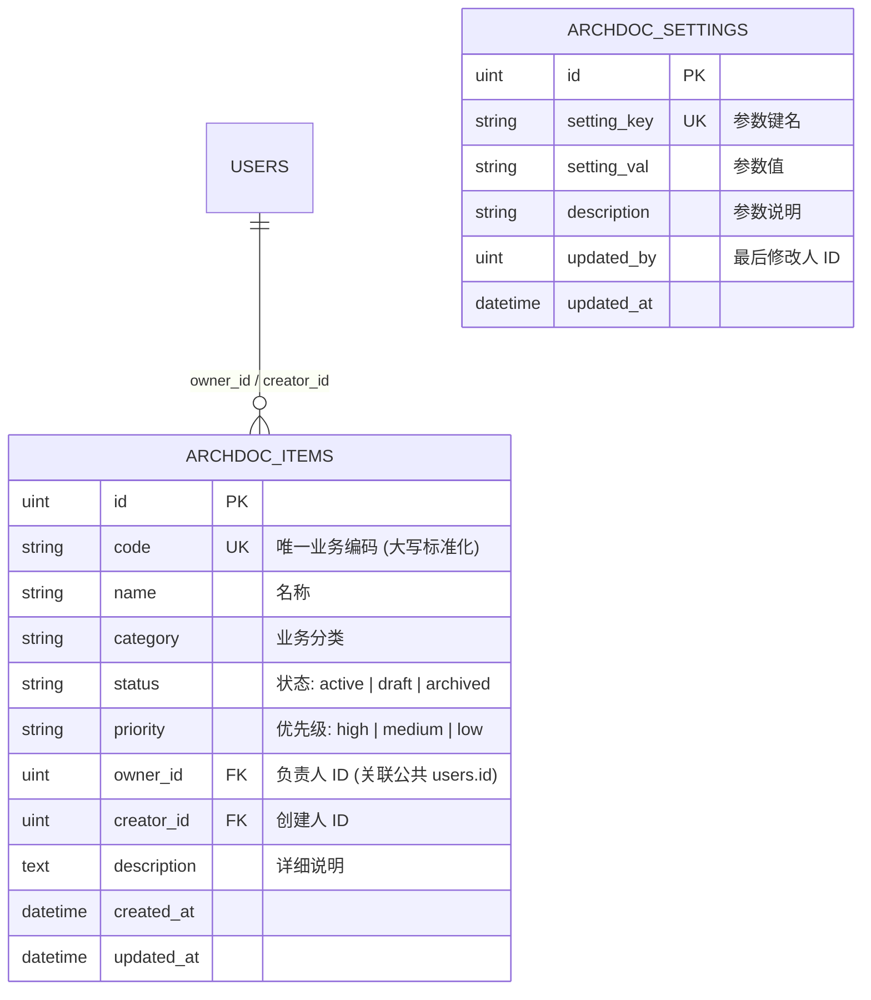

# 代码设计文档反推 (`code-archdoc`) 系统总体架构与数据模型设计

- **文档编号**：`01-system-architecture.md`
- **文档版本**：v0.1.0
- **编制日期**：2026-11-15
- **归属阶段**：阶段二：系统架构与模型设计

---

## 1. 微前端双模运行架构 (Dual-Mode Architecture)

`code-archdoc` 采用前后端一体化单二进制内嵌（`go:embed`）+ Vite Module Federation 微前端联邦架构，无缝支持两种运行形态：

1. **门户嵌入模式 (`isEmbedded = true`)**：
   - CodeBench 宿主门户（`:8000`）通过网关配置挂载 `/archdoc`，在运行时动态拉取 `/archdoc/assets/remoteEntry.js` 的 `./menu` 与 `./App`。
   - 前端 `setupFetchInterceptor({ appPrefix: '/archdoc' })` 自动将模块内的 `/api/*` 请求重写为 `/archdoc/api/*` 并携带门户签发的 `Bearer JWT`。
   - 后端 `commonServer.Run` 自动剥离 `/archdoc` 前缀，由同一套 Gin 路由处理器响应。
2. **独立开发调试模式 (`isEmbedded = false`)**：
   - 开发者直接访问 Vite 调试端口（`http://192.168.56.18:5182/archdoc/`）或后端端口（`http://192.168.56.18:8100`）。
   - 自动渲染内置的 `StandaloneShell`（含独立调试侧边栏、亮/暗主题切换器与 `UnifiedLogin` 登录页）。

---

## 2. 数据库模型与表前缀隔离设计 (Database Schema)

本模块与 CodeBench 共享 PostgreSQL 数据库，所有模块自有表均强制以 **`archdoc_`** 开头：

---

## 3. 代码分层与职责边界 (Package Layering)

| 层级 / 目录 | 核心文件 | 职责说明 |
| :--- | :--- | :--- |
| **配置层 (`config/`)** | `config.go` | 集中声明 `ModuleKey="archdoc"`、`TablePrefix="archdoc_"`、`AdminRole="archdoc_admin"`、`DefaultPort=":8100"` 及 YAML 加载逻辑 |
| **模型层 (`models/`)** | `db.go`, `item.go` | GORM 连接池初始化、`AutoMigrate`、幂等种子数据初始化及业务结构体/白名单校验函数 |
| **控制层 (`handlers/`)** | `health.go`, `auth.go`, `item.go`, `settings.go` | HTTP 参数绑定、RBAC 权限校验、GORM 事务/查询编排、`commonAudit` 审计记录 |
| **前端视图 (`frontend/src/`)** | `App.tsx`, `menu.ts`, `pages/*` | 路由分发、侧边栏契约导出、基于 `--color-*` Token 的业务页面组件 |

---

## 4. 阶段一下沉的设计输入 (Design Inputs from Stage 1)

> 以下内容由 [`01-feature-matrix.md`](../01-features/01-feature-matrix.md) v0.3.0 从特性描述中下沉而来，属于**待阶段二细化与评审的设计输入**，尚未冻结。

### 4.1 `DocType` 目录资产约定（对应 `F-03`）

- **目录结构**：`doc_types/<slug>/` 包含 `meta.json`、`template.md`（文档骨架）、`generation_prompt.md`（生成指令）、可选 `refine_prompt.md`（Chat 精修约束）。
- **`meta.json` 候选字段**：`name`、`display_name`、`is_active`、`scope_profile`（声明式文件范围）、`ir_facets`（订阅的事实类别）、`slots`（含稳定 `slot_id`、`ownership`、`required`、`ir_facets`）、`verify_policy`、`model_tier`、`timeout`；写回时保留未知扩展字段。
- **唯一事实源**：目录为资产唯一事实源；数据库仅存索引与不可变 `DocTypeRevision`（`aggregate_hash` = 全部资产文件内容的有序聚合哈希）。
- **名称校验**：`^[a-z0-9][a-z0-9_-]{1,62}$`。
- **写盘方式**：临时文件 + 原子重命名，同一 `slug` 写操作串行化。

### 4.2 Git 沙箱（对应 `F-02`、`D-04`）

- 抽取 `code-shield/services/runner/git_sync.go` 为 `code-common/backend/gitsync`：同路径互斥锁、残留 `.git/*.lock` 自愈、子进程 `Setpgid` 独立进程组并在 Context 取消/超时时整组强杀。
- 沙箱路径按 `(repo_id, subdir)` 组织，所有文件访问经 `filepath.Rel` 校验不得逃逸沙箱根目录。

### 4.3 生成任务状态机（对应 `F-05`）

`pending -> extracting -> generating -> verifying -> ready | failed | canceled`；槽位级子任务独立记录状态，支持单槽位重试。

### 4.4 架构防腐检查（对应 NFR-1）

参照 `code-shield` 建立 `make lint-arch`：Code IR 解析器、`DocType` 注册表、LLM 客户端与 Verifier 所在包禁止导入 `models.DB` 全局对象。

### 4.5 待阶段二决策的关键技术选型

| 议题 | 候选方案 | 关注点 |
| :--- | :--- | :--- |
| C/C++ 解析 | tree-sitter（Go 绑定，需 CGO）/ universal-ctags / libclang | 容错能力、CGO 对单二进制交付的影响、宏与条件编译处理 |
| Code IR 存储 | PG `jsonb`（按 facet 分行）/ 对象文件 + PG 索引 | 大仓体积、按 facet 增量读取、LRU 回收（`F-27`） |
| 证据锚点 | 符号全限定名 + 文件路径 + 内容指纹 | 跨提交定位稳定性（`F-12`） |
| 发布目录与挂载契约 | `publish_dir` 目录树布局 + `code-bench` 符号链接子树挂载（P0 同机）/ 网关 API 拉取（P1 跨机） | 发布目录原子更新、撤回清理及与 `D-02`/`D-03` 的 Frontmatter/深链契约 |
