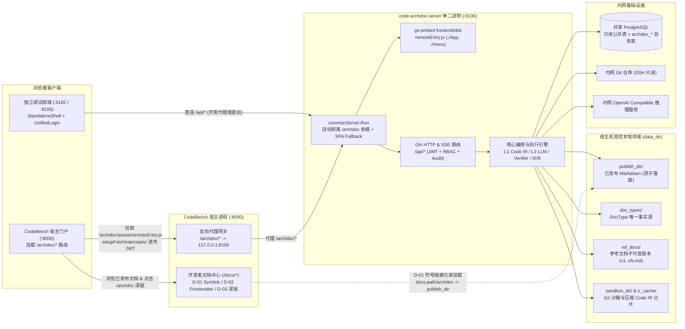
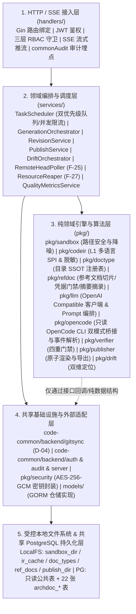
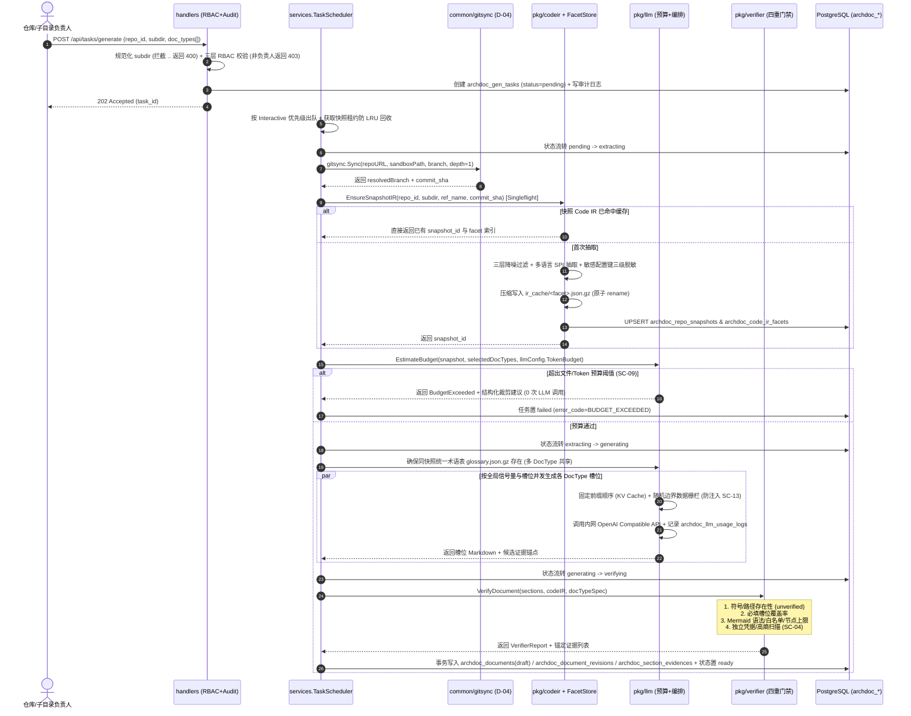
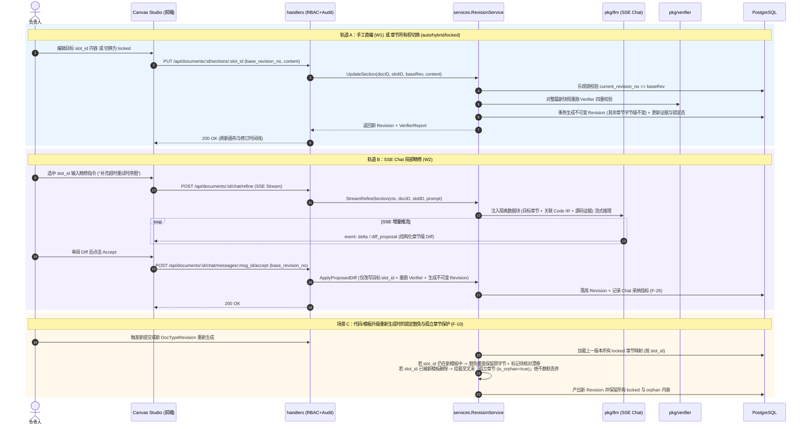
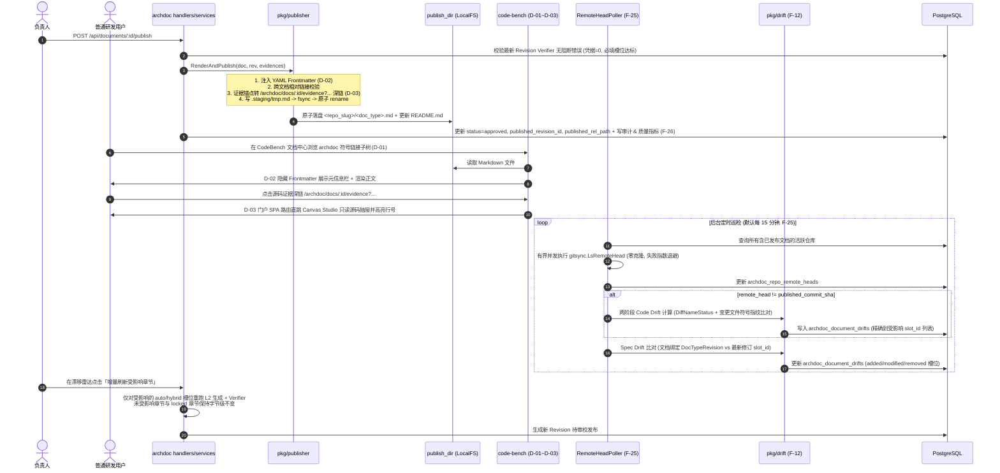

# 代码设计文档反推 (`code-archdoc`) 系统总体架构、跨模块协同与包分层治理

- **文档编号**：`01-system-architecture.md`
- **文档版本**：v1.2.0 (ADR-10 架构参考文档与双引擎上下文引用包边界对齐)
- **编制日期**：2026-11-24
- **归属阶段**：阶段二：系统架构、领域引擎与数据模型设计 (`02-design`)
- **上游基线**：[`docs/01-features/01-feature-matrix.md`](../01-features/01-feature-matrix.md) (v0.10.0)、[`ADR-01`](../05-adr/01-microfrontend-and-table-prefix-isolation.md) ~ [`ADR-10`](../05-adr/10-arch-reference-docs-and-context-injection.md)

---

## 0. 设计总览与专篇索引

本阶段设计采用「**5 篇高内聚设计专篇 + 关键选型 ADR**」结构，全面覆盖阶段一基线（`KA-01`~`KA-07`、`D-01`~`D-04`、`W1`/`W2` P0 特性、`ADR-04`~`ADR-10` 演进特性与 `SC-01`~`SC-24`）：

| 专篇 / ADR | 路径 | 核心职责 |
| :--- | :--- | :--- |
| **【总览篇】** | [`01-system-architecture.md`](./01-system-architecture.md)（本篇） | 双模微前端拓扑、运行时五层架构、项目群协同（`D-01`~`D-04`）、Go 包依赖与 `make lint-arch`、三大端到端时序图、`W1`/`W2` 波次切分与 P1 扩展钩子 |
| **【核心引擎篇】** | [`02-extraction-and-generation-engine.md`](./02-extraction-and-generation-engine.md) | Git 沙箱与三层降噪、Code IR 多语言 SPI、L2 编排熔断、OpenCode 双引擎、Verifier 四重门禁、资源调度（`F-27`）与架构参考文档分层切片/隔离注入（`ADR-10`） |
| **【领域治理篇】** | [`03-doctype-drift-and-publishing.md`](./03-doctype-drift-and-publishing.md) | `DocType` 目录 SSOT 注册表与 5 类内置槽位规划、`slot_id` 锁定与孤立章节、`publish_dir` 原子落盘/撤回/导出、`F-25` 巡检与 `F-12` 双维漂移算法、`F-26` 评测与度量 |
| **【应用与安全篇】** | [`04-workbench-and-security.md`](./04-workbench-and-security.md) | `./App` & `./menu` 联邦契约、四大工作台 React 组件分层树、手工直编 + SSE Chat 双轨修订协议、三层与归属作用域 RBAC 权限决策引擎与 `commonAudit` 审计清单 |
| **【数据模型篇】** | [`05-database-schema.md`](./05-database-schema.md) | 共享主数据只读契约、完整 Mermaid ER 图、全量 22 张 `archdoc_*` GORM Struct 建模字典、迁移/加密与 `testdb` 物理隔离约束 |
| **关键选型 ADR** | [`ADR-01`](../05-adr/01-microfrontend-and-table-prefix-isolation.md) ~ [`ADR-10`](../05-adr/10-arch-reference-docs-and-context-injection.md) | 微前端与表前缀隔离、Code IR 存储、`publish_dir` 挂载、Monorepo 发现/切片/汇总、蓝图双模编辑器、审阅精修台、单仓分支切换、单文档拆单与 OpenCode 双引擎、架构全景主视图、架构树参考文档与双引擎上下文引用 |

---

## 1. 双模微前端运行拓扑与单二进制交付边界

`code-archdoc` 严格遵守 `ADR-01` 与工作区微前端契约，后端默认监听 **`:8100`**，前端 Vite 调试端口 **`5182`**，模块标识 `ModuleKey="archdoc"`，通过 `//go:embed all:frontend/dist` 打入单一可执行文件 `code-archdoc-server`。



### 双模运行契约要点
1. **门户嵌入模式 (`isEmbedded = true`)**：
   - `code-bench` 通过 `/api/modules` 暴露 `archdoc` 模块元数据（`path: "/archdoc"`、`entry: "/archdoc/assets/remoteEntry.js"`），动态加载 `./menu`（侧边栏菜单）与 `./App`（主路由视图）。
   - 前端入口调用 `setupFetchInterceptor({ appPrefix: '/archdoc' })`，自动将业务侧 `/api/*` 与 SSE 请求重写为 `/archdoc/api/*` 并携带宿主 `Bearer JWT`。
   - `code-bench` 开发者文档中心通过符号链接只读挂载 `publish_dir`，读者点击文档中 `/archdoc/docs/:id/evidence?...` 链接时直接触发宿主 SPA 路由跳转至 `code-archdoc` 源码证据抽屉。
2. **独立调试模式 (`isEmbedded = false`)**：
   - 开发者直接访问 Vite 端口 `http://192.168.56.18:5182/archdoc/`（由 Vite 代理 `/archdoc/api` 与 `/api` 至 `:8100`）或单二进制 `:8100`，自动激活 `StandaloneShell`、`UnifiedLogin` 与亮/暗主题切换器。
3. **单二进制交付边界**：
   - 编译期采用 `CGO_ENABLED=1`（见 [`ADR-02`](../05-adr/02-cpp-parser-and-code-ir-storage.md)）将 `tree-sitter` C 语法解析器与 `frontend/dist` 一并内嵌至 `code-archdoc-server`。
   - 除内网共享 PostgreSQL、宿主机标准 `git`（已配全局免密只读 SSH Key，`KA-02`）与内网 LLM HTTP 接口外，自 `ADR-08` 起可选接入宿主机 `opencode` CLI 作为深度反推引擎（未安装或 `opencode.enabled=false` 时自动回退至 Native 引擎，不影响单二进制开箱即用）。

---

## 2. 系统运行时五层架构

系统自顶向下划分为五个职责清晰的运行时分层，上层通过接口调用下层，核心领域算法层完全不感知 HTTP 框架与 GORM 句柄：



### 各层运行时边界说明
- **HTTP / SSE 接入层 (`handlers/`)**：仅负责请求参数校验（路径规范化、防 `..` 穿越）、JWT/RBAC 鉴权校验、调用 `services/` 编排方法、组装标准 HTTP/SSE 响应以及向 `gin.Context` 注入 `commonAudit` 字段级 Diff 上下文。严禁在 `handlers/` 中直接执行 `git` 命令、文件落盘或调用 LLM。
- **领域编排与调度层 (`services/`)**：持有仓储接口（Repository Interfaces）与事务边界，统筹异步任务调度、Singleflight 去重、后台周期巡检（`F-25`）、磁盘 LRU 回收（`F-27`）与事件驱动的指标采集（`F-26`）。
- **纯领域引擎与算法层 (`pkg/`)**：**零 `models.DB` 依赖、零 Gin 依赖**。所有输入输出均为纯 Go 领域结构体与受控接口（如 `FacetStore`、`SecretScanner`、`LLMClient`），可脱离 PostgreSQL 执行毫秒级纯单元测试。
- **受控本地文件系统层 (`data_dir`)**：统一收口至配置项 `storage.data_dir` 下的五个隔离目录：
  - `sandbox_dir/`：受 `gitsync` 管理的只读代码仓沙箱；
  - `ir_cache/`：压缩分片的 Code IR `.json.gz` 与术语表缓存（[`ADR-02`](../05-adr/02-cpp-parser-and-code-ir-storage.md)）；
  - `doc_types/`：`DocType` 资产唯一事实源目录；
  - `ref_docs/`：架构参考文档不可变版本落盘目录（`<doc_id>/v<ver>.md`，[`ADR-10`](../05-adr/10-arch-reference-docs-and-context-injection.md)）；
  - `publish_dir/`：已审批定稿 Markdown 原子落盘目录（[`ADR-03`](../05-adr/03-evidence-anchor-and-publish-mount.md)）。
- **PostgreSQL 共享持久化层 (`models/`)**：复用平台只读主数据，自有 **22 张表**（含 `ADR-10` 新增 `archdoc_reference_docs` 与 `archdoc_reference_bindings`）强制 `archdoc_` 前缀与 `TableName() string` 方法。

---

## 3. 项目群协同改造设计（`D-01`~`D-04`）

严格遵循 `Non-Goal 8`：**所有对 `code-common` 与 `code-bench` 的改造均为通用平台能力增强且 100% 向后兼容，严禁在目标工程中引入任何 `archdoc` 专有业务逻辑**。

### 3.1 `D-04`：`code-common/backend/gitsync` 公共包抽取（W1 首个任务）

将 `code-shield/services/runner/git_sync.go` 中经过生产验证的底层 Git 同步与进程安全治理能力，剥离 `code-shield/models` 依赖后下沉至 `code-common/backend/gitsync`。

#### 导出 API 契约

```go
package gitsync

import (
    "context"
    "sync"
    "time"
)

// SyncOptions 定义单次仓库同步参数
type SyncOptions struct {
    RepoURL        string        // 远端仓库地址（SSH/HTTPS）
    LocalPath      string        // 宿主机本地目标目录（绝对路径）
    Branch         string        // 目标分支（为空时默认 master，并兼容 fallback 至 main）
    Depth          int           // 浅克隆深度（0 表示完整克隆，1 表示浅克隆）
    Timeout        time.Duration // 单次同步超时（默认 5 分钟；鉴权失败快速熔断 < 30s）
    AutoHealCache  bool          // 非权限类本地损坏时是否清理重建缓存（默认 true）
    CleanUntracked bool          // 同步前是否执行 reset --hard && clean -fd（默认 true）
}

// SyncResult 返回同步后的仓库状态
type SyncResult struct {
    LocalPath      string
    ResolvedBranch string // 实际检出的分支名（如 master 自动适配为 main）
    CommitSHA      string // 当前 HEAD 40 位提交哈希
    RawOutput      string // 脱敏后的 git 输出摘要
}

// ChangedFile 描述两次提交间的文件级变更
type ChangedFile struct {
    Status  string // "A" | "M" | "D" | "R"
    Path    string
    OldPath string // 重命名时非空
}

// 1. 进程组受控执行：Setpgid=true, Pdeathsig=SIGKILL，ctx 取消/超时立即 kill(-pgid, SIGKILL)
func ExecCommandWithProcessGroup(ctx context.Context, dir string, name string, args ...string) ([]byte, int, error)

// 2. 同物理路径互斥排队锁，防止同仓并发同步损坏 .git 索引
func GetPathLock(localPath string) *sync.Mutex

// 3. 残留锁文件自愈：自动清理 index.lock / shallow.lock / config.lock / HEAD.lock / refs/**/*.lock
func CleanStaleGitLocks(localPath string)

// 4. 鉴权/权限错误快速识别（不触发本地销毁重试，快速返回明确错误）
func IsAuthOrPermissionError(msg string) bool

// 5. 完整同步入口（持锁 -> 清残留锁 -> clone/fetch/checkout/reset -> 自愈重试 -> 解析 HEAD）
func Sync(ctx context.Context, opts SyncOptions) (*SyncResult, error)

// 6. 轻量远端 HEAD 查询（供 F-25 巡检使用，仅执行 git ls-remote，不拉取对象、不克隆）
func LsRemoteHead(ctx context.Context, repoURL, branch string) (commitSHA string, resolvedBranch string, err error)

// 7. 差异文件列表与单文件历史快照读取（供 F-12 章节级漂移与 F-08 指定 commit 源码预览使用）
func DiffNameStatus(ctx context.Context, localPath, baseSHA, headSHA string) ([]ChangedFile, error)
func ShowFileAtCommit(ctx context.Context, localPath, commitSHA, relPath string) ([]byte, error)
func FetchCommitMetadata(ctx context.Context, localPath, repoURL, commitSHA string) error
```

#### 安全与并发机制细节
- **鉴权快速失败**：执行 `git` 子进程时固定注入环境变量 `GIT_TERMINAL_PROMPT=0` 与 `GIT_SSH_COMMAND="ssh -o BatchMode=yes -o ConnectTimeout=15"`，彻底防止 SSH 交互式密码提示挂死，确保鉴权失败在 30 秒内明确返回（满足 `F-02` 验收指标 3）。
- **独立进程组强杀**：沿用 `code-shield` 的 `SysProcAttr{Setpgid: true, Pdeathsig: syscall.SIGKILL}`；当任务取消或超时触发 `ctx.Done()` 时，向整个负进程组 `-pgid` 发送 `SIGKILL` 并等待 `cmd.Wait()` 回收僵尸进程，杜绝 `git`/`ssh`/`pack-objects` 孤儿进程泄漏。
- **`code-shield` 无损切换方式**：
  1. 在 `code-shield/go.mod` 中保留既有 `replace code-common/backend => ../code-common/backend`；
  2. `code-shield/services/runner/git_sync.go` 改为薄适配层：保留 `PrepareAndSync(ctx, repo, reportID, repoURL)` 对 `UpdateTaskStatus` 与 `models.UpdateActiveTaskReport` 的业务状态回写，内部直接委托调用 `gitsync.Sync(...)`、`gitsync.ExecCommandWithProcessGroup(...)` 等公共函数；
  3. 原封不动执行 `code-shield` 全量 `go test ./...`，确保 `code-shield` 零行为回退。

### 3.2 `D-01`~`D-03`：`code-bench` 开发者文档中心通用增强（W1 交付）

基于对 `code-bench/handlers/docs.go` 与 `code-bench/frontend/src/pages/DeveloperDocs.tsx` 的源码盘点，三项协同改造严格遵循通用化设计：

1. **`D-01` 符号链接子树挂载（已具备，仅约定部署规范）**：
   - `code-bench/handlers/docs.go` 的 `scanDocDirInternal` 已原生支持目录符号链接、`EvalSymlinks` 循环防环、自动跳过 `.` 与 `_` 开头文件/目录、以及自动隐藏空目录。
   - 运维部署仅需在 `code-bench` 的 `docs.path` 根目录建立指向 `code-archdoc` 受控 `publish_dir` 的符号链接即可（详见 [`ADR-03`](../05-adr/03-evidence-anchor-and-publish-mount.md) §3.1）。
2. **`D-02` 通用 YAML Frontmatter 解析隐藏与元信息栏**：
   - **实现位置**：`code-bench/frontend/src/pages/DeveloperDocs.tsx`（及抽离的纯工具模块 `utils/frontmatter.ts`，便于 Vitest/Jest 单元测试）。
   - **解析契约**：
     - 仅当原始 Markdown 首行为 `---`（允许 `\r\n`）且后续存在独立 `---` 闭合行时，解析中间键值对为 `Record<string, string>`，并将闭合行之后的文本作为 `body` 传给 `renderMarkdown(body)`；
     - 若文件无 Frontmatter 或 YAML 格式不合法，**原样降级为普通正文渲染**，确保存量文档 100% 零回归；
     - 目录（TOC）提取函数同样基于剥离后的 `body` 执行，避免 Frontmatter 中的 `#` 注释误入 TOC。
   - **通用元信息栏渲染**：当解析出有效 `metadata` 时，在文档标题栏下方以紧凑徽章条展示通用字段（如优先展示 `repo`/`doc_type`/`commit_sha`（截断前 8 位 + 悬浮全量）/`published_at`/`version`/`author`，其余字段按需折叠），严格使用 `--color-*` Design Tokens 适配亮/暗双主题，不包含任何 `archdoc` 专属逻辑。
3. **`D-03` 已挂载模块前缀链接走门户前端路由**：
   - **实现位置**：`code-bench/frontend/src/pages/DeveloperDocs.tsx`。
   - **通用判定规则**：
     - `DeveloperDocs` 初始化时通过宿主的 `fetchActiveModules()`（复用 `utils/moduleLoader.ts`，缓存模块列表）提取所有激活模块的挂载路径前缀集合 `mountedPrefixes: string[]`（例如 `["/shield", "/pipeline", "/pdm", "/gate", "/contract", "/archdoc"]`）；
     - 扩展 `resolveMarkdownUrl(url, baseDocPath, mountedPrefixes)`：在检查完外链、`#` 锚点、`/api/`、`/docs/` 之后，若 `trimmed` 匹配任意 `prefix`（`trimmed === prefix || trimmed.startsWith(prefix + '/')`），返回 `{ href: trimmed, isExternal: false, isPortalRoute: true }`；
     - 在 `handleContentClick` 中，对 `href.startsWith('/docs/')` 或命中 `mountedPrefixes` 的内部链接，统一执行 `e.preventDefault(); navigate(href);` 完成门户内平滑 SPA 跳转；
     - **零回归保障**：`/docs/...`、`/api/...`、相对路径 `./xxx.md`、`../xxx.md` 及外链 `https://...` 的既有判定优先级与行为 100% 保持不变。

---

## 4. Go 包分层、依赖矩阵与 `make lint-arch` 架构防腐治理

为严格满足 NFR-1（核心引擎包不直接依赖数据库全局对象、通过领域接口解耦），`code-archdoc` 后端采用**清晰的单向分层包架构**：

### 4.1 后端目录与包职责规划

```text
code-archdoc/
├── main.go                          # 组合根 (Composition Root)：配置加载、DB/仓储/引擎装配、路由注册与优雅停机
├── config/                          # 静态模块常量 (ModuleKey/TablePrefix/AdminRole/:8100) 与 YAML 配置模型
├── models/                          # GORM 表结构定义（只读公共表映射 + 22 张 archdoc_*）、DB 迁移、仓储接口实现
├── handlers/                        # Gin HTTP/SSE 控制器、三层/归属作用域 RBAC 中间件、commonAudit 埋点与 HTTP 集成测试
├── services/                        # 领域编排服务（持有仓储接口与引擎实例）：生成/修订/发布/漂移/巡检/调度/回收/度量/参考文档
└── pkg/                             # 纯领域引擎与算法包（严禁导入 models、gorm、gin）
    ├── security/                    # APIKey AES-256-GCM 加密、脱敏器、通用凭据/高熵扫描器（L1、refdoc 与 Verifier 共用）
    ├── sandbox/                     # 沙箱路径安全校验 (SafeJoin/防符号链接逃逸) 与三层降噪过滤引擎
    ├── codeir/                      # Canonical Code IR 模型、FacetStore 接口、LanguageExtractor SPI、通用与 Proto 提取器
    │   └── treesitter/              # CGO 隔离包：tree-sitter C/C++ (W1) 与 Java/Python (W2) 语法树解析器
    ├── doctype/                     # DocType 目录 SSOT 解析、meta.json 校验、未知字段保留、有序聚合哈希与原子写盘
    ├── refdoc/                      # 架构参考文档纯领域引擎（ATX/Setext/编号切片、无标题分块、分级凭据检验、单源 Token 估算、非工具槽位摘录）
    ├── llm/                         # OpenAI Compatible HTTP/SSE 客户端、三层超时重试、Prompt 注入隔离、结构化裁剪与 KV Cache 编排器
    ├── opencode/                    # 只读 OpenCode CLI 双模式配置桥接、进程组强杀、8MB JSONL 事件解析与 --session 续跑（零 DB/Gin 耦合）
    ├── verifier/                    # 四重确定性校验管线（符号/路径、槽位完备度、Mermaid 语法与上限、凭据拦截）与独立 RefDocCitation 对齐
    ├── publisher/                   # Frontmatter 渲染、平台深链转换、跨文档相对链接检查、publish_dir 原子落盘与 ZIP 导出
    └── drift/                       # 章节级 Code Drift（证据锚点+内容指纹）与 Spec Drift（slot_id 差异）纯计算引擎
```

### 4.2 有向包依赖矩阵

| 源包 \ 可依赖目标 | `config` | `pkg/*` | `models` | `services` | `handlers` | `code-common/backend/*` |
| :--- | :---: | :---: | :---: | :---: | :---: | :---: |
| **`config`** | — | ❌ | ❌ | ❌ | ❌ | ✅ (`configutil`, `models`) |
| **`pkg/*`** | ❌ *(仅接收值参)* | ✅ *(按 DAG，无环)* | **❌ (红线禁止)** | **❌ (红线禁止)** | **❌ (红线禁止)** | ✅ *(仅 `gitsync` 等纯工具)* |
| **`models`** | ✅ | ❌ *(避免反向耦合)* | — | ❌ | ❌ | ✅ (`gormdb`, `models`, `auth`) |
| **`services`** | ✅ | ✅ | ✅ *(通过仓储接口)* | — | ❌ | ✅ (`gitsync`, `models`) |
| **`handlers`** | ✅ | ✅ *(仅常量/错误型)* | ✅ *(仅类型与 RBAC 查表)* | ✅ | — | ✅ (`auth`, `audit`, `models`) |
| **`main`** | ✅ | ✅ | ✅ | ✅ | ✅ | ✅ (`server`, `auth`, `audit`) |

> **依赖倒置与 `pkg/*` 内部 DAG 约束**：
> - `services/` 内部定义仓储接口（如 `SnapshotRepo`、`DocTypeRepo`、`DocumentRepo`、`TaskRepo`、`DriftRepo`、`ReferenceDocRepo`），由 `models/` 下的 `*Store` 结构体实现并在 `main.go` 组合根注入；`pkg/*` 仅定义纯 Go 接口（如 `codeir.FacetStore`、`llm.ChatClient`），彻底杜绝在引擎内部出现 `models.DB` 全局单例访问。
> - **`pkg/*` 内部严格保持无环 DAG（`ADR-10`）**：`pkg/llm`、`pkg/opencode` 与 `pkg/verifier` 可单向依赖 `pkg/refdoc`；`pkg/refdoc` 仅允许依赖 `pkg/security` 与 `pkg/sandbox`（用于路径安全与分级凭据检测），**严禁导入 `pkg/llm`**。全链路统一 Token 估算公式（`ceil(ascii/3.5 + nonASCII/1.5)`）在叶包 `pkg/refdoc.EstimateTextTokens` 单源定义，由 `pkg/llm.EstimateTextTokens` 直接委托复用，从根源杜绝 `pkg/llm <-> pkg/refdoc` 循环依赖。

### 4.3 `make lint-arch` 静态防腐门禁规则（NFR-1）

参照 `code-shield/Makefile` 的 `ArchGuard` 机制并进一步结合 `go list` 导入图精确检测，在 `code-archdoc/Makefile` 中定义 `lint-arch` 目标（挂载为 `make lint` 与 CI 必过门禁）：

```makefile
lint-arch:
	@echo "Checking architecture boundaries (ArchGuard)..."
	@# 规则 1: pkg/ 下所有引擎包（含 pkg/opencode、pkg/refdoc）严禁导入 code-archdoc/models、services、handlers、gorm.io/gorm 或 github.com/gin-gonic/gin
	@bad_pkg_imports=$$(go list -f '{{.ImportPath}} -> {{.Imports}}' ./pkg/... | grep -E 'code-archdoc/models|code-archdoc/services|code-archdoc/handlers|gorm\.io/gorm|github\.com/gin-gonic/gin' || true); \
	if [ -n "$$bad_pkg_imports" ]; then \
		echo "❌ [ArchGuard Failed] pkg/* must not import models/services/handlers/gorm/gin:"; \
		echo "$$bad_pkg_imports"; exit 1; \
	fi
	@# 规则 2: pkg/ 与 services/ 严禁直接访问全局 models.DB 单例（强制依赖注入）
	@if grep -rn "models\.DB" pkg/ services/; then \
		echo "❌ [ArchGuard Failed] pkg/ and services/ must not access global models.DB directly!"; \
		exit 1; \
	fi
	@# 规则 3: CGO tree-sitter 依赖必须严格隔离在 pkg/codeir/treesitter/ 内
	@bad_cgo=$$(go list -f '{{.ImportPath}} -> {{.Imports}}' ./... | grep -v '^code-archdoc/pkg/codeir/treesitter ' | grep 'tree-sitter' || true); \
	if [ -n "$$bad_cgo" ]; then \
		echo "❌ [ArchGuard Failed] tree-sitter CGO dependency must be isolated inside pkg/codeir/treesitter:"; \
		echo "$$bad_cgo"; exit 1; \
	fi
	@# 规则 4: models/ 严禁反向导入 services/ 或 handlers/
	@bad_model_imports=$$(go list -f '{{.ImportPath}} -> {{.Imports}}' ./models/... | grep -E 'code-archdoc/(services|handlers)' || true); \
	if [ -n "$$bad_model_imports" ]; then \
		echo "❌ [ArchGuard Failed] models/ must not depend on services/ or handlers/:"; \
		echo "$$bad_model_imports"; exit 1; \
	fi
	@# 规则 5: 自有 GORM 模型强制声明 TableName() 返回 archdoc_ 前缀（静态抽检）
	@echo "✅ [ArchGuard Passed] All architectural boundaries are clean."
```

---

## 5. 三大端到端全链路时序图

### 5.1 链路一：反推生成主链路（`F-01`/`F-02`/`F-04`/`F-05`/`F-07`/`F-13`/`F-27`）



### 5.2 链路二：双轨精修、章节锁定与重生成保护链路（`F-08`/`F-09`/`F-10`）



### 5.3 链路三：定稿发布、`code-bench` 浏览与双维漂移刷新链路（`F-11`/`F-12`/`F-25`）



---

## 6. 交付波次切分（`W1` / `W2`）与 P1 扩展钩子

### 6.1 P0 交付波次边界对照表

严格遵循阶段一收敛的「`W1` 纵向闭环验收通过后启动 `W2`」原则：

| 架构域 | **`W1` 最小可用纵向闭环** | **`W2` P0 全量补齐** |
| :--- | :--- | :--- |
| **跨模块协同 (`D-01`~`D-04`)** | `D-04` 抽取 `code-common/backend/gitsync` 并切换 `code-shield`；`D-01`~`D-03` 完成 `code-bench` Frontmatter 隐藏与模块前缀深链路由 | — |
| **仓库与权限 (`F-01`/`F-13`)** | 只读复用 `repositories`/`architecture_elements`、URL 同步分页、三层 RBAC（含子目录负责人）、全量 `commonAudit` | — |
| **沙箱与 Code IR (`F-02`/`F-04`)** | `gitsync` 沙箱 + 路径防护 + 三层降噪；通用提取器 + C/C++ (`tree-sitter`) + Protobuf/CROS RPC + 敏感配置键脱敏；`FacetStore` 本地压缩缓存 | Java（Spring/ORM/调度）与 Python（FastAPI/Flask/ORM/调度）`tree-sitter` 提取器 |
| **`DocType` 注册表 (`F-03`)** | 启动幂等 Seed 内置 5 类 `DocType`、目录 -> DB `DocTypeRevision` 同步、只读列表与详情 API | 管理员 Web 在线新建/克隆/编辑/启停/受保护删除（含原子写盘重同步与 `409` 防护） |
| **生成、校验与 LLM (`F-05`/`F-07`/`F-14`)** | L2 分层摘要/术语表共享、首次调用前预算熔断、多类型生成/取消/单槽位重试、Verifier 四重门禁、LLM 配置与探活 | 按 `DocTypeRevision` 与阶段的细粒度观测统计联动质量看板 |
| **工作台与修订 (`F-08`/`F-09`/`F-10`)** | Canvas Studio 阅读、Mermaid 缩放平移、只读源码证据抽屉、手工直编、版本历史与一键回滚、章节所有权与锁定/孤立保护 | SSE Chat 局部精修面板、章节级 Diff `Accept`/`Reject` 与采纳率采集 |
| **发布、巡检、漂移与治理 (`F-11`/`F-12`/`F-25`/`F-26`/`F-27`)** | `Approved` 发布落盘至 `publish_dir`、撤回、单篇/ZIP 导出；`F-26` 内置 5 类 Golden Sample 标准样例与自动化回归脚本 | `F-25` 远端 `ls-remote` 巡检调度、`F-12` 章节级双维漂移雷达与增量刷新、`F-26` 在线质量度量看板、`F-27` 磁盘配额 LRU 回收与双优先级并发队列 |

### 6.2 P1 扩展钩子预留清单（低成本字段/接口预埋，P0 不实现）

| P1 特性 | 预留层 | 预留钩子设计 |
| :--- | :--- | :--- |
| **多分支/Tag 基线 (`F-20`)** | 数据模型 & API | `archdoc_repo_snapshots`、`archdoc_documents`、`archdoc_gen_tasks` 均内置 `ref_name` 字段并纳入联合唯一键（P0 默认写入 `Repository.Branch`） |
| **`DocPack` 文档套件 (`F-24`)** | 服务与调度层 | `TaskScheduler` 已支持 `priority: interactive | batch` 双队列与批量多 `DocType` 派发载荷，P1 仅需新增 `archdoc_doc_packs` 表 |
| **历史文档 Gap 诊断 (`F-06`)** | `DocType` 引擎 | `meta.json` 的 `scope_profile` 与 `inputs` 字段预留 `include_legacy_docs: bool` 声明式开关，P1 直接以内置 `DocType` `legacy-gap-report` 接入，零引擎特例分支 |
| **Chat 只读工具调用 (`F-09` P1)** | `pkg/llm` & `pkg/sandbox` | `pkg/sandbox.Reader` 提供只读受控文件检索/符号查询纯接口，`pkg/llm` 消息结构保留 OpenAI `tool_calls` 扩展字段 |
| **任务断点恢复 (`F-05` P1)** | `archdoc_gen_slot_tasks` | 每个槽位已独立持久化状态、产物与重试次数，P1 仅需增加服务重启后的 `running -> pending` 恢复扫描器 |
| **`code-contract` 运行态融合 (`F-21`)** | Code IR Schema | `idl_contracts` 分片预留 `runtime_overlay` 可选扩展对象（`verified_calls`、`architecture_violations`），无关联数据时自动忽略 |
| **跨机部署网关拉取 (`KA-05` P1)** | `pkg/publisher` | 发布输出经由 `PublishSink` 接口解耦，P1 增加只读发布内容 API 与 `code-bench` 远程文档源适配，文档格式/Frontmatter/深链零变更 |

---

## 7. 阶段一基线可追溯矩阵

| 阶段一编号 | 架构落点专篇与章节 |
| :--- | :--- |
| `F-01`, `SC-01`, `SC-06` | `01-system-architecture` §3/§5、`04-workbench-and-security` §2.1/§4、`05-database-schema` §1 |
| `F-02`, `D-04`, `SC-06`, `SC-09` | `01-system-architecture` §3.1、`02-extraction-and-generation-engine` §1 |
| `F-03`, `SC-08` | `03-doctype-drift-and-publishing` §1、`04-workbench-and-security` §2.4、`05-database-schema` §3.1 |
| `F-04`, `KA-01`, `SC-02`, `SC-09` | `ADR-02`、`02-extraction-and-generation-engine` §2、`05-database-schema` §3.2 |
| `F-05`, `F-14`, `SC-02`, `SC-09`, `SC-13` | `02-extraction-and-generation-engine` §3、`04-workbench-and-security` §2.4、`05-database-schema` §3.3/§3.7 |
| `F-07`, `SC-04` | `ADR-03` §2、`02-extraction-and-generation-engine` §4、`05-database-schema` §3.4 |
| `F-08`, `F-09`, `SC-05`, `SC-10` | `04-workbench-and-security` §2.2/§3、`05-database-schema` §3.4/§3.5 |
| `F-10`, `SC-05`, `SC-10` | `03-doctype-drift-and-publishing` §2、`05-database-schema` §3.4 |
| `F-11`, `D-01`~`D-03`, `SC-07`, `SC-10` | `ADR-03` §3、`01-system-architecture` §3.2、`03-doctype-drift-and-publishing` §3 |
| `F-12`, `F-25`, `SC-07`, `SC-08`, `SC-11` | `ADR-03` §2、`03-doctype-drift-and-publishing` §4、`05-database-schema` §3.6 |
| `F-13`, `SC-01`, `SC-12` | `04-workbench-and-security` §4、`05-database-schema` §1 |
| `F-26` | `03-doctype-drift-and-publishing` §1.3/§5、`04-workbench-and-security` §2.3、`05-database-schema` §3.7 |
| `F-27` | `ADR-02` §3、`02-extraction-and-generation-engine` §5、`05-database-schema` §3.2/§3.7 |
