# PostgreSQL 物理模型与 `archdoc_*` GORM 建模字典

- **文档编号**：`05-database-schema.md`
- **文档版本**：v1.5.0 (ADR-10 增量演进：20 → 22 张 `archdoc_*` 自有表 + 3 表 JSONB 隔离扩展)
- **编制日期**：2026-11-24
- **归属阶段**：阶段二：系统架构、领域引擎与数据模型设计 (`02-design`)
- **关联基线**：`Non-Goal 1`, `Non-Goal 6`, `F-01`, `F-03`, `F-04`, `F-05`, `F-07`, `F-09`, `F-10`, `F-11`, `F-12`, `F-14`, `F-25`~`F-37`, [`ADR-01`](../05-adr/01-microfrontend-and-table-prefix-isolation.md), [`ADR-02`](../05-adr/02-cpp-parser-and-code-ir-storage.md), [`ADR-03`](../05-adr/03-evidence-anchor-and-publish-mount.md), [`ADR-04`](../05-adr/04-module-scope-discovery-and-hierarchical-docs.md), [`ADR-06`](../05-adr/06-document-review-and-refine-studio.md), [`ADR-07`](../05-adr/07-single-repo-branch-switch.md), [`ADR-08`](../05-adr/08-dual-engine-doc-generation.md), [`ADR-10`](../05-adr/10-arch-reference-docs-and-context-injection.md)

---

## 1. 共享主数据只读契约（零 DDL 变更红线）

`code-archdoc` 与宿主门户 `code-bench` 共享同一 PostgreSQL 实例，遵循 `Non-Goal 1` 与 `ADR-01`，**严禁自建用户、部门、代码仓或架构元素主表，且严禁在生产运行时对以下 5 张平台公共表执行任何 DDL 修改（增删改列、改索引或删表）**：

| 公共表名 | 来源包 / 映射位置 | 本模块访问权限 | 关键复用字段与关联键 |
| :--- | :--- | :---: | :--- |
| **`users`** | `code-common/backend/models.User` | 只读 | `id`, `username`, `name`, `email`, `roles` (`archdoc_admin` / `super_admin`), `department_id`, `is_active` |
| **`departments`** | `code-common/backend/models.Department` | 只读 | `id`, `name`, `leader_id` |
| **`repositories`** | `code-common/backend/models.Repository` | 只读 | `id`, `department_id`, `name`, `url` (SSH), `http_url`, `owner_id`, `branch`, `related_members` (JSON), `is_active` |
| **`architecture_elements`** | 本模块 `models.ArchitectureElement` 只读镜像（映射 `code-bench` 既有表） | 只读 | `id`, `identifier`, `name_cn`, `name_en`, `type` (`subsystem\|group\|module`), `parent_id`, `owner_id`, `repo_id`, `subdirectory` |
| **`audit_logs`** | `code-common/backend/models.SysAuditLog` | 追加写（仅经 `commonAudit`） | `module = "archdoc"` 字段级 Diff 审计记录 |

> **隔离单测说明**：在生产环境 `InitDB()` 中，**不**对 `repositories` 与 `architecture_elements` 执行破坏性迁移；仅在 `testdb.SetupIsolatedDB(t)` 创建的临时空测试库中，通过测试辅助函数 `EnsureSharedTablesForTest(db)` 自动建出上述公共表结构以实现零外部依赖的全量单元测试。

### 共享只读映射结构示例（`ArchitectureElement`）

```go
package models

import "time"

// ArchitectureElement 映射 code-bench 维护的共享只读表 architecture_elements（本模块只读不写）
type ArchitectureElement struct {
	ID           uint      `gorm:"primaryKey" json:"id"`
	Identifier   string    `gorm:"not null" json:"identifier"`
	NameCn       string    `gorm:"not null" json:"name_cn"`
	NameEn       string    `gorm:"not null" json:"name_en"`
	Type         string    `gorm:"not null" json:"type"` // "subsystem" | "group" | "module"
	ParentID     *uint     `json:"parent_id"`
	OwnerID      *uint     `json:"owner_id"`
	RepoID       *uint     `gorm:"index" json:"repo_id"`
	Subdirectory string    `gorm:"default:''" json:"subdirectory"`
	Description  string    `gorm:"default:''" json:"description"`
	CreatedAt    time.Time `json:"created_at"`
	UpdatedAt    time.Time `json:"updated_at"`
}

func (ArchitectureElement) TableName() string {
	return "architecture_elements"
}
```

---

## 2. 全局物理实体关系图（Mermaid ER Diagram）

本模块共设计 **22 张自有业务表**，全部严格遵循 `archdoc_` 表前缀约束，划分为 9 个领域子域（严格遵守共享公共表零 DDL 红线）：

```mermaid
erDiagram
    REPOSITORIES ||--o| ARCHDOC_REPO_MODULE_POLICIES : "repo_id"
    REPOSITORIES ||--o{ ARCHDOC_REPO_MODULES : "repo_id"
    REPOSITORIES ||--o{ ARCHDOC_REPO_SNAPSHOTS : "repo_id"
    REPOSITORIES ||--o{ ARCHDOC_DOCUMENTS : "repo_id"
    REPOSITORIES ||--o{ ARCHDOC_GEN_TASKS : "repo_id"
    REPOSITORIES ||--o| ARCHDOC_REPO_REMOTE_HEADS : "repo_id"
    REPOSITORIES ||--o{ ARCHDOC_REFERENCE_BINDINGS : "repo_id"
    ARCHITECTURE_ELEMENTS ||--o{ ARCHDOC_REFERENCE_BINDINGS : "arch_element_id"
    USERS ||--o{ ARCHDOC_GEN_TASKS : "triggered_by"
    USERS ||--o{ ARCHDOC_DOCUMENT_REVISIONS : "created_by"
    USERS ||--o{ ARCHDOC_REVIEW_COMMENTS : "author_id"
    USERS ||--o{ ARCHDOC_REFERENCE_DOCS : "created_by"

    ARCHDOC_REFERENCE_DOCS ||--o{ ARCHDOC_REFERENCE_BINDINGS : "doc_id"

    ARCHDOC_DOC_TYPES ||--o{ ARCHDOC_DOC_TYPE_REVISIONS : "doc_type_id"
    ARCHDOC_DOC_TYPES ||--o{ ARCHDOC_DOCUMENTS : "doc_type_slug"
    ARCHDOC_DOC_TYPE_REVISIONS ||--o{ ARCHDOC_DOCUMENTS : "doc_type_revision_id"

    ARCHDOC_REPO_SNAPSHOTS ||--o{ ARCHDOC_REPO_SNAPSHOTS : "base_snapshot_id"
    ARCHDOC_REPO_SNAPSHOTS ||--o{ ARCHDOC_CODE_IR_FACETS : "snapshot_id"
    ARCHDOC_REPO_SNAPSHOTS ||--o{ ARCHDOC_GEN_TASKS : "snapshot_id"
    ARCHDOC_REPO_SNAPSHOTS ||--o{ ARCHDOC_DOCUMENT_REVISIONS : "snapshot_id"

    ARCHDOC_GEN_TASKS ||--o{ ARCHDOC_GEN_TASKS : "parent_task_id"
    ARCHDOC_GEN_TASKS ||--o{ ARCHDOC_GEN_SLOT_TASKS : "task_id"
    ARCHDOC_GEN_TASKS ||--o{ ARCHDOC_LLM_USAGE_LOGS : "task_id"

    ARCHDOC_DOCUMENTS ||--o{ ARCHDOC_DOCUMENT_REVISIONS : "document_id"
    ARCHDOC_DOCUMENTS ||--o{ ARCHDOC_SECTION_EVIDENCES : "document_id"
    ARCHDOC_DOCUMENTS ||--o{ ARCHDOC_CHAT_SESSIONS : "document_id"
    ARCHDOC_DOCUMENTS ||--o{ ARCHDOC_REVIEW_COMMENTS : "document_id"
    ARCHDOC_DOCUMENTS ||--o{ ARCHDOC_CHAT_PROPOSAL_ITEMS : "document_id"
    ARCHDOC_DOCUMENTS ||--o{ ARCHDOC_DOCUMENT_DRIFTS : "document_id"
    ARCHDOC_DOCUMENTS ||--o{ ARCHDOC_QUALITY_METRICS : "document_id"

    ARCHDOC_CHAT_SESSIONS ||--o{ ARCHDOC_CHAT_MESSAGES : "session_id"
    ARCHDOC_CHAT_MESSAGES ||--o{ ARCHDOC_CHAT_PROPOSAL_ITEMS : "message_id"
    ARCHDOC_CHAT_MESSAGES ||--o{ ARCHDOC_REVIEW_COMMENTS : "proposal_group_msg_id"
```



---

## 3. 全量 `archdoc_*` GORM Go Struct 建模字典

> **通用规范**：
> 1. 所有模型均显式实现 `func (X) TableName() string { return config.TablePrefix + "..." }`；
> 2. 所有 JSONB 字段在 PostgreSQL 中统一使用 `gorm:"type:jsonb;not null;default:'{}'"`（或 `'[]'`）配合 `gorm.io/datatypes.JSON`；
> 3. **删除策略**：历史修订、任务记录、审计与观测日志一律不可物理删除；`archdoc_doc_types` 仅在无已发布文档引用时允许物理删除（关联目录文件同步移除）；软状态控制采用 `is_active` 或 `status` 字段，不使用隐式 `gorm.DeletedAt` 避免与联合唯一索引冲突。

### 3.1 文档类型索引域（`F-03`）

```go
package models

import (
	"time"

	"code-archdoc/config"
	"gorm.io/datatypes"
)

// DocType 对应目录 doc_types/<slug>/ 的数据库只读同步索引（目录为唯一事实源）
type DocType struct {
	ID                  uint           `gorm:"primaryKey" json:"id"`
	Slug                string         `gorm:"size:64;uniqueIndex;not null" json:"slug"`                       // 唯一标识，匹配 ^[a-z0-9][a-z0-9_-]{1,62}$
	DisplayName         string         `gorm:"size:120;not null" json:"display_name"`                          // 中文显示名称
	Description         string         `gorm:"type:text;default:''" json:"description"`                        // 文档类型说明
	IsBuiltin           bool           `gorm:"default:false;not null" json:"is_builtin"`                       // 是否内置 5 类之一
	IsActive            bool           `gorm:"default:true;not null;index" json:"is_active"`                   // 是否启用（停用不影响历史已发布文档）
	PreferredModel      string         `gorm:"size:80;default:'';not null" json:"preferred_model"`          // 可选显式指定模型标识；空串表示跟随全局默认模型
	TimeoutSeconds      int            `gorm:"default:300;not null" json:"timeout_seconds"`                    // 生成超时（秒）
	IRFacetsJSON        datatypes.JSON `gorm:"type:jsonb;not null;default:'[]'" json:"ir_facets"`              // 订阅的 Code IR facet 名称数组
	LatestRevisionID    *uint          `gorm:"index" json:"latest_revision_id"`                                // 指向最新不可变修订 ID
	LatestRevisionNo    int            `gorm:"default:0;not null" json:"latest_revision_no"`                   // 最新修订序号
	LatestAggregateHash string         `gorm:"size:64;not null;default:''" json:"latest_aggregate_hash"`       // 目录全部资产有序聚合 sha256
	UpdatedBy           *uint          `json:"updated_by"`                                                     // 最后一次 Web 编辑的管理员 ID
	CreatedAt           time.Time      `json:"created_at"`
	UpdatedAt           time.Time      `json:"updated_at"`
}

func (DocType) TableName() string { return config.TablePrefix + "doc_types" }

// DocTypeRevision 文档类型不可变修订快照（任一资产文件变更即追加一条，驱动 Spec Drift 与质量对比）
type DocTypeRevision struct {
	ID                 uint           `gorm:"primaryKey" json:"id"`
	DocTypeID          uint           `gorm:"not null;uniqueIndex:idx_archdoc_dt_rev_unique,priority:1;index" json:"doc_type_id"`
	DocTypeSlug        string         `gorm:"size:64;not null;index" json:"doc_type_slug"`
	RevisionNo         int            `gorm:"not null;uniqueIndex:idx_archdoc_dt_rev_unique,priority:2" json:"revision_no"`
	AggregateHash      string         `gorm:"size:64;not null;index" json:"aggregate_hash"`                   // 确定性有序聚合 sha256
	MetaJSON           datatypes.JSON `gorm:"type:jsonb;not null;default:'{}'" json:"meta_json"`              // 完整 meta.json（含未知扩展字段）
	SlotsSnapshotJSON  datatypes.JSON `gorm:"type:jsonb;not null;default:'[]'" json:"slots_snapshot"`         // 规范化 slots[] 快照（用于 Spec Drift slot_id 比对）
	TemplateMD         string         `gorm:"type:text;not null" json:"template_md"`                          // template.md 原文快照
	GenerationPromptMD string         `gorm:"type:text;not null" json:"generation_prompt_md"`                 // generation_prompt.md 原文快照
	RefinePromptMD     string         `gorm:"type:text;default:''" json:"refine_prompt_md"`                   // 可选 refine_prompt.md 原文快照
	PromptHash         string         `gorm:"size:64;not null" json:"prompt_hash"`                            // generation_prompt.md sha256（快速判断全局指令变更）
	CreatedBy          *uint          `json:"created_by"`                                                     // 触发变更的管理员 ID（启动同步为 nil）
	CreatedAt          time.Time      `json:"created_at"`
}

func (DocTypeRevision) TableName() string { return config.TablePrefix + "doc_type_revisions" }
```

### 3.2 快照与 Code IR 元数据域（`F-04`、`F-27`、[`ADR-02`](../05-adr/02-cpp-parser-and-code-ir-storage.md)）

```go
// RepoSnapshot 代码仓特定范围与提交的抽取快照（同快照多 DocType 共享 Code IR 与术语表）
type RepoSnapshot struct {
	ID                uint           `gorm:"primaryKey" json:"id"`
	RepoID            uint           `gorm:"not null;uniqueIndex:idx_archdoc_snapshot_key,priority:1;index" json:"repo_id"`
	Subdirectory      string         `gorm:"size:512;not null;default:'';uniqueIndex:idx_archdoc_snapshot_key,priority:2" json:"subdirectory"` // 规范化子目录，整仓为 ""
	RefName           string         `gorm:"size:128;not null;default:'master';uniqueIndex:idx_archdoc_snapshot_key,priority:3" json:"ref_name"` // P0 追踪主干；P1 支持多分支/Tag 基线
	CommitSHA         string         `gorm:"size:40;not null;uniqueIndex:idx_archdoc_snapshot_key,priority:4" json:"commit_sha"`
	IRSchemaVersion   string         `gorm:"size:16;not null;default:'1.1';uniqueIndex:idx_archdoc_snapshot_key,priority:5" json:"ir_schema_version"`
	BaseSnapshotID    *uint          `gorm:"index" json:"base_snapshot_id"`                      // ADR-04：切片快照指向整仓基线快照 ID（基线快照为 nil）
	Status            string         `gorm:"size:20;not null;default:'extracting'" json:"status"` // extracting | ready | failed
	EffectiveFiles    int            `gorm:"default:0;not null" json:"effective_files"`           // 降噪后有效分析文件数
	SkippedFiles      int            `gorm:"default:0;not null" json:"skipped_files"`             // 被三层降噪跳过的文件数
	TotalLOC          int            `gorm:"default:0;not null" json:"total_loc"`
	GlossaryPath      string         `gorm:"size:512;default:''" json:"glossary_path"`            // 本地 ir_cache 术语表缓存路径（glossary.json.gz）
	GlossaryModel     string         `gorm:"size:120;default:''" json:"glossary_model"`           // 生成术语表的 fast 模型名
	StatsJSON         datatypes.JSON `gorm:"type:jsonb;not null;default:'{}'" json:"stats"`       // 语言占比、降噪分类、诊断数摘要
	LastAccessedAt    time.Time      `gorm:"index;not null" json:"last_accessed_at"`              // LRU 回收排序依据
	CreatedAt         time.Time      `json:"created_at"`
	UpdatedAt         time.Time      `json:"updated_at"`
}

func (RepoSnapshot) TableName() string { return config.TablePrefix + "repo_snapshots" }

// CodeIRFacet 单个 Code IR 分片元数据索引（大 JSON 载荷压缩落盘于 FacetStore，彻底防共享 PG 膨胀，见 ADR-02）
type CodeIRFacet struct {
	ID              uint           `gorm:"primaryKey" json:"id"`
	SnapshotID      uint           `gorm:"not null;uniqueIndex:idx_archdoc_ir_facet_unique,priority:1;index" json:"snapshot_id"`
	FacetName       string         `gorm:"size:32;not null;uniqueIndex:idx_archdoc_ir_facet_unique,priority:2" json:"facet_name"` // tree|build|deps|config_keys|symbols|idl_contracts|http_routes|data_models|runtime_primitives
	StoragePath     string         `gorm:"size:512;not null" json:"storage_path"`                // 相对于 data_dir/ir_cache 的压缩文件路径
	ContentSHA256   string         `gorm:"size:64;not null" json:"content_sha256"`               // 原始 JSON 内容校验和
	ItemCount       int            `gorm:"default:0;not null" json:"item_count"`                 // 该分片抽取的事实条目总数
	SizeBytes       int64          `gorm:"default:0;not null" json:"size_bytes"`                 // 未压缩原始 JSON 字节数
	CompressedBytes int64          `gorm:"default:0;not null" json:"compressed_bytes"`           // 磁盘实际占用字节数（F-27 磁盘配额精确统计）
	SummaryJSON     datatypes.JSON `gorm:"type:jsonb;not null;default:'{}'" json:"summary"`      // 轻量级顶层统计（< 512B）
	LastAccessedAt  time.Time      `gorm:"index;not null" json:"last_accessed_at"`               // F-27 LRU 回收时间戳
	EvictedAt       *time.Time     `gorm:"index" json:"evicted_at"`                              // 非空表示文件已被 LRU 回收（下次访问透明重抽）
	CreatedAt       time.Time      `json:"created_at"`
	UpdatedAt       time.Time      `json:"updated_at"`
}

func (CodeIRFacet) TableName() string { return config.TablePrefix + "code_ir_facets" }
```

### 3.3 任务编排域（`F-05`、`F-27`）

```go
// GenTask 文档生成或增量刷新主任务（支持状态机流转、预算熔断报告与优先级调度）
type GenTask struct {
	ID              uint           `gorm:"primaryKey" json:"id"`
	RepoID          uint           `gorm:"not null;index:idx_archdoc_task_scope,priority:1" json:"repo_id"`
	Subdirectory    string         `gorm:"size:512;not null;default:'';index:idx_archdoc_task_scope,priority:2" json:"subdirectory"`
	RefName         string         `gorm:"size:128;not null;default:'master'" json:"ref_name"` // P1 多分支预留
	SnapshotID      *uint          `gorm:"index" json:"snapshot_id"`
	ParentTaskID    *uint          `gorm:"index" json:"parent_task_id"`                          // ADR-04：批量子任务指向批次父任务 ID
	TaskKind         string         `gorm:"size:32;not null;default:'generate'" json:"task_kind"` // generate | regenerate | incremental_refresh | batch
	Engine           string         `gorm:"size:20;not null;default:'native';index" json:"engine"` // native | opencode (ADR-08)
	Priority         string         `gorm:"size:20;not null;default:'interactive';index" json:"priority"` // interactive | batch (F-27)
	DocTypesJSON     datatypes.JSON `gorm:"type:jsonb;not null;default:'[]'" json:"doc_types"`    // ADR-08：非批量任务固定长度为 1；批量父任务存所选 DocType 清单
	TargetDocumentID         *uint          `gorm:"index" json:"target_document_id"`                                // 仅 incremental_refresh 时非空：指向被增量刷新的目标文档 ID
	TargetSlotsJSON          datatypes.JSON `gorm:"type:jsonb;not null;default:'[]'" json:"target_slots"`            // 仅 incremental_refresh 时非空：待刷新的受影响 slot_id 列表
	ReferenceDocSnapshotJSON datatypes.JSON `gorm:"type:jsonb;not null;default:'[]'" json:"reference_doc_snapshots"` // ADR-10：任务创建时固化的参考文档版本快照
	Status                   string         `gorm:"size:24;not null;default:'pending';index" json:"status"`          // pending|extracting|generating|verifying|ready|failed|canceled
	ProgressPercent int            `gorm:"default:0;not null" json:"progress_percent"`
	EstimatedTokens int            `gorm:"default:0;not null" json:"estimated_tokens"`           // 首次 LLM 调用前预估总 Token
	ErrorCode       string         `gorm:"size:64;default:''" json:"error_code"`                 // 如 TOKEN_BUDGET_EXCEEDED / FILE_BUDGET_EXCEEDED / GIT_AUTH_FAILED
	ErrorMessage    string         `gorm:"type:text;default:''" json:"error_message"`
	BudgetAdviceJSON datatypes.JSON `gorm:"type:jsonb;not null;default:'{}'" json:"budget_advice"` // 预算超限时的结构化裁剪建议（Top 目录/DocType）
	TriggeredBy     uint           `gorm:"not null;index" json:"triggered_by"`                   // 触发用户 ID
	StartedAt       *time.Time     `json:"started_at"`
	FinishedAt      *time.Time     `json:"finished_at"`
	CreatedAt       time.Time      `gorm:"index" json:"created_at"`
	UpdatedAt       time.Time      `json:"updated_at"`
}

func (GenTask) TableName() string { return config.TablePrefix + "gen_tasks" }

// GenSlotTask 槽位级生成子任务（支持单槽位独立重试与 P1 断点恢复）
type GenSlotTask struct {
	ID                uint       `gorm:"primaryKey" json:"id"`
	TaskID            uint       `gorm:"not null;uniqueIndex:idx_archdoc_slot_task_unique,priority:1;index" json:"task_id"`
	DocTypeSlug       string     `gorm:"size:64;not null;uniqueIndex:idx_archdoc_slot_task_unique,priority:2" json:"doc_type_slug"`
	DocTypeRevisionID uint       `gorm:"not null" json:"doc_type_revision_id"`
	SlotID            string     `gorm:"size:64;not null;uniqueIndex:idx_archdoc_slot_task_unique,priority:3" json:"slot_id"`
	DocumentID        *uint      `gorm:"index" json:"document_id"`
	Status            string     `gorm:"size:24;not null;default:'pending';index" json:"status"` // pending|running|completed|failed|skipped_locked|canceled
	AttemptCount      int        `gorm:"default:0;not null" json:"attempt_count"`
	ModelName         string     `gorm:"size:128;default:''" json:"model_name"`
	OutputMarkdown    string     `gorm:"type:text;default:''" json:"output_markdown"`            // 本槽位生成产物（供单槽位重试/P1 断点恢复复用）
	CitedAnchorsJSON  datatypes.JSON `gorm:"type:jsonb;not null;default:'[]'" json:"cited_anchors"`
	ErrorMessage      string     `gorm:"type:text;default:''" json:"error_message"`
	StartedAt         *time.Time `json:"started_at"`
	FinishedAt        *time.Time `json:"finished_at"`
	CreatedAt         time.Time  `json:"created_at"`
	UpdatedAt         time.Time  `json:"updated_at"`
}

func (GenSlotTask) TableName() string { return config.TablePrefix + "gen_slot_tasks" }
```

### 3.4 文档、不可变修订与章节证据域（`F-07`、`F-08`、`F-09`、`F-10`、`F-11`）

```go
// Document 某一 (仓库, 子目录, 分支基线, 文档类型) 下的逻辑文档主记录
type Document struct {
	ID                  uint       `gorm:"primaryKey" json:"id"`
	RepoID              uint       `gorm:"not null;uniqueIndex:idx_archdoc_doc_scope_unique,priority:1;index" json:"repo_id"`
	Subdirectory        string     `gorm:"size:512;not null;default:'';uniqueIndex:idx_archdoc_doc_scope_unique,priority:2" json:"subdirectory"`
	RefName             string     `gorm:"size:128;not null;default:'master';uniqueIndex:idx_archdoc_doc_scope_unique,priority:3" json:"ref_name"` // P1 多分支隔离键
	DocTypeSlug         string     `gorm:"size:64;not null;uniqueIndex:idx_archdoc_doc_scope_unique,priority:4;index" json:"doc_type_slug"`
	DocTypeRevisionID   uint       `gorm:"not null;index" json:"doc_type_revision_id"`           // 当前修订绑定的 DocTypeRevision ID
	Title               string     `gorm:"size:255;not null" json:"title"`
	Status              string     `gorm:"size:24;not null;default:'draft';index" json:"status"` // draft | approved
	CurrentRevisionNo   int        `gorm:"default:0;not null" json:"current_revision_no"`        // 乐观锁版本号
	CurrentRevisionID   *uint      `json:"current_revision_id"`
	LastCommentNo       int        `gorm:"default:0;not null" json:"-"`                          // 文档内单调递增批注编号高水位（物理删除后永不复用旧号）
	PublishedRevisionID *uint      `json:"published_revision_id"`                                // 当前对外发布的修订 ID（撤回后置 nil）
	PublishedCommitSHA  string     `gorm:"size:40;default:'';index" json:"published_commit_sha"` // 已发布版本对应的 commit_sha（驱动 Code Drift）
	PublishedRelPath    string     `gorm:"size:512;default:''" json:"published_rel_path"`        // publish_dir 内相对路径（防改名残留与撤回精准清理）
	PublishedBy         *uint      `json:"published_by"`
	PublishedAt         *time.Time `json:"published_at"`
	CreatedAt           time.Time  `json:"created_at"`
	UpdatedAt           time.Time  `json:"updated_at"`
}

func (Document) TableName() string { return config.TablePrefix + "documents" }

// DocumentRevision 文档不可变修订历史（任何生成/直编/Chat Accept/回滚均追加新行，绝不原地覆写）
type DocumentRevision struct {
	ID                 uint           `gorm:"primaryKey" json:"id"`
	DocumentID         uint           `gorm:"not null;uniqueIndex:idx_archdoc_doc_rev_unique,priority:1;index" json:"document_id"`
	RevisionNo         int            `gorm:"not null;uniqueIndex:idx_archdoc_doc_rev_unique,priority:2" json:"revision_no"`
	SnapshotID         uint           `gorm:"not null;index" json:"snapshot_id"`
	CommitSHA          string         `gorm:"size:40;not null" json:"commit_sha"`
	DocTypeRevisionID  uint           `gorm:"not null;index" json:"doc_type_revision_id"`
	Source             string         `gorm:"size:32;not null" json:"source"` // ai_generate | incremental_refresh | manual_edit | chat_refine | rollback
	SourceRefID        *uint          `json:"source_ref_id"`                  // 关联 task_id / chat_message_id / 回滚来源 revision_id
	ChangeSummary      string         `gorm:"size:500;default:''" json:"change_summary"`
	SectionsJSON       datatypes.JSON `gorm:"type:jsonb;not null;default:'[]'" json:"sections"`        // 结构化有序章节数组 [{slot_id, title, ownership, is_orphan, markdown, content_sha256}]
	FullMarkdown       string         `gorm:"type:text;not null" json:"full_markdown"`                 // 完整组装后的 Markdown 正文（不含 Frontmatter）
	VerifierPassed     bool           `gorm:"default:false;not null" json:"verifier_passed"`           // 是否零错误通过
	CanApprove         bool           `gorm:"default:false;not null" json:"can_approve"`               // 是否满足审批门禁（blocker_count == 0）
	SlotCoverageRate   float64        `gorm:"default:0;not null" json:"slot_coverage_rate"`            // 必填槽位覆盖率 [0.0, 1.0]
	VerifierReportJSON datatypes.JSON `gorm:"type:jsonb;not null;default:'{}'" json:"verifier_report"` // 完整四重校验明细（unverified_refs / mermaid_issues / secret_findings）
	CreatedBy          uint           `gorm:"not null;index" json:"created_by"`
	CreatedAt          time.Time      `json:"created_at"`
}

func (DocumentRevision) TableName() string { return config.TablePrefix + "document_revisions" }

// SectionEvidence 章节槽位所有权、孤立态、校验摘要与稳定证据锚点索引（服务于 F-07 / F-10 / F-12）
type SectionEvidence struct {
	ID                  uint           `gorm:"primaryKey" json:"id"`
	DocumentID          uint           `gorm:"not null;uniqueIndex:idx_archdoc_sec_ev_unique,priority:1;index" json:"document_id"`
	RevisionID          uint           `gorm:"not null;uniqueIndex:idx_archdoc_sec_ev_unique,priority:2;index" json:"revision_id"`
	SlotID              string         `gorm:"size:64;not null;uniqueIndex:idx_archdoc_sec_ev_unique,priority:3" json:"slot_id"`
	SectionOrder        int            `gorm:"default:0;not null" json:"section_order"`
	Title               string         `gorm:"size:255;not null" json:"title"`
	Ownership           string         `gorm:"size:16;not null;default:'auto'" json:"ownership"` // auto | hybrid | locked
	IsOrphan            bool           `gorm:"default:false;not null;index" json:"is_orphan"`    // 模板升级移除旧槽位后的孤立保护标记
	ManuallyEdited      bool           `gorm:"default:false;not null" json:"manually_edited"`
	NeedsDriftReview    bool           `gorm:"default:false;not null" json:"needs_drift_review"` // locked 章节重生成豁免后的待核对标记
	ContentSHA256       string         `gorm:"size:64;not null" json:"content_sha256"`           // 字节级不变性验证摘要
	VerifierSummaryJSON datatypes.JSON `gorm:"type:jsonb;not null;default:'{}'" json:"verifier_summary"`
	EvidencesJSON       datatypes.JSON `gorm:"type:jsonb;not null;default:'[]'" json:"evidences"`     // ADR-03 源码/module_doc 锚点数组（零污染）
	RefCitationsJSON    datatypes.JSON `gorm:"type:jsonb;not null;default:'[]'" json:"ref_citations"` // ADR-10 参考文档章节引用数组 []verifier.RefDocCitation
	CreatedAt           time.Time      `json:"created_at"`
	UpdatedAt           time.Time      `json:"updated_at"`
}

func (SectionEvidence) TableName() string { return config.TablePrefix + "section_evidences" }
```

### 3.5 协同精修与审阅批注域（`F-09` / `F-33`，`W2` → `M12`）

```go
// ChatSession Canvas Studio 文档协同精修会话
type ChatSession struct {
	ID           uint      `gorm:"primaryKey" json:"id"`
	DocumentID   uint      `gorm:"not null;index" json:"document_id"`
	TargetSlotID string    `gorm:"size:64;default:'';index" json:"target_slot_id"` // 为空表示整篇上下文，非空锁定目标槽位
	Title        string    `gorm:"size:255;default:''" json:"title"`
	CreatedBy    uint      `gorm:"not null;index" json:"created_by"`
	CreatedAt    time.Time `json:"created_at"`
	UpdatedAt    time.Time `json:"updated_at"`
}

func (ChatSession) TableName() string { return config.TablePrefix + "chat_sessions" }

// ChatMessage 精修对话消息与多槽位提案组头记录
type ChatMessage struct {
	ID                  uint           `gorm:"primaryKey" json:"id"`
	SessionID           uint           `gorm:"not null;index" json:"session_id"`
	Role                string         `gorm:"size:16;not null" json:"role"` // user | assistant
	Intent              string         `gorm:"size:16;not null;default:'revise'" json:"intent"` // revise | ask
	ScopeType           string         `gorm:"size:20;not null;default:'slot'" json:"scope_type"` // slot | inline | global | review_batch
	Content             string         `gorm:"type:text;not null" json:"content"`
	TargetSlotID        string         `gorm:"size:64;default:''" json:"target_slot_id"`
	BaseRevisionNo      int            `gorm:"default:0;not null" json:"base_revision_no"`
	ProposedBeforeMD    string         `gorm:"type:text;default:''" json:"proposed_before_md"`
	ProposedAfterMD     string         `gorm:"type:text;default:''" json:"proposed_after_md"`
	UnifiedDiff         string         `gorm:"type:text;default:''" json:"unified_diff"`
	VerifierPreviewJSON datatypes.JSON `gorm:"type:jsonb;not null;default:'{}'" json:"verifier_preview"`
	PlanSummaryJSON     datatypes.JSON `gorm:"type:jsonb;not null;default:'{}'" json:"plan_summary"` // M12: 阶段 1 Plan 路由结果与 advisory_locked 建议
	ContextRefsJSON     datatypes.JSON `gorm:"type:jsonb;not null;default:'[]'" json:"context_refs"` // M12/M16: 引用的选区锚点 / slot_id / comment_ids / ref_docs 快照
	ProposalStatus      string         `gorm:"size:20;default:'none';not null;index" json:"proposal_status"` // none | pending | accepted | rejected | superseded
	AppliedRevisionID   *uint          `json:"applied_revision_id"`
	ModelName           string         `gorm:"size:128;default:''" json:"model_name"`
	CreatedAt           time.Time      `json:"created_at"`
	UpdatedAt           time.Time      `json:"updated_at"`
}

func (ChatMessage) TableName() string { return config.TablePrefix + "chat_messages" }

// ChatProposalItem 一次精修消息下包含的单槽位 Diff 提案项（第 20 张 archdoc_* 自有表）
type ChatProposalItem struct {
	ID                      uint           `gorm:"primaryKey" json:"id"`
	MessageID               uint           `gorm:"not null;uniqueIndex:idx_archdoc_cpi_msg_slot,priority:1;index" json:"message_id"`
	DocumentID              uint           `gorm:"not null;index:idx_archdoc_cpi_doc_slot_status,priority:1" json:"document_id"`
	SlotID                  string         `gorm:"size:64;not null;uniqueIndex:idx_archdoc_cpi_msg_slot,priority:2;index:idx_archdoc_cpi_doc_slot_status,priority:2" json:"slot_id"`
	BaseRevisionNo          int            `gorm:"not null;default:0" json:"base_revision_no"`
	ProposedBeforeMD        string         `gorm:"type:text;not null;default:''" json:"proposed_before_md"`
	ProposedAfterMD         string         `gorm:"type:text;not null;default:''" json:"proposed_after_md"`
	FinalAppliedMD          string         `gorm:"type:text;not null;default:''" json:"final_applied_md"`
	UnifiedDiff             string         `gorm:"type:text;not null;default:''" json:"unified_diff"`
	CitedAnchorsJSON        datatypes.JSON `gorm:"type:jsonb;not null;default:'[]'" json:"cited_anchors"`
	RefCitationsJSON        datatypes.JSON `gorm:"type:jsonb;not null;default:'[]'" json:"ref_citations"` // ADR-10：参考文档章节引用数组
	VerifierPreviewJSON     datatypes.JSON `gorm:"type:jsonb;not null;default:'{}'" json:"verifier_preview"`
	AddressedCommentIDsJSON datatypes.JSON `gorm:"type:jsonb;not null;default:'[]'" json:"addressed_comment_ids"`
	Status                  string         `gorm:"size:20;not null;default:'pending';index:idx_archdoc_cpi_doc_slot_status,priority:3" json:"status"` // pending | accepted | rejected | superseded
	AppliedRevisionID       *uint          `json:"applied_revision_id,omitempty"`
	CreatedAt               time.Time      `json:"created_at"`
	UpdatedAt               time.Time      `json:"updated_at"`
}

func (ChatProposalItem) TableName() string { return config.TablePrefix + "chat_proposal_items" }

// ReviewComment 文档审阅批注实体（第 19 张 archdoc_* 自有表）
type ReviewComment struct {
	ID                 uint           `gorm:"primaryKey" json:"id"`
	DocumentID         uint           `gorm:"not null;uniqueIndex:idx_archdoc_rc_doc_no,priority:1;index:idx_archdoc_rc_doc_status,priority:1" json:"document_id"`
	CommentNo          int            `gorm:"not null;default:0;uniqueIndex:idx_archdoc_rc_doc_no,priority:2" json:"comment_no"`
	BaseRevisionNo     int            `gorm:"not null;default:0" json:"base_revision_no"`
	AuthorID           uint           `gorm:"not null;index" json:"author_id"`
	OriginRole         string         `gorm:"size:16;not null;default:'owner'" json:"origin_role"`
	ScopeType          string         `gorm:"size:16;not null;default:'inline'" json:"scope_type"`
	SlotID             string         `gorm:"size:64;not null;default:'';index" json:"slot_id"`
	AnchorJSON         datatypes.JSON `gorm:"type:jsonb;not null;default:'{}'" json:"anchor"`
	Category           string         `gorm:"size:24;not null;default:'correction'" json:"category"`
	Content            string         `gorm:"type:text;not null" json:"content"`
	PersistForRegen    bool           `gorm:"default:false;not null;index" json:"persist_for_regen"`
	Status             string         `gorm:"size:20;not null;default:'open';index:idx_archdoc_rc_doc_status,priority:2" json:"status"`
	ProposalGroupMsgID *uint          `gorm:"index" json:"proposal_group_msg_id,omitempty"`
	ResolvedRevisionID *uint          `json:"resolved_revision_id,omitempty"`
	CreatedAt          time.Time      `json:"created_at"`
	UpdatedAt          time.Time      `json:"updated_at"`
}

func (ReviewComment) TableName() string { return config.TablePrefix + "review_comments" }
```

### 3.6 巡检与双维漂移域（`F-25`、`F-12`，`W2`）

```go
// RepoRemoteHead 记录 F-25 后台轻量 git ls-remote 巡检结果与失败指数退避状态
type RepoRemoteHead struct {
	ID                  uint       `gorm:"primaryKey" json:"id"`
	RepoID              uint       `gorm:"not null;uniqueIndex:idx_archdoc_remote_head_unique,priority:1" json:"repo_id"`
	RefName             string     `gorm:"size:128;not null;default:'master';uniqueIndex:idx_archdoc_remote_head_unique,priority:2" json:"ref_name"`
	RemoteHeadSHA       string     `gorm:"size:40;not null;default:''" json:"remote_head_sha"`
	LastPolledAt        *time.Time `json:"last_polled_at"`
	LastSuccessAt       *time.Time `json:"last_success_at"`
	ConsecutiveFailures int        `gorm:"default:0;not null" json:"consecutive_failures"`
	LastError           string     `gorm:"type:text;default:''" json:"last_error"`
	NextRetryAt         *time.Time `gorm:"index" json:"next_retry_at"` // 失败指数退避下次允许巡检时间
	CreatedAt           time.Time  `json:"created_at"`
	UpdatedAt           time.Time  `json:"updated_at"`
}

func (RepoRemoteHead) TableName() string { return config.TablePrefix + "repo_remote_heads" }

// DocumentDrift 已发布文档的章节级 Code Drift / Spec Drift 状态快照
type DocumentDrift struct {
	ID                     uint           `gorm:"primaryKey" json:"id"`
	DocumentID             uint           `gorm:"not null;uniqueIndex:idx_archdoc_drift_unique,priority:1;index" json:"document_id"`
	DriftType              string         `gorm:"size:16;not null;uniqueIndex:idx_archdoc_drift_unique,priority:2;index" json:"drift_type"` // code | spec
	HasDrift               bool           `gorm:"default:false;not null;index" json:"has_drift"`
	Precision              string         `gorm:"size:20;default:'section_level';not null" json:"precision"` // section_level | repo_level
	BaseCommitSHA          string         `gorm:"size:40;default:''" json:"base_commit_sha"`
	RemoteHeadSHA          string         `gorm:"size:40;default:''" json:"remote_head_sha"`
	BoundDocTypeRevisionID *uint          `json:"bound_doc_type_revision_id"`
	LatestDocTypeRevisionID *uint         `json:"latest_doc_type_revision_id"`
	AffectedSlotCount      int            `gorm:"default:0;not null" json:"affected_slot_count"`
	AffectedSlotsJSON      datatypes.JSON `gorm:"type:jsonb;not null;default:'[]'" json:"affected_slots"` // [{slot_id, reason, changed_symbols[], change_kind: added|modified|removed}]
	DetectedAt             time.Time      `gorm:"not null" json:"detected_at"`
	UpdatedAt              time.Time      `json:"updated_at"`
}

func (DocumentDrift) TableName() string { return config.TablePrefix + "document_drifts" }
```

### 3.7 治理、成本观测与质量度量域（`F-14`、`F-26`、`F-27`）

```go
// LLMConfig 内网 OpenAI Compatible 平等模型配置（不按档位分层，单系统允许 1 个默认模型）
type LLMConfig struct {
	ID                 uint       `gorm:"primaryKey" json:"id"`
	Name               string     `gorm:"size:80;uniqueIndex;not null" json:"name"`               // 管理员定义模型标识（如 DeepSeek-V3 / GLM-4 / Kimi）
	BaseURL            string     `gorm:"size:512;not null;default:''" json:"base_url"`           // 内网 OpenAI Compatible 接口基址
	ModelName          string     `gorm:"size:128;not null;default:''" json:"model_name"`         // 模型请求名
	OpenCodeModel      string     `gorm:"size:128;not null;default:''" json:"opencode_model"`     // ADR-08 可选原生 OpenCode provider/model（留空走模式 A 自动桥接）
	APIKey             string     `gorm:"type:text;not null;default:''" json:"-"`                 // 内网 API Key（json:"-" 永不序列化返回）
	APIKeyMasked       string     `gorm:"size:64;not null;default:''" json:"api_key_masked"`      // 仅保存脱敏预览 sk-****1234
	TimeoutSeconds     int        `gorm:"default:180;not null" json:"timeout_seconds"`
	MaxRetries         int        `gorm:"default:3;not null" json:"max_retries"`
	MaxTokensPerTask   int        `gorm:"default:200000;not null" json:"max_tokens_per_task"`     // 单任务预估 Token 熔断上限
	MaxFilesPerTask    int        `gorm:"default:2000;not null" json:"max_files_per_task"`        // 单任务有效文件数熔断上限
	IsActive           bool       `gorm:"default:true;not null" json:"is_active"`
	IsDefault          bool       `gorm:"default:false;not null;index" json:"is_default"`         // 全局唯一默认模型（仅手动切换）
	LastProbeStatus    string     `gorm:"size:20;default:'unknown'" json:"last_probe_status"`     // unknown | ok | failed
	LastProbeLatencyMs int64      `gorm:"default:0" json:"last_probe_latency_ms"`
	LastProbedAt       *time.Time `json:"last_probed_at"`
	UpdatedBy          *uint      `json:"updated_by"`
	CreatedAt          time.Time  `json:"created_at"`
	UpdatedAt          time.Time  `json:"updated_at"`
}

func (LLMConfig) TableName() string { return config.TablePrefix + "llm_configs" }

// LLMUsageLog 每次模型调用的延迟与观测流水
type LLMUsageLog struct {
	ID                 uint      `gorm:"primaryKey" json:"id"`
	TaskID             *uint     `gorm:"index" json:"task_id"`
	DocumentID         *uint     `gorm:"index" json:"document_id"`
	RepoID             uint      `gorm:"not null;index" json:"repo_id"`
	DocTypeSlug        string    `gorm:"size:64;default:'';index" json:"doc_type_slug"`
	DocTypeRevisionID  *uint     `gorm:"index" json:"doc_type_revision_id"`
	SlotID             string    `gorm:"size:64;default:''" json:"slot_id"`
	Engine             string    `gorm:"size:20;not null;default:'native';index" json:"engine"` // native | opencode (ADR-08)
	Stage              string    `gorm:"size:32;not null;index" json:"stage"`       // glossary | slot_gen | slot_retry | chat_refine | probe | doc_gen_opencode | doc_gen_oc_continue | slot_retry_opencode | inc_refresh_opencode
	ModelName          string    `gorm:"size:128;not null" json:"model_name"`
	PromptTokens       int       `gorm:"default:0;not null" json:"prompt_tokens"`
	CachedPromptTokens int       `gorm:"default:0;not null" json:"cached_prompt_tokens"` // 推理服务 KV Cache 命中 Token 数
	CompletionTokens   int       `gorm:"default:0;not null" json:"completion_tokens"`
	LatencyMs          int64     `gorm:"default:0;not null" json:"latency_ms"`
	Status             string    `gorm:"size:20;not null" json:"status"`            // success | failed | canceled
	ErrorCode          string    `gorm:"size:64;default:''" json:"error_code"`
	OperatorID         uint      `gorm:"not null;index" json:"operator_id"`
	CreatedAt          time.Time `gorm:"index" json:"created_at"`
}

func (LLMUsageLog) TableName() string { return config.TablePrefix + "llm_usage_logs" }

// QualityMetric 生成质量与审批修改度量事件（按 DocTypeRevision 纵向对比，F-26）
type QualityMetric struct {
	ID                 uint           `gorm:"primaryKey" json:"id"`
	DocumentID         uint           `gorm:"not null;index" json:"document_id"`
	RepoID             uint           `gorm:"not null;index" json:"repo_id"`
	DocTypeSlug        string         `gorm:"size:64;not null;index:idx_archdoc_qm_dt_rev,priority:1" json:"doc_type_slug"`
	DocTypeRevisionID  uint           `gorm:"not null;index:idx_archdoc_qm_dt_rev,priority:2" json:"doc_type_revision_id"`
	MetricEvent        string         `gorm:"size:32;not null;index" json:"metric_event"` // ai_draft_verified | doc_published | chat_proposal_resolved
	EditDiffRatio      float64        `gorm:"default:0;not null" json:"edit_diff_ratio"`  // 草稿->定稿章节级修改比例 [0.0, 1.0]
	SlotDiffRatiosJSON datatypes.JSON `gorm:"type:jsonb;not null;default:'{}'" json:"slot_diff_ratios"`
	SlotCoverageRate   float64        `gorm:"default:0;not null" json:"slot_coverage_rate"`
	VerifierBlocked    bool           `gorm:"default:false;not null" json:"verifier_blocked"`
	ChatAccepted       *bool          `json:"chat_accepted"`                              // 仅 chat_proposal_resolved 事件非空
	TotalTokens        int            `gorm:"default:0;not null" json:"total_tokens"`
	CreatedAt          time.Time      `gorm:"index" json:"created_at"`
}

func (QualityMetric) TableName() string { return config.TablePrefix + "quality_metrics" }
```

### 3.8 Monorepo 模块发现域（`F-28`，[`ADR-04`](../05-adr/04-module-scope-discovery-and-hierarchical-docs.md)）

```go
// RepoModulePolicy 仓库级治理策略（含模块发现策略与目标跟踪分支；缺省行使用默认策略 merged + MinEffectiveFiles=3，TargetBranch 为空表示跟随 repositories.branch）
type RepoModulePolicy struct {
	ID                uint           `gorm:"primaryKey" json:"id"`
	RepoID            uint           `gorm:"not null;uniqueIndex" json:"repo_id"`
	Strategy          string         `gorm:"size:20;not null;default:'merged'" json:"strategy"`       // arch_elements | top_level_dirs | merged
	ExcludeGlobs      datatypes.JSON `gorm:"type:jsonb;not null;default:'[]'" json:"exclude_globs"`   // 叠加默认排除名单
	MinEffectiveFiles int            `gorm:"not null;default:3" json:"min_effective_files"`           // 降噪后有效文件数下限
	TargetBranch      string         `gorm:"size:128;not null;default:''" json:"target_branch"`       // ADR-07：单仓目标分支覆写（空串表示跟随 repositories.branch）
	UpdatedBy         *uint          `json:"updated_by"`
	CreatedAt         time.Time      `json:"created_at"`
	UpdatedAt         time.Time      `json:"updated_at"`
}

func (RepoModulePolicy) TableName() string { return config.TablePrefix + "repo_module_policies" }

// RepoModule 派生模块索引（非主数据，严禁冗余负责人字段；负责人以 architecture_elements 为唯一事实源）
type RepoModule struct {
	ID             uint      `gorm:"primaryKey" json:"id"`
	RepoID         uint      `gorm:"not null;uniqueIndex:idx_archdoc_repo_module,priority:1;index" json:"repo_id"`
	Subdirectory   string    `gorm:"size:512;not null;uniqueIndex:idx_archdoc_repo_module,priority:2" json:"subdirectory"`
	Source         string    `gorm:"size:20;not null" json:"source"`                          // arch_element | discovered
	ArchElementID  *uint     `gorm:"index" json:"arch_element_id"`
	Status         string    `gorm:"size:16;not null;default:'active';index" json:"status"`   // active | missing | ignored
	EffectiveFiles int       `gorm:"not null;default:0" json:"effective_files"`
	TotalLOC       int       `gorm:"not null;default:0" json:"total_loc"`
	LastSeenCommit string    `gorm:"size:40;default:''" json:"last_seen_commit"`
	LastSeenAt     time.Time `json:"last_seen_at"`
	CreatedAt      time.Time `json:"created_at"`
	UpdatedAt      time.Time `json:"updated_at"`
}

func (RepoModule) TableName() string { return config.TablePrefix + "repo_modules" }
```

### 3.9 架构参考文档与多层级绑定域（`F-37`，[`ADR-10`](../05-adr/10-arch-reference-docs-and-context-injection.md)）

```go
// ReferenceDoc 架构参考 Markdown 文档主实体（第 21 张 archdoc_* 自有表）
type ReferenceDoc struct {
	ID                 uint           `gorm:"primaryKey" json:"id"`
	Title              string         `gorm:"size:200;not null" json:"title"`
	DocKind            string         `gorm:"size:32;not null;default:'arch_design';index" json:"doc_kind"` // arch_design | domain_glossary | interface_spec | adr_constraint | other
	Description        string         `gorm:"size:500;default:''" json:"description"`
	Visibility         string         `gorm:"size:16;not null;default:'public'" json:"visibility"`          // 一期默认 public（登录可读），预留 scope_bound 扩展
	OwnerScopeKey      string         `gorm:"size:512;not null;index" json:"owner_scope_key"`               // 归属作用域唯一键: "system" | "arch:<id>" | "repo:<id>:<subdir>"
	OwnerScopeLevel    string         `gorm:"size:16;not null;index" json:"owner_scope_level"`              // system | subsystem | group | repo | module
	OwnerArchElementID *uint          `gorm:"index" json:"owner_arch_element_id"`
	OwnerRepoID        *uint          `gorm:"index" json:"owner_repo_id"`
	OwnerSubdirectory  string         `gorm:"size:512;not null;default:''" json:"owner_subdirectory"`
	SummaryMD          string         `gorm:"type:text;not null;default:''" json:"summary_md"`              // L0 精简摘要（<=300字）
	SummarySource      string         `gorm:"size:16;not null;default:'fallback'" json:"summary_source"`    // manual | llm | fallback
	SummaryStatus      string         `gorm:"size:16;not null;default:'ready'" json:"summary_status"`       // ready | pending | failed
	SummaryForVersion  int            `gorm:"not null;default:1" json:"summary_for_version"`                // 摘要对应的正文版本号（检测手填摘要滞后）
	TOCJSON            datatypes.JSON `gorm:"type:jsonb;not null;default:'[]'" json:"toc"`                  // []refdoc.HeadingNode（含无标题分块兜底节点）
	DeclaredTerms      datatypes.JSON `gorm:"type:jsonb;not null;default:'[]'" json:"declared_terms"`       // []string（仅限人工声明或术语表文档词条）
	CurrentVersion     int            `gorm:"not null;default:1" json:"current_version"`
	StorageRelPath     string         `gorm:"size:512;not null;default:''" json:"-"`                        // <doc_id>/v<ver>.md
	ContentSHA256      string         `gorm:"size:64;not null;default:'';index" json:"content_sha256"`
	ByteSize           int64          `gorm:"not null;default:0" json:"byte_size"`
	RuneCount          int            `gorm:"not null;default:0" json:"rune_count"`
	EstimatedTokens    int            `gorm:"not null;default:0" json:"estimated_tokens"`                   // 按 refdoc.EstimateTextTokens 预计算
	LineCount          int            `gorm:"not null;default:0" json:"line_count"`
	Status             string         `gorm:"size:16;not null;default:'active';index" json:"status"`        // active | archived
	CreatedBy          uint           `gorm:"not null;index" json:"created_by"`
	UpdatedBy          uint           `gorm:"not null" json:"updated_by"`
	CreatedAt          time.Time      `json:"created_at"`
	UpdatedAt          time.Time      `json:"updated_at"`
}

func (ReferenceDoc) TableName() string { return config.TablePrefix + "reference_docs" }

// ReferenceDocBinding 参考文档与四层架构作用域的多对多绑定关系（第 22 张 archdoc_* 自有表）
type ReferenceDocBinding struct {
	ID                uint           `gorm:"primaryKey" json:"id"`
	DocID             uint           `gorm:"not null;uniqueIndex:idx_archdoc_ref_bind_unique,priority:1;index" json:"doc_id"`
	ScopeKey          string         `gorm:"size:512;not null;uniqueIndex:idx_archdoc_ref_bind_unique,priority:2;index" json:"scope_key"`
	ScopeLevel        string         `gorm:"size:16;not null;index" json:"scope_level"` // system | subsystem | group | repo | module
	IsHome            bool           `gorm:"not null;default:false" json:"is_home"`     // 归属作用域主绑定标记（active 状态下不可单独解绑）
	ArchElementID     *uint          `gorm:"index" json:"arch_element_id"`
	RepoID            *uint          `gorm:"index" json:"repo_id"`
	Subdirectory      string         `gorm:"size:512;not null;default:''" json:"subdirectory"`
	InheritToChildren bool           `gorm:"not null;default:true" json:"inherit_to_children"`
	DocTypeSlugsJSON  datatypes.JSON `gorm:"type:jsonb;not null;default:'[]'" json:"doc_type_slugs"`
	SortOrder         int            `gorm:"not null;default:0" json:"sort_order"`
	CreatedBy         uint           `gorm:"not null" json:"created_by"`
	CreatedAt         time.Time      `json:"created_at"`
	UpdatedAt         time.Time      `json:"updated_at"`
}

func (ReferenceDocBinding) TableName() string { return config.TablePrefix + "reference_bindings" }
```

---

## 4. 一致性、加密与物理隔离测试约束

### 4.1 `AutoMigrate` 初始化顺序与幂等 Seed 规则

1. **迁移顺序**：`models.SetupWithDB(db)` 仅对本模块 **22 张 `archdoc_*` 表**执行 `db.AutoMigrate(...)`（顺序按基础域→关联域：`DocType` → `DocTypeRevision` → `RepoModulePolicy` → `RepoModule` → `RepoSnapshot` → `CodeIRFacet` → `GenTask` → `GenSlotTask` → `Document` → `DocumentRevision` → `SectionEvidence` → `ReviewComment` → `ChatSession` → `ChatMessage` → `ChatProposalItem` → `RepoRemoteHead` → `DocumentDrift` → `LLMConfig` → `LLMUsageLog` → `QualityMetric` → `ReferenceDoc` → `ReferenceDocBinding`）。
   - **ADR-08 & ADR-10 平滑升级**：ADR-08 向 `archdoc_gen_tasks.engine`、`archdoc_llm_usage_logs.engine`、`archdoc_llm_configs.opencode_model` 增补列并扩容 `stage`；ADR-10 新增 `archdoc_reference_docs` 与 `archdoc_reference_bindings` 2 表，并向 `archdoc_gen_tasks.reference_doc_snapshot_json`、`archdoc_section_evidences.ref_citations_json`、`archdoc_chat_proposal_items.ref_citations_json` 增补带 `default:'[]'` 的 JSONB 列，支持 GORM `AutoMigrate` 无损升级；写入 `GenSlotTask.ModelName` / `LLMUsageLog.ModelName` 的 `[opencode] <label>` 字符串在写入前按 128 runes 安全截断。
2. **幂等初始化**：
   - `LLMConfig`：初始保持为空表，由管理员在门户「LLM 模型配置」中按需新增内网模型；启动前置 `migrateLegacyGovernanceSchema()` 幂等将历史 `tier`/`api_key_cipher` 行清理或迁移（注意旧密文不可再复用，需管理员按需重填）；
   - `DocType`：启动时将内嵌 5 类默认 `DocType` 释放至 `doc_types/`（仅补缺失目录），再调用 `DocTypeRegistry.SyncAll()` 计算聚合哈希同步入库，重复启动零重复记录、零多余修订。
   - **独立开发模式兼容**：遵循 `ADR-01`，仅当独立调试库中 `users`/`departments`/`audit_logs` 尚未存在时由 `commonAuth.EnsureSeedAdmin` 引导默认管理员。

### 4.2 数据一致性与引用删除保护

- **被引用 `DocType` 删除保护**：物理删除 `DocType` 时在数据库事务中持锁检查 `SELECT COUNT(1) FROM archdoc_documents WHERE doc_type_slug = ? AND status = 'approved'`，若 > 0 返回 `ErrDocTypeInUse`（HTTP `409 Conflict`）；目录删文件与删库操作同在 `slug` 写互斥锁内完成。
- **参考文档 `is_home` 绑定保护与管理员物理 `purge`**：`ReferenceDoc.Status == "active"` 时禁止直接删除 `is_home == true` 的归属主绑定（返回 `400 HOME_BINDING_PROTECTED`），须通过归档或同时持新旧归属作用域写权转移 `new_home_binding` 处理；若需彻底擦除误传涉密文档，仅管理员可调用 `DELETE /api/admin/ref-docs/:id/purge` 在原子清除数据库记录的同时物理删除 `<RefDocsDir>/<doc_id>/` 下全部 `v1..vN.md`。
- **逻辑外键与跨表隔离**：为避免对共享库公共表（`users`/`repositories`/`architecture_elements`）强加跨模块物理 `FOREIGN KEY` 约束导致宿主清理/迁移阻塞，跨模块关联一律采用带索引的逻辑外键 + 应用层完整性校验。

### 4.3 `APIKey` 脱敏与审计零泄露规范

- **内网运维简洁化**：鉴于服务与 PostgreSQL 同处内网受控环境，`archdoc_llm_configs.api_key` 直接以 `json:"-"` 私有列持久化，不再强依赖外部主密钥环境变量（免除密钥轮换与启动阻断风险）。
- **脱敏强约束**：对外返回 `LLMConfigVO` 与 `commonAudit` 审计快照仅暴露 `api_key_masked`（如 `sk-****1234`）与布尔标识 `has_api_key`/`api_key_changed`，接口响应、服务器日志与审计日志严禁输出明文 `APIKey`。

### 4.4 `testdb.SetupIsolatedDB(t)` 物理隔离测试约束（NFR-2）

- 所有涉及数据库读写的 Go 单元测试与接口集成测试，必须通过 `code-common/backend/testdb.SetupIsolatedDB(t)` 动态创建独立临时测试库，并在 `t.Cleanup` 中自动销毁。
- 测试辅助函数 `models.SetupTestDB(t, db)` 在隔离测试库中按顺序完成：① 建出共享只读测试表（`departments`、`users`、`repositories`、`architecture_elements`、`audit_logs`）；② 执行全量 `archdoc_*` 自有表 `AutoMigrate`；③ 验证 `DocType` 幂等 Seed、`LLMConfig` 脱敏与默认切换、`Document` 乐观锁及联合唯一索引，确保全程 **零外部环境依赖、100% 可重复执行**。
