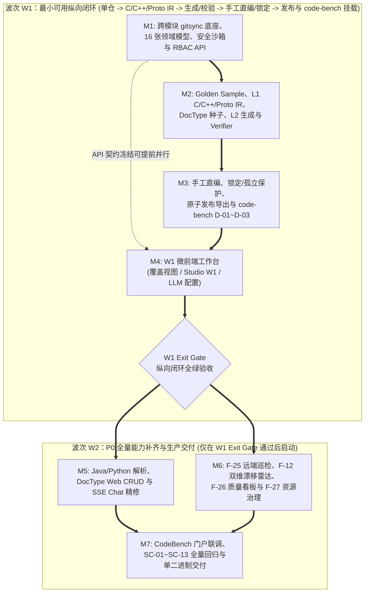

# 代码设计文档反推 (`code-archdoc`) 工程实施路线图与 TDD 任务拆解总纲 (Roadmap)

- **文档编号**：`01-roadmap.md`
- **文档版本**：v1.0.0 (Stage 3 Frozen Roadmap)
- **编制日期**：2026-11-19
- **归属阶段**：阶段三：契约冻结与 TDD 里程碑任务分解 (`04-tasks`)
- **上游基线**：[`docs/01-features/01-feature-matrix.md`](../01-features/01-feature-matrix.md) (v0.3.1)、[`docs/02-design/01-system-architecture.md`](../02-design/01-system-architecture.md) ~ [`05-database-schema.md`](../02-design/05-database-schema.md)、[`docs/03-api/01-http-api-contract.md`](../03-api/01-http-api-contract.md)、[`docs/03-api/02-data-model-and-dto-contract.md`](../03-api/02-data-model-and-dto-contract.md)

---

## 1. 工程递进策略与波次依赖拓扑 (Milestone DAG)

严格遵循阶段一冻结的「**`W1` 最小可用纵向闭环 100% 验收通过后，方可启动 `W2` 补齐**」策略，将 P0 全部工程任务拆解为 **7 个正交递进的 Milestone（`M1`~`M7`）**。每个 Milestone 严格遵守 **TDD（先写测试 Red -> 编写实现 Green -> 重构门禁 Refactor）** 研发纪律。

> **并行加速说明**：
> - `W1` 内部：`M1` 冻结后端模型与核心 API 后，`M4` 前端骨架、TypeScript 类型与 `RepoCoveragePage`/`AdminLLMConfigPage` 可与 `M2`/`M3` 并行开发（依赖冻结的 `03-api` 契约与 Mock）；
> - `W2` 内部：`W1 Exit Gate` 通过后，`M5`（Java/Python + DocType Web + Chat 精修）与 `M6`（巡检 + 双维漂移 + 质量看板 + 资源调度）文件边界高度正交，可双线并行推进，最后在 `M7` 汇合联调交付。

---

## 2. Milestone 全景任务矩阵

| 里程碑 | 波次 | 作战卡文档 | 覆盖特性 / 协同项 | 核心验收场景 (`SC`) | 核心交付边界 | 状态 |
| :---: | :-: | :--- | :--- | :--- | :--- | :-: |
| **M1** | **W1** | [`02-m1-domain-model-and-api.md`](./02-m1-domain-model-and-api.md) | `D-04`, `F-01`, `F-02`(沙箱), `F-13`, `F-14`, `NFR-1` | `SC-01`, `SC-06`(部分), `SC-12` | `code-common/backend/gitsync` + `code-shield` 切换；`lint-arch`；16 张 `archdoc_*` 表与仓储；`pkg/security`、`pkg/sandbox`；仓库覆盖/RBAC/LLM 配置 API | ✅ 已完成 |
| **M2** | **W1** | [`03-m2-codeir-doctype-and-generation.md`](./03-m2-codeir-doctype-and-generation.md) | `F-26`(W1), `F-04`(W1), `F-03`(W1), `F-05`, `F-07` | `SC-02`, `SC-04`, `SC-09`, `SC-13` | `testdata/golden/` 夹具与 5 类标准样例；`pkg/codeir`(+CGO `treesitter` C/C++ & `.proto`)；`pkg/doctype` 内置 5 类与只读 API；`pkg/llm` 预算熔断防注入；`pkg/verifier` 四重门禁；生成任务编排 API | ✅ 已完成 |
| **M3** | **W1** | [`04-m3-revision-publish-and-bench-sync.md`](./04-m3-revision-publish-and-bench-sync.md) | `F-08`(后端), `F-09`(W1), `F-10`, `F-11`, `D-01`~`D-03` | `SC-06`, `SC-07`(W1), `SC-10` | `services.RevisionService` 手工直编/回滚/锁定/孤立保护；只读源码抽屉 API；`pkg/publisher` 原子落盘/撤回/ZIP；`code-bench` Frontmatter 隐藏与模块前缀深链路由 | ✅ 已完成 |
| **M4** | **W1** | [`05-m4-w1-frontend-workbench.md`](./05-m4-w1-frontend-workbench.md) | `F-01`, `F-08`(W1), `F-09`(W1), `F-10`, `F-11`, `F-14`, `NFR-7` | W1 端到端纵向闭环 | `./menu` & `./App` 联邦路由（含深链入口）；`RepoCoveragePage`、`CanvasStudioPage`(W1)、`AdminLLMConfigPage`；双模主题与 **W1 Exit Gate** | ✅ 已完成 |
| **M5** | **W2** | [`06-m5-w2-java-python-doctype-and-chat.md`](./06-m5-w2-java-python-doctype-and-chat.md) | `F-04`(W2), `F-03`(W2), `F-09`(W2) | `SC-05`, `SC-08` | `tree-sitter-java`/`python` 提取器；`DocType` 原子写盘 Web CRUD API + `AdminDocTypesPage`；SSE Chat 精修后端 + `ChatRefineTab` 前端 | ⏳ 待实施 |
| **M6** | **W2** | [`07-m6-w2-drift-metrics-and-governance.md`](./07-m6-w2-drift-metrics-and-governance.md) | `F-25`, `F-12`, `F-26`(W2), `F-27` | `SC-07`(W2), `SC-08`(漂移), `SC-11` | `RemoteHeadPoller` 轻量巡检与退避；`pkg/drift` 双维定位与增量刷新；`QualityMetricsService`；`ResourceReaper` LRU 与双优先级队列；`DriftRadarPage` & `QualityMetricsPage` | ⏳ 待实施 |
| **M7** | **交付** | [`08-m7-portal-integration-and-delivery.md`](./08-m7-portal-integration-and-delivery.md) | `D-01`~`D-04`, 全量 P0 收口 | `SC-01`~`SC-13` (除 P1 `SC-03`) | `code-bench` 网关与符号链接挂载联调；全量隔离回归测试与 `make eval-baseline`；运维部署手册更新与单二进制交付 | ⏳ 待实施 |

---

## 3. 需求特性与验收场景 100% 覆盖追踪表

| 阶段一编号 | 波次 | 归属 Milestone | 关键验证方式 |
| :--- | :-: | :-: | :--- |
| **`D-04`** (`gitsync` 公共包) | W1 | **M1** (`T-M1-01`) | `code-common/backend/gitsync` 单测 + `code-shield` 全量 `go test ./...` 零回归 |
| **`D-01`~`D-03`** (`code-bench` 协同) | W1 | **M3** (`T-M3-05`) + **M7** | `code-bench` 前端 Frontmatter/路由单测 + 符号链接挂载联调 |
| **`F-01`** (仓库与子目录视图) | W1 | **M1** + **M4** | `handlers/repo_test.go` + URL 分页默认 25 条/页前端验收 |
| **`F-02`** (只读 Git 沙箱与降噪) | W1 | **M1** | `pkg/sandbox/*_test.go` + 并发锁与进程组强杀单测 |
| **`F-03`** (`DocType` 注册表) | W1/W2 | **M2** (Seed/只读) + **M5** (Web CRUD) | `pkg/doctype/*_test.go` + `handlers/doctype_test.go` (`400`/`403`/`409`) |
| **`F-04`** (Code IR 抽取与脱敏) | W1/W2 | **M2** (C/C++/Proto) + **M5** (Java/Py) | `make eval-baseline` 量化准确率断言（100% / ≥95% / ≥98% / ≥90% / 0 密钥） |
| **`F-05`** (L2 分层摘要与预算熔断) | W1 | **M2** | `httptest` Mock LLM + 首次调用前熔断（0 HTTP 请求）+ 取消与单槽位重试单测 |
| **`F-07`** (证据锚定与 Verifier 四重门禁) | W1 | **M2** | `pkg/verifier/*_test.go` 覆盖伪造符号、非法/超限 Mermaid、明文凭据 `blocker` |
| **`F-08`** (Canvas Studio 工作台) | W1/W2 | **M3**(源码API) + **M4**(W1) + **M5**(Chat) | 亮/暗双模主题验收 + 源码越权 `403` 单测 |
| **`F-09`** (手工直编 + SSE Chat 双轨修订) | W1/W2 | **M3** + **M4** + **M5** | 非目标章节 SHA256 字节级不变断言 + 乐观锁 `409` + SSE Diff `Accept`/`Reject` |
| **`F-10`** (章节所有权与锁定/孤立保护) | W1 | **M3** + **M4** | 重生成 `locked` 字节保留 + 模板删槽位转 `is_orphan=true` 单测 |
| **`F-11`** (定稿发布、`code-bench` 挂载与导出) | W1 | **M3** + **M4** | `.staging` 原子落盘、Frontmatter/深链、撤回清空目录、防 Zip-Slip 单测 |
| **`F-12`** (章节级双维漂移雷达与增量刷新) | W2 | **M6** | 仅改单一函数不误报其他章节（`SC-11`）、模板变更标 `Spec Drift`、增量刷新跳过 `locked` |
| **`F-13`** (三层 RBAC 与字段级审计) | W1 | **M1** | `SC-01` + `SC-12` 子目录负责人越权拦截 + `audit_logs` Diff 断言 |
| **`F-14`** (OpenAI Compatible 分层模型配置) | W1 | **M1** + **M4** | AES-256-GCM 加解密 + 接口/审计脱敏 `sk-****` + `httptest` 探活单测 |
| **`F-25`** (远端变更巡检调度) | W2 | **M6** | 仅巡检活跃已发布仓 + 失败指数退避不阻塞健康仓单测 |
| **`F-26`** (质量评测基线与度量看板) | W1/W2 | **M2**(Golden Sample) + **M6**(度量看板) | 5 类内置标准样例回归 + 按 `DocTypeRevision` 聚合修改率/采纳率单测 |
| **`F-27`** (沙箱与任务资源治理) | W2 | **M6** | 活跃租约免回收 + LRU 配额清理 + 交互优先于批量队列 + 全局并发排队单测 |

---

## 4. 全局强制质量门禁 (Mandatory Quality Gates)

每一个 Milestone 合并前必须 **100% 通过**以下全部门禁，任何一项未通过均禁止进入下一个 Milestone：

1. **架构防腐零违规 (`make lint-arch`)**：
   - `pkg/*` 零导入 `models`/`services`/`handlers`/`gorm`/`gin`；
   - `pkg/` 与 `services/` 零直接访问全局 `models.DB`；
   - `tree-sitter` CGO 依赖严格封闭于 `pkg/codeir/treesitter/`；
   - 自有 GORM 模型全部返回 `archdoc_` 表前缀。
2. **后端静态检查与物理隔离全量单测**：
   - `make test`（`go fmt` + `go vet` + 全部纯单测）零警告通过；
   - `TEST_DB_DSN="host=127.0.0.1 port=5432 user=postgres password=<PWD> dbname=postgres sslmode=disable" make test` 全绿，所有 DB 单测强制通过 `testdb.SetupIsolatedDB(t)` 隔离并自动清理。
3. **前端类型与规范门禁 (`make lint`)**：
   - `tsc --noEmit` 零错误、零 `any` 滥用；
   - `eslint` 零报错；
   - 样式严格使用 `--color-*` Token 与 `.code-archdoc-*` Flat BEM，亮/暗双主题完整适配，无静态内联 `style` 与硬编码颜色。
4. **单二进制与端口卫生**：
   - `make build`（`CGO_ENABLED=1`）成功产出内嵌前端静态资产的单二进制 `code-archdoc-server`；
   - 验证结束后立即清理测试二进制与所有占用 `:8100` / `:5182` 的后台进程。
5. **W1 Exit Gate（波次硬隔离闸门）**：
   - 必须在 `M1`~`M4` 全部验收清单勾选完成，且端到端验证通过「`cpp_order_service` 夹具仓 → Git 同步 → C/C++/Proto Code IR → 5 类内置 `DocType` 生成 → Verifier 校验 → 手工直编与锁定 → 审批发布至 `publish_dir` → `code-bench` 符号链接浏览与深链回跳」完整纵向闭环后，方可启动 `M5`/`M6`。
