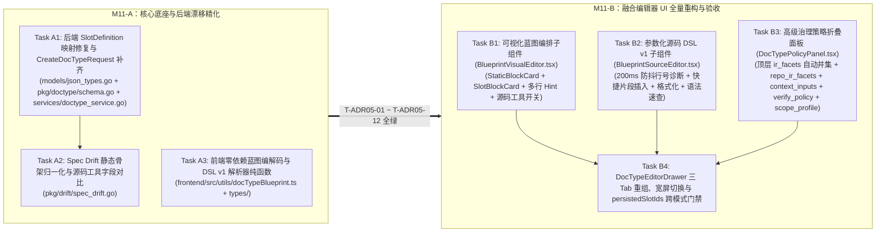

# Milestone 11 作战卡：`DocType` 蓝图化双模融合编辑器与 `Spec Drift` 模板判定精化（`M11-A` & `M11-B`）

- **文档编号**：`12-m11-doctype-blueprint-editor.md`
- **归属阶段**：ADR-05 演进里程碑 M11（前置：M10 已完成）
- **覆盖特性与场景**：`F-03`、`F-12`、`F-32`、`SC-08`、`SC-19`、`T-ADR05-01` ~ `T-ADR05-12`
- **上游基线**：[`ADR-05`](../05-adr/05-doctype-blueprint-dual-mode-editor.md)、[`03-doctype-drift-and-publishing.md`](../02-design/03-doctype-drift-and-publishing.md) (§4.3 & §7)、[`04-workbench-and-security.md`](../02-design/04-workbench-and-security.md) (§2.4)、[`01-http-api-contract.md`](../03-api/01-http-api-contract.md) (§3.3)、[`02-data-model-and-dto-contract.md`](../03-api/02-data-model-and-dto-contract.md) (§8)

---

## 1. 里程碑定位与分阶段交付策略

为确保「纯函数算法/后端契约」与「前端复杂交互视图」严格解耦、可独立验证，M11 拆分为 **`M11-A`（核心底座与后端漂移精化）** 与 **`M11-B`（融合编辑器 UI 全量重构与验收）** 两个正交子阶段，每个子阶段均须 strictly 遵循 **Red（先写失败测试）→ Green（最小实现通过）→ Refactor（重构与门禁）** 循环。



---

## 2. 子阶段 `M11-A`：核心底座与后端漂移精化（Tasks & TDD）

### 2.1 `M11-A` 原子任务分解

#### Task A1：修复 `models.SlotDefinition` 映射并补齐 `CreateDocTypeRequest` & `Meta.Validate`
- **涉及文件**：
  - [`models/json_types.go`](../../models/json_types.go)
  - [`pkg/doctype/schema.go`](../../pkg/doctype/schema.go)
  - [`services/doctype_service.go`](../../services/doctype_service.go)
- **实施要点**：
  1. 在 `models/json_types.go` 的 `SlotDefinition` 结构体中补齐：
     ```go
     EnableSourceTools bool `json:"enable_source_tools,omitempty"`
     MaxToolRounds     int  `json:"max_tool_rounds,omitempty"`
     ```
  2. 在 `services/doctype_service.go` 的 `toModelSlotDefs(specs []doctype.SlotSpec) []models.SlotDefinition` 中补齐 `EnableSourceTools: sl.EnableSourceTools` 与 `MaxToolRounds: sl.MaxToolRounds` 拷贝，确保 `archdoc_doc_type_revisions.slots_snapshot` 与 `GET /api/doc-types/:slug` 返回的 `detail.slots` 无损携带槽位源码工具配置；
  3. 在 `services/doctype_service.go` 的 `CreateDocTypeRequest` 中补齐可选字段 `RepoIRFacets []string`、`ContextInputs []string`、`ModuleDigestSource *doctype.ModuleDigestSourceSpec`，并在 `DocTypeService.Create` 构造 `doctype.Meta` 时完整透传；
  4. 在 `pkg/doctype/schema.go` 的 `Meta.Validate` 中，将 `ContextInputs` 白名单扩展为允许 `"code_ir"`、`"module_context"`、`"module_digests"`（对齐 `ADR-04 §5.2`）。

#### Task A2：`Spec Drift` 模板静态骨架归一化与槽位工具字段比对
- **涉及文件**：
  - [`pkg/drift/spec_drift.go`](../../pkg/drift/spec_drift.go)
  - [`services/doctype_service.go`](../../services/doctype_service.go) (`unmarshalSpecSlotMetas`)
- **实施要点**：
  1. 在 `pkg/drift/spec_drift.go` 的 `SpecSlotMeta` 中新增 `EnableSourceTools bool` 与 `MaxToolRounds int`；
  2. 在 `services/doctype_service.go` 的 `unmarshalSpecSlotMetas` 中将 `sl.EnableSourceTools` 与 `sl.MaxToolRounds` 映射至 `drift.SpecSlotMeta`；
  3. 在 `pkg/drift/spec_drift.go` 中实现纯函数 `normalizeTemplateStaticSkeleton(templateMD string, slots []SpecSlotMeta) string`：
     - 将 `\r\n` 归一化为 `\n` 后按行扫描；
     - 建立 `declaredSlots` 集合；自上而下扫描首次命中 `^\s*<!--\s*slot:([a-z][a-z0-9_]{1,48})\s*-->\s*$` 且属于 `declaredSlots` 的行，标记移除该标记行；
     - 向上跳过空行查找紧邻上一非空行：若匹配 `^#{2,4}\s+.+$`，一并标记移除该绑定标题行；
     - 过滤移除行后，将连续空行折叠为单个空行并 `strings.TrimSpace`；
  4. 将 `ComputeSpecDrift` 中的 `globalPromptChanged` 升级为：
     ```go
     boundSkeleton := normalizeTemplateStaticSkeleton(boundTemplateMD, boundSlots)
     latestSkeleton := normalizeTemplateStaticSkeleton(latestTemplateMD, latestSlots)
     globalPromptChanged := boundPromptHash != latestPromptHash || boundSkeleton != latestSkeleton
     ```
  5. 在 `slotSpecChanged(a, b SpecSlotMeta)` 中纳入 `EnableSourceTools` 与归一化 `MaxToolRounds`（当 `EnableSourceTools == false` 时归为 `0`，当 `EnableSourceTools == true` 且 `<= 0` 时归为默认 `4`）比对。

#### Task A3：前端强类型补齐与零依赖蓝图编解码 / `DSL v1` 解析器纯函数
- **涉及文件**：
  - [`frontend/src/types/domain.ts`](../../frontend/src/types/domain.ts)
  - [`frontend/src/types/api.ts`](../../frontend/src/types/api.ts)
  - 新增 `frontend/src/utils/docTypeBlueprint.ts`
  - 新增 `frontend/src/utils/docTypeBlueprint.test.ts`
  - [`frontend/package.json`](../../frontend/package.json)（更新 `"test"` 脚本覆盖 `docTypeBlueprint.test.ts`）
- **实施要点**：
  1. 严格遵循 `ADR-05` §3 ~ §4 契约，在 `docTypeBlueprint.ts` 中保持**零 React/DOM/第三方库依赖**，导出以下核心纯函数与类型：
     - `CANONICAL_FACET_NAMES: readonly CanonicalFacetName[]`（9 大可订阅规范分片，不含 `module_context`）
     - `decompileToBlueprint(templateMD: string, slots: readonly SlotDefinition[]): { blueprint: DocBlueprint; diagnostics: BlueprintDiagnostic[] }`
     - `compileFromBlueprint(blueprint: DocBlueprint): { templateMD: string; slots: SlotDefinition[] }`
     - `serializeBlueprintToDSL(blueprint: DocBlueprint): string`
     - `parseDSLToBlueprint(source: string): { blueprint: DocBlueprint | null; diagnostics: BlueprintDiagnostic[] }`
     - `computeCanonicalFacetsUnion(slots: readonly SlotDefinition[]): CanonicalFacetName[]`
     - `shouldDefaultAutoFacetsUnion(metaFacets: readonly string[] | undefined, slots: readonly SlotDefinition[]): boolean`
     - `detectUnconfirmedMissingSlotIds(persistedSlotIds: ReadonlySet<string>, currentSlots: readonly SlotDefinition[], confirmedSlotIds?: ReadonlySet<string>): string[]`
  2. 在 `frontend/package.json` 中将 `"test"` 更新为：
     `"node --test src/utils/archdocUtils.test.ts src/utils/docTypeBlueprint.test.ts"`。

### 2.2 `M11-A` TDD 先行测试用例清单（`T-ADR05-01` ~ `T-ADR05-12`）

| 编号 | 测试文件 | 测试名称 / 场景 | 核心断言 (Red -> Green) |
| :--- | :--- | :--- | :--- |
| **T-ADR05-01** | `frontend/src/utils/docTypeBlueprint.test.ts` | 5 类内置 DocType（`system-architecture`、`data-and-contract`、`ops-and-config`、`code-walkthrough`、`agents-context`）的 `template.md` + `slots` 执行 `decompileToBlueprint` → `compileFromBlueprint` | 5 套内置资产均识别出全部 `SlotBlueprintBlock`（`emitHeading=true, headingLevel=2`）与文首 H1 `StaticBlueprintBlock`，编译产出的 `templateMD`、`slots` 与原始资产完全一致且连续往返幂等 |
| **T-ADR05-02** | `frontend/src/utils/docTypeBlueprint.test.ts` | 复杂自由排版 `template.md`：包含前置多段导语、章节间固定免责声明、`###` 3 级标题绑定槽位、以及无紧邻标题的自由内嵌槽位 | 自由内嵌槽位准确识别为 `emitHeading=false`，3 级标题记录 `headingLevel=3`，静态片段 100% 保留为 `static` 块，编译往返无损一致；若紧邻标题与 `slot.title` 不一致，记录 `divergedTemplateHeading` |
| **T-ADR05-03** | `frontend/src/utils/docTypeBlueprint.test.ts` | 在 `DocBlueprint` 中调整槽位块顺序并修改某槽位 `title` 后执行 `compileFromBlueprint` | 编译产出的 `slots[]` 顺序与 `templateMD` 中 `<!-- slot:... -->` 出现顺序及 `## 标题` 100% 同步一致 |
| **T-ADR05-04** | `frontend/src/utils/docTypeBlueprint.test.ts` | `parseDSLToBlueprint` 解析含完整字段、别名（`facets`/`budget`/`source_tools`/`tool_rounds`/`instruction_hint`）、单行数组与多行 `-` 列表、`hint: \|` 多行缩进块、4 反引号围栏及极简缺省写法的 DSL 文本 | 全部合法语法 `diagnostics` 无 `error`；缺省字段按 `ADR-05` 表 4.3 正确填充默认值；普通代码围栏（```` ```mermaid ```` / ```` ```markdown ```` 内的示例 ` ```slot `) 不误解析为槽位 |
| **T-ADR05-05** | `frontend/src/utils/docTypeBlueprint.test.ts` | `serializeBlueprintToDSL` 导出与连续往返幂等校验 | `emitHeading=true` 的槽位不输出冗余 `title:` 行；`emitHeading=false` 显式输出 `title:`；多行或 >80 字符 `hint` 输出规范 `hint: \|` 块；含反引号的 `hint` 自动升级外层围栏为 `N+1` 反引号；连续 `serialize(parse(serialize(bp)))` 字节级完全相等 |
| **T-ADR05-06** | `frontend/src/utils/docTypeBlueprint.test.ts` | DSL 非法输入诊断测试：未知键 `token_budegt`、非法 `slot_id`、重复 `slot_id`、非法分片名 `symbol` / `module_context`、未闭合 `slot` 围栏、无标题槽位缺 `title`、越界 `token_budget=100` / `max_tool_rounds=9`、`hint` 超 1000 字 | 全部产生 `severity='error'` 诊断并准确指向对应行号（`line`）；`symbol` 给出 `symbols` Levenshtein 纠错建议 |
| **T-ADR05-07** | `frontend/src/utils/docTypeBlueprint.test.ts` | 顶层 `ir_facets` 自动并集与存量手动模式判定 | `computeCanonicalFacetsUnion` 按 9 大规范分片标准顺序去重汇总；当存量 `meta.ir_facets` 与槽位并集不等且非空时，`shouldDefaultAutoFacetsUnion` 返回 `false`（保留手动模式） |
| **T-ADR05-08** | `frontend/src/utils/docTypeBlueprint.test.ts` | 跨模式 `persistedSlotIds` 变更差集检测 | 源码中删除或重命名既有 `slot_id` 时 `detectUnconfirmedMissingSlotIds` 准确返回缺失 ID 列表；已确认 ID 不重复报警；改回原 `slot_id` 后差集自动清零 |
| **T-ADR05-09** | `pkg/drift/drift_test.go` | `TestSpecDriftHeadingRenameDoesNotTriggerSiblingPromptChanged`：修改单个槽位 A 的 `title`（同步修改 `template.md` 中紧邻绑定 `## 标题`），兄弟槽位 B/C 与静态文本不变 | `ComputeSpecDrift` 仅返回槽位 A（`reason="slot_modified"`），兄弟槽位 B/C 零误报 |
| **T-ADR05-10** | `pkg/drift/drift_test.go` | `TestSpecDriftAddRemoveSlotDoesNotTriggerSiblingPromptChanged`：新增槽位 E 或删除槽位 C（同步增删 `template.md` 中绑定 `## 标题` 与标记）或仅重排槽位顺序 | 新增仅槽位 E 报 `slot_added`；删除仅槽位 C 报 `slot_removed`；纯重排槽位顺序（未改静态骨架）返回 0 漂移 |
| **T-ADR05-11** | `pkg/drift/drift_test.go` | `TestSpecDriftStaticSkeletonAndSourceToolsChange`：① 修改 `template.md` 中的静态导语/H1 标题或修改 `generation_prompt.md`；② 仅开启槽位 B 的 `enable_source_tools=true` 或修改 `max_tool_rounds` | ① 所有非锁定槽位均准确标为 `prompt_changed`（`locked` 豁免）；② 仅槽位 B 标为 `slot_modified`，其他槽位零漂移 |
| **T-ADR05-12** | `handlers/admin_doctype_test.go` | `TestCreateDocTypeWithGovernancePoliciesAndSourceTools`：`POST /api/admin/doc-types` 携带 `repo_ir_facets`、`context_inputs`、`module_digest_source`、`scope_profile`、`verify_policy` 及槽位 `enable_source_tools=true, max_tool_rounds=4` 创建并回读；传入非法 `repo_ir_facets` | 合法请求返回 `201`，落盘 `meta.json`、`GetDetail` 回读的 `detail.slots` 与 `latest_revision.slots_snapshot` 均完整保留 `enable_source_tools` / `max_tool_rounds` 及高级策略；非法分片返回 `400` 且无目录残留 |

---

## 3. 子阶段 `M11-B`：融合编辑器 UI 全量重构与验收（Tasks & AC）

### 3.1 `M11-B` 原子任务分解

#### Task B1：可视化蓝图编排组件 (`frontend/src/components/doctype/BlueprintVisualEditor.tsx`)
- 替换原孤立的 `SlotsSchemaBuilder.tsx`（或将其升级封装），直接渲染 `DocBlueprint.blocks`：
  - **`StaticBlockCard`**：渲染文首 `# 主标题`、导语或章节间固定说明 Markdown 块，支持多行编辑、上移/下移、删除（新建模式下当用户未手工改过文首 `# 主标题` 时，随 `display_name` 自动同步 `# ${displayName}`）；
  - **`SlotBlockCard`**：
    - 标题栏：标题层级下拉（`H2` / `H3` / `H4` / `无标题内嵌`）+ 内联章节标题输入框 + 上移/下移/展开收起/删除按钮（若存在 `divergedTemplateHeading`，显示温和提示徽标「已对齐为槽位标题，保存后生效」）；
    - 参数胶囊行：`slot_id`（既有槽位默认加锁，点击弹出 `useConfirm` 确认后解锁）· `ownership`（`auto`/`hybrid`/`locked`）· `required` 必填开关 · `token_budget` · `enable_source_tools` 开关（开启时显示 `max_tool_rounds: 1~6` 数字选择，默认 `4`）· `min_chars`；
    - 订阅 Code IR 分片（`ir_facets`）Chip 组：展示 9 大规范分片，标注轻量/中等/较重体量；当勾选 `symbols` 或 `runtime_primitives` 且 `token_budget < 10000` 时显示温和建议提示；
    - 章节写作提示（`instruction_hint`）：多行自适应 `<textarea rows={3}>`（取代原单行 `<input>`）。

#### Task B2：参数化源码 `DSL v1` 编辑器组件 (`frontend/src/components/doctype/BlueprintSourceEditor.tsx`)
- 提供等宽代码编辑区（`spellCheck={false}`），支持：
  - 200ms 防抖调用 `parseDSLToBlueprint(source)`，实时渲染底部/顶部诊断列表（红色 `error` 精确显示 `第 N 行：...`，黄色 `warning` 温和提醒）；
  - 工具栏快捷操作：`[+ 插入槽位片段]`（在光标处或文末插入标准 ```` ```slot ```` 模板）、`[格式化源码]`（调用 `serializeBlueprintToDSL` 规范化缩进与字段顺序）、`[DSL 语法速查]`（可展开折叠的参数字典与示例浮层）。

#### Task B3：基础信息、顶层 `ir_facets` 自动并集与高级治理策略面板 (`frontend/src/components/doctype/DocTypePolicyPanel.tsx`)
- 承载 Tab 2「基础信息与策略」：
  - 基础身份表单：`slug`、`display_name`、`short_name`、`category`、`description`、`model_tier`、`timeout_seconds`、`max_output_tokens`、`is_active`；
  - 顶层 `meta.ir_facets` 区域：
    - 默认开启「自动聚合自全部章节槽位（推荐）」，以只读徽标实时展示 `computeCanonicalFacetsUnion(slots)`；
    - 支持切换「手动覆写」开关（加载存量 DocType 若 `shouldDefaultAutoFacetsUnion` 为 `false`，自动保持手动模式并提供「一键对齐并集」按钮）；
  - 默认折叠的「高级治理策略（可选）」面板：
    - `repo_ir_facets`：多模块大仓整仓汇总裁剪白名单 Chip 组 + 「一键应用轻量与契约分片预设」按钮；
    - `context_inputs` & `module_digest_source`：`module_context` / `module_digests` 勾选框，勾选 `module_digests` 时展示摘要源 `doc_type_slug`、`slot_id`、`max_chars` 输入项；
    - `verify_policy`：`strict_symbol_check`、`require_mermaid`、`max_mermaid_nodes`、`max_mermaid_edges`、`block_on_secret_leak`；
    - `scope_profile`：`max_depth`、`include_tests`、`include_legacy_docs`、`include_globs`、`exclude_globs`。

#### Task B4：`DocTypeEditorDrawer.tsx` 三 Tab 重组、宽屏切换与 `persistedSlotIds` 跨模式门禁
- **涉及文件**：
  - [`frontend/src/components/doctype/DocTypeEditorDrawer.tsx`](../../frontend/src/components/doctype/DocTypeEditorDrawer.tsx)
  - [`frontend/src/pages/AdminDocTypesPage.css`](../../frontend/src/pages/AdminDocTypesPage.css)
- **实施要点**：
  1. 抽屉顶部支持 `width="xl"`（标准宽度）与 `width="full"`（宽屏编排）一键切换；
  2. Tab 重组为：`文档蓝图 (Blueprint)`（编辑模式默认激活，新建模式在填完基础信息后可一键跳入）、`基础信息与策略 (Metadata & Policy)`（新建模式默认激活）、`修订历史 (Revisions)`（仅编辑模式可见）；
  3. 「文档蓝图」Tab 顶部内置 `generation_prompt.md` 与 `refine_prompt.md` 折叠抽屉，使全局指令与章节级 `instruction_hint` 同屏可见；
  4. 蓝图编排支持 `[可视化编排]`、`[参数化源码]`、`[预览 template.md]` 三视图切换：
     - 当源码模式存在任何 `severity === 'error'` 诊断时，禁止切回可视化视图与点击保存，保留用户源码草稿；
     - 当源码模式检测到 `unconfirmedMissingIds.length > 0`（修改或移除了既有 `persistedSlotIds`）时，底部状态栏展示高风险预警徽标，且在切回可视化视图或点击保存前强制弹出 `useConfirm` 确认弹窗；
  5. 保存时统一通过 `compileFromBlueprint(blueprint)` 产出 `{ slots, templateMD }`，新建与更新均完整提交高级治理策略并保留 `loadedDetail.meta` 未知 `ExtraFields`；
  6. 新增样式 100% 采用 `.code-archdoc-blueprint-*` Flat BEM 类名与 `--color-*` 语义 Token，严格兼容亮/暗双模主题，零静态内联 `style={{ ... }}`、零 `any`。

---

## 4. 里程碑自动化验收门禁 (Acceptance Criteria)

实施完成后，必须顺序执行并通过以下全部验证命令（零报错、零警告、零残留进程）：

```bash
# 1. 前端纯函数单测（含 T-ADR05-01 ~ T-ADR05-08）
cd frontend && npm test

# 2. 架构防腐红线检查
make lint-arch

# 3. 后端静态检查与物理隔离全量单测（含 T-ADR05-09 ~ T-ADR05-12）
make test

# 4. Golden Sample 评测基线回归
make eval-baseline

# 5. 前端 TypeScript 严格类型检查与 ESLint 门禁
make lint

# 6. 单二进制打包与产物清理
make build && make clean
```
