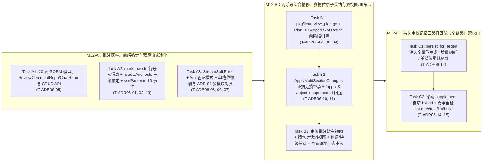

# Milestone 12 作战卡：Canvas Studio 审阅批注篮、多槽位综合精修与文档级审校记忆（`M12-A` / `M12-B` / `M12-C`）

- **文档编号**：`13-m12-review-and-refine-studio.md`
- **归属阶段**：ADR-06 演进里程碑 M12（前置：M11 已完成）
- **覆盖特性与场景**：`F-08`、`F-09`、`F-15`、`F-33`、`SC-05`、`SC-20`、`T-ADR06-01` ~ `T-ADR06-15`
- **上游基线**：[`ADR-06`](../05-adr/06-document-review-and-refine-studio.md)、[`04-workbench-and-security.md`](../02-design/04-workbench-and-security.md) (§2.2 & §3)、[`05-database-schema.md`](../02-design/05-database-schema.md) (§3.4 & §3.5)、[`01-http-api-contract.md`](../03-api/01-http-api-contract.md) (§6)、[`02-data-model-and-dto-contract.md`](../03-api/02-data-model-and-dto-contract.md) (§9)

---

## 1. 里程碑定位与分阶段交付策略

为确保「数据模型与前端纯函数锚定」「两阶段多槽位精修与画布协同 UI」与「持久审校记忆回流与全链路门禁」正交解耦、逐波验证，M12 拆分为 **`M12-A`**、**`M12-B`**、**`M12-C`** 三个子阶段，严格执行 **Red（先写失败测试）→ Green（最小实现通过）→ Refactor（重构与门禁）** 循环。



---

## 2. 子阶段原子任务与 TDD 测试清单

### 2.1 子阶段 `M12-A`：批注底座、前端锚定与双段流式净化
1. **Task A1（20 张自有表 & 批注 CRUD API）**：
   - `models/document.go` 增加 `LastCommentNo`；新增 `models/review_comment.go`（第 19 张表 `archdoc_review_comments`）；扩展 `models/chat.go`（`ChatMessage` 4 列 + 第 20 张表 `archdoc_chat_proposal_items`）；更新 `models/db.go` `AllOwnModels()`（20 张）与 `models/models_test.go`（`TestAll20TablesPrefixAndAutoMigrate`）；
   - `models/stores.go` & `services/repos.go` 实现 `ReviewCommentStore` / `ReviewCommentRepo` 与扩展 `ChatStore` / `ChatRepo`；
   - 新增 `services/review_comment_service.go` 与 `handlers/review_comment.go`，在 `handlers/router.go` 挂载 4 条 `ScopeWrite` 路由。
2. **Task A2（前端行号 AST、锚定纯函数与 10 事件 SSE）**：
   - 扩展 `frontend/src/types/{domain,api,sse}.ts`；
   - 升级 `frontend/src/utils/markdown.ts` 记录 `startLine`/`endLine`（含递归 `blockquote` 偏移）；
   - 新增 `frontend/src/utils/reviewAnchor.ts`（三级降级定位与跨行内节点偏移区间投影）；
   - 升级 `frontend/src/utils/sseParser.ts` 支持 10 类事件帧；补充 `reviewAnchor.test.ts` 与 `archdocUtils.test.ts`（`T-ADR06-01`, `02`, `13`）。
3. **Task A3（双段流式切分、`Ask` 模式与 `ADR-04` 多模块对齐）**：
   - 新增 `pkg/llm/stream_splitter.go`（`StreamSplitFilter`，跨 chunk 滑动缓冲、多轮 Tool-Calling `ResetTurn`、兼容旧版 JSON 静默缓存与补偿推送）；
   - 泛化 `pkg/llm/prompt.go` & `pkg/llm/tool_loop.go` 工具收敛提示并增加 `OnTurnStart` 回调；
   - 升级 `pkg/llm/chat_refine.go`（双段协议、`ParseChatRefineOutput`、`BuildChatAskMessages`、注入 `ModuleContext`/`ModuleDigests`/`InlineAnchor`）；
   - 更新 `services/chat_service.go` 落地 `mode="ask"`（放行 `locked`）、单槽位微创快路径、`ExternalFileWhitelist` 与 `ModuleDigests` 透传、落库 `ChatProposalItem` 与推送 `proposal_item`（`T-ADR06-03`, `06`, `07`）。

### 2.2 子阶段 `M12-B`：两阶段综合精修、原子批量采纳与审校工作台 UI
1. **Task B1（Plan → Scoped Slot Refine 引擎）**：
   - 新增 `pkg/llm/review_plan.go`（`BuildReviewPlanMessages` + `ParseAndGuardReviewPlan`，强制 `locked` 转 `advisory_locked`、非锁定局部批注并集补齐、上限 ≤ 6 截断，`T-ADR06-04`）；
   - `services/chat_service.go` 实现 `global`/`review_batch` 两阶段串行隔离流式精修（`emit` `sync.Mutex` 保护、单一 `AcquireRepoLease`、无差异/部分成功容错、全篇联合 Verifier、`AbortController` 回滚，`T-ADR06-08`, `09`）。
2. **Task B2（统一多槽位原子修订与提案组 Apply/Reject）**：
   - `services/revision_service.go` 实现 `ApplyMultiSectionChanges`（`ApplySectionChange` 委托调用），修复未修改及已采纳槽位非内联证据锚点丢失（`P-7 ①`），在手工直编/采纳/回滚/重生成时自动 `SupersedePendingProposalsBySlots` 并回退关联 `proposed` 批注为 `open`；
   - `services/chat_service.go` & `handlers/chat.go` 新增 `ApplyProposalItems`（`/apply`，`P1` 审计）与 `RejectProposalItem`（`/reject`），旧版 `AcceptProposal` / `RejectProposal` 委托兼容（`T-ADR06-10`, `11`）。
3. **Task B3（审阅批注篮为主、精修对话为辅 UI 与画布联动）**：
   - 新增 `frontend/src/api/reviewComments.ts`，扩展 `frontend/src/api/chat.ts`；
   - 新增 `ReviewBasketPanel.tsx`、`ChatRefineThreadPanel.tsx`、`ProposalGroupCard.tsx`、`SectionReviewOverlay.tsx`、`SelectionReviewPopover.tsx`；
   - 升级 `ChatRefineTab.tsx`、`RightUtilityDrawer.tsx`（`440px ↔ 680px` 展宽）、`SectionMarkdownRenderer.tsx`（`+ 批注` 与跨行内节点 `<mark>`/`#N` 投影）、`SectionInlineEditor.tsx`（支持 `initialMarkdown` 与 `proposal_tweak`）、`SectionCard.tsx`、`StudioTopBar.tsx`、`CanvasStudioPage.tsx` 与 `CanvasStudioPage.css`（100% `--color-*` Token 与 `.code-archdoc-review-*` BEM）。

### 2.3 子阶段 `M12-C`：持久审校记忆三路径回流与全链路门禁
1. **Task C1（`persist_for_regen` 三路径注入）**：
   - `pkg/llm/prompt.go` `SlotPromptInput` 新增 `ReviewGuidance`，追加至 `BuildSlotMessages` 槽位第 3 段尾部（随机 `nonce` 数据栅栏包裹，绝不破坏 `system` 与共享前缀）；
   - `services/generation_service.go` 注入 `ReviewCommentRepo` 并在全量重生成、增量刷新、单槽位失败重试 3 条路径统一装配作用域 `ReviewGuidance`（`T-ADR06-12`）。
2. **Task C2（收口与门禁）**：
   - 前端采纳含 `supplement` 批注的 `auto` 章节提案后提示一键切 `hybrid`；
   - 执行安全自检（XSS/RBAC/SQL/Injection/Token）与全部自动化验收命令（`T-ADR06-14`, `15`）。

---

## 3. 安全验证清单与自动化验收门禁 (Acceptance Criteria)

### 3.1 安全验证清单
- [ ] 前端新增与改造组件 **零 `dangerouslySetInnerHTML` / `innerHTML` / `alert()` / `confirm()`**，链接全部经过 `isSafeLinkHref` 校验；
- [ ] 6 条新增 REST 路由全部挂载 `JWT + ScopeWrite (resolveDocumentAccess(c, true, false))`，普通用户与跨子目录负责人均返 `403`；
- [ ] 全量数据库操作使用 GORM 参数化绑定，无 SQL 拼接与敏感错误暴露；
- [ ] 批注内容、划词摘录与持久约束进入 Prompt 全部经 128-bit 随机 `nonce` `<untrusted_repo_data>` 栅栏隔离，输出经四重 Verifier 拦截。

### 3.2 自动化验证命令
```bash
# 1. 架构防腐红线检查
make lint-arch

# 2. 后端格式化、静态检查与全量单测（含物理隔离 DB 测试）
make test
TEST_DB_DSN="host=127.0.0.1 port=5432 user=postgres password=<PWD> dbname=postgres sslmode=disable" make test

# 3. F-26 Golden Sample 评测基线回归
make eval-baseline

# 4. 前端纯函数单测（含 T-ADR06-01, T-ADR06-02, T-ADR06-13）
cd frontend && npm test

# 5. 前端 TypeScript 严格类型与 ESLint 检查
make lint

# 6. 单二进制打包与产物清理
make build && make clean
```
