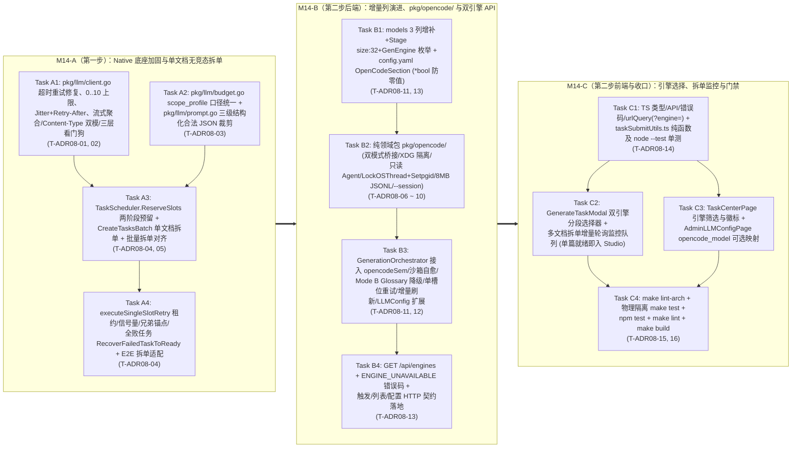

# Milestone 14 作战卡：单文档粒度拆单、Native 底座加固与 OpenCode 双引擎文档反推（`M14-A` / `M14-B` / `M14-C`）

- **文档编号**：`15-m14-dual-engine-doc-generation.md`
- **归属阶段**：ADR-08 演进里程碑 M14（前置：M13 已完成）
- **覆盖特性与场景**：`F-05`、`F-07`、`F-09`、`F-12`、`F-14`、`F-27`、`F-31`、`F-35`、`SC-02`、`SC-04`、`SC-09`、`SC-13`、`SC-18`、`SC-22`、`T-ADR08-01` ~ `T-ADR08-16`
- **上游基线**：[`ADR-08`](../05-adr/08-dual-engine-doc-generation.md)、[`01-feature-matrix.md`](../01-features/01-feature-matrix.md) (v0.8.0)、[`01-system-architecture.md`](../02-design/01-system-architecture.md) (v1.1.0)、[`02-extraction-and-generation-engine.md`](../02-design/02-extraction-and-generation-engine.md) (v1.2.0 §7)、[`04-workbench-and-security.md`](../02-design/04-workbench-and-security.md) (v1.3.0)、[`05-database-schema.md`](../02-design/05-database-schema.md) (v1.4.0)、[`01-http-api-contract.md`](../03-api/01-http-api-contract.md) (v1.5.0)、[`02-data-model-and-dto-contract.md`](../03-api/02-data-model-and-dto-contract.md) (v1.4.0)

---

## 1. 里程碑定位与分阶段交付 DAG

为落实「**第一步先止血立竿见影、第二步双引擎稳健落地、第三步前后端闭环交付**」，`M14` 划分为 **`M14-A`**、**`M14-B`**、**`M14-C`** 三个正交子阶段，全程严格遵守 **SDD 契约先行 + TDD 红（先写失败测试）→ 绿（最小实现通过）→ 重构（自检与门禁）** 研发纪律：



---

## 2. 子阶段原子任务拆解

### 2.1 子阶段 `M14-A`：Native 底座加固与单文档无竞态拆单

1. **Task A1（修复超时零重试 Bug、对齐 `0..10` 上限、流式聚合与三层超时看门狗）**：
   - **修改文件**：`pkg/llm/client.go`、`pkg/llm/tool_loop.go`、`config/config.go`、`services/llm_config_service.go`、`services/generation_service.go`。
   - **核心改造**：
     1. 在 `Client.executeWithRetry` 中区分调用方 `parentCtx` 与单次 `attemptCtx, cancel := context.WithTimeout(parentCtx, attemptTimeout)`，将 `parentCtx` 显式透传至 `doOnce`（或在返回路径依据 `parentCtx.Err()` 判断）：仅 `parentCtx.Err() != nil` 判定为不可重试；`attemptCtx` 超时、`isTimeoutErr(err)`、首包/空闲看门狗超时、`io.EOF` / `io.ErrUnexpectedEOF`、`connection reset` / `broken pipe` 及 HTTP `429`/`500`/`502`/`503`/`504` 一律判定 `retryable = true`；
     2. 将 `maxRetries` 钳位上限由 `3` 放宽至 **`10`（合法范围 `0..10`，默认 `3`）**；`NewClient()` 默认 `baseBackoff = 1 * time.Second`（保留 `NewClientWithOptions` 供单测注入 `10ms`），退避计算加入 `±20%` 随机 Jitter 并封顶 `30s`，优先解析 `429`/`503` 的整数秒或 HTTP-date `Retry-After`（封顶 `30s` 且响应 `parentCtx.Done()`）；
     3. `EndpointConfig` 与 `config.LLMSection` 扩展 `FirstByteTimeoutSeconds`（默认 `90`）与 `IdleTimeoutSeconds`（默认 `60`），`ResolveLLMEndpoint` 自动填充；在 `doOnce` 中通过首包等待计时器 + `parseSSEResponse` 帧间活跃计时器实现三层超时（均自动取 `min(..., TimeoutSeconds)`）；
     4. 槽位生成（`executeSlotLLM`、`RunToolLoop`）支持内部以 `stream: true` + `stream_options: {"include_usage": true}` 发起请求并聚合响应；`200 OK` 按 `Content-Type` 与首非空字节双模自适应（SSE vs `application/json`，100% 兼容存量 `httptest` 桩）；遇 `400/422/501` 提示 `stream` 或 `stream_options` 不支持时自动降级；
     5. **已吐流防重复护栏**：当 `onDelta != nil`（如 Chat SSE 流）且已向调用方推送至少 1 次非空 delta（`emittedAny == true`）后发生流断连或空闲超时，置 `retryable = false` 防止 UI 出现重复文本；
     6. `GenerationOrchestrator` 计算槽位 `MaxTokens` 时将下限由 `300` 提至 `max(MaxOutputTokens/len(slots), 4096)`，并在 `FinishReason == "length"` 时打印结构化告警。

2. **Task A2（单文档预算目录口径校准与三级结构化合法 JSON 裁剪）**：
   - **修改文件**：`pkg/llm/budget.go`、`pkg/llm/prompt.go`。
   - **核心改造**：
     1. 将 `countEffectiveFilesForDocTypes` 重构为 `filterEffectiveFilesForDocTypes(ir, docTypes) []codeir.FileSummary`，使 `effectiveFiles` 与 `computeTopDirectories` 共同基于 `scope_profile` 过滤后的有效文件列表计算；
     2. 重构 `serializeSlotFacets`，彻底移除 `serialized[:maxChars]` 字符切片，实现三级结构化裁剪（Level 1 剥离 `Deps.FileImports`/`Tree.Files` → Level 2 按优先级收缩大列表并注入 `_meta: {truncated, budget_chars, omitted_counts}` → Level 3 最小合法 JSON 兜底），保证 100% `json.Valid == true`；
     3. 更新 `sourceToolsGuidancePrompt`，引导模型在遇到 `_meta.truncated == true` 时按需调用 `get_symbol_impl`/`grep_in_sandbox`/`read_file_lines` 检索。

3. **Task A3（`1 GenTask = 1 Scope × 1 DocType` 两阶段无竞态拆单与批量子任务对齐）**：
   - **修改文件**：`services/scheduler_service.go`、`models/stores.go`、`services/repos.go`、`services/generation_service.go`、`services/batch_generation.go`、`handlers/task.go`。
   - **核心改造**：
     1. `TaskScheduler` 新增 `ReserveSlots(priority string, count int) (commit func([]ScheduledJob) error, rollback func(), err error)`，锁内校验 `!s.stopped` 与 `len(q) + reserved + count <= cap`，`commit` 内部二次检查 `stopped` 并在停机时释放预留且对传入 `jobs` 执行 `OnDrop`；
     2. `TaskRepo` & `TaskStore` 新增 `CreateTasksBatch(ctx, tasks)`（单 DB 事务插入并回填自增 ID）；
     3. `GenerateTaskRequest` 新增可选 `DocType string`（与 `DocTypes` 合并去重），`SubmitGenerateTask` 返回 `*GenerateTaskSubmitResponse`（匿名内嵌首任务 `GenTaskDetailVO` + `CreatedCount` + `Tasks[]`），并在单测无调度器（`o.scheduler == nil`）时兼容直发；`handlers/task.go` 同步扩展审计描述记录 `created_count` 与拆单 ID 集合；
     4. `executeBatchGenerateTask` 按 `(subdir, slug)` 创建阶段 1 子任务、`("", slug)` 创建阶段 2 整仓子任务，`estimateBatchTokens` 准确累加各组合预估 Token，`ModuleBreakdown` 继续按 `subdirectory` 聚合。

4. **Task A4（单槽位独立重试全面加固与存量 E2E 多文档测试适配）**：
   - **修改文件**：`services/generation_service.go`、`models/stores.go`、`services/repos.go`、`handlers/e2e_scenarios_test.go`。
   - **核心改造**：
     1. `executeSingleSlotRetry` 全程持 `AcquireRepo` + `AcquireSnapshot` 租约，统一调用 `o.acquireLLMSlot(ctx)`；
     2. 加载上一修订时执行 `overlaySectionMetadata` 并从 `prevEvs` 完整还原兄弟槽位的 `CitedAnchors`；
     3. 若 `GetByScope` 返回 `ErrNotFound` 或 `doc.CurrentRevisionNo == 0`（首次 `ALL_SLOTS_FAILED` 尚未建档），回查该任务全部槽位并调用 `persistGeneratedDocument` 建档落库且回填 `slotTask.DocumentID`；
     4. `TaskRepo` & `TaskStore` 新增 `RecoverFailedTaskToReady(ctx, taskID, updates)`（`WHERE id = ? AND status = 'failed'` 原子更新），当原主任务处于 `failed` 且本次重试落库成功后收敛为 `ready`（`progress_percent = 100`）；
     5. 更新 `handlers/e2e_scenarios_test.go` 中多选 `["system-architecture", "data-and-contract"]` 的 `SC-02` 用例：解析 `GenerateTaskSubmitResponse`、断言 `CreatedCount == 2` 并等待 `resp.Tasks` 全部进入终态。

---

### 2.2 子阶段 `M14-B`：增量列演进、`pkg/opencode/` 与双引擎编排 API

1. **Task B1（20 表增量列演进、`GenEngine` 枚举与 `OpenCodeSection` 配置）**：
   - **修改文件**：`models/task.go`、`models/governance.go`、`models/enums.go`、`models/stores.go`、`models/models_test.go`、`config/config.go`、`config/config_test.go`、`config.yaml.example`。
   - **核心改造**：
     1. `GenTask` 新增 `Engine`（`size:20;not null;default:'native';index`）；`LLMConfig` 新增 `OpenCodeModel`（`size:128;not null;default:''`）；`LLMUsageLog` 新增 `Engine`（`size:20;not null;default:'native';index`）且 `Stage` 扩为 `size:32`；
     2. `models/enums.go` 新增 `EngineNative`、`EngineOpenCode`、`IsValidEngine`、`NormalizeEngine`；`TaskListFilter` 新增 `Engine string`；`TaskStore` 实现 `GetLatestEngineByDocumentID`（经 `archdoc_gen_slot_tasks.document_id` 关联查询最近一次有效任务引擎）与 `Engine` 过滤；
     3. `config.go` 新增 `OpenCodeSection`（`Enabled`/`ContinuationEnabled` 使用 `*bool` 避免 YAML 缺省时 Go `bool` 零值误关闭，并提供完整 `Effective*` 方法）；更新 `config.yaml.example` 注释模板与配置单测。

2. **Task B2（新增纯领域包 `pkg/opencode/`）**：
   - **新建文件**：`pkg/opencode/runner.go`、`pkg/opencode/config_bridge.go`、`pkg/opencode/process.go`、`pkg/opencode/event_parser.go`、`pkg/opencode/prompt.go`、`pkg/opencode/opencode_test.go`。
   - **核心改造**：
     1. 遵守 `make lint-arch` 红线（零导入 `models`/`services`/`handlers`/`gorm`/`gin`/`gitsync`）；
     2. 实现 30s TTL CLI 探测（`binary_path` → `exec.LookPath("opencode")` → `$HOME/.opencode/bin/opencode` → `/usr/local/bin/opencode`）；
     3. 实现双模式配置桥接（Mode A `0700` 隔离目录 + `0600` `opencode.json` `@ai-sdk/openai-compatible` + `defer os.RemoveAll`；Mode B `--model <opencode_model>` + 按需复制 `auth.json` 至隔离 `xdg_data`）、白名单基础环境变量 + 全套 `XDG_*`/`CI=true`/`NO_COLOR=1`/`TERM=dumb` 隔离与强制只读 Agent 配置（`--pure`）；
     4. 实现进程安全启动与回收：规约 `> 64KB` 写 `0600` `prompt.md` 走 `--file`；**单一 owner 协程全程 `runtime.LockOSThread()` 完成 `cmd.Start()` → 并发读 `stdout` & 32KB 环形 `stderr` & Idle 看门狗 → 等待管道协程关闭 → 同线程 `cmd.Wait()`**；取消/超时时 `syscall.Kill(-pgid, syscall.SIGKILL)` 秒杀进程树；
     5. 实现 8MB 缓冲 JSONL 解析、`messageID` 文本聚合、Usage 归一化（`CachedPromptTokens <= PromptTokens`）、防重 H2 首行标题剥离、多格式容错 JSON 解析及 `--session <id>` 至多 1 次轻量续跑；
     6. 使用 Fake `opencode` Shell 脚本编写离线零外部依赖单测覆盖 `T-ADR08-06` ~ `T-ADR08-10`。

3. **Task B3（双引擎编排融合、沙箱自愈、增量刷新与模型配置扩展）**：
   - **修改文件**：`services/generation_service.go`、`services/batch_generation.go`、`services/drift_service.go`、`services/repo_service.go`、`services/llm_config_service.go`、`main.go`。
   - **核心改造**：
     1. `GenerationOrchestrator` 新增 `opencodeRunner *opencode.Runner` 与 `opencodeSem chan struct{}`（容量 `config.AppConfig.OpenCode.EffectiveMaxConcurrency()`，通过 `WithOpenCodeRunner` 注入，单测可注入 Mock Runner）；
     2. 提取 `CheckEngineAvailable(engine string) error`（供触发生成/批量/增量刷新前置校验，返回哨兵错误 `ErrEngineUnavailable`）；
     3. 实现单文档 OpenCode 执行路径：若 Mode A 则严格前置 `EnsureGlossary`，若 Mode B（`OpenCodeModel != ""`）且 `EnsureGlossary` 失败则记录告警降级为 `glossary = nil`；先检查 `ResolveSandboxScope`，若被 LRU 回收则调用 `EnsureSandboxSynced` 拉取，再在 `WithRepoReadLock` 共享读锁下运行 `opencodeRunner.GenerateDocument`；
     4. 统一回填 `archdoc_gen_slot_tasks`（`locked` 标 `skipped_locked`；`[opencode] <label>` 按 128 runes 安全截断；按 `DocGenResult.Slots` / `MissingSlotIDs` 回填 `completed`/`failed`；记录 `LLMUsageLog.Engine = "opencode"` 与对应 `stage`）；只要 `>= 1` 个活跃槽位产出即进入 `verifying` 执行四重 Verifier 门禁并落库修订；
     5. 适配 `executeSingleSlotRetry`（继承 `task.Engine`，`opencode` 走 `stage="slot_retry_opencode"`）与 `TriggerIncrementalRefresh` / `executeIncrementalRefreshTask`（未传 `engine` 时查 `GetLatestEngineByDocumentID`，`opencode` 合并全部受影响非锁槽位一次执行，`stage="inc_refresh_opencode"`）；
     6. `GenTaskDetailVO`、`GenTaskSummaryVO` 补充 `Engine`；`LLMConfigUpsertRequest`、`LLMConfigVO`、`LLMConfigAuditSnapshot` 补充并校验 `OpenCodeModel`（长度 `<= 128` 且无空白/控制字符）。

4. **Task B4（HTTP API 路由与错误码落地）**：
   - **修改文件**：`handlers/error.go`、`handlers/engine.go` *(新增)*、`handlers/task.go`、`handlers/drift.go`、`handlers/router.go`。
   - **核心改造**：
     1. `handlers/error.go` 新增 `ErrCodeEngineUnavailable = "ENGINE_UNAVAILABLE"`；
     2. 新增 `handlers/engine.go` 实现 `GET /api/engines`（CLI 探活走 30s TTL 缓存，实时读取 DB 当前默认模型 label）；在 `router.go` 挂载至 `protected.GET("/engines", h.ListEngines)`；
     3. `TriggerGenerateTask`、`TriggerBatchGenerateTask`、`TriggerIncrementalRefresh` 统一映射 `ErrEngineUnavailable` → HTTP `400 ENGINE_UNAVAILABLE`、`ErrInvalidTaskParam` → `400 INVALID_PARAM`；`ListTasks` 支持 `?engine=all|native|opencode` 校验与透传。

---

### 2.3 子阶段 `M14-C`：前端可选引擎、拆单监控与全链路门禁

1. **Task C1（前端类型契约、API 封装、URL 参数与纯函数单测）**：
   - **修改文件**：`frontend/src/types/domain.ts`、`frontend/src/types/api.ts`、`frontend/src/api/tasks.ts`、`frontend/src/api/admin.ts`、`frontend/src/api/drift.ts`、`frontend/src/utils/errorMessages.ts`、`frontend/src/utils/urlQuery.ts`、`frontend/src/utils/archdocUtils.test.ts`、`frontend/package.json`；**新增**：`frontend/src/utils/taskSubmitUtils.ts`、`frontend/src/utils/taskSubmitUtils.test.ts`。
   - **核心改造**：
     1. 补齐 `GenEngine`、`EngineInfoVO`、`EnginesResponse`、`GenerateTaskSubmitResponse` 等零 `any` 强类型契约；
     2. 新增 `listEngines()` API，扩展 `triggerGenerateTask` 返回 `GenerateTaskSubmitResponse`、扩展 `listTasks` (`?engine=`)、`triggerIncrementalRefresh` (`engine`)、`upsertLLMConfig` (`opencode_model`)；
     3. `errorMessages.ts` 新增 `ENGINE_UNAVAILABLE` 映射；`urlQuery.ts` 扩展 `TaskCenterFilterState.engine` 编解码；
     4. 新增 `taskSubmitUtils.ts`（`resolveInitialEngine`、`normalizeGenerateSubmitResponse`、`summarizeSplitTasksProgress`）与 `taskSubmitUtils.test.ts`（含 `urlQuery` `?engine=` 补充测试），并在 `frontend/package.json` `scripts.test` 注册运行。

2. **Task C2（`GenerateTaskModal` 双引擎选择器与多文档拆单增量轮询队列视图）**：
   - **修改文件**：`frontend/src/components/GenerateTaskModal.tsx`、`frontend/src/styles/archdoc.css`。
   - **核心改造**：
     1. 配置态打开时加载 `GET /api/engines`（失败静默降级为仅 `Native` 可用），渲染双引擎分段卡片选择器（展示 `OpenCode` 版本号、不可用原因置灰、选中时展示只读与耗时提示条），结合 `localStorage` (`archdoc.preferred_gen_engine`) 记忆偏好；
     2. 动态提交按钮文案：「开始生成 (1 篇)」 / 「创建 N 个文档生成任务」 / 「提交批量编排任务」；
     3. 非批量拆单返回 `tasks.length > 1` 时进入拆单队列监控视图：增量按需轮询非终态任务、展示汇总进度条与逐文档行（任务 `#ID`、文档类型名、引擎徽标、状态、进度条、取消按钮、单篇 `ready` 即刻触发 `onTaskCompleted` 并展示「进入工作台」按钮），支持点击「槽位明细」下钻单任务详情及顶部「返回拆单队列（共 N 篇）」。

3. **Task C3（`TaskCenterPage` 与 `AdminLLMConfigPage` 协同更新）**：
   - **修改文件**：`frontend/src/pages/TaskCenterPage.tsx`、`frontend/src/pages/TaskCenterPage.css`、`frontend/src/pages/AdminLLMConfigPage.tsx`。
   - **核心改造**：
     1. `TaskCenterPage` 筛选栏新增「执行引擎」下拉框（同步 URL Search Params `?engine=`），任务列表与批量展开子任务行均展示紧凑 `Native` / `OpenCode` 引擎徽标与单文档 `DocType` 徽标；
     2. `AdminLLMConfigPage` 弹窗表单新增可选 `OpenCode 原生模型映射 (provider/model，可选)` 输入框与模式 A 自动桥接说明文案。
     3. 全量遵循 `--color-*` Design Tokens 与 `.code-archdoc-*` Flat BEM，兼容亮/暗双模，零静态内联 `style` 与硬编码色值。

4. **Task C4（全链路安全自检与质量门禁收口）**：
   - 执行 `make lint-arch`、物理隔离 `TEST_DB_DSN="..." make test`、`cd frontend && npm test`、`make lint`、`make build && make clean`，自检并关闭全部后台测试进程与端口。

---

## 3. TDD 测试与验收清单 (`T-ADR08-01` ~ `T-ADR08-16`)

> 所有涉及 OpenCode CLI 的单测均通过临时目录注入 **Fake `opencode` Shell 脚本** 实现 100% 离线确定性验证，零外部模型与网络依赖。

| 用例编号 | 归属阶段 | 目标测试文件 / 包 | 核心测试场景与硬断言 |
| :--- | :---: | :--- | :--- |
| **`T-ADR08-01`** | `M14-A` | `pkg/llm/llm_test.go` | **超时重试回归与 `0..10` 上限**：Mock `httptest` Server 前 2 次超时、第 3 次成功，断言 `attempt == 3`；支持 `MaxRetries = 4`（突破旧上限 3）与 `Retry-After`；`parentCtx` 取消时立即终止零重试。 |
| **`T-ADR08-02`** | `M14-A` | `pkg/llm/llm_test.go` | **流式三层超时、`Content-Type` 双模自适应与已吐流保护**：Mock SSE 慢首包触发 `FirstByteTimeout` 重试；流中途卡死（且 `onDelta == nil`）触发 `IdleTimeout` 重试；`onDelta != nil` 已吐出部分文本后断流不再重试防重复；对端忽略 `stream:true` 返回 `application/json` 或返回 `400 unsupported stream` 时均能降级提取正文。 |
| **`T-ADR08-03`** | `M14-A` | `pkg/llm/llm_test.go` | **三级结构化 JSON 裁剪与预算校准**：超大 `Tree.Files` / `Deps.FileImports` / `Symbols.Symbols` 经 `serializeSlotFacets` 裁剪后 `json.Valid == true` 且含 `_meta.truncated == true`（极端小预算仍合法）；`EstimateAndCheckBudget` 应用 `include_tests: false` 后 `TopDirectories` 不含 `test/`。 |
| **`T-ADR08-04`** | `M14-A` | `handlers/task_test.go`<br>`handlers/e2e_scenarios_test.go` | **单文档拆单、共享缓存与单槽位重试加固**：`POST /api/tasks/generate` 传入 3 个 `doc_types` 返回 `created_count == 3`、`len(tasks) == 3`、`len(doc_types) == 1`；全链路 `gitsync` 与 `glossary` 调用严格为 `1`（`SC-02`）；单槽位重试保留兄弟非内联 `cited_anchors`，并支持全败任务重试创建文档且将主任务 `failed` 收敛为 `ready`。 |
| **`T-ADR08-05`** | `M14-A` | `handlers/module_batch_test.go`<br>`services/scheduler_service_test.go` | **批量拆单与两阶段预留原子排队**：`generate-batch` 对 `2 模块 × 2 DocType + 整仓` 准确创建 `4 + 2 = 6` 个单文档子任务且 `ModuleBreakdown` 保持 3 个范围条目；当 `InteractiveQueueCap` 剩余空间 `< N` 时返 `429 QUEUE_FULL` 且 DB 写入 `0` 条任务。 |
| **`T-ADR08-06`** | `M14-B` | `pkg/opencode/opencode_test.go` | **双模式配置桥接与零凭据泄漏**：模式 A 生成 `0700`/`0600` 临时 `opencode.json` 含 `@ai-sdk/openai-compatible` 与只读 Agent；启动 `argv` 与脱敏日志中 `0` 次出现明文 `APIKey`，退出后临时目录彻底销毁；模式 B 正确传递 `--model <provider/model>` 并隔离全套 `XDG_*`、`CI=true`、`NO_COLOR=1`。 |
| **`T-ADR08-07`** | `M14-B` | `pkg/opencode/opencode_test.go` | **只读权限矩阵与大 Prompt `--file` 传输**：校验 `opencode.json` 中 `edit/write/patch/bash/webfetch` 全 `false/deny` 且 `external_directory: "deny"`；Prompt 超 `64 KB` 自动落盘 `--file`，不进 `argv`。 |
| **`T-ADR08-08`** | `M14-B` | `pkg/opencode/opencode_test.go` | **8MB JSONL、Usage 归一化、防重 H2 与多格式 JSON 解析**：超长单行（>128KB）JSONL 正常解析不报 `ErrTooLong`；正确归一化 `CachedPromptTokens <= PromptTokens`；自动剥离与 `slot.Title` 重复的首行 `#`/`##` 标题；兼容纯 JSON、`` ```json `` 围栏与顶层槽位映射。 |
| **`T-ADR08-09`** | `M14-B` | `pkg/opencode/opencode_test.go` | **`--session` 断点续跑与缺槽位补齐**：Fake 脚本首轮输出 `sessionID` 后模拟超时或遗漏 1 个 `slot_id`，验证在同隔离目录以 `--session <id>` 发起且至多 1 次续跑并补齐全部 `ActiveSlots`。 |
| **`T-ADR08-10`** | `M14-B` | `pkg/opencode/opencode_test.go` | **`LockOSThread` + 进程组取消与 Idle 看门狗**：Fake 脚本派发后台睡眠孙进程，触发 `ctx.Cancel()` 或 `IdleTimeout` 后，1 秒内整个进程组被回收且无僵尸/孤儿进程残留。 |
| **`T-ADR08-11`** | `M14-B` | `handlers/task_test.go` | **OpenCode 单文档端到端（含锁定与 Verifier）**：`POST /api/tasks/generate` 指定 `engine: "opencode"`：`locked` 槽位不下发且字节不变；明文凭据触发 Gate 4 Verifier 硬阻断（`can_approve=false`）；Usage 落库 `engine="opencode"` 且长模型名不超 128 字符、`stage` 不超 32 字符。 |
| **`T-ADR08-12`** | `M14-B` | `handlers/task_test.go` | **OpenCode 单槽位重试、增量刷新、沙箱自愈与 `opencodeSem` 限流**：删除沙箱目录模拟 LRU 回收后触发重试/增量刷新仍能自动同步恢复；部分槽位缺失调用 `/slots/:id/retry` 走 OpenCode 补齐并收敛状态；增量刷新默认继承文档最近引擎；`max_concurrency=1` 时多任务串行排队不突破上限。 |
| **`T-ADR08-13`** | `M14-B` | `handlers/task_test.go`<br>`handlers/admin_llm_test.go` | **引擎探活与参数/配置校验**：`GET /api/engines` 正确返回版本、30s 缓存与实时默认模型；`opencode` 禁用/缺失时传 `engine="opencode"` 返 `400 ENGINE_UNAVAILABLE`；非法 `engine` 返 `400 INVALID_PARAM`；`GET /api/tasks?engine=opencode` 精准筛选；Admin 接口支持保存/校验/审计 `opencode_model`。 |
| **`T-ADR08-14`** | `M14-C` | `frontend/src/utils/taskSubmitUtils.test.ts`<br>`frontend/src/utils/archdocUtils.test.ts` | **前端纯函数单测 (`node --test`)**：测试 `resolveInitialEngine`、`normalizeGenerateSubmitResponse`、`summarizeSplitTasksProgress` 与 `parseTaskFilterParams`/`serializeTaskFilterParams` `?engine=` 编解码。 |
| **`T-ADR08-15`** | `M14-C` | `frontend/` | **前端类型安全与构建校验**：`cd frontend && npm test` 全绿，`make lint`（`tsc --noEmit` + `eslint`）零报错零警告，亮/暗主题 Token 无硬编码色值。 |
| **`T-ADR08-16`** | 全局 | `code-archdoc` | **架构与全量回归门禁**：`make lint-arch`（确认 `pkg/opencode/` 零 DB/Gin/gitsync 依赖）、`TEST_DB_DSN="..." make test` 全量物理隔离测试全绿、`make build && make clean` 单二进制构建通过。 |

---

## 4. 设计自我反思与核验矩阵 (Self-Reflection & Design Verification Audit)

在阶段一~阶段三设计冻结前，对标现有 Go/TS 代码基线逐一核查并前置消除了以下 **10 项工程风险与设计缺口**：

| # | 发现的潜在缺陷 / 隐含假设 | 对标代码证据 | 设计修正与闭环方案 |
| :---: | :--- | :--- | :--- |
| **1** | 常规 `TransitionTaskStatus` 禁止 `failed -> ready`，导致全败任务单槽位重试无法收敛状态 | `models/enums.go:123` (`CanTransitionTaskStatus`) 仅允许非终态转移，且 `MarkTaskReady` 会被 `ErrInvalidStateTransition` 拒绝 | 在 `TaskRepo` / `TaskStore` 显式新增专有原子方法 `RecoverFailedTaskToReady(ctx, taskID, updates)`（`WHERE id = ? AND status = 'failed'`），仅在单槽位重试落库成功后收敛主任务态 |
| **2** | 流式模式下若 `onDelta != nil`（Chat 场景）已吐出部分增量后断流，直接重试会导致 UI 出现重复错乱文本 | `pkg/llm/client.go:468-478` `parseSSEResponse` 实时回调 `onDelta(delta)` | `parseSSEResponse` 记录 `emittedAny` 标志；当 `onDelta != nil && emittedAny` 时发生中途断流/IdleTimeout 强制置 `retryable = false`；槽位内部聚合（`onDelta == nil`）或未吐出任何内容时安全重试 |
| **3** | OpenAI Compatible 在 `stream: true` 下部分网关默认不返回最终 `usage` 统计 | `pkg/llm/client.go:178-186` `openAIChatPayload` 尚无 `stream_options` 字段 | 槽位与流式请求附带 `stream_options: {"include_usage": true}`，若网关返 `400/422/501` 提示 `stream_options`/`stream` 不支持则自动剥离并降级 |
| **4** | OpenCode 单槽位重试或增量刷新时，本地沙箱目录可能已被 `ResourceReaper` 按 LRU 回收 | `services/generation_service.go:1750` 仅加载 `IRBundle` 未检查本地 `sandbox_dir` 是否存在 | OpenCode 路径与重试/增量刷新在调用前检测 `ResolveSandboxScope`；缺失时先调用 `SnapshotService.EnsureSandboxSynced`（持写锁重建沙箱），再持 `WithRepoReadLock` 运行 CLI |
| **5** | Linux 下 Go `SysProcAttr.Pdeathsig` 绑定启动子进程的 OS 线程（M）而非进程 | Go 运行时 M:N 调度特性 | 强制单一 owner 协程在入口调用 `runtime.LockOSThread()`（`defer runtime.UnlockOSThread()`），由该同一协程顺序完成 `cmd.Start()` → 等待读写协程退出 → `cmd.Wait()` |
| **6** | `config.yaml` 缺省 `opencode:` 段时，Go `bool` 字段零值 `false` 会静默关闭 `enabled` 与 `continuation_enabled` | `config/config.go:143` `LoadConfig` 若依赖字段零值易误关开关 | `OpenCodeSection.Enabled` 与 `ContinuationEnabled` 采用 `*bool` 指针定义，`nil` 时由 `IsEnabled()` / `IsContinuationEnabled()` 默认返回 `true` |
| **7** | `GenSlotTask.ModelName` 与 `LLMUsageLog.ModelName` 列宽 `varchar(128)`，拼接 `[opencode] ` 前缀后遇长模型名可能溢出 | `models/task.go:49`、`models/governance.go:45` 均声明 `size:128` | 写入 `[opencode] <label>` 前执行按 128 runes 安全截断的辅助函数，彻底防止 PG `value too long for type character varying(128)` |
| **8** | `IncrementalRefresh` 未传 `engine` 时需确定性回溯该文档最近一次生成引擎 | `models/task.go:21` `GenTask` 无 `document_id` 字段，需经 `GenSlotTask.DocumentID` 关联 | 在 `TaskRepo` / `TaskStore` 新增 `GetLatestEngineByDocumentID(ctx, docID)`，利用 `archdoc_gen_slot_tasks(document_id)` 索引高效查询最近一次非空任务引擎 |
| **9** | Mode B（配置了 `OpenCodeModel` 原生 provider/model）时，前置 Native HTTP `EnsureGlossary` 可能因网关协议差异失败 | `services/generation_service.go:1006` `EnsureGlossary` 直接阻断主流程 | 当 `LLMConfig.OpenCodeModel != ""` 时若 `EnsureGlossary` 失败，记录结构化告警并优雅降级为 `glossary = nil` 继续运行 OpenCode 会话；Mode A 维持严格失败拦截 |
| **10** | 阶段一文档旧约束与存量 E2E/前端测试清单不对齐导致阶段四阻塞 | `01-feature-matrix.md` 原 `KA-03`/`Non-Goal 5` 禁 CLI；`e2e_scenarios_test.go:533` 仅等首任务；`frontend/package.json:10` 显式枚举测试文件 | 已在本轮同步修订 `KA-03`/`Non-Goal 5`、明确 `e2e_scenarios_test.go` 多任务等待改造，并在 `M14-C Task C1` 明确向 `frontend/package.json` `scripts.test` 注册 `taskSubmitUtils.test.ts` |

---

## 5. 安全验证清单与自动化门禁命令

### 5.1 安全验证清单
- [ ] **零明文凭据泄漏**：`pkg/opencode/` 模式 A 临时 `opencode.json` 目录权限 `0700`、文件权限 `0600`、函数退出 `defer os.RemoveAll` 清理；`APIKey` 绝不进 `argv`、环境变量、日志或审计快照。
- [ ] **只读沙箱硬隔离**：OpenCode Agent 配置显式 `edit/write/patch/bash/webfetch: false/deny` 与 `external_directory: "deny"`，固定 `--pure`，禁 `--auto`/`--thinking`；`--dir` 必经 `NormalizeSubdir` + `SafeJoin`。
- [ ] **进程树防逃逸**：`LockOSThread` 同线程 `Start`/`Wait` + `Setpgid: true` + `syscall.Kill(-pgid, syscall.SIGKILL)`，取消/超时/Idle 看门狗 1 秒内回收全部子孙进程。
- [ ] **输出侧不可绕过门禁**：所有引擎生成结果均经过独立四重 Verifier（Gate 4 `SecretScanner` 命中凭据即 `can_approve = false` 并由发布接口返 `422 VERIFIER_BLOCKED`）。
- [ ] **前端安全与双模规范**：零 `dangerouslySetInnerHTML`/`innerHTML`/`alert()`/`confirm()`，100% `--color-*` Token 与 Flat BEM，零 `any` 类型与静态内联 `style`。

### 5.2 自动化质量门禁命令
```bash
# 1. 架构防腐红线检查（确保 pkg/opencode 零 models/services/handlers/gorm/gin/gitsync 依赖）
make lint-arch

# 2. 后端格式化、静态检查与全量物理隔离单测（含 T-ADR08-01 ~ T-ADR08-13）
make test
TEST_DB_DSN="host=127.0.0.1 port=5432 user=postgres password=<PWD> dbname=postgres sslmode=disable" make test

# 3. 前端纯函数单测（含 T-ADR08-14）
cd frontend && npm test && cd ..

# 4. 前端 TypeScript 严格类型与 ESLint 检查（T-ADR08-15）
make lint

# 5. 单二进制打包与产物清理（T-ADR08-16）
make build && make clean
```
