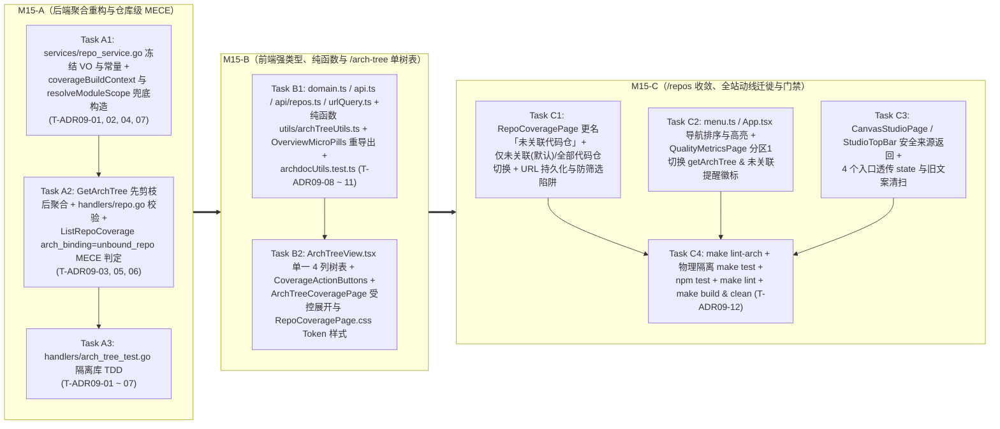

# Milestone 15 作战卡：架构文档全景主视图树表化重构与未关联代码仓定位收敛（`M15-A` / `M15-B` / `M15-C`）

- **文档编号**：`16-m15-arch-tree-primary-view.md`
- **归属阶段**：ADR-09 演进里程碑 M15（前置：M14 已完成；与 M14 文件边界高度正交）
- **覆盖特性与场景**：`F-01`、`F-26`、`F-36`、`SC-12`、`SC-23`、`T-ADR09-01` ~ `T-ADR09-12`
- **上游基线**：[`ADR-09`](../05-adr/09-arch-tree-primary-view-and-unassigned-repos.md)、[`01-feature-matrix.md`](../01-features/01-feature-matrix.md) (v0.9.0)、[`04-workbench-and-security.md`](../02-design/04-workbench-and-security.md) (v1.4.0)、[`01-http-api-contract.md`](../03-api/01-http-api-contract.md) (v1.6.0)、[`02-data-model-and-dto-contract.md`](../03-api/02-data-model-and-dto-contract.md) (v1.5.0)

---

## 1. 里程碑定位与分阶段交付 DAG

为落实「**后端契约与 MECE 口径先行、前端单树表重构紧随、全站动线收敛与全量门禁收口**」，`M15` 划分为 **`M15-A`**、**`M15-B`**、**`M15-C`** 三个正交子阶段，全程严格遵守 **SDD 契约先行 + TDD 红（先写失败测试）→ 绿（最小实现通过）→ 重构（自检与门禁）** 研发纪律：



---

## 2. 子阶段原子任务拆解

### 2.1 子阶段 `M15-A`：后端聚合重构、实时兜底解析与仓库级 MECE 判定

1. **Task A1（冻结 VO/常量、提取 `coverageBuildContext` 与 `resolveModuleScope` 实时兜底）**：
   - **修改文件**：`services/repo_service.go`。
   - **核心改造**：
     1. 新增冻结常量：`ArchBindingStatusBound = "bound"`、`ArchBindingStatusUnbound = "unbound"`、`ArchBindingStatusRepoInactive = "repo_inactive"`、`ArchBindingFilterUnboundRepo = "unbound_repo"`；
     2. 更新冻结 VO：`ArchSubsystemOptionVO` 新增 `ModuleCount int`（并镜像填充 `ScopeCount`）；新增 `ArchTreeSummaryVO`；`ArchTreeStatsVO` 字段收敛为 `ModuleCount`、`BoundModuleCount`、`CoveredModuleCount`、`ApprovedDocCount`、`DraftDocCount`、`DriftedDocCount`、`BlockedDocCount`；`ArchTreeNodeVO` 新增 `BindingStatus string` 与 `Scope *RepoScopeCoverageVO`（`Scopes` 标 `@deprecated` 固定返回 `[]`）；`ArchTreeResponse.Summary` 改为 `ArchTreeSummaryVO`（`UnassignedScopes` 标 `@deprecated` 固定返回 `[]`）；
     3. 从 `buildCoverageData` 提取内部结构 `coverageBuildContext`（持有 `idx *archIndex`、`activeRepoByID map[uint]*commonModels.Repository`、`rowsByScope map[scopeKey]RepoScopeCoverageVO`、`defaultBranchByRepo`、`effectiveBranchByRepo`、`overriddenByRepo`、`docsByScope`、`revMap`、`codeDriftByDoc`、`specDriftByDoc`、`latestCommitByScope`、`remoteHeadByRepo`、`activeTaskByScope`、`modulesByRepo`），`buildCoverageData` 复用该上下文消除重复加载；
     4. 实现 `(ctx *coverageBuildContext) resolveModuleScope(el models.ArchitectureElement, user *commonModels.User) (string, *RepoScopeCoverageVO)`：
        - 若 `el.RepoID == nil || *el.RepoID == 0`，返回 `(ArchBindingStatusUnbound, nil)`；
        - 若 `*el.RepoID` 不在 `activeRepoByID` 中（不存在或 `is_active == false`），返回 `(ArchBindingStatusRepoInactive, nil)`；
        - 按 `(*el.RepoID, normSub)` 查找 `rowsByScope`：命中则**值拷贝为独立 `RepoScopeCoverageVO` 实例**（避免多模块同 Scope 指针/元素元数据覆盖），回填当前 `el` 的 `ArchElementID`/`ArchElementName`/`ArchElementType`/`ArchPath`/`SubsystemID`/`SubsystemName`/`OwnerID`/`OwnerName`；
        - 未命中预构建行（例如该子目录在 `archdoc_repo_modules` 标 `ignored` 或尚未执行模块刷新扫描）时，调用 `buildSingleScopeRow` **实时兜底构造**，整仓模块（`normSub == ""`）写权限仅认 `repoLevelWrite`、子目录模块认 `repoLevelWrite || (el.OwnerID != nil && *el.OwnerID == user.ID)`（`SC-12`），严格执行 `!canWrite && d.Status != models.DocStatusApproved` 草稿过滤，并补齐 `DefaultBranch`、`IsBranchOverridden`、`CanSwitchBranch`、`ScopeStatus`/`EffectiveFiles`/`TotalLOC`/`ModuleSource`；返回 `(ArchBindingStatusBound, &scopeCopy)`。

2. **Task A2（`GetArchTree` 先剪枝后聚合、`parseRepoCoverageFilter` 分流校验与 `unbound_repo` 过滤）**：
   - **修改文件**：`services/repo_service.go`、`handlers/repo.go`。
   - **核心改造**：
     1. `GetArchTree` **调用 `s.masterRepo.ListAllActiveRepositories(ctx, nil)` 加载全量活跃仓库**（严禁传入 `filter.DepartmentID` 预过滤，防止跨部门活跃仓库被误判为 `repo_inactive` 及破坏 `UnassignedRepoCount` 全量口径）；
     2. 构建 `architecture_elements` 节点树时，非功能模块（`subsystem`/`group`）`Scopes` 恒为 `[]`、`Scope` 恒为 `nil`、`BindingStatus` 恒为空；仅 `type == "module"` 节点调用 `resolveModuleScope` 填充 `BindingStatus` 与 `Scope`；
     3. 在树剪枝**前**基于全树递归统计每个根子系统子树下的全部 `module` 数（含 `unbound`/`repo_inactive`），构造 `subsystems[]`（`ModuleCount` 与向后兼容 `ScopeCount = ModuleCount`）；同时基于全量 `idx.allElems` 中 `type == "module" && el.RepoID != nil && *el.RepoID > 0` 构建 `boundModuleRepoIDs`，统计所有活跃仓中 `repo.ID ∉ boundModuleRepoIDs` 的个数作为 `summary.UnassignedRepoCount`；
     4. **先筛选剪枝，后向上聚合**：重构 `pruneArchTreeNode` 接收 `ancestorSearchMatched bool` 与 `filter`：
        - 当祖先或当前节点自身命中 `searchLower` 时置 `ancestorSearchMatched = true` 向下传递；
        - 对 `module` 叶节点按 D-1 精确规则过滤（`search` 命中节点字段或 `scope.repo_name`/`scope.subdirectory` 或继承 `ancestorSearchMatched`；`status`/`department_id`/`scope_type` 仅匹配 `binding_status == "bound"` 模块；`arch_binding=bound` 匹配 `bound`，`arch_binding=unbound` 匹配 `unbound`/`repo_inactive`）；
        - 对非叶节点：保留存在至少 1 个留存子节点的分支，或在仅 `search` 且无其他非搜索限制、且满足 `subsystem_id` 约束时保留命中 `search` 的空非叶节点；
        - 剪枝完成后再对 `roots` 执行 `aggregateArchTreeStats(root)` 递归计算 `ArchTreeStatsVO`，并汇总顶层 `roots` 得到 `ArchTreeSummaryVO`（保留 `UnassignedRepoCount`）；
     5. `handlers/repo.go` 将 `parseRepoCoverageFilter(c, withPagination, allowUnboundRepo bool)` 增加 `allowUnboundRepo` 参数：`ListRepos` 传入 `true`（允许 `all | bound | unbound | unbound_repo`），`GetArchTree` 传入 `false`（仅允许 `all | bound | unbound`，传入 `unbound_repo` 等非法枚举返回 `400 INVALID_PARAM`）；
     6. `services/repo_service.go` 实现 `filterCoverageRowsWithArchModules(allRows, idx, filter)`（或扩充 `filterCoverageRows` 传入 `boundModuleRepoIDs`）：当 `arch_binding=unbound_repo` 时基于**全量** `idx.allElems` 判定 `repo.ID ∉ boundModuleRepoIDs`（无视 `department_id` 截断，且即使仓库设了 `ServiceGroup` 或绑定到 `group` 也纳入 `unbound_repo`）。

3. **Task A3（`handlers/arch_tree_test.go` TDD 测试重构与扩充）**：
   - **修改文件**：`handlers/arch_tree_test.go`。
   - **核心改造**：
     1. 依据 `ADR-09` 同步迁移旧断言（如 `coreNode.Stats.ScopeCount` → `ModuleCount`、`BoundModuleCount`、`CoveredModuleCount`；`unassigned_scopes` 固定为 `[]`；`repoA` 整仓与 `gateway` 不再挂入 `subsysCore`，而是整仓 `repoA` 被 `modOrder` 排除出 `unbound_repo`，`repoC` 出现在 `unbound_repo`）；
     2. 补齐 `T-ADR09-01` ~ `T-ADR09-07` 全量物理隔离库单测（先写红测试验证后再运行变绿）。

---

### 2.2 子阶段 `M15-B`：前端强类型、纯函数与 `/arch-tree` 单一 4 列树形表格重构

1. **Task B1（前端类型、API 契约、URL 工具与零 React 纯函数单测）**：
   - **修改文件**：`frontend/src/types/domain.ts`、`frontend/src/types/api.ts`、`frontend/src/api/repos.ts`、`frontend/src/utils/urlQuery.ts`、`frontend/src/components/OverviewMicroPills.tsx`、`frontend/src/utils/archdocUtils.test.ts`；
   - **新建文件**：`frontend/src/utils/archTreeUtils.ts`（**纯 TypeScript、零 React/JSX 导入**，确保 `node --test` 直接运行）。
   - **核心改造**：
     1. `domain.ts` 更新 `ArchBindingFilter`（新增 `'unbound_repo'`）、`ArchModuleBindingStatus`、`ArchSubsystemOptionVO`（`module_count?: number`）、`ArchTreeSummaryVO`、`ArchTreeStatsVO`、`ArchTreeNodeVO`（`binding_status?`、`scope?`、`@deprecated scopes`）、`ArchTreeResponse`（`summary: ArchTreeSummaryVO`、`@deprecated unassigned_scopes`）；
     2. `urlQuery.ts`：
        - 扩展 `VALID_ARCH_BINDING_SET` 支持 `'unbound_repo'`（或保留用户态有效筛选解析，同时 `serializeRepoFilterParams` 当 `archBinding === 'all'` 时**显式写入 `arch_binding=all`**，`''` 或 `'unbound_repo'` 时省略）；
        - 新增 `computeRepoFilterFlags(filter: RepoFilterState): RepoFilterFlags`（将视图模式 `''`/`'all'`/`'unbound_repo'` 与 `advancedFilterCount`/`hasActiveFilters` 解耦）；
        - 新增 `StudioNavState`、`SafeStudioBackTarget` 与 `resolveSafeStudioBackTarget(state: unknown, isEmbedded: boolean): SafeStudioBackTarget`（正则 `/^(?:\/archdoc)?\/(arch-tree|repos|tasks|drift|overview)(\?[^#]*)?$/` 白名单校验）；
     3. `archTreeUtils.ts` 实现：`flattenArchTreeRows`、`collectArchTreeExpandableIds`、`computeDefaultExpandedArchTreeIds`（默认阈值 `50`）、`buildArchTreeMicroPills`；`OverviewMicroPills.tsx` 重导出 `buildArchTreeMicroPills`；
     4. `archdocUtils.test.ts` 补充 `T-ADR09-08` ~ `T-ADR09-11` 单测（含 `serializeRepoFilterParams({ archBinding: 'all' })` 与旧用例兼容校验）。

2. **Task B2（`/arch-tree` 单一 4 列树形表格、受控展开与操作按钮自适应）**：
   - **修改文件**：`frontend/src/components/coverage/CoverageActionButtons.tsx`、`frontend/src/components/coverage/ArchTreeView.tsx`、`frontend/src/pages/ArchTreeCoveragePage.tsx`、`frontend/src/pages/RepoCoveragePage.css`。
   - **核心改造**：
     1. `CoverageActionButtons.tsx` 新增向后兼容可选 Props：`preferGeneratePrimary?: boolean`（默认 `false`，为 `true` 时将「生成」设为 `code-archdoc-row-btn--primary`、「工作台」为次按钮）、`hideDisabledExport?: boolean`（默认 `false`，为 `true` 且 `approvedCount === 0` 且仅剩 `export` 单项次操作时不渲染置灰导出按钮）；
     2. `ArchTreeView.tsx` 完全重构为单一 4 列 `<table>`（表头：`架构层级 / 关联源码` | `负责人与基线` | `文档覆盖（N 类）` | `操作`）：
        - 删除顶部独立图例条与底部「未归类代码仓与目录」卡片；
        - 接收受控 `expandedNodeIds: Set<number>` 与 `onToggleNode: (nodeId: number) => void`；
        - 消费 `flattenArchTreeRows(nodes, expandedNodeIds)` 渲染扁平行；
        - 非功能模块行：阶梯缩进（`style={{ '--tree-depth': depth } as React.CSSProperties}`，零静态样式与硬编码颜色）、展开切换按钮、节点类型徽标、名称+`identifier`、负责人、汇总覆盖进度条与计数微标（`0 模块` 提示空占位；非空显示 `模块覆盖 covered / total` + 进度条 + 状态微标 + tooltip「已绑定活跃代码仓 X / Y 个模块」；严格仅当计数 `> 0` 时展示对应徽标）、操作列固定 `—`；
        - 功能模块行：行 Key 统一为 `module:${node.id}`；
          - `bound`：`ScopeIdentityCell` 口径精简呈现（模块徽标 + 名称 + `identifier` + 必保 `active_task_id` 胶囊 + 副行 `repo_name / subdir` · 分支与 `· 自定义` 高亮 · 文件/LOC · 必保 `scope_status === 'missing'` 告警），负责人列显示 `node.owner_name || scope.owner_name || '-'` + `Commit: shortSha`，覆盖列复用 `ScopeDocCoverageCell`（点击展开 `<tr className="code-archdoc-coverage-expanded-row"><td colSpan={4}><ScopeDocExpandedGrid ... /></td></tr>`），操作列复用 `CoverageActionButtons`（传入 `preferGeneratePrimary={scope.can_write && generatedCount === 0}` 与 `hideDisabledExport`）；
          - `unbound`：副行斜体弱化「*未关联代码仓*」，覆盖列 `—`，操作列「*未绑定源码*」；
          - `repo_inactive`：副行告警弱化「*所绑仓库已停用*」，覆盖列 `—`，操作列「*仓库已停用*」；
     3. `ArchTreeCoveragePage.tsx`：
        - 状态改为 `ArchTreeSummaryVO`；
        - 顶部摘要接入 `buildArchTreeMicroPills`；
        - 子系统下拉选项展示 `sub.module_count ?? sub.scope_count`；
        - 将 `expandedNodeIds` 提升至页面受控管理，筛选栏最右侧放置「全部展开」「全部收起」按钮，树加载完成时根据 `computeDefaultExpandedArchTreeIds(nodes, summary.total_modules, hasActiveFilters)` 自动同步默认展开集合；
        - `openStudio` 透传 `{ state: { from: `${location.pathname}${location.search}`, fromLabel: '架构文档全景' } }`；
     4. `RepoCoveragePage.css`：新增 `.code-archdoc-tree-*` 树表阶梯缩进、左侧引导竖线、非叶底色微差、缺口状态文本与紧凑进度条样式，全部基于 `theme.css` `--color-*` Token 实现亮/暗双模适配，零硬编码色值。

---

### 2.3 子阶段 `M15-C`：`/repos` 未关联代码仓收敛、全站导航/概览/工作台安全返回与全量门禁

1. **Task C1（`/repos` 页面定位收敛为「未关联代码仓」与防筛选陷阱闭环）**：
   - **修改文件**：`frontend/src/pages/RepoCoveragePage.tsx`、`frontend/src/pages/RepoCoveragePage.css`。
   - **核心改造**：
     1. 页面标题与副标题更新为 **「未关联代码仓」**（副标题：展示尚未关联任何架构功能模块的独立或待归类代码仓库，支持直接生成与审校文档；切换至「全部代码仓」可进行模块治理与整仓汇总）；
     2. 在筛选栏右侧增加轻量分段开关：**`仅未关联 (默认)` ↔ `全部代码仓`**：
        - `viewMode`: URL 中 `archBinding === ''`（默认）对应请求 `arch_binding=unbound_repo`；切至「全部代码仓」时调用 `updateFilter({ archBinding: 'all' })` 显式写入 URL `?arch_binding=all`；切回「仅未关联 (默认)」时清空 URL 中的 `arch_binding`（若当前处于历史兼容 `bound`/`unbound` 参数则同步显示）；
     3. 消费 `computeRepoFilterFlags(filterState)` 替代旧的 `advancedFilterCount` 与 `hasActiveFilters` 计算：默认的 `unbound_repo` 与模式切换 `all` 均不自动撑开高级筛选面板、也不禁用按仓库折叠子目录（`subdirCountsByRepo`）；
     4. 默认「仅未关联」模式下，高级筛选面板隐藏 `subsystem_id` 与 `arch_binding` 下拉（仅保留 `scope_type`）；「重置筛选」保持 `archBinding` 视图模式不变；
     5. 当 `total === 0` 且 `!hasActiveFilters` 且处于默认未关联模式时，渲染正向空态（“全部活跃代码仓均已关联架构功能模块”）并提供一键切换至「查看全部代码仓」按钮；
     6. `openStudio` 透传 `{ state: { from: `${location.pathname}${location.search}`, fromLabel: '未关联代码仓' } }`；保留 `/repos?view=arch` 自动重定向至 `/arch-tree` 与 3 项低频工程治理能力。

2. **Task C2（侧边栏导航排序、`App.tsx` 高亮与 `/overview` 分区 1 数据源迁徙）**：
   - **修改文件**：`frontend/src/menu.ts`、`frontend/src/App.tsx`、`frontend/src/pages/QualityMetricsPage.tsx`、`frontend/src/pages/QualityMetricsPage.css`。
   - **核心改造**：
     1. `menu.ts`「文档全景」组顺序调整为：`全局概览 (/overview)` → `架构文档全景 (/arch-tree)` → `未关联代码仓 (/repos)`；
     2. `App.tsx` 独立调试模式侧边栏同步顺序与文案，`/studio` 与 `/docs/*` 高亮切换至 `isArchTree || isStudio`，`topbarTitle` 兜底文案更新为 `'未关联代码仓'`；
     3. `QualityMetricsPage.tsx`：
        - 分区 1 数据源由 `listRepos({ page: 1, pageSize: 15 })` 改为 **`getArchTree({})`**，消费 `ArchTreeSummaryVO`；
        - 4 张覆盖卡片全部下钻 `/arch-tree`：① `架构功能模块总数`（`total_modules`，副标题 `总体覆盖率 X% · 已绑源码 bound / total`）→ `/arch-tree`；② `已覆盖功能模块`（`covered_modules`）→ `/arch-tree`；③ `已发布架构文档`（`approved_docs`，副标题注明“架构功能模块已发布定稿”）→ `/arch-tree?status=approved`；④ `架构漂移文档`（`drifted_docs`，副标题注明“架构功能模块待刷新；全平台含独立仓见下方漂移区”）→ `/arch-tree?status=drifted`；
        - 分区 1 右上角主推「架构文档全景」、次推「未关联代码仓」（当 `summary.unassigned_repo_count > 0` 时展示轻量提醒徽标 `N`）；
        - 分区 2「待治理漂移文档」副标题明确标注全平台已发布文档口径（含独立未关联仓）。

3. **Task C3（`CanvasStudioPage` 安全来源返回与全站旧文案清扫）**：
   - **修改文件**：`frontend/src/pages/CanvasStudioPage.tsx`、`frontend/src/components/studio/StudioTopBar.tsx`、`frontend/src/pages/TaskCenterPage.tsx`、`frontend/src/pages/DriftRadarPage.tsx`。
   - **核心改造**：
     1. `TaskCenterPage.tsx` 与 `DriftRadarPage.tsx` 跳转 Studio 时统一携带 `state: { from: `${location.pathname}${location.search}`, fromLabel }`（并更新 `TaskCenterPage.tsx` 空态文案中的“仓库覆盖矩阵”）；
     2. `CanvasStudioPage.tsx` 使用 `useLocation()` 读取 `location.state`，在 `handleSelectDoc`、`handleSelectSubdirectory` 与 `GenerateTaskModal.onOpenStudio` 等 Studio 内部跳转时透传 `{ state: location.state }`；
     3. 通过 `resolveSafeStudioBackTarget(location.state, isEmbedded)` 替代硬编码 `/repos` 返回逻辑，同步传 `backLabel` 至 `StudioTopBar.tsx`（更新返回按钮 tooltip 与 `CanvasStudioPage` 缺参错误提示、空态返回按钮文案）。

4. **Task C4（安全自检、双模主题检查与全量质量门禁收口）**：
   - 执行 `make lint-arch`、物理隔离 `TEST_DB_DSN="..." make test`、`cd frontend && npm test && cd ..`、`make lint`、`make build && make clean`，检查亮/暗双模 CSS Token 零硬编码色值与无后台进程/端口残留。

---

## 3. TDD 测试与验收清单 (`T-ADR09-01` ~ `T-ADR09-12`)

| 用例编号 | 归属阶段 | 目标测试文件 / 包 | 核心测试场景与硬断言 |
| :--- | :---: | :--- | :--- |
| **`T-ADR09-01`** | `M15-A` | `handlers/arch_tree_test.go` | **非功能模块零挂仓与辅助目录隔离**：仓库设 `ServiceGroup`、`group` 绑整仓、`repoMods` 含未建 `module` 的 `discovered` 目录（如 `models`/`templates`）时，`GetArchTree` 返回的所有 `subsystem`/`group` 节点 `Scopes == []`、`Scope == nil`，且 `UnassignedScopes == []`。 |
| **`T-ADR09-02`** | `M15-A` | `handlers/arch_tree_test.go` | **三态模块与实时兜底构造**：覆盖 `bound`（整仓模块、子目录模块、被 `repoMods` 标 `ignored` 的绑定目录、未刷新扫描的新绑定目录）、`unbound`（`repo_id == nil`）、`repo_inactive`（`is_active == false`）三态，断言 `binding_status`、`scope`、实时文档/快照与整仓/子目录 `can_write` 精确无误。 |
| **`T-ADR09-03`** | `M15-A` | `handlers/arch_tree_test.go` | **先剪枝后聚合与跨部门/分母口径一致**：无筛选时 `unbound`/`repo_inactive` 计入 `module_count` 与 `summary.total_modules`；开启 `status=approved`/`drifted`/`department_id` 筛选后，`unbound`/`repo_inactive` 与空分支被剪除，且跨部门活跃仓不误判为 `repo_inactive`；父节点 `stats` 与 `summary` 严格等于可见 `module` 之和；`subsystems[].module_count` 与全树模块数一致。 |
| **`T-ADR09-04`** | `M15-A` | `handlers/arch_tree_test.go` | **普通用户草稿隔离红线 (`SC-12`)**：非负责人/非成员查询 `GET /api/arch-tree`（含兜底构造模块）时，`draft_doc_count == 0`、`blocked_doc_count == 0`、`summary.draft_docs == 0`，仅草稿的模块不计入 `covered_module_count`，`scope.doc_statuses` 零草稿泄露。 |
| **`T-ADR09-05`** | `M15-A` | `handlers/arch_tree_test.go` | **`arch_binding` 树筛选、非叶 `search` 与非法参数拦截**：`GET /api/arch-tree?arch_binding=unbound` 仅返 `unbound`/`repo_inactive` 缺口模块；`arch_binding=bound` 仅返 `bound` 模块；`GET /api/arch-tree?arch_binding=unbound_repo` 返 `400 INVALID_PARAM`；`search` 命中功能组时保留其匹配子模块。 |
| **`T-ADR09-06`** | `M15-A` | `handlers/arch_tree_test.go` | **仓库级 MECE 判定 (`arch_binding=unbound_repo`)**：仓内任一子目录或整仓已绑 `module` 的仓库（含其未绑辅助目录）从 `unbound_repo` 中整体排除；无任何 `module` 绑定（即使设了 `ServiceGroup` 或 `group` 绑仓）的活跃仓库必出现在 `unbound_repo` 列表且数量与 `summary.unassigned_repo_count` 一致（跨部门筛选不致误算）。 |
| **`T-ADR09-07`** | `M15-A` | `handlers/arch_tree_test.go` | **任意深度与多模块同 Scope 独立计账**：验证跳过 `group`（`subsystem -> module`）直挂场景及两模块同指一 `(repo_id, subdir)` 场景，均正确建树、保留各自 `ArchElement*` 元数据与独立计数。 |
| **`T-ADR09-08`** | `M15-B` | `frontend/src/utils/archdocUtils.test.ts` | **树表扁平化与默认展开阈值 (`node --test`)**：`flattenArchTreeRows` 与 `collectArchTreeExpandableIds` 正确计算 `depth`、支持跳过 `group`、生成 `module:${id}` Key；验证 `computeDefaultExpandedArchTreeIds` 在 `totalModules <= 50` 全展、`> 50` 仅展第 1 层及筛选态全展规则。 |
| **`T-ADR09-09`** | `M15-B` | `frontend/src/utils/archdocUtils.test.ts` | **`/repos` URL 序列化往返与筛选陷阱防护 (`node --test`)**：`serializeRepoFilterParams({ archBinding: 'all' })` 显式输出 `arch_binding=all`；默认（无 `arch_binding`）与 `unbound_repo` 解析一致；`computeRepoFilterFlags` 确认 `''`/`'all'`/`'unbound_repo'` 不触发 `hasActiveFilters` 或 `advancedFilterCount`。 |
| **`T-ADR09-10`** | `M15-B` | `frontend/src/utils/archdocUtils.test.ts` | **Studio 来源安全返回白名单校验 (`node --test`)**：`resolveSafeStudioBackTarget` 对合法模块内路径（`/repos?page=2&arch_binding=all`、`/archdoc/tasks?status=failed`）原样返回；对缺失 `state`、外域 URL（`https://evil.com`）、`//evil`、`javascript:alert(1)` 及非白名单路径全部安全回落至 `/arch-tree`（或 `/archdoc/arch-tree`）。 |
| **`T-ADR09-11`** | `M15-B` | `frontend/src/utils/archdocUtils.test.ts` | **架构全景微标与概览下钻 (`node --test`)**：`buildArchTreeMicroPills` 输出「功能模块 / 已覆盖 / 已发布 / 漂移」文案与点击切换状态；`buildOverviewDrilldownPath` 对 `/arch-tree` 带参数下钻独立/嵌入态均正确。 |
| **`T-ADR09-12`** | 全局 | `code-archdoc` | **端到端质量门禁 (`SC-23`)**：`make lint-arch && make test && TEST_DB_DSN=... make test && cd frontend && npm test && cd .. && make lint && make build && make clean` 全绿通过，无静态样式/硬编码颜色违规，无后台残留进程。 |

---

## 4. 设计自我反思与核验矩阵 (Self-Reflection & Design Verification Audit)

在阶段一~阶段三设计冻结前，对标现有 Go/TS 代码基线逐一核查并前置消除了以下 **10 项工程风险与设计缺口**：

| # | 发现的潜在缺陷 / 隐含假设 | 对标代码证据 | 设计修正与闭环方案 |
| :---: | :--- | :--- | :--- |
| **1** | `GetArchTree` 若沿用旧写法传 `filter.DepartmentID` 查活跃仓库，会把其他部门的活跃仓库从索引剔除，误判为 `repo_inactive` 且导致 `UnassignedRepoCount` 失真 | `services/repo_service.go:270` 原调用 `ListAllActiveRepositories(ctx, filter.DepartmentID)` | `GetArchTree` 固定传 `nil` 加载全量活跃仓库构建 `activeRepoByID` 与 `UnassignedRepoCount`，`department_id` 仅在树节点剪枝阶段生效 |
| **2** | `OverviewMicroPills.tsx` 含 JSX/React 依赖，`frontend/package.json` 的 `node --test` 运行纯函数单测无法直接导入 `.tsx` | `frontend/package.json:10`（`node --test`）与 `OverviewMicroPills.tsx:1` | 将 `buildArchTreeMicroPills`、`flattenArchTreeRows` 等零 React 依赖纯函数沉淀于 `frontend/src/utils/archTreeUtils.ts`，`OverviewMicroPills.tsx` 仅做重导出 |
| **3** | `CanvasStudioPage` 内部切换文档、切换子目录或从生成弹窗打开 Studio 时若未透传 `location.state`，会导致原页面返回来源丢失 | `CanvasStudioPage.tsx:303,335,835` 直接调用 `navigate(buildStudioPath(...))` | 在 Studio 内部全部 `navigate(buildStudioPath(...))` 处显式透传 `{ state: location.state }`，保持返回来源链完整 |
| **4** | `parseRepoCoverageFilter` 由 `/api/repos` 与 `/api/arch-tree` 共用，若不区分接口放行 `unbound_repo`，会导致 `/api/arch-tree?arch_binding=unbound_repo` 语义歧义 | `handlers/repo.go:20,91,114` | `parseRepoCoverageFilter` 增加 `allowUnboundRepo bool` 参数：仅 `/api/repos` 接受 `unbound_repo`，`/api/arch-tree` 收到时返回 `400 INVALID_PARAM` |
| **5** | 搜索关键词命中非叶节点（如搜「门户功能组」）时，若仅在叶节点匹配 `search` 会导致整棵子树被误剪为空 | `services/repo_service.go:718` 原逻辑在后置剪枝检查空节点 | `pruneArchTreeNode` 向下透传 `ancestorSearchMatched bool`，非叶命中后其子孙模块继承搜索命中（仍受 `status`/`department_id` 等约束）；仅 `search` 且无其他限制时保留命中的空非叶 |
| **6** | `buildCoverageData` 在 `len(repoMods) > 0` 时跳过 `ignored` 与未刷新扫描的 `architecture_elements` 子目录，导致已绑模块 `scope` 丢失 | `services/repo_service.go:1064-1070` | 抽离 `coverageBuildContext.resolveModuleScope`，未命中预构建行时基于活跃仓库实时调用 `buildSingleScopeRow` 兜底，并严格执行 `SC-12` 写权限与草稿隔离 |
| **7** | 多模块误绑同一 `(repo_id, subdir)` 时，共享 `Scope` 引用或前端用 `${repo_id}:${subdir}` 作 Key 会造成元信息串改及 React Key/展开态碰撞 | `ScopeCoverageTable.tsx:76` 使用 `${row.repo_id}:${row.subdirectory}` | 后端每模块值拷贝独立 `Scope` 并回填自身 `ArchElement*`；前端树表行 Key 与展开集合统一使用 `module:${node.id}` |
| **8** | `RepoCoveragePage` 默认请求 `unbound_repo` 若进入 `hasActiveFilters` 或 `advancedFilterCount`，会自动展开高级筛选并禁用 `subdirCountsByRepo` 折叠 | `RepoCoveragePage.tsx:79-84,456-464,790` | 提取纯函数 `computeRepoFilterFlags`，将视图模式（`''`/`'all'`/`'unbound_repo'`）与用户筛选解耦，且 `serializeRepoFilterParams` 显式保留 `arch_binding=all` |
| **9** | `CoverageActionButtons` 当前固定「工作台」主按钮且 0 篇已发布仍渲染置灰导出图标，不符合 D-2 自适应主次与极简裁剪要求 | `CoverageActionButtons.tsx:99-131` | 为 `CoverageActionButtons` 增加可选向后兼容 Props `preferGeneratePrimary` 与 `hideDisabledExport`，不影响 `/repos` 原有动作菜单 |
| **10** | 全站散落「仓库覆盖矩阵」旧提示文本与 `arch_tree_test.go` 旧数据结构断言需要一次性同步对齐 | `TaskCenterPage.tsx:575`、`CanvasStudioPage.tsx:239,675`、`StudioTopBar.tsx:117`、`App.tsx:165,193,197`、`arch_tree_test.go:377-422` | 在 `M15-A Task A3` 同步迁移隔离库单测断言，在 `M15-C Task C2/C3` 逐一清扫 4 处旧文案与高亮分支 |

---

## 5. 安全验证清单与自动化门禁命令

### 5.1 安全验证清单
- [ ] **零数据库结构变更 (`ADR-01`)**：零新增表、零改列、共享表零 DDL。
- [ ] **核心引擎零 DB 耦合 (`AGENTS.md`)**：`pkg/*` 零改动；树聚合、兜底与筛选收敛在 `services/repo_service.go`。
- [ ] **普通用户草稿隔离红线 (`SC-12`)**：`GetArchTree`（含兜底构造路径）严格过滤 `!canWrite && status != "approved"`，整仓模块严禁子目录负责人越权写。
- [ ] **开放重定向与 XSS 防护**：`resolveSafeStudioBackTarget` 严格正则白名单拦截外域 URL、`//` 与 `javascript:`；前端零 `dangerouslySetInnerHTML`。
- [ ] **双模主题与样式规范**：`.code-archdoc-tree-*` 全部复用 `theme.css` `--color-*` Token，亮/暗双模完整适配，零静态内联 `style` 与硬编码颜色，零 `any` 类型。

### 5.2 自动化质量门禁命令
```bash
# 1. 架构防腐红线检查
make lint-arch

# 2. 后端格式化、静态检查与全量物理隔离单测（含 T-ADR09-01 ~ T-ADR09-07）
make test
TEST_DB_DSN="host=127.0.0.1 port=5432 user=postgres password=<PWD> dbname=postgres sslmode=disable" make test

# 3. 前端纯函数单测（含 T-ADR09-08 ~ T-ADR09-11）
cd frontend && npm test && cd ..

# 4. 前端 TypeScript 严格类型与 ESLint 检查
make lint

# 5. 单二进制打包与产物清理（T-ADR09-12）
make build && make clean
```
