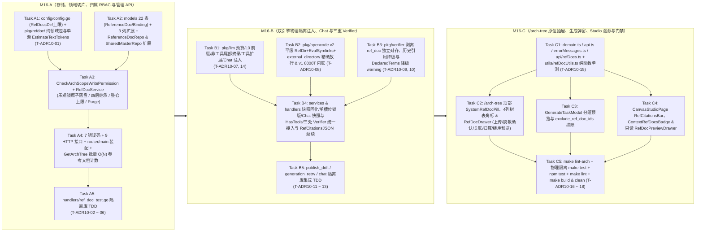

# Milestone 16 作战卡：基于架构树层级的 Markdown 参考文档组织与双引擎上下文引用（`M16-A` / `M16-B` / `M16-C`）

- **文档编号**：`17-m16-arch-reference-docs-and-context-injection.md`
- **归属阶段**：ADR-10 演进里程碑 M16（前置：M15 契约已冻结/实施）
- **覆盖特性与场景**：`F-37`、`SC-24`、`T-ADR10-01` ~ `T-ADR10-18`
- **上游基线**：[`ADR-10`](../05-adr/10-arch-reference-docs-and-context-injection.md)、[`01-feature-matrix.md`](../01-features/01-feature-matrix.md) (v0.10.0)、[`01-system-architecture.md`](../02-design/01-system-architecture.md) (v1.2.0)、[`02-extraction-and-generation-engine.md`](../02-design/02-extraction-and-generation-engine.md) (v1.3.0 §8)、[`04-workbench-and-security.md`](../02-design/04-workbench-and-security.md) (v1.5.0)、[`05-database-schema.md`](../02-design/05-database-schema.md) (v1.5.0)、[`01-http-api-contract.md`](../03-api/01-http-api-contract.md) (v1.7.0)、[`02-data-model-and-dto-contract.md`](../03-api/02-data-model-and-dto-contract.md) (v1.6.0 §13)

---

## 1. 里程碑定位与分阶段交付 DAG

为落实「**领域存储与归属 RBAC 先行、双引擎隔离与三重 Verifier 跟进、工作台原位嵌合与全仓门禁收口**」，`M16` 划分为 **`M16-A`**、**`M16-B`**、**`M16-C`** 三个正交子阶段，全程严格遵守 **SDD 契约先行 + TDD 红（先写失败测试）→ 绿（最小实现通过）→ 重构（自检与门禁）** 研发纪律：



---

## 2. 子阶段原子任务拆解

### 2.1 子阶段 `M16-A`：存储配置、纯领域切片包、归属 RBAC 与管理 API

1. **Task A1（`config` 配置扩展与纯领域包 `pkg/refdoc/`）**：
   - **修改文件**：`config/config.go`、`config/config_test.go`、`config.yaml.example`、`pkg/llm/budget.go`；
   - **新建文件**：`pkg/refdoc/types.go`、`pkg/refdoc/tokens.go`、`pkg/refdoc/gate.go`、`pkg/refdoc/parser.go`、`pkg/refdoc/excerpt.go`、`pkg/refdoc/refdoc_test.go`。
   - **核心改造**：
     1. `StorageSection` 新增 `RefDocMaxBytes int64`（默认 `524288`）、`RefDocsDir()` 与 `EffectiveRefDocMaxBytes()`；
     2. 在叶包 `pkg/refdoc/tokens.go` 单源实现 `EstimateTextTokens(s string) int`，`pkg/llm/budget.go` 的 `EstimateTextTokens` 直接委托调用 `refdoc.EstimateTextTokens`，保证零循环依赖；
     3. `gate.go` 实现 UTF-8/空正文/体积校验、`> 4 KB` Base64 内嵌图拦截（`INLINE_BASE64_IMAGE`），以及基于 `pkg/security.SecretRedactor` 的分级凭据检验：硬规则（`pem_private_key`/`token_prefix`/`url_credential`）恒返回 `SECRET_DETECTED` 不可通过 `redact_and_save` 绕过；仅命中软规则（`key_blacklist`/`high_entropy`）时默认返 `SECRET_CONFIRM_REQUIRED`，传入 `redact_and_save=true` 后自动 `RedactText` 脱敏；
     4. `parser.go` 实现围栏状态机、ATX/Setext/编号标题切分、无标题或 `> 250 行` 章节按 `~160 行` 段落边界生成 `sec-chunk-N`、确定性首段大纲兜底摘要及收窄 `DeclaredTerms` 提取（仅显式声明或 `domain_glossary` 词条，剔除 `/` 与 `::`）；
     5. `excerpt.go` 实现 `ReadSection`（上限 200 行 / 12 KB）、`SearchSections` 与非工具槽位 `SelectBudgetedExcerptsForSlot(docs, slotTitle, slotHint, maxTokens)`。

2. **Task A2（22 表 GORM 模型、3 表 JSONB 扩展与仓储接口实现）**：
   - **新建文件**：`models/reference_doc.go`；
   - **修改文件**：`models/db.go`、`models/enums.go`、`models/json_types.go`、`models/task.go`、`models/document.go`、`models/chat.go`、`models/stores.go`、`models/test_helper.go`、`models/models_test.go`、`services/repos.go`。
   - **核心改造**：
     1. 新增 `ReferenceDoc`（`archdoc_reference_docs`）与 `ReferenceDocBinding`（`archdoc_reference_bindings`），纳入 `AllOwnModels()`（20 → 22 张）；
     2. `GenTask` 新增 `ReferenceDocSnapshotJSON`；`SectionEvidence` 与 `ChatProposalItem` 新增独立列 `RefCitationsJSON`；`json_types.go` 新增 `HeadingNode`、`TaskReferenceDocSnapshot`、`RefDocCitation` 及 `ChatContextRefVO.RefDocs`；
     3. `enums.go` 新增参考文档作用域/分类/状态/摘要来源枚举与 `RefDocScopeRank`；
     4. `services/repos.go` & `models/stores.go` 新增 `ReferenceDocRepo`（含 `CreateWithHomeBinding`、`UpdateDocWithVersion` 乐观锁条件更新、`PurgeDoc` 事务物理删库）与扩展 `SharedMasterRepo`（`GetArchElement`、`GetRepositoriesByIDs`）。

3. **Task A3（归属作用域 RBAC、`RefDocService` 乐观锁原子落盘与四层继承解析）**：
   - **新建文件**：`services/ref_doc_service.go`；
   - **修改文件**：`services/rbac.go`。
   - **核心改造**：
     1. `services/rbac.go` 新增 `CheckArchScopeWritePermission`（保留既有 `CheckScopeWritePermission` 不变），支持 `system` 仅管理员、`subsystem`/`group` 祖先链 `<=16` 层防环回溯、`module` 节点祖先或已绑仓库双通道、`repo` 复用仓库写权限；
     2. `RefDocService` 按 `doc_id` 持进程内互斥锁，严格执行「校验 `expected_version` → 先临时文件+`fsync`+原子 `rename` 写入 `<RefDocsDir>/<doc_id>/v<N+1>.md`（经 `sandbox.SafeJoin` 校验）→ 后 DB 事务条件更新（失败立即清理孤儿文件）」；`PUT` 归档/修改校验 `OwnerScopeKey`（节点被删回退管理员或 `CreatedBy`），`new_home_binding` 须同时具备新旧归属作用域写权；
     3. 实现确定性五步解析算法 `ResolveEffectiveRefDocs`（显式 `arch_element_id` 消歧、保留已挂树 `repo` 绑定、先按最大 `scope_rank` 归并再过滤 `doc_type_slugs`、Monorepo 整仓上限 12 篇、按 `(scope_rank ASC, sort_order ASC, doc_id ASC)` 排序），以及管理员 `PurgeRefDoc` 物理清理磁盘与数据库。

4. **Task A4（7 个错误码、9 个 HTTP 接口、`GetArchTree` 计数与路由装配）**：
   - **新建文件**：`handlers/ref_doc.go`；
   - **修改文件**：`handlers/error.go`、`handlers/router.go`、`handlers/repo.go`、`services/repo_service.go`、`main.go`。
   - **核心改造**：
     1. `handlers/error.go` 新增 `HOME_BINDING_PROTECTED`、`VERSION_CONFLICT`、`ALREADY_BOUND`、`PAYLOAD_TOO_LARGE`、`INLINE_BASE64_IMAGE`、`SECRET_DETECTED`、`SECRET_CONFIRM_REQUIRED`；
     2. `handlers/ref_doc.go` 实现 9 个端点（含 `POST` multipart/JSON 双支持、`commonAudit` 元数据 Diff 埋点，严禁把正文/敏感片段写入审计表），在 `router.go` 与 `main.go` 完成依赖注入与路由挂载；
     3. `services/repo_service.go` 的 `GetArchTree` 批量一次性加载活跃参考文档与绑定，在内存中按祖先链 O(N) 一次遍历聚合 `summary.system_ref_doc_count` 与节点 `direct_ref_doc_count` / `inherited_ref_doc_count`。

5. **Task A5（`M16-A` 隔离库 TDD：`handlers/ref_doc_test.go`）**：
   - 先红后绿完成 `T-ADR10-02` ~ `T-ADR10-06`。

---

### 2.2 子阶段 `M16-B`：双引擎物理隔离注入、Chat 上下文与三重 Verifier 协同

1. **Task B1（`pkg/llm` 预算、KV Cache 前缀、工具/非工具注入与 Chat 集成）**：
   - **修改文件**：`pkg/llm/budget.go`、`pkg/llm/prompt.go`、`pkg/llm/source_tools.go`、`pkg/llm/chat_refine.go`、`pkg/llm/llm_test.go`、`pkg/llm/tool_calling_test.go`。
   - **核心改造**：
     1. `EstimateAndCheckBudget` 纳入参考文档 L0 前缀（短文档 `<=1800T` & 单篇 `<=1000T` 直通；否则 L0 限 `3000T`/整仓 `3600T`）及非工具槽位尾部摘录预算；
     2. `BuildSlotMessages` 在 `system` 声明事实优先级仲裁铁律；将 `<untrusted_repo_data label="arch_reference_docs">` 写入第 2 段共享前缀末尾（保 KV Cache）；当 `EnableSourceTools == false` 且存在未全文内联参考文档时，调用 `refdoc.SelectBudgetedExcerptsForSlot(..., 1500)` 追加至第 3 段尾部；
     3. `SandboxSourceToolkit` 新增 `read_ref_doc_section` 与 `search_ref_docs`（输出二次 `RedactText` + `nonce` 栅栏），更新 `HasTools()` 为 `hasFS || ir != nil || len(refDocs) > 0`；
     4. `chat_refine.go` 的 `BuildChatRefineMessages`、`BuildChatAskMessages` 与 `review_plan.go` 同步支持参考文档注入与工具检索。

2. **Task B2（`pkg/opencode` v2 平级 `RefDir` 隔离与 v1 预算内联）**：
   - **修改文件**：`pkg/opencode/runner.go`、`pkg/opencode/config_bridge.go`、`pkg/opencode/prompt.go`、`pkg/opencode/opencode_test.go`。
   - **核心改造**：
     1. `DocGenRequest` 新增 `RefDocs []PromptRefDoc`；
     2. OpenCode v2.x：`prepareSessionEnv` 创建与 `RootDir` 平级 `RefDir`（`0700`），`filepath.EvalSymlinks` 获取 `canonicalRefDir`，写入经 `SecretRedactor.RedactText` 脱敏的 `<doc_id>_v<ver>_<slug>.md`（`0600`）；在 `buildOpenCodeV2ConfigJSON` 的 `external_directory: *:deny` 之后追加单条 `{"action": "external_directory", "resource": canonicalRefDir + "/*", "effect": "allow"}`；`Cleanup()` 同时清理 `RootDir` 与 `RefDir`；`BuildDocumentPrompt` 注入 `canonicalRefDir` 副本清单与只读说明；
     3. OpenCode v1.x：保持 `"external_directory": "deny"`，按 `scope_rank` 降序以 `8000 Tokens` 预算内联章节并复用 `> 64KB` `--file` 机制。

3. **Task B3（`pkg/verifier` 独立 `RefDocCitation` 对齐与 `DeclaredTerms` 降级）**：
   - **修改文件**：`pkg/verifier/verifier.go`、`pkg/verifier/aligner.go`、`pkg/verifier/symbol_gate.go`、`pkg/verifier/verifier_test.go`。
   - **核心改造**：
     1. `VerifyInput` 新增 `ActiveRefDocs []RefDocSpec` 与 `HistoricalRefDocs []RefDocSpec`；`VerifyResult` 新增 `SectionRefCitations map[string][]RefDocCitation`；`UnverifiedRef.RefKind` 支持 `"ref_doc"` 与 `"external_term"`；
     2. `Verifier.Verify` 前置剥离 `scope == "ref_doc" || symbol_kind == "ref_doc"` 交由 `AlignRefDocCandidates`：命中 `ActiveRefDocs` 生成 `stale: false`；命中 `HistoricalRefDocs` 生成 `stale: true` + `warning`（不阻断 `can_approve`）；均未命中记录 `UnverifiedRef{RefKind: "ref_doc", Severity: "error"}` 阻断 `can_approve`；
     3. `RunSymbolGate` 命中汇聚的 `DeclaredTerms` 时固定记录 `UnverifiedRef{RefKind: "external_term", Severity: "warning"}`（`StrictSymbolCheck` 下仍为 `warning`），绝不从 `arch_design` 正文/表格豁免过时代码类名。

4. **Task B4（全链路编排、单槽位锁版、三重 Verifier 与 `RefCitationsJSON` 延续）**：
   - **修改文件**：`services/generation_service.go`、`services/batch_generation.go`、`services/opencode_execution.go`、`services/chat_service.go`、`services/revision_service.go`、`services/drift_service.go`、`handlers/task.go`、`handlers/drift.go`。
   - **核心改造**：
     1. `SubmitGenerateTask`、`SubmitBatchGenerateTask` 与 `TriggerIncrementalRefresh` 解析生效参考文档（支持 `exclude_ref_doc_ids` 与 `arch_element_id`）并固化至 `GenTask.ReferenceDocSnapshotJSON`（单文档各自过滤 `doc_type_slug`）；执行时严格从 `<RefDocsDir>/<doc_id>/v<ver>.md` 加载正文，且 `GenTaskDetailVO` 透出 `reference_docs`；
     2. `executeSingleSlotRetry` 严格从原所属 `GenTask.ReferenceDocSnapshotJSON` 加载锁定版本的参考文档；
     3. `chat_service.go` 实时解析生效参考文档写入 `ChatMessage.ContextRefsJSON`（`RefDocs`），更新 `enableTools := hasFS || irBundle != nil || len(activeRefDocs) > 0`，并在 `ChatProposalItem` 与提案列表/应用流程同步落库/透出 `RefCitationsJSON`；
     4. `generation_service.go`、`chat_service.go` 与 `revision_service.go` 三处统一构造 `VerifyInput.ActiveRefDocs` + `HistoricalRefDocs`，并将 `VerifyResult.SectionRefCitations` 写入 `SectionEvidence.RefCitationsJSON`（非重跑/未编辑章节像 `priorEvMap` 一样继承上一修订 `RefCitationsJSON`），`SectionVO` 透出 `ref_citations`。

5. **Task B5（`M16-B` 隔离库集成 TDD）**：
   - 新建 `services/publish_drift_refdoc_test.go`（`T-ADR10-11`）、`services/generation_retry_refdoc_test.go`（`T-ADR10-12`），扩展 `services/chat_review_test.go`（`T-ADR10-13`）。

---

### 2.3 子阶段 `M16-C`：前端原位抽屉、生成弹窗、Studio 溯源与全量门禁

1. **Task C1（前端类型契约、API 封装与零 React 纯函数单测）**：
   - **新建文件**：`frontend/src/api/refDocs.ts`、`frontend/src/utils/refDocUtils.ts`；
   - **修改文件**：`frontend/src/types/domain.ts`、`frontend/src/types/api.ts`、`frontend/src/api/tasks.ts`、`frontend/src/api/drift.ts`、`frontend/src/utils/errorMessages.ts`、`frontend/src/utils/archdocUtils.test.ts`。
   - **核心改造**：补齐强类型 DTO（零 `any`）、新增 7 个错误码映射、`refDocs.ts` 封装 8 个业务接口（含 multipart 上传）与纯函数单测 `T-ADR10-15`。

2. **Task C2（`/arch-tree` 顶部系统胶囊、4 列树表角标与 `RefDocDrawer`）**：
   - **新建文件**：`frontend/src/components/coverage/RefDocDrawer.tsx`；
   - **修改文件**：`frontend/src/pages/ArchTreeCoveragePage.tsx`、`frontend/src/components/coverage/ArchTreeView.tsx`、`frontend/src/pages/RepoCoveragePage.css`。
   - **核心改造**：顶部新增 `全系统参考文档：N 篇 · 查看与管理 ▸`；4 列树表第 1 列行末挂载轻量角标（零新增列）；抽屉实现区域 A（上传/粘贴 `.md`、内置 `markitdown`/`pandoc` 转换引导、`422 SECRET_CONFIRM_REQUIRED` 脱敏确认开关、搜索关联已有、乐观锁更新与滞后摘要提示、归属来源标识、解绑/归档）与区域 B（上级继承分组只读预览）。严格使用 `--color-*` Token 适配亮/暗主题。

3. **Task C3（`GenerateTaskModal` 生效清单与当次临时排除）**：
   - **修改文件**：`frontend/src/components/GenerateTaskModal.tsx`、`frontend/src/styles/archdoc.css`。
   - **核心改造**：选择范围与 `DocType` 后请求 `GET /api/ref-docs/effective`，折叠展示生效参考文档与预估 Token 徽标，支持勾选排除并在提交生成/批量生成时传入 `exclude_ref_doc_ids`。

4. **Task C4（`CanvasStudioPage` 独立参考引用溯源与只读预览抽屉）**：
   - **新建文件**：`frontend/src/components/studio/RefDocPreviewDrawer.tsx`；
   - **修改文件**：`frontend/src/pages/CanvasStudioPage.tsx`、`frontend/src/components/studio/ChatRefineTab.tsx`、`frontend/src/pages/CanvasStudioPage.css`。
   - **核心改造**：章节内独立展示 `ref_citations`（含 `stale` 标记）与 Chat 消息内 `context_refs[].ref_docs` 徽标，点击弹出 `RefDocPreviewDrawer` 定位至对应 `v<N>` 历史版本章节，不与源码预览抽屉混用。

5. **Task C5（架构防腐、全量测试与单二进制门禁收口）**：
   - 执行 `make lint-arch`、`make test`、物理隔离 `TEST_DB_DSN="..." make test`、`cd frontend && npm test && cd ..`、`make lint`、`make build && make clean`，检查端口与后台进程卫生（`T-ADR10-16` ~ `18`）。

---

## 3. TDD 测试与验收清单 (`T-ADR10-01` ~ `T-ADR10-18`)

| 用例编号 | 归属阶段 | 目标测试文件 / 包 | 核心测试场景与硬断言 |
| :--- | :---: | :--- | :--- |
| **`T-ADR10-01`** | `M16-A` | `pkg/refdoc/refdoc_test.go` | **多格式切片、无标题分块兜底与分级凭据门禁**：围栏代码块内 `#` 不误判；无 ATX 标题或 `>250` 行大节切分为 `sec-chunk-N`；Base64 大图/硬凭据即使传 `redact_and_save=true` 仍硬阻断，高熵示例支持确认脱敏通过；单源 `EstimateTextTokens` 与 `pkg/llm` 一致。 |
| **`T-ADR10-02`** | `M16-A` | `handlers/ref_doc_test.go` | **参考文档 CRUD、乐观锁与原子落盘**：上传生成 `v1.md`，带正确 `expected_version` `PUT` 生成 `v2.md` 并保留 `v1.md`；旧 `expected_version` 返 `409 VERSION_CONFLICT`；空正文/超 512KB/硬凭据分别返 `400`/`413`/`422`；管理员 `purge` 物理删盘。 |
| **`T-ADR10-03`** | `M16-A` | `handlers/ref_doc_test.go` | **四层继承、最具体绑定覆盖与挂树兼容**：`system(1) → subsystem(2) → group(3) → repo(4) → module(5)` 排序正确；`module` 绑定限定 `doc_type_slugs` 覆盖上级 `system`；已挂树仓原 `repo` 绑定仍生效；`system` 设 `inherit_to_children=false` 返 `400`。 |
| **`T-ADR10-04`** | `M16-A` | `handlers/ref_doc_test.go` | **归属作用域 RBAC、防互锁与零绑定防护**：子系统 `OwnerID` 可管理下属文档；消费方绑定后原作者仍可 `PUT`，消费方 `PUT` 返 `403` 且仅能解绑己方节点；`is_home` 在 `active` 下禁删；零消费绑定文档非归属普通用户访问写接口返 `403`。 |
| **`T-ADR10-05`** | `M16-A` | `handlers/ref_doc_test.go` | **变更仅下次生效与零漂移联动**：参考文档升 `v2` 不触发已发布文档 `Spec/Code Drift`；新生成或 `incremental-refresh` 任务固化 `v2` 快照。 |
| **`T-ADR10-06`** | `M16-A` | `handlers/ref_doc_test.go` | **`GetArchTree` 计数与多任务排除列表**：`GetArchTree` 返回准确 `system_ref_doc_count`/`direct_ref_doc_count`/`inherited_ref_doc_count`；`generate` / `generate-batch` / `incremental-refresh` 传 `exclude_ref_doc_ids` 精确排除。 |
| **`T-ADR10-07`** | `M16-B` | `pkg/llm/llm_test.go` | **Native 共享前缀 KV Cache、工具检索与非工具尾部摘录**：多槽位第 2 段共享前缀字节 100% 一致；`EnableSourceTools=true` 可调 `read_ref_doc_section`/`search_ref_docs`（即使无本地 FS 仍 `HasTools()==true`）；`EnableSourceTools=false` 第 3 段尾部获得 `<= 1500 Tokens` 摘录。 |
| **`T-ADR10-08`** | `M16-B` | `pkg/opencode/opencode_test.go` | **OpenCode 平级 `RefDir` 隔离与 v1/v2 安全分流**：v2 创建平级 `archdoc-ocref-*`（不在 `RootDir` 内），`EvalSymlinks` 后仅在 `external_directory: *:deny` 后追加 `<canonicalRefDir>/*` allow 且 `RootDir/opencode.json` 被拦截；v1 保持 `deny` 按 `8000T` 内联；`Cleanup()` 双目录回收。 |
| **`T-ADR10-09`** | `M16-B` | `pkg/verifier/verifier_test.go` | **Verifier 独立 `RefDocCitation` 对齐与历史引用兼容**：合法 `scope="ref_doc"` 对齐至 `SectionRefCitations` 且零污染 `SectionEvidences`；历史解绑引用标 `stale=true` + `warning`（不阻断审批）；伪造 `ref_doc:9999` 标 `error` 阻断 `can_approve`。 |
| **`T-ADR10-10`** | `M16-B` | `pkg/verifier/verifier_test.go` | **`DeclaredTerms` 降级与过时类名拦截反例**：`arch_design` 正文/表格中过时驼峰类名 `LegacyOrderMgr` 仍触发 Gate 1 拦截；显式 `DeclaredTerms` 外部名词降级为 `external_term` `warning` 不阻断审批。 |
| **`T-ADR10-11`** | `M16-B` | `services/publish_drift_refdoc_test.go` | **独立 `RefCitationsJSON` 对源码预览/发布/漂移零污染**：含 `RefCitationsJSON` 文档执行源码预览、定稿发布渲染与 Git Diff 漂移计算零报错、零误链、零误报。 |
| **`T-ADR10-12`** | `M16-B` | `services/generation_retry_refdoc_test.go` | **单槽位重试版本锁定与三入口复核延续**：升级 `v2` 后 `RetrySlotTask` 仍读取原任务 `v1.md`；解绑参考文档后手工直编与 Chat 均保留非编辑槽位 `RefCitationsJSON` 且不因解绑报 `error`。 |
| **`T-ADR10-13`** | `M16-B` | `services/chat_review_test.go` | **Chat 精修与 Ask 问答参考文档注入及留痕**：`BuildChatRefineMessages` / `BuildChatAskMessages` 注入生效参考文档，`ChatMessage.ContextRefsJSON` 记录 `ref_docs` 快照，采纳提案后 `RefCitationsJSON` 写入新修订。 |
| **`T-ADR10-14`** | `M16-B` | `pkg/llm/llm_test.go` | **预算预检纳入参考文档 Token**：`EstimateAndCheckBudget` 计入 L0 前缀与非工具摘录预算，Monorepo 整仓遵守 12 篇 / `3600 Tokens` 上限。 |
| **`T-ADR10-15`** | `M16-C` | `frontend/src/utils/archdocUtils.test.ts` | **前端纯函数单测 (`node --test`)**：测试 `groupEffectiveRefDocsByScope`、`buildExcludedRefDocIds`、`formatRefDocSummaryStaleHint` 与 `formatRefCitationBadgeLabel`。 |
| **`T-ADR10-16` ~ `18`** | `M16-C` | 全仓 CI 门禁 | **契约对齐、架构防腐与全量回归 (`SC-24`)**：`make lint-arch`（确认 `pkg/refdoc` 零 DB/Gin/pkg-llm 依赖）、`make test`、`TEST_DB_DSN=... make test`、`npm test`、`make lint`、`make build && make clean` 全绿。 |

---

## 4. 设计自我反思与核验矩阵 (Self-Reflection & Design Verification Audit)

在阶段一~阶段三设计冻结前，对标现有 Go/TS 代码基线逐一核查并前置消除了以下 **10 项工程风险与设计缺口**：

| # | 发现的潜在缺陷 / 隐含假设 | 对标代码证据 | 设计修正与闭环方案 |
| :---: | :--- | :--- | :--- |
| **1** | `pkg/llm` 导入 `pkg/refdoc` 并共用 `EstimateTextTokens` 极易触发 Go 循环导入 | `pkg/llm/budget.go:65` 当前在 `pkg/llm` 内定义 `EstimateTextTokens` | 将 `EstimateTextTokens` 单源沉淀至叶包 `pkg/refdoc/tokens.go`（零 `pkg/llm` 导入），`pkg/llm.EstimateTextTokens` 直接委托调用，保持 `pkg/*` 无环 DAG |
| **2** | 硬凭据与可确认高熵同时命中时，若仅凭 `redact_and_save=true` 全部脱敏放行，会导致私钥等高危凭据借道入库 | `pkg/security/redactor.go:100` `RedactText` 返回统一 `[]Finding` | `pkg/refdoc/gate.go` 将结果分为 `hardFindings`（`pem_private_key`/`token_prefix`/`url_credential`）与 `softFindings`（`key_blacklist`/`high_entropy`），`len(hardFindings) > 0` 恒返 `422 SECRET_DETECTED` 绝不放行 |
| **3** | `ChatMessage.ContextRefsJSON` 实为 `[]ChatContextRefVO` 数组，`chat_service.go` `enableTools` 未把纯参考文档纳入工具开关 | `services/chat_service.go:111,311,646`（`enableTools := hasFS || irBundle != nil`） | 扩展 `ChatContextRefVO.RefDocs` 保持数组兼容，并同步更新 `enableTools` 与 `tk.HasTools()` 为 `hasFS || ir != nil || len(refDocs) > 0` |
| **4** | `SharedMasterRepo` 缺少按单 ID 查询 `ArchitectureElement` 与批量按 IDs 查询 `Repository` 方法 | `services/repos.go:12-22` 仅含按仓/全量列表接口 | 显式扩展 `GetArchElement` 与 `GetRepositoriesByIDs`，支撑祖先链 RBAC（≤16 层）与绑定作用域回显，杜绝 N+1 与直访 `models.DB` |
| **5** | `Verifier.Verify` 直接送 `scope="ref_doc"` 进 `AlignCandidates` 会误判未对齐，且非重跑/未编辑章节会丢历史 `RefCitationsJSON` | `pkg/verifier/verifier.go:90`、`services/revision_service.go:1110,1142` | `Verify` 前置剥离 `ref_doc` 候选走独立 `AlignRefDocCandidates`，并在 `generation_service.go` / `revision_service.go` / `chat_service.go` 同步继承 `priorRefCitationsBySlot` |
| **6** | `/tmp` 软链（如容器或 macOS `/tmp -> /private/tmp`）会导致 OpenCode v2 `external_directory` 路径匹配失效，且 Prompt 须知悉动态目录名 | `pkg/opencode/config_bridge.go:27,164` 使用 `os.MkdirTemp` | `prepareSessionEnv` 对 `RefDir` 执行 `filepath.EvalSymlinks` 得到 `canonicalRefDir`，同步注入 `permissions`（`canonicalRefDir + "/*"`）与 `BuildDocumentPrompt`，`Cleanup()` 双目录回收 |
| **7** | `PUT /api/ref-docs/:id` 若先提交 DB 再写盘，写盘失败将导致 DB 版本号指向不存在的 `v<N+1>.md` | `pkg/doctype/registry.go` 原子写盘顺序基准 | 持 `doc_id` 细粒度锁严格执行「校验 `expected_version` → 临时文件+`fsync`+原子 `rename` 写 `v<N+1>.md` → 后 DB 条件事务更新（失败立删孤儿文件）」 |
| **8** | 异常多架构模块绑定同一 `(repo_id, subdir)` 时，若不传 `arch_element_id` 可能混入兄弟模块参考文档 | `services/repo_service.go`（`ADR-09` 已显式兼容多模块同 Scope） | `POST /api/tasks/generate` 允许可选传入 `arch_element_id` 作为精确起点（缺省按 `id ASC` 合并兼容），并校验权限与范围归属 |
| **9** | `GetArchTree` 若逐节点查询参考文档与绑定会产生严重 N+1 查询退化 | `services/repo_service.go` `GetArchTree` 全量内存建树机制 | 在 `GetArchTree` 内一次性批量查询活跃参考文档与绑定表，在内存中按祖先链一次 DFS O(N) 聚合 `direct`/`inherited`/`system` 计数 |
| **10** | `frontend/package.json` 的 `node --test` 无法加载 `.tsx`/React 组件 | `frontend/package.json:10`（纯 TS `node --test`） | 将参考文档分组排序、排除集计算、摘要滞后文案与引用徽标格式化沉淀至零 React 依赖的 `frontend/src/utils/refDocUtils.ts`，并在 `archdocUtils.test.ts` 覆盖 `T-ADR10-15` |

---

## 5. 安全验证清单与自动化门禁命令

### 5.1 安全验证清单
- [ ] **核心引擎零 DB / 零环依赖 (`AGENTS.md`)**：`pkg/refdoc/` 严禁导入 `models`/`services`/`handlers`/`gorm`/`gin`/`pkg/llm`，通过 `make lint-arch` 检查。
- [ ] **纯 Markdown 契约与分级凭据门禁**：硬阻断私钥/Token/URL 凭据与 `>4 KB` Base64 大图，疑似高熵支持用户显式确认脱敏，工具读取与 OpenCode 副本二次过 `SecretRedactor`，管理员支持物理 `purge`。
- [ ] **归属作用域单点写权与防越权**：编辑/归档仅认 `OwnerScopeKey`，消费绑定零互锁、空绑定零越权，`is_home` 在 `active` 下受保护，不破坏既有源码生成 `SC-12` 隔离。
- [ ] **OpenCode v2 平级目录物理隔离**：`RefDir` 与含明文 `APIKey` 的 `RootDir` 平级互不包含，`EvalSymlinks` 后尾部单条放行 `<canonicalRefDir>/*`，`Cleanup()` 双目录回收；v1 保持 `external_directory: "deny"`。
- [ ] **双模主题与前端安全**：`.code-archdoc-*` 100% 使用 `--color-*` Token 适配亮/暗主题，零 `dangerouslySetInnerHTML`/`any`/静态内联 `style`。

### 5.2 自动化质量门禁命令
```bash
# 1. 架构防腐红线检查（确保 pkg/refdoc 零 models/services/handlers/gorm/gin/pkg-llm 依赖）
make lint-arch

# 2. 后端格式化、静态检查与全量物理隔离单测（含 T-ADR10-01 ~ T-ADR10-14）
make test
TEST_DB_DSN="host=127.0.0.1 port=5432 user=postgres password=<PWD> dbname=postgres sslmode=disable" make test

# 3. 前端纯函数单测（含 T-ADR10-15）
cd frontend && npm test && cd ..

# 4. 前端 TypeScript 严格类型与 ESLint 检查
make lint

# 5. 单二进制打包与产物清理（T-ADR10-16 ~ 18）
make build && make clean
```
