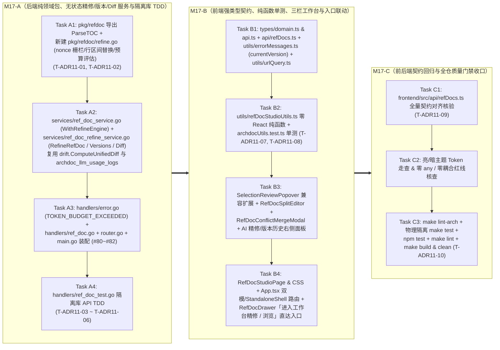

# Milestone 17 作战卡：架构参考文档精修工作台（一期轻量方案）（`M17-A` / `M17-B` / `M17-C`）

- **文档编号**：`18-m17-ref-doc-refine-studio.md`
- **归属阶段**：ADR-11 演进里程碑 M17（前置：M16 已合入，9 端点与 22 表基线就绪）
- **覆盖特性与场景**：`F-38`、`SC-25`、`T-ADR11-01` ~ `T-ADR11-10`
- **上游基线**：[`ADR-11`](../05-adr/11-ref-doc-refine-studio.md)、[`01-feature-matrix.md`](../01-features/01-feature-matrix.md) (v0.11.0)、[`01-system-architecture.md`](../02-design/01-system-architecture.md) (v1.3.0)、[`04-workbench-and-security.md`](../02-design/04-workbench-and-security.md) (v1.6.0)、[`01-http-api-contract.md`](../03-api/01-http-api-contract.md) (v1.8.0 §11)、[`02-data-model-and-dto-contract.md`](../03-api/02-data-model-and-dto-contract.md) (v1.7.0 §14)

---

## 1. 里程碑定位与分阶段交付 DAG

为落实「**零新增 DB 表与叶包无环约束先行、三栏轻量工作台与纯函数草稿引擎跟进、契约对齐核验与全仓门禁收口**」，`M17` 划分为 **`M17-A`**、**`M17-B`**、**`M17-C`** 三个正交子阶段，全程严格遵守 **SDD 契约先行 + TDD 红（先写失败测试）→ 绿（最小实现通过）→ 重构（自检与门禁）** 研发纪律：



---

## 2. 子阶段原子任务拆解

### 2.1 子阶段 `M17-A`：纯领域包 `pkg/refdoc/refine.go`、编排服务与 3 个轻量接口

1. **Task A1（`pkg/refdoc` 导出 `ParseTOC` 与新建 `refine.go`）**：
   - **修改文件**：`pkg/refdoc/parser.go`、`pkg/refdoc/refdoc_test.go`；
   - **新建文件**：`pkg/refdoc/refine.go`。
   - **核心改造**：
     1. `parser.go` 导出 `ParseTOC(markdown string) []HeadingNode`（内部先归一化 `\r\n -> \n` 后调用 `parseTOC`）；
     2. `refine.go` **严守叶包约束**（仅导入 Go 标准库 + `pkg/security`，**严禁导入 `pkg/llm`、`pkg/drift`、`models`、`services`、`handlers`、`gorm`、`gin`**）；
     3. 定义纯 Go 结构体 `RefinePromptMessage`、`RefineSelectionRange`、`RefinePromptInput`、`RefineLLMOutput` 及常量（`RefineScope*`、`RefineMode*`、`RefinePreset*`、`DefaultFullRefineMaxTokens = 16000`、`DefaultSummaryExtractMaxTokens = 24000`）；
     4. 实现 `CheckFullRefineBudget`（复用叶包 `EstimateTextTokens`）、`BuildRefinePrompt`（128-bit `crypto/rand` 随机 `nonce` 数据栅栏 `<untrusted_ref_doc nonce="...">` + 闭合/开启标签转义 + `polish`/`mermaid`/`refresh_summary` 指令模板 + 超长 `refresh_summary` 自动按 TOC/各节首段浓缩）、`ParseRefineLLMOutput`（兼容 JSON / ```` ```json ```` / 纯文本兜底）与 `ApplyLineRangeReplacement`（1-based 闭区间精确替换，非目标行字节级不变）；
     5. 在 `pkg/refdoc/refdoc_test.go` 先红后绿完成 `T-ADR11-01`、`T-ADR11-02`。

2. **Task A2（`RefDocService` 无状态 AI 精修、版本枚举与 Diff 服务）**：
   - **修改文件**：`services/ref_doc_service.go`；
   - **新建文件**：`services/ref_doc_refine_service.go`。
   - **核心改造**：
     1. `services/ref_doc_service.go` 新增 `govRepo GovernanceRepo` 与 `llmClient *llm.Client` 可选字段及 `WithRefineEngine(govRepo GovernanceRepo, llmClient *llm.Client) *RefDocService`；
     2. `services/ref_doc_refine_service.go` 实现 `RefineRefDoc(ctx, docID, req, user)`：
        - `mode` 默认 `revise`，校验 `revise` 走 `checkDocOwnerWritePermission`（无权返 `ErrRefDocForbidden`），`ask` 放行登录态但 `!canEdit` 强制忽略 `req.DraftContentMD`；
        - 校验 `preset_action` 与 `prompt` 不可同时为空，传入合法 `preset_action` 时自动填充默认中文指令；
        - 若采用 `draft_content_md` 且非空，校验 UTF-8 与 `<= s.maxBytes`（超限返回 `&RefDocGateError{...413 PAYLOAD_TOO_LARGE}`），并以 `refdoc.ParseTOC(baseMD)` 动态解析目录（`section_id == "__preamble__"` 且 `toc[0].StartLine > 1` 时映射至 `1..toc[0].StartLine-1`）；
        - `scope_type == "full"` 且 `mode == "revise"` 且 `preset_action != "refresh_summary"` 时，调用 `ResolveLLMEndpoint` 获取端点配置后按 `min(max(cfg.MaxTokensPerTask/2, 4000), 16000)` 校验 `CheckFullRefineBudget`，超限返回 `&RefDocTokenBudgetExceededError`（0 次 LLM 请求）；
        - 调用 `llmClient.ChatCompletion`（将 `RefinePromptMessage` 映射为 `[]llm.Message`），并将用量写入 `archdoc_llm_usage_logs`（`TaskID=nil`、`DocumentID=nil`、`RepoID=ownerRepoIDOrZero`、`SlotID="ref_doc:<id>"`、`Engine="native"`、`Stage="ref_doc_refine" | "ref_doc_ask"`）；
        - `revise` 且非 `refresh_summary` 时经 `ApplyLineRangeReplacement` 合成 `proposed_full_markdown` 并调用 `drift.ComputeUnifiedDiff(baseMD, proposedFullMD)` 生成 `unified_diff`；
        - 对 `proposed_full_markdown` **独立跑完两项专属门禁**（`refdoc.ValidateAndParse` + `verifier.RunMermaidGate`，**明确豁免 `RunSymbolGate`**），汇总 `preflight`；`refresh_summary` 保持正文不变（`proposed_fragment=""`、`proposed_full_markdown=baseMD`、`unified_diff=""`），返回 `suggested_summary_md` 与 `suggested_declared_terms`；
     3. 实现 `ListRefDocVersions`（倒序返回 `current_version..1`，结合 `sandbox.SafeJoin` 检测 `file_exists` 与 `byte_size`）与 `DiffRefDocVersions`（默认 `to = current_version`、`from = max(1, to-1)`，越界返 `ErrInvalidRefDocParam`，缺文件返 `models.ErrNotFound`，调用 `drift.ComputeUnifiedDiff` 返回 `from_version`、`to_version`、`unified_diff`、`added_lines`、`removed_lines`）。

3. **Task A3（错误码、3 个 HTTP 控制器、路由绑定与 `main.go` 装配）**：
   - **修改文件**：`handlers/error.go`、`handlers/ref_doc.go`、`handlers/router.go`、`main.go`。
   - **核心改造**：
     1. `handlers/error.go` 新增 `ErrCodeTokenBudgetExceeded = "TOKEN_BUDGET_EXCEEDED"`；
     2. `writeRefDocServiceError` 映射 `*services.RefDocTokenBudgetExceededError` → HTTP `422 TOKEN_BUDGET_EXCEEDED`（带 `details: { estimated_tokens, max_full_refine_tokens, suggested_scope: "section" }`）与 `errors.Is(err, services.ErrChatLLMNotConfigured)` → HTTP `400 INVALID_PARAM`；
     3. `handlers/ref_doc.go` 新增 `RefineRefDoc`、`ListRefDocVersions`、`GetRefDocDiff`；
     4. `handlers/router.go` 在 `if h.refDocSvc != nil` 组下挂载 `#80 POST /ref-docs/:id/refine`、`#81 GET /ref-docs/:id/versions`、`#82 GET /ref-docs/:id/diff`；`main.go` 在 `refDocSvc` 构造后链式调用 `.WithRefineEngine(govStore, llmClient)`。

4. **Task A4（`M17-A` 隔离库 API TDD：`handlers/ref_doc_test.go`）**：
   - 先红后绿完成 `T-ADR11-03` ~ `T-ADR11-06`（测试路由注册中同时注入 `WithRefineEngine` 与 `httptest` Mock LLM）。

---

### 2.2 子阶段 `M17-B`：前端类型契约、纯函数单测与三栏精修工作台

1. **Task B1（类型契约、API 封装、错误码提取与路由工具）**：
   - **修改文件**：`frontend/src/types/domain.ts`、`frontend/src/types/api.ts`、`frontend/src/api/refDocs.ts`、`frontend/src/utils/errorMessages.ts`、`frontend/src/utils/urlQuery.ts`。
   - **核心改造**：
     1. `domain.ts` 与 `api.ts` 补齐 §14.4 定义的强类型接口（零 `any`）；
     2. `api/refDocs.ts` 新增 `refineRefDoc(docId, payload)`、`listRefDocVersions(docId)`、`getRefDocDiff(docId, from?, to?)`（并确保既有 4 处对齐修正完整保留）；
     3. `errorMessages.ts` 在 `FormattedApiError` 新增 `currentVersion?: number`，`VERSION_CONFLICT` 分支提取 `details.current_version`；
     4. `urlQuery.ts` 新增 `buildRefDocStudioPath(isEmbedded, docId)`。

2. **Task B2（零 React 草稿切片/偏置纯函数与 `node --test` 单测）**：
   - **新建文件**：`frontend/src/utils/refDocStudioUtils.ts`；
   - **修改文件**：`frontend/src/utils/archdocUtils.test.ts`。
   - **核心改造**：
     1. 实现 `parseLocalRefDocTOC`（对齐后端围栏状态机、ATX/Setext/编号标题及 `>250` 行切分规则）、`splitRefDocIntoDisplaySections`（**含首标题 `start_line > 1` 时自动补齐 `__preamble__` 导言节**）、`replaceLinesInDraft`、`computeAbsoluteSelectionLines`（节内相对行号 → 全局 1-based 绝对行号）、`hasUnsavedRefDocDraft`、`mergeRefDocRefineProposal`、`classifyRefDocDiffLine`；
     2. 在 `archdocUtils.test.ts` 完成 `T-ADR11-07`、`T-ADR11-08`。

3. **Task B3（复用扩展与精修工作台子组件）**：
   - **修改文件**：`frontend/src/components/studio/SelectionReviewPopover.tsx`；
   - **新建文件**：
     - `frontend/src/components/refdoc/RefDocSplitEditor.tsx`（分栏/源码/预览编辑器，独立复用 `SectionMarkdownRenderer` 与 `.code-archdoc-inline-editor*` CSS，零 `SectionVO` 耦合）；
     - `frontend/src/components/refdoc/RefDocRefinePanel.tsx`（右栏 Tab 1：作用域/模式/快捷动作、纯内存对话与复用 `DiffProposalCard` 样式的提案 Diff 卡、双门禁预检明细展示、`redact_and_save` 开关、4 种采纳处置）；
     - `frontend/src/components/refdoc/RefDocVersionHistoryPanel.tsx`（右栏 Tab 2：倒序版本清单、双版本 Unified Diff、`file_exists` 缺失提示与「恢复此版本为新版」前滚动作）；
     - `frontend/src/components/refdoc/RefDocConflictMergeModal.tsx`（`409 VERSION_CONFLICT` 弹窗：保留本地草稿与内存提案，拉取最新服务端版对照，支持「以当前最新版本号覆盖提交」或「放弃本地改动加载新版」）。
   - **核心改造**：`SelectionReviewPopover.tsx` 向后兼容扩展 `showCommentButton?: boolean`、`canAsk?: boolean`、`ownership?: SectionOwnership`、`onAddComment?: () => void`，不影响 `CanvasStudioPage` 既有调用。

4. **Task B4（`RefDocStudioPage` 主页面、双模路由与 `RefDocDrawer` 直达入口）**：
   - **新建文件**：`frontend/src/pages/RefDocStudioPage.tsx`、`frontend/src/pages/RefDocStudioPage.css`；
   - **修改文件**：`frontend/src/App.tsx`、`frontend/src/components/coverage/RefDocDrawer.tsx`。
   - **核心改造**：
     1. `RefDocStudioPage` 完整落地左栏（动态 TOC + 全量元信息编辑 + 绑定管理 `PATCH`）、中栏（含导言与分节画布、单节/全文分栏编辑、`.md` 文件 UTF-8 重新导入、划词绝对行号映射）、右栏双 Tab 及顶部保存/未保存草稿条；100% 使用 `--color-*` Token 与 `.code-archdoc-*` Flat BEM；
     2. `App.tsx` 在 **`EmbeddedRoutes`**（`/ref-docs/:docId/studio` 与 `${MODULE_BASE_PATH}/ref-docs/:docId/studio`）及 **`StandaloneShell`**（`/ref-docs/:docId/studio`、`isRefDocStudio` 顶栏标题与导航高亮）同步注册，保持 `menu.ts` 零变动；
     3. `RefDocDrawer.tsx` 详情头部在 `detailDoc.can_edit` 判断**之外**渲染「进入工作台精修」（可写）或「工作台浏览」（只读），跳转携带安全来源 `state`。

---

### 2.3 子阶段 `M17-C`：契约回归、样式走查与全仓门禁收口

1. **Task C1（`refDocs.ts` 契约对齐回归核验，`T-ADR11-09`）**：逐一验证 `listRefDocs(status=all)`、`createRefDoc(payload)`、`purgeRefDoc(/admin/ref-docs/:id/purge)`、`updateRefDocBinding(PATCH)` 及 3 个新接口。
2. **Task C2（亮/暗双模主题与代码规范核查）**：走查新增 `.tsx`/`.css`，确认零硬编码色值、零静态内联 `style`、零 `any`、零 `SectionVO`/`ChatService` 耦合。
3. **Task C3（全仓质量门禁执行，`T-ADR11-10`）**：执行 `make lint-arch`、`make test`、物理隔离 `TEST_DB_DSN="..." make test`、`cd frontend && npm test && cd ..`、`make lint`、`make build && make clean`，并核查进程/端口卫生。

---

## 3. TDD 测试与验收清单 (`T-ADR11-01` ~ `T-ADR11-10`)

| 用例编号 | 归属阶段 | 目标测试文件 / 包 | 核心测试场景与硬断言 |
| :--- | :---: | :--- | :--- |
| **`T-ADR11-01`** | `M17-A` | `pkg/refdoc/refdoc_test.go` | **精修 Prompt 构造、防注入转义与行区间合成**：`nonce` 栅栏与 `<untrusted_ref_doc` 转义生效；`selection`/`section` 替换仅改动 `[startLine, endLine]`，非目标行字节级不变；`ParseRefineLLMOutput` 兼容 JSON/围栏/纯文本；`pkg/refdoc` 零 `pkg/llm`/`pkg/drift` 导入。 |
| **`T-ADR11-02`** | `M17-A` | `pkg/refdoc/refdoc_test.go` | **大文档 Token 预算拦截与 `refresh_summary` 豁免**：`CheckFullRefineBudget` 超限 `full` 请求返回超限与建议；`section`/`selection` 与 `refresh_summary` 正常放行，超 `24000T` 时 `refresh_summary` 自动按 TOC/首段浓缩。 |
| **`T-ADR11-03`** | `M17-A` | `handlers/ref_doc_test.go` | **无状态 `/refine` 权限、专属预检与用量记账**：非归属方发起 `revise` 返回 `403`；未配置 LLM 返 `400`；超限 `full` 返 `422 TOKEN_BUDGET_EXCEEDED`（Mock LLM 0 请求）；含规划态外部类名提案通过预检（豁免 `RunSymbolGate`）；非法 Mermaid 与 `sk-` 硬凭据在 `preflight` 分别标 `error`/`SECRET_DETECTED` 且 `can_save=false`；高熵示例标 `secret_confirm_required=true` 且 `can_save=true`；`archdoc_llm_usage_logs` 写入 `ref_doc:<id>` 记录。 |
| **`T-ADR11-04`** | `M17-A` | `handlers/ref_doc_test.go` | **未保存草稿动态 `ParseTOC` 与只读 `ask` 防滥用**：归属方传入增删行后的 `draft_content_md` 时，按动态 TOC 精确替换目标章节并计算 Diff；非归属登录用户发起 `mode="ask"` 即使传入 `draft_content_md` 也被服务端强制忽略，仅基于磁盘已落盘版作答。 |
| **`T-ADR11-05`** | `M17-A` | `handlers/ref_doc_test.go` | **`refresh_summary` 非破坏性提炼、采纳升版与乐观锁冲突**：`refresh_summary` 返回 `proposed_fragment=""`、`unified_diff=""` 与 `suggested_summary_md`/`suggested_declared_terms`；仅提交 `summary_md`/`declared_terms` 消除 `summary_stale` 且版本号不变；采纳正文 `PUT` 成功升版 `v2.md`；过期 `expected_version` 返 `409 VERSION_CONFLICT` 且带 `details.current_version`。 |
| **`T-ADR11-06`** | `M17-A` | `handlers/ref_doc_test.go` | **版本枚举、双版本 Diff 与不可变前滚恢复**：升级至 `v3` 后 `/versions` 倒序返回 3 条记录；`/diff?from=1&to=3` 返回准确的 `from_version`/`to_version`/`added_lines`/`removed_lines`；模拟删除磁盘 `v2.md` 后 `/versions` 显式标 `file_exists=false`、`/diff?from=2&to=3` 返 `404`；将 `v1` 正文带 `expected_version=3` 恢复发布为 `v4`，`v1` 与 `v3` 磁盘内容保持不可变。 |
| **`T-ADR11-07`** | `M17-B` | `frontend/src/utils/archdocUtils.test.ts` | **前端草稿切片、导言零丢失与选区绝对行号偏置 (`node --test`)**：`splitRefDocIntoDisplaySections` 对首个标题前 `<=30` 行自动补齐 `__preamble__` 导言节；`replaceLinesInDraft` 保持非目标行不变；`computeAbsoluteSelectionLines` 正确映射节内相对行号至全局绝对行号；`buildRefDocStudioPath` 兼顾独立/嵌入态；`formatApiError` 对 `VERSION_CONFLICT` 提取 `currentVersion`。 |
| **`T-ADR11-08`** | `M17-B` | `frontend/src/utils/archdocUtils.test.ts` | **提案合并、草稿脏状态与 Diff 行分类 (`node --test`)**：验证 `hasUnsavedRefDocDraft`、`mergeRefDocRefineProposal`（兼容 `section`/`selection`/`full` 与 `refresh_summary` 无变更）及 `classifyRefDocDiffLine`。 |
| **`T-ADR11-09`** | `M17-C` | `frontend/src/api/refDocs.ts` | **前端 `refDocs.ts` 契约对齐验证**：核实 `status=all`、`payload` 表单字段、`/admin/ref-docs/:id/purge`、`PATCH` 绑定与新增 3 个精修/版本接口全量对齐后端路由。 |
| **`T-ADR11-10`** | `M17-C` | 全仓 CI 门禁 | **架构防腐与全量回归 (`SC-25`)**：`make lint-arch`、`make test`、`TEST_DB_DSN=... make test`、`cd frontend && npm test && cd ..`、`make lint`、`make build && make clean` 全绿通过。 |

---

## 4. 设计自我反思与核验矩阵 (Self-Reflection & Design Verification Audit)

在设计冻结前，逐行对标真实代码基线核验并前置消除了以下 **12 项潜在风险与设计缺口**：

| # | 发现的潜在缺陷 / 隐含假设 | 对标代码证据 | 设计修正与闭环方案 |
| :---: | :--- | :--- | :--- |
| **1** | 若在 `pkg/refdoc/refine.go` 中直接调用 `pkg/llm.EstimateTextTokens` 或 `pkg/drift.ComputeUnifiedDiff`，会破坏无环 DAG（`pkg/llm` 与 `pkg/verifier` 已导入 `pkg/refdoc`） | `pkg/llm/prompt.go:14`、`pkg/llm/budget.go:65`、`pkg/drift/section_diff.go:108` | `pkg/refdoc/refine.go` 严格保持叶包零 `pkg/llm`/`pkg/drift` 依赖，直接使用同包 `EstimateTextTokens`，`ComputeUnifiedDiff` 由 `services/ref_doc_refine_service.go` 直接复用 `pkg/drift` |
| **2** | 后端复用 `archdoc_llm_usage_logs` 记账时，`Stage` 列宽仅 `varchar(32)` 且 `TaskID`/`DocumentID` 为可选指针 | `models/governance.go:37-46` | 显式定义 `Stage = "ref_doc_refine"` / `"ref_doc_ask"`（≤14 字符）、`SlotID = "ref_doc:<id>"`、`TaskID = nil`、`DocumentID = nil`，零 DDL 即完整纳入 `F-27` 成本观测 |
| **3** | 前端传入未保存草稿 `draft_content_md` 后，若继续用 DB 中过期的 `doc.TOCJSON` 解析 `section_id` 行号，会导致替换错位 | `services/ref_doc_service.go:748`、`pkg/refdoc/parser.go:60` | `pkg/refdoc` 导出 `ParseTOC`；当采用 `draft_content_md` 时，服务端用 `refdoc.ParseTOC(baseMD)` 动态重建 TOC 定位章节边界 |
| **4** | 只读用户可通过 `mode="ask"` 传入任意超大 `draft_content_md` 把 `/refine` 当作免费文本问答代理 | `handlers/ref_doc.go`（`GetRefDocDetail` 仅需 `JWT`） | 明确规则：`mode == "ask"` 且 `!canEdit` 时后端强制忽略 `draft_content_md`，仅允许基于服务端已落盘版本提问 |
| **5** | `pkg/refdoc/parser.go` 仅在首个标题前 `>30` 行时才创建导言节点，`1..30` 行前置导言不在 `toc[]` 内，直接按 `toc[]` 渲染会丢失导言 | `pkg/refdoc/parser.go:174-182` | 前端纯函数 `splitRefDocIntoDisplaySections` 在 `toc[0].start_line > 1` 时自动合成 `__preamble__` 导言节，保证全行覆盖零丢失 |
| **6** | `SectionMarkdownRenderer` 的 `data-line-start`/`data-line-end` 是相对传入单节 `markdown` 的行号，直接传给后端会导致划词选区命中错误行 | `frontend/src/components/studio/SectionCard.tsx:115-120`、`markdown.ts` | 中栏捕获选区后强制经纯函数 `computeAbsoluteSelectionLines` 加上 `sectionStartLine - 1` 映射为文档全局 1-based 绝对行号 |
| **7** | `preset_action="refresh_summary"` 若走常规全文重写，既易触发大文档预算拦截又会误改正文 | `docs/05-adr/11-ref-doc-refine-studio.md` §3.3 | 冻结 `refresh_summary` 非破坏性语义：豁免全文重写拦截（超 `24000T` 自动浓缩目录+首段），仅产出建议摘要/术语，不改正文且支持不升正文版本单独采纳 |
| **8** | `ValidateGate` 命中 `SECRET_CONFIRM_REQUIRED` 后提前返回，若直接串联调用将漏掉同轮提案里的 Mermaid 语法错误 | `pkg/refdoc/gate.go:119-128`、`pkg/verifier/mermaid_gate.go:33` | 服务端 `runRefinePreflight` 对 `proposed_full_markdown` **独立跑完** `ValidateAndParse` 与 `RunMermaidGate` 并聚合返回 `secret_issues` + `mermaid_issues` |
| **9** | `frontend/src/App.tsx` 有 `EmbeddedRoutes` 与 `StandaloneShell` 两套 `<Routes>`，仅改一处会导致独立调试模式 `npm run dev` 进入工作台 404 | `frontend/src/App.tsx:57-109, 293-308` | 明确要求在 `EmbeddedRoutes` 与 `StandaloneShell` 双处同步注册 `/ref-docs/:docId/studio`，并设置 `isRefDocStudio` 顶栏标题与导航高亮 |
| **10** | `RefDocDrawer.tsx` 详情动作区当前全部包在 `{detailDoc.can_edit && ...}` 内，若直接放进去会导致只读用户看不到工作台浏览入口 | `frontend/src/components/coverage/RefDocDrawer.tsx:842-873` | 显式规定「进入工作台精修 / 工作台浏览」按钮置于 `detailDoc.can_edit` 判断之外，按权限自适应主次样式与只读状态 |
| **11** | `SelectionReviewPopover.tsx` 固定渲染「批注修改」按钮且 `canWrite=false` 时不渲染「问 AI」，直接复用会露出无用的批注入口 | `frontend/src/components/studio/SelectionReviewPopover.tsx:43-77` | 向后兼容扩展 `showCommentButton?: boolean`、`canAsk?: boolean`、`ownership?: SectionOwnership`、`onAddComment?: () => void`，零复制复用 |
| **12** | `errorMessages.ts` 当前仅提取 `current_revision_no`，不提取 `details.current_version`；且直接恢复 `vK` 若误传 `expected_version=K` 会必报 409 | `frontend/src/utils/errorMessages.ts:76`、`services/ref_doc_service.go:653` | `FormattedApiError` 补齐 `currentVersion`；前滚恢复统一传 `expected_version = doc.current_version`；`409` 时弹出 `RefDocConflictMergeModal` 绝不丢弃草稿 |

---

## 5. 安全验证清单与自动化门禁命令

### 5.1 安全验证清单
- [ ] **叶包无环与零 DB 耦合 (`AGENTS.md`)**：`pkg/refdoc/refine.go` 零导入 `models`/`services`/`handlers`/`gorm`/`gin`/`pkg/llm`/`pkg/drift`，通过 `make lint-arch`。
- [ ] **提示词注入与只读防滥用**：`BuildRefinePrompt` 使用 128-bit 随机 `nonce` 栅栏并转义 `<untrusted_ref_doc`；非归属 `ask` 忽略 `draft_content_md`；`revise` 严格校验 `RefDocOwnerWrite`。
- [ ] **双门禁预检与豁免边界**：`ValidateAndParse` + `RunMermaidGate` 独立完成校验，硬凭据与 `>4 KB` Base64 图不可绕过，明确豁免 `RunSymbolGate`。
- [ ] **不可变版本与并发冲突保护**：前滚恢复严禁覆盖或删除 `v1..vN.md`，`PUT` 必带当前 `expected_version`，`409` 时保留本地草稿合并。
- [ ] **双模主题与组件隔离**：`RefDocStudioPage` 与 `components/refdoc/*` 100% 使用 `--color-*` Token 与 `.code-archdoc-*` Flat BEM，零 `any`/静态内联 `style`，零耦合反推槽位或 `ChatService`。

### 5.2 自动化质量门禁命令
```bash
# 1. 架构防腐红线检查
make lint-arch

# 2. 后端格式化、静态检查与物理隔离全量单测（含 T-ADR11-01 ~ T-ADR11-06）
make test
TEST_DB_DSN="host=127.0.0.1 port=5432 user=postgres password=<PWD> dbname=postgres sslmode=disable" make test

# 3. 前端纯函数单测（含 T-ADR11-07 ~ T-ADR11-08）
cd frontend && npm test && cd ..

# 4. 前端 TypeScript 严格类型与 ESLint 检查
make lint

# 5. 单二进制打包与产物清理（T-ADR11-10）
make build && make clean
```
