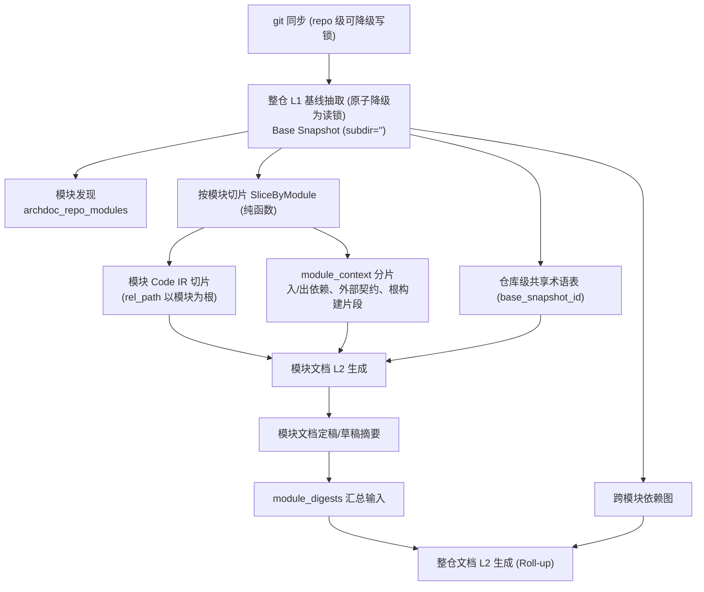

# ADR-04: Monorepo 一层模块范围发现、整仓抽取按模块切片与层级文档汇总

- **文档编号**：`04-module-scope-discovery-and-hierarchical-docs.md`
- **日期**：2026-11-20
- **状态**：已采纳 (Accepted) —— 已按代码基线完成检视修正，并同步修订阶段一矩阵、阶段二设计、阶段三契约与 M8~M10 作战卡
- **关联议题**：[`01-feature-matrix.md`](../01-features/01-feature-matrix.md) (`KA-04`, `F-01`, `F-04`, `F-05`, `F-12`, `F-13`, `F-27`, `F-28`~`F-31`, `Non-Goal 1`, `Non-Goal 7`)；[`ADR-02`](./02-cpp-parser-and-code-ir-storage.md)（Code IR 分片存储）；[`ADR-03`](./03-evidence-anchor-and-publish-mount.md)（证据锚点与发布布局）

---

## 1. 背景与问题陈述 (Context & Problem Statement)

### 1.1 业务现实

团队绝大多数代码仓是**多模块 Monorepo**：**仓库的一层子目录即一个功能模块**（如 `order/`、`pay/`、`common/`），设计文档也主要以「一层模块」为粒度编写和维护；整仓文档则承担「模块全景 + 模块间关系」的总览职责。同时系统也须无损兼容单模块普通仓库（无一层功能模块划分时平滑按整仓分析）。

### 1.2 现状实现（v0.3.1 / M7 交付基线）

`code-archdoc` 已将 `(repo_id, subdirectory, ref_name)` 作为一等分析范围贯穿全链路：

| 环节 | 现状 | 代码位置 |
| :--- | :--- | :--- |
| 范围来源 | 仅读取共享表 `architecture_elements` 的 `RepoID + Subdirectory`；每仓固定 1 行整仓 + 每个已登记元素 1 行子目录 | `services/repo_service.go` `buildCoverageRows` |
| 数据模型 | `archdoc_documents` / `archdoc_repo_snapshots` / `archdoc_gen_tasks` 的唯一键或索引均含 `subdirectory`（整仓为 `""`） | `models/document.go`、`models/snapshot.go`、`models/task.go` |
| L1 抽取 | 同仓共享 `repo_<id>` 克隆；`FileWalker.Walk` 的扫描根收敛为 `repoRoot/subdir`，`rel_path` 以子目录为根 | `pkg/sandbox/walker.go`、`services/snapshot_service.go` |
| L2 读源码 | 受限只读工具 `ScopeRoot` 同样收敛于子目录 | `pkg/llm/source_tools.go` |
| 权限 | 三层 RBAC，第 3 层为子目录负责人严格全等匹配 | `services/rbac.go` |
| 发布 | `<repo>/sub/<subdir>/<doctype>.md` | `pkg/publisher/fs_sink.go` |
| Code Drift | 按仓 `ls-remote` + 整仓 diff，仅匹配 `subdir + anchor.file_path` | `pkg/drift/code_drift.go` |

即：**「把子目录当作一个独立的小仓库」**。单模块单篇文档链路可用，但对「一层模块」这一主流场景存在以下结构性缺口。

### 1.3 问题清单

| 编号 | 问题 | 严重度 | 根因 |
| :--- | :--- | :---: | :--- |
| **P-1** | **模块不可见**：仓库若未在 `code-bench` 登记 `architecture_elements`，覆盖视图仅有整仓 1 行；API 允许对任意合法子目录生成文档，但未登记子目录的文档不会出现在覆盖视图中，形成孤儿文档 | 🔴 | 范围来源单一，无「一层目录即模块」约定与自动发现 |
| **P-2** | **无批量生成**：1 个任务只对应 1 个 `(repo, subdir)`，为 20 个模块生成需手工触发 20 次 | 🔴 | 任务模型无父子/批次概念 |
| **P-3** | **模块上下文孤岛**：扫描根硬收敛于子目录，导致：① 对兄弟模块的 `#include` / `import` 无法解析为模块级依赖（`InternalModuleEdge` 仅为子目录内部目录间边）；② 根 `CMakeLists.txt`（`add_subdirectory`）、公共 `proto/`、`include/` 等仓库级共享资产不可见；③ 兄弟模块公共接口变更不触发本模块漂移 | 🔴 | 抽取与证据锚点的「根」只有子目录一级 |
| **P-4** | **整仓文档与模块文档割裂**：整仓快照对大 Monorepo 全量抽取并全量喂给 L2，易触发 `F-27` 预算熔断；整仓文档不复用模块文档，与模块结论可能矛盾；术语表按子目录快照各生成一份，术语不一致且重复消耗 Token；发布 README 仅为平铺列表，缺少模块导航 | 🟠 | 无层级（Repo → Module）文档模型 |
| **P-5** | **并发竞态**：`gitsync.Sync` 仅在同步期间持有路径锁；`singleflight` 键含 `subdir`，不同模块任务各自同步。模块 A 同步完成后进入 L1 抽取期间，模块 B 的同步可能将工作区切换到新提交（含 `CleanUntracked`），导致 A 读到的文件内容与其记录的 `commit_sha` 不一致 | 🟠 | 工作区「同步 → 读取」区间无原子读写互斥与锁降级 |
| **P-6** | **模块迁移无路径**：模块目录重命名后，旧文档成为孤儿，无范围迁移机制 | 🟡 | 范围以路径字符串为唯一身份 |

---

## 2. 决策概览 (Decision Summary)



| 决策 | 要点 | 解决问题 |
| :--- | :--- | :--- |
| **D-1 模块发现与迁移** | 按仓配置 `arch_elements` / `top_level_dirs` / `merged`，派生模块索引表；支持忽略/恢复与原子迁移；覆盖视图以「模块索引 ∪ 登记元素 ∪ 已有文档范围」渲染 | P-1、P-6 |
| **D-2 整仓一次抽取 + 按模块切片** | 同仓同提交仅 1 次同步、1 次整仓 L1 抽取；Schema `1.1` 补齐文件级 import 与根构建元数据，模块快照由纯函数确定性切片；引入仓库级**可降级读写锁**消除竞态窗口 | P-3（基础）、P-4（成本）、P-5 |
| **D-3 模块外部上下文** | 新增第 10 个派生分片 `module_context`；证据锚点新增 `scope` 字段支持仓库级白名单锚点；源码预览与工具调用严格受白名单保护；Code Drift 纳入外部契约变更 | P-3 |
| **D-4 层级文档汇总** | 仓库级共享术语表；声明式范围感知 `context_inputs` / `repo_ir_facets` / `module_digest_source`；双源合并漂移不互相覆盖；发布自动生成模块导航与动态深度 `parent_doc` | P-4 |
| **D-5 批量生成** | 批次父任务（`task_kind="batch"`）+ 模块子任务，共享基线快照，批次级预算前置熔断（`scheduler.max_tokens_per_batch`），批次协调器不占用户并发槽位防死锁，级联取消 | P-2 |

---

## 3. 决策 D-1：模块发现策略、派生模块索引与模块迁移

### 3.1 候选方案

| 方案 | 描述 | 结论 |
| :--- | :--- | :--- |
| A. 仅依赖 `architecture_elements`（现状） | 要求所有模块先在 `code-bench` 登记 | ❌ 登记缺失普遍，P-1 无解 |
| B. 每次请求实时扫描一层目录 | 无持久化，覆盖视图实时 `ReadDir` | ❌ 依赖沙箱目录存在（LRU 回收后不可用），且无法承载状态与迁移 |
| **C. 按仓策略 + 派生模块索引表** | 从整仓快照 `tree` 分片派生一层模块，与 `architecture_elements` 合并，持久化为 `archdoc_` 派生索引 | ✅ **采纳** |

### 3.2 数据模型（新增 2 张 `archdoc_` 表，总表数 16 → 18）

```go
// RepoModulePolicy 仓库级模块发现策略（缺省行即默认策略，管理员/仓库级写者可配置）
type RepoModulePolicy struct {
    ID                uint           `gorm:"primaryKey" json:"id"`
    RepoID            uint           `gorm:"not null;uniqueIndex" json:"repo_id"`
    Strategy          string         `gorm:"size:20;not null;default:'merged'" json:"strategy"` // arch_elements | top_level_dirs | merged
    ExcludeGlobs      datatypes.JSON `gorm:"type:jsonb;not null;default:'[]'" json:"exclude_globs"` // 叠加默认排除名单
    MinEffectiveFiles int            `gorm:"not null;default:3" json:"min_effective_files"`         // 降噪后有效文件数下限
    UpdatedBy         *uint          `json:"updated_by"`
    CreatedAt         time.Time      `json:"created_at"`
    UpdatedAt         time.Time      `json:"updated_at"`
}
func (RepoModulePolicy) TableName() string { return config.TablePrefix + "repo_module_policies" }

// RepoModule 派生模块索引（非主数据：负责人与中文名仍以 architecture_elements 为唯一事实源，严禁含 owner 字段）
type RepoModule struct {
    ID             uint      `gorm:"primaryKey" json:"id"`
    RepoID         uint      `gorm:"not null;uniqueIndex:idx_archdoc_repo_module,priority:1;index" json:"repo_id"`
    Subdirectory   string    `gorm:"size:512;not null;uniqueIndex:idx_archdoc_repo_module,priority:2" json:"subdirectory"` // 规范化路径
    Source         string    `gorm:"size:20;not null" json:"source"`                        // arch_element | discovered
    ArchElementID  *uint     `gorm:"index" json:"arch_element_id"`
    Status         string    `gorm:"size:16;not null;default:'active';index" json:"status"` // active | missing | ignored
    EffectiveFiles int       `gorm:"not null;default:0" json:"effective_files"`
    TotalLOC       int       `gorm:"not null;default:0" json:"total_loc"`
    LastSeenCommit string    `gorm:"size:40;default:''" json:"last_seen_commit"`
    LastSeenAt     time.Time `json:"last_seen_at"`
    CreatedAt      time.Time `json:"created_at"`
    UpdatedAt      time.Time `json:"updated_at"`
}
func (RepoModule) TableName() string { return config.TablePrefix + "repo_modules" }
```

**默认排除名单**（`ExcludeGlobs` 在其上叠加，大小写不敏感，且与 `sandbox.MatchLayer1Builtin` 保持一致）：
`docs`、`doc`、`scripts`、`tools`、`third_party`、`thirdparty`、`3rdparty`、`vendor`、`external`、`node_modules`、`pods`、`target`、`__pycache__`、`build`、`out`、`dist`、`test`、`tests`、`examples`、`samples`、`benchmark`、`benchmarks`、`.*`、`_*`。

### 3.3 发现规则与完整生命周期接口

1. **零额外成本**：每次构建整仓基线快照（`subdirectory = ""`）后，从 `tree` 分片的 `Files`/`Directories` 聚合出一层目录（首段路径名）的有效文件数与 LOC（已经过 Layer 1 + `.archdocignore` 降噪），无需额外 Git/文件系统操作。M8 阶段 `POST /api/repos/:repo_id/modules/refresh` 直接复用整仓 `EnsureSnapshot(repo, "", branch)` 获取 `tree` 分片并刷新模块索引，不依赖 M9 切片改造即可独立交付。
2. **合并语义**：
   - `arch_elements`：仅登记元素（现状行为，向后兼容）；
   - `top_level_dirs`：仅一层目录（满足 `EffectiveFiles >= MinEffectiveFiles` 且不在排除名单）；
   - `merged`（**默认策略**）：二者并集；同一规范化路径以 `arch_element` 来源为准并关联 `ArchElementID`；登记元素可为多级路径（如 `svc/order`），原样保留，不受默认排除名单与 `MinEffectiveFiles` 限制。
3. **状态流转**：
   - 目录在新基线中消失 → `missing`（文档保留、覆盖视图标灰；`ignored` 保持不变）；
   - 用户手工忽略（`PATCH /api/repos/:repo_id/modules/:module_id/status` 置 `ignored`）→ 覆盖视图不再展示，可在模块管理抽屉恢复为 `active`；
   - 原 `missing` 目录重新出现 → 自动恢复为 `active`。
4. **覆盖视图渲染（向后兼容 `RepoScopeCoverageVO`）**：
   - 保持 `scope_type` 为 `"repo" | "subdir"` 不变，新增 `scope_status`（`"active" | "missing" | "orphan"`）、`module_source`（`"repo" | "arch_element" | "discovered" | "orphan"`）、`effective_files`、`total_loc`；
   - 渲染集合为：`整仓行 ∪ RepoModule(active|missing) ∪ (未刷新仓的 architecture_elements) ∪ DISTINCT(archdoc_documents.subdirectory)`；
   - 若某文档的 `subdirectory` 未命中 `active`/`missing` 模块索引且不属于已登记元素（含已被 `ignored` 的历史范围），以 `scope_status = "orphan"`、`module_source = "orphan"` 展示，**彻底消除不可见孤儿文档**；若某仓库尚未执行过模块刷新，仍自动展示全部 `architecture_elements`，保证存量行为 100% 向后兼容。
5. **模块治理 API 闭环**：
   - `GET /api/repos/:repo_id/modules`（`JWT`）：查询仓库发现策略与模块索引列表（含 `ignored` 以便恢复）；
   - `GET /api/repos/:repo_id/module-policy`（`JWT`）与 `PUT /api/repos/:repo_id/module-policy`（仓库级写者）：读取/更新策略并接入 `commonAudit`；
   - `POST /api/repos/:repo_id/modules/refresh`（仓库级写者）：执行同步 + 零 LLM 整仓 L1 抽取并刷新模块索引（`F-25` 巡检仍只做 `ls-remote`，不触发抽取）；
   - `PATCH /api/repos/:repo_id/modules/:module_id/status`（仓库级写者）：切换模块 `active` ↔ `ignored`；
   - `POST /api/repos/:repo_id/modules/migrate`（仓库级写者）：模块范围原子迁移。

### 3.4 权限边界（不变）

- 模块负责人**仍仅**来源于 `architecture_elements.OwnerID` 严格全等匹配（遵循 `Non-Goal 1`，不在 `archdoc_repo_modules` 中复制负责人字段）。
- `discovered` 来源且未登记的模块，仅**仓库级写者**（`IsRepoLevelWriter`：`Repository.OwnerID` / `RelatedMembers` / `archdoc_admin` / `super_admin`）可写。
- 模块策略配置、手动刷新、忽略/恢复与范围迁移均要求**仓库级写者**权限，所有写操作接入 `commonAudit` 字段级审计。

### 3.5 模块迁移（P-6，修正边界校验与重渲染契约）

`POST /api/repos/:repo_id/modules/migrate`（`{from_subdir, to_subdir}`，仓库级写者）：

1. **前置校验**：`from_subdir` 与 `to_subdir` 须经 `sandbox.NormalizeSubdir` 规范化、均非空且 `from_subdir != to_subdir`（禁止将整仓 `""` 迁入子目录或反之），非法返回 `400 INVALID_SUBDIR` / `400 INVALID_PARAM`；若 `from_subdir` 下不存在任何文档返回 `404 NOT_FOUND`。
2. **并发与冲突防线**：
   - 若 `from_subdir` 或 `to_subdir` 存在非终态生成任务（`pending`/`extracting`/`generating`/`verifying`），返回 `409 CONFLICT`；
   - 若目标范围 `to_subdir` 已存在同 `(ref_name, doc_type_slug)` 文档，返回 `409 CONFLICT`（原子零改动）。
3. **原子改写与发布文件重渲染**：
   - 在数据库事务内将 `from_subdir` 下全部 `archdoc_documents` 的 `subdirectory` 改写为 `to_subdir`，同步更新文档 `title`（由 `buildDocumentTitle` 重新生成）；
   - 对其中 `status == "approved"` 的已发布文档，调用 `PublishService` 按新范围**重渲染 Frontmatter（`subdir`、`module`、`parent_doc`）与深链**，按 ADR-03 §3.1「先落新、后删旧、重建 README.md」规则原子迁移落盘文件并更新 `published_rel_path`，确保旧路径零残留；
   - 证据锚点 `file_path`（`scope = module`）以模块为根（ADR-03 §2.1），**目录整体改名时锚点天然保持有效**，无需改写，在新范围下仍可深链定位；
   - 同步更新 `archdoc_repo_modules`（若 `from_subdir` 存在记录则置 `missing` 或删除无元素孤儿记录，为 `to_subdir` 幂等确保存在 `active` 记录），并清理旧范围漂移脏状态，全程记录 `commonAudit` 字段级 Diff。

---

## 4. 决策 D-2：整仓一次同步与抽取 + 按模块确定性切片

### 4.1 候选方案

| 方案 | 描述 | 结论 |
| :--- | :--- | :--- |
| A. 维持按子目录独立抽取（现状） | 每模块各自扫描子目录 | ❌ 无法提供跨模块事实（P-3），N 个模块 N 次同步并存在竞态（P-5） |
| B. 子目录抽取 + 额外轻量全仓依赖扫描 | 模块内照旧，另扫描全仓 `include/import` | ⚠️ 两套扫描逻辑重复，违背代码精简原则；仅作为 D-2 超限降级路径 |
| **C. 整仓基线抽取 + 按模块切片** | 同提交 1 次整仓 L1 抽取，模块快照由纯函数切片得到 | ✅ **采纳** |

### 4.2 基线快照、Schema 1.1 事实增强与确定性切片

- **基线快照**：`archdoc_repo_snapshots(subdirectory = "")`，`rel_path` 以仓库根为基准，包含完整 9 大分片（L1 零 LLM，仅 CPU/IO 成本）。
- **Schema `1.1` 纯静态增量字段**（支撑零 IO 切片与 `module_context` 推导，全部由既有 L1 提取器在整仓扫描时顺带采集）：
  - `DepsFacet.FileImports []FileImportFact`：记录文件级跨文件引用 `{SourceFile, Target, Kind: "include"|"java_import"|"python_import"|"proto_import", Line}`（由既有 `CommonExtractor`、`JavaExtractor`、`PythonExtractor`、`ProtoExtractor` 直接产出）；
  - `BuildFacet.Subdirectories []BuildSubdirFact`：记录根构建文件关联子模块指令（CMake `add_subdirectory`、Maven `<modules>`、Bazel 依赖路径），含 `Span` 与经 `SecretRedactor` 脱敏的 `Snippet`（≤ 400 字符）；
  - `BuildFacet.IncludeDirs []BuildIncludeDirFact`：记录 CMake `target_include_directories` / `include_directories` 与 `compile_commands.json` `-I` 头搜索目录。
- **切片快照**：`archdoc_repo_snapshots(subdirectory = "<module>")` **保留现有行结构与唯一键**，新增可空列 `base_snapshot_id`（索引）指向基线快照。分片由纯函数生成：

```go
// pkg/codeir/slice.go —— 纯函数，零 IO，零数据库依赖（遵守 pkg/ 防腐红线）
// SliceByModule 按规范化模块路径前缀切出模块视图：
//  1. 仅保留 span.file_path（及 SourceFile / FilePath）以 subdir/ 为前缀的事实，并将路径重写为以模块为根（兼容 ADR-03 锚点契约）；
//  2. 处理边界等价性：Python 符号 FQSymbol 剥离 "<subdir>." 前缀；.h/.cpp 跨模块归并产生的外部 DeclSpan 在切片内清空（归入 module_context）；
//  3. tree 分片重新汇总 TotalFiles/TotalLOC/LanguageStats/Directories；deps.InternalModules 重算为模块内部目录边；
//  4. 同时确定性生成第 10 个派生分片 module_context（见 D-3）。
func SliceByModule(base *CodeIRBundle, subdir string, modules []string) (*CodeIRBundle, *ModuleContextFacet, error)
```

- **下游零改动**：生成编排、单槽位重试、Verifier、Code Drift 仍按 `snapshot_id` 加载切片快照；`module_context` 作为可选第 10 分片持久化于 `archdoc_code_ir_facets(facet_name = "module_context")`（仅切片快照写入），不影响基线快照的 9 分片校验逻辑。
- **预算熔断口径**：`F-27` 预算预检以**切片**的有效文件数与估算 Token 计算，基线抽取不计入 LLM 预算。

### 4.3 超大仓库降级

新增配置节 `extract:`（`config/config.go`）：
- `extract.max_repo_files`（默认 `50000`）
- `extract.max_repo_duration_seconds`（默认 `600`，即 10 分钟）

当整仓 `FileWalker` 预检有效文件数超过 `max_repo_files` 或基线抽取耗时超过 `max_repo_duration_seconds` 时：
- 退化为**按子目录独立抽取**（`base_snapshot_id = nil`），并基于全仓文件清单复用既有 `CommonExtractor`/`JavaExtractor`/`PythonExtractor`/`ProtoExtractor`/`BuildExtractor` 仅提取文件级依赖边与根构建片段（严禁复制第二套扫描器），构建降级版 `module_context`；
- 快照 `StatsJSON` 新增可选字段 `degraded_reason`（如 `"max_repo_files_exceeded"` / `"max_repo_duration_exceeded"`），前端工作台展示「跨模块上下文为降级精度」提示。

### 4.4 工作区可降级读写锁并发互斥（彻底修复 P-5，零窗口零死锁）

1. `SnapshotService` 内唯一维护进程级 `repoWorktreeLocks map[uint]*DowngradableRWMutex`（基于 `sync.Mutex + sync.Cond` 实现，支持写锁原子降级为读锁，避免 `Unlock -> RLock` 间隙竞态，且严格禁止 `RLock -> Lock` 升级防止死锁）：
   - **同步 + 基线抽取路径**：获取**写锁**执行 `gitSyncer.Sync` → 读取 `commit_sha` → 命中已有就绪基线快照则直接释放写锁返回；未命中时**原子降级为读锁 (`DowngradeToRLock`)** 再执行 L1 基线抽取，释放读锁前阻止任何并发 `Sync` 改写工作区，同时允许其他只读操作并发读取，确保 `commit_sha` 与抽取内容严格一致；
   - **只读路径**：源码预览（`SourcePreviewService`）、L2 只读源码工具（`source_tools`）、`DriftOrchestrator` 元数据读取统一通过 `SnapshotService.WithRepoReadLock(repoID, fn)` 持读锁执行；
   - **按需重拉路径**：`SourcePreviewService` 在沙箱缺失需自动重拉时，统一经 `SnapshotService.EnsureSandboxSynced(ctx, repo, branch)` 持写锁执行，严禁绕过锁直接调用 `gitSyncer.Sync`。
2. `singleflight` 键分层调整：
   - 基线同步与抽取：`base:<repo_id>|<branch>`；
   - 模块切片：`slice:<base_snapshot_id>|<subdir>`；
   - 仓库级共享术语表：`glossary:<base_snapshot_id>`；
   同仓多模块并发 / 批量生成严格只触发 1 次 Git 同步、1 次整仓抽取、1 次术语表 LLM 调用。

### 4.5 Schema 版本

新增 `module_context` 分片与 Schema `1.1` 事实增强字段，`codeir.SchemaVersion` 由 `1.0` 升至 **`1.1`**。旧版本快照因唯一键含 `ir_schema_version` 自动失效，首次访问时零 LLM 成本重新抽取；已有文档修订与证据锚点不受影响。

---

## 5. 决策 D-3：模块外部上下文 (`module_context`) 与仓库级证据锚点

### 5.1 `module_context` 分片契约（第 10 个派生分片，仅对切片快照生成）

```go
type ModuleContextFacet struct {
    SchemaVersion     string                `json:"schema_version"`
    Module            string                `json:"module"`             // 规范化模块路径
    OutboundDeps      []ModuleDepEdge       `json:"outbound_deps"`      // 本模块 -> 兄弟模块 / 共享目录
    InboundDeps       []ModuleDepEdge       `json:"inbound_deps"`       // 兄弟模块 -> 本模块
    ExportedSurface   []ExternalSymbolRef   `json:"exported_surface"`   // 本模块被兄弟模块引用的符号 / RPC
    ConsumedContracts []ExternalSymbolRef   `json:"consumed_contracts"` // 本模块引用的模块外符号 / 公共 proto / RPC
    RepoBuildContext  []BuildContextSnippet `json:"repo_build_context"` // 根构建文件中引用本模块的片段
    Truncated         bool                  `json:"truncated"`
}

type ModuleDepEdge struct {
    Module      string     `json:"module"`       // 对端模块；模块外公共目录记为 "<shared>/proto" 等
    Kind        string     `json:"kind"`         // include | import | proto_import | build_link
    Weight      int        `json:"weight"`
    SampleFiles []string   `json:"sample_files"` // 仓库根相对路径，≤ 3 个
    Confidence  Confidence `json:"confidence"`
}

type ExternalSymbolRef struct {
    FQSymbol           string     `json:"fq_symbol"`
    Kind               string     `json:"kind"`
    Signature          string     `json:"signature,omitempty"`
    Module             string     `json:"module"`
    Span               SourceSpan `json:"span"` // file_path 为仓库根相对路径
    ContentFingerprint string     `json:"content_fingerprint,omitempty"`
}

type BuildContextSnippet struct {
    FilePath  string `json:"file_path"` // 如 CMakeLists.txt、BUILD.bazel、pom.xml（仓库根相对）
    LineStart int    `json:"line_start"`
    LineEnd   int    `json:"line_end"`
    Snippet   string `json:"snippet"` // 经 SecretRedactor 脱敏，≤ 400 字符
}
```

**依赖归属解析规则**（全部确定性、零 LLM、基于基线 `CodeIRBundle` 纯内存计算）：

| 语言 / 来源 | 解析方式 | 可信度 |
| :--- | :--- | :---: |
| C/C++ `#include "x/y.h"` | 依次按「当前文件目录 → `Build.IncludeDirs`（`compile_commands.json` `-I` / CMake `include_directories` / `target_include_directories`）→ 仓库根」在基线 `Tree.Files` 中查找真实文件，按其所属模块归属（若属于非模块共享目录如 `proto/`、`include/`，记为 `<shared>/<top_dir>`） | 命中真实文件 `exact`，按首段前缀启发匹配 `heuristic` |
| Java `import a.b.C` | 基线 `Symbols` 分片建立「全限定类名 / 包名 → 模块」映射 | `exact` |
| Python `import a.b` / `from a import b` | 基线 `Tree.Files` 按包路径（`a/b.py` 或 `a/b/__init__.py`）映射 | 命中文件 `exact`，否则 `heuristic` |
| Proto `import "x.proto"` | 按基线 `IDLContracts.Protos` 文件路径归属 | `exact` |
| 构建系统 | CMake `add_subdirectory` / `target_link_libraries` 本地目标映射、Bazel `deps` 标签、Maven `<modules>` | `exact` |

**体积约束**：`OutboundDeps`/`InboundDeps` 按权重降序取 Top-20，`ExportedSurface`/`ConsumedContracts` 各取 Top-50，`RepoBuildContext` 取 Top-10，序列化后上限约 **4K Token**（约 14000 字符），超限截断并置 `Truncated = true`。

### 5.2 声明式 Prompt 注入与范围感知 `meta.json` 契约

- `DocType` 的 `meta.json` 新增 3 个可选声明式扩展字段（纳入 `pkg/doctype/schema.go` 强类型校验，零脚本，遵循 `Non-Goal 7`）：

```json
{
  "context_inputs": ["code_ir", "module_context", "module_digests"],
  "repo_ir_facets": ["tree", "build", "deps"],
  "module_digest_source": {
    "doc_type": "system-architecture",
    "slot_id": "overview_boundaries"
  }
}
```

- **范围感知注入语义**（解决同一 `DocType` 同时用于模块文档与整仓文档的冲突）：
  1. **模块范围（`subdir != ""`）**：若 `context_inputs` 含 `"module_context"` 且切片快照具备 `module_context` 分片，将其作为独立上下文块包裹在随机 `nonce` 数据栅栏内注入 L2 Prompt，并显式标注「**模块外部上下文：仅用于描述依赖与集成关系，不得作为本模块内部实现的事实依据；引用外部符号或文件时必须在 `cited_anchors` 中显式标注 `"scope": "repo"`**」；
  2. **整仓范围（`subdir == ""`）**：若 `context_inputs` 含 `"module_digests"` 且当前仓库存在 ≥ 1 个 `active` 模块，启用层级汇总模式——整仓 IR 仅加载 `repo_ir_facets`（缺省为 `["tree", "build", "deps"]`），并注入 `module_digests` 与跨模块依赖图；若该仓库为单模块非 Monorepo（0 个 `active` 模块），自动回退为标准整仓全量 `ir_facets`，对存量单仓（含 Golden Sample）100% 无损兼容。
- 内置 `DocType` 默认配置：
  - `system-architecture`：`context_inputs: ["code_ir", "module_context", "module_digests"]`，`repo_ir_facets: ["tree", "build", "deps"]`，`module_digest_source: { "doc_type": "system-architecture", "slot_id": "overview_boundaries" }`；
  - `data-and-contract`：`context_inputs: ["code_ir", "module_context", "module_digests"]`，`repo_ir_facets: ["tree", "deps", "idl_contracts", "http_routes"]`，`module_digest_source: { "doc_type": "data-and-contract", "slot_id": "service_interfaces" }`；
  - `agents-context`：`context_inputs: ["code_ir", "module_context", "module_digests"]`，`repo_ir_facets: ["tree", "build", "deps"]`，`module_digest_source: { "doc_type": "agents-context", "slot_id": "agent_module_summary" }`；
  - `code-walkthrough` 与 `ops-and-config`：默认仅 `["code_ir"]`。
- **受限只读工具扩展**：`SandboxSourceToolkit` 新增 `ExternalFileWhitelist map[string]bool`（由 `module_context` 中的 `SampleFiles`、`ExportedSurface`/`ConsumedContracts` 路径与 `RepoBuildContext` 路径确定性汇总）；当模块槽位调用 `read_file_lines` 访问模块外路径时，仅白名单内的仓库根相对路径允许经 `SafeJoin(repoRoot, …) + EvalSymlinks` 读取，其余模块外路径一律拒绝。

### 5.3 证据锚点扩展（向后兼容 ADR-03 与 `SC-12` 安全隔离）

在 `EvidenceAnchor` 与 `CitedAnchorCandidate` 中新增可选字段 `scope`：

| 取值 | `file_path` 基准 | 说明 |
| :--- | :--- | :--- |
| `""` / `"module"`（缺省） | 模块根（与 ADR-03 一致） | 存量锚点无需迁移 |
| `"repo"` | 仓库根 | 仅允许引用 `module_context` 中出现的外部符号 / 文件 |

- `anchor_key` 对 `scope = repo` 的锚点追加前缀：`repo::<symbol_kind>::<file_path>::<fq_symbol>`，与模块内锚点不冲突。
- **Verifier 硬规则**：当 L2 输出 `scope = "repo"` 的候选锚点时，必须在 `module_context` 白名单（外部符号或外部构建/样本文件）中精确命中，否则**不论 `strict_symbol_check` 取值如何，一律判为 `error` 且 `can_approve = false`**（防止 L2 借外部上下文虚构或越界引用模块外事实）。
- **深链与源码预览白名单隔离**：
  - 深链（ADR-03 §2.2）对 `scope = "repo"` 的锚点追加 `&scope=repo`；
  - `GET /api/documents/:id/source-preview` 新增可选查询参数 `scope=module|repo`（默认 `module`）；当 `scope = "repo"` 且 `doc.Subdirectory != ""` 时，`SourcePreviewService` **强制校验目标 `file` 必须命中当前文档可见修订的 `scope="repo"` 证据锚点或对应快照 `module_context` 白名单**，再经 `SafeJoin(repoDir, file)` 读取，未命中返回 `403 PATH_ESCAPE`，严防子目录只读/写用户借 `scope=repo` 越权读取同仓其他模块任意源码（坚守 `SC-12` 隔离红线）。

### 5.4 Code Drift 扩展

- `DetectCodeDrift` 对 `scope = "repo"` 锚点直接以 `file_path` 作为仓库相对路径匹配 `ChangedFiles`（不再拼接 `subdir`），复用既有单文件符号指纹比对流程。
- 新增漂移原因 `external_contract_modified` / `external_contract_removed`，**优先级严格低于**模块内原因（`file_removed_or_renamed > symbol_removed > symbol_modified > file_modified > external_contract_removed > external_contract_modified`），在漂移雷达中以「外部依赖变更」标签区分展示。

---

## 6. 决策 D-4：层级文档汇总 (Repo → Module Roll-up)

### 6.1 候选方案

| 方案 | 描述 | 结论 |
| :--- | :--- | :--- |
| A. 整仓文档全量读源码（现状） | 整仓快照全量喂给 L2 | ❌ 大仓易熔断，结论与模块文档可能矛盾 |
| B. 整仓文档仅汇总模块文档文本 | 不读 IR，只拼接模块文档 | ❌ 丢失跨模块依赖等确定性事实，且模块缺稿时无法生成 |
| **C. 模块摘要 + 跨模块依赖图 + 整仓精简 IR** | 以模块文档摘要和基线快照的跨模块依赖图为主输入，整仓 IR 按 `repo_ir_facets` 仅保留全景分片 | ✅ **采纳** |

### 6.2 仓库级共享术语表

- 术语表 `glossary.json.gz` 统一由**基线快照（`subdirectory = ""`）**基于整仓 Code IR 生成 1 次，存储于基线 `SnapshotLoc{RepoID, Subdir: "", CommitSHA}`；切片快照共享引用（`EnsureGlossary` 的 `singleflight` 键为 `base_snapshot_id`；`HasCachedGlossary` 与 `ReadCachedGlossary` 统一解析至基线快照）。
- 模块槽位 Prompt 注入「仓库术语表 + 本模块 `module_summaries` 条目」，保证同仓各模块术语一致，并消除 N 次重复的术语表 LLM 调用。

### 6.3 `module_digests` 声明式汇总输入与 `module_doc` 锚点

- **模块摘要构建规则**（确定性、零 LLM，按优先级三级回退）：
  对每个 `active` 模块，按 `module_digest_source`（默认 `{ "doc_type": "system-architecture", "slot_id": "overview_boundaries" }`）提取摘要（截断至 ≤ 600 字，记录 `content_sha256`）：
  1. **优先级 1（已发布定稿）**：取该模块对应 `DocType` 已发布修订（`status == "approved"`）中目标 `slot_id` 正文（若无该 `slot_id` 则回退取首个非孤立章节），标注 `source_status = "approved"`；
  2. **优先级 2（最新草稿）**：当尚未发布但存在当前修订（例如刚在同一批次中生成完毕），提取最新修订的目标槽位正文并标注 `source_status = "draft"`（「草稿未定稿」，仅注入给正在生成的整仓草稿，不向无权限普通用户泄露）；
  3. **优先级 3（术语表兜底）**：该模块尚无文档时，回退取仓库术语表 `module_summaries` 对应条目，标注 `source_status = "glossary_fallback"`（「待生成」）。
- 汇总输入同时附带基线快照的**跨模块依赖图**（由各 `active` 模块切片的 `OutboundDeps` 确定性聚合，纯函数 `BuildCrossModuleGraph`）。
- 整仓文档引用模块摘要时，使用新锚点类型 `symbol_kind = "module_doc"`（纳入 `models.IsValidSymbolKind`）、`file_path = <module_subdir>`、`fq_symbol = <module_subdir>`、`content_fingerprint = <被引用摘要 content_sha256>`；Verifier 将 `module_digests` 纳入合法索引对齐，不误报 `unverified`。

### 6.4 漂移联动（双源合并防互相覆盖）

- `archdoc_document_drifts` 继续保持 `(document_id, drift_type)` 两维结构（`code` / `spec`）。
- 对**整仓级已发布文档（`subdirectory == ""`）**，`DriftTypeCode` 由两类来源**合并计算、互不覆盖**：
  1. **Git Diff 漂移**：`EvaluateRepoCodeDrift` 针对非 `module_doc` 锚点计算的代码漂移；
  2. **层级模块漂移**：针对 `symbol_kind == "module_doc"` 锚点比对当前模块已发布摘要指纹变化（`reason = "module_digest_changed"`）以及模块列表增删/`missing` 变化（`reason = "module_scope_changed"`）。
- 触发时机：
  - 模块文档发布/撤回后，`DriftOrchestrator.OnDocumentPublished` / `OnDocumentUnpublished` 立即重算同仓整仓文档的层级模块漂移并与既有非 `module_doc` 漂移槽位合并落库；
  - 仓库模块列表刷新出现新增或 `missing` 模块时，`DriftOrchestrator.OnRepoModulesChanged` 触发整仓文档「模块全景」槽位漂移重算；
  - `F-25` 巡检执行 `EvaluateRepoCodeDrift` 时自动叠加最新的层级模块漂移结果，确保两者永不互相清零。
- 负责人可通过既有增量刷新（`SC-11`）仅重生成受影响章节。

### 6.5 发布与导航

- 整仓文档发布时，由 `pkg/publisher` 渲染器（确定性、非 LLM）在文末追加 `## 模块导航` 节：按模块列出同仓各已发布模块文档的相对链接（指向 ADR-03 §3.1 的 `./sub/<sanitized_subdir>/<doctype>.md`）与状态/短提交徽标。
- 发布文档 YAML Frontmatter 追加通用键（对 `code-bench` `D-02` 通用解析器完全透明，零改造）：

```yaml
# 整仓文档
scope_type: "repo"

# 模块文档（parent_doc 按 sanitized_subdir 层级动态计算：N 级目录为 (N+1) 个 "../"）
scope_type: "module"
module: "order"               # 或 "trade/order"
parent_doc: "../../system-architecture.md"  # 2 级模块时自动为 "../../../system-architecture.md"
```

- 仓库级 `README.md` 索引升级为两级结构：`## 整仓文档` + `## 模块文档`（按模块路径分组列出各文档链接）。

---

## 7. 决策 D-5：批量生成 (Batch Generation)

### 7.1 接口契约

```http
POST /api/tasks/generate-batch
{
  "repo_id": 12,
  "subdirectories": ["order", "pay"],   // 与 all_modules 二选一
  "all_modules": false,                  // true 时取该仓全部 active 模块（若尚未刷新自动先执行一次零 LLM 模块发现）
  "include_repo_scope": true,            // 是否在全部模块子任务进入终态后追加整仓文档生成
  "ref_name": "",                        // 可选，留空取仓库默认分支
  "doc_types": ["system-architecture", "data-and-contract"],
  "mode": "generate"                     // generate | regenerate
}
```

### 7.2 任务模型与状态机

- `archdoc_gen_tasks` 新增 1 个可空列 `parent_task_id`（索引）；`TaskKind` 新增枚举值 **`batch`**（`models.TaskKindBatch`）。
- **批次父任务状态机**：`pending -> extracting`（同步基线快照 + 批次预算预检）`-> generating`（派发并跟踪子任务进度）`-> ready | failed | canceled`（父任务不直接调用 LLM 与 Verifier，不创建 `archdoc_gen_slot_tasks`）。
- **防调度死锁设计**：批次父任务协调协程**不占用 `TaskScheduler` 的单用户并发槽位与全局 LLM 信号量**，仅作为轻量编排器向 `TaskScheduler` 提交子任务（`Priority = models.TaskPriorityBatch`），彻底杜绝 `MaxUserConcurrency = 1~2` 时父任务占坑导致子任务死锁的风险。
- **子任务编排**：
  - 每个目标模块创建 1 个子任务（`parent_task_id = batchTask.ID`，`priority = "batch"`，沿用既有 `generate`/`regenerate` 状态机与槽位子任务）；
  - `include_repo_scope = true` 时，整仓子任务**在全部模块子任务均进入终态后**才入队执行（若父任务已被取消则不再入队），以便消费最新的 `module_digests`；
  - 全部子任务通过 D-2 `singleflight` 共享同一基线快照与仓库术语表，同步、整仓抽取与术语表 LLM 调用各仅执行 1 次。
- `GET /api/tasks/:task_id` 对批次父任务额外返回 `parent_task_id`、`child_tasks` 与 `batch_summary`（`total / pending / running / ready / failed / canceled`）。

### 7.3 权限、预算与调度

1. **权限前置（全有或全无）**：对目标全部范围（所选模块 + `include_repo_scope` 时的整仓 `""`）逐一执行 `CheckScopeWritePermission`；任一无权 → 整批返回 `403 FORBIDDEN` 并在 `details.forbidden_scopes` 中返回无权范围列表，**无任何任务落库**。
2. **预算前置熔断（延续 `SC-09` 语义）**：在任何 LLM 请求发出前，基于基线快照与各目标范围切片汇总总预估 Token（术语表只计 1 次，跳过已锁定槽位），超过新增配置 `scheduler.max_tokens_per_batch`（默认 `1000000`，可在 `config.yaml` 配置）→ 整批失败（`error_code = "BATCH_TOKEN_BUDGET_EXCEEDED"`）并在 `budget_advice.module_breakdown` 返回按模块分解的预估明细，**0 次 LLM 请求**。
3. **调度与公平性**：子任务以既有优先级 `batch`（`models.TaskPriorityBatch`，低于 `interactive`）入队，共享 `TaskScheduler` 4:1 防饥饿调度与全局 LLM 并发信号量，避免批量任务饿死交互式操作。
4. **取消与重试**：
   - 取消批次父任务前，校验调用者对全部子范围均具备写权限（或为仓库级写者），取消后级联取消全部未终态子任务并阻止尚未入队的整仓子任务；
   - 单个模块子任务失败不影响其他兄弟子任务继续完成，用户可对失败子任务沿用单槽位独立重试；若全部子任务均失败，父任务置 `failed`，否则全部终态后置 `ready`。

### 7.4 前端交互

- `RepoCoveragePage` 展示每行的 `scope_status`（`active`/`missing`/`orphan`）与 `module_source` 徽标，支持同仓模块多选与「批量生成 / 为全部模块生成」入口，以及单仓「模块治理」抽屉（刷新发现、策略配置、忽略/恢复、范围迁移）。
- `GenerateTaskModal` 兼容批次任务模式，展示批次聚合进度条、子任务状态列表与按模块分解的预算熔断建议。

---

## 8. 决策后果与约束 (Consequences & Guardrails)

### 8.1 正向收益

1. 未登记模块可见、可生成，孤儿文档消除（P-1、P-6）。
2. 同仓 N 个模块：Git 同步 **N → 1**，L1 抽取 **N → 1**，术语表 LLM 调用 **N → 1**（P-2、P-4、P-5）。
3. 模块文档可准确描述「我依赖谁 / 谁依赖我 / 如何集成到仓库构建」，并对外部契约变更保鲜（P-3）。
4. 整仓文档与模块文档结论同源、可追溯，且不再因全量读源码触发预算熔断，同时对非 Monorepo 单仓零回归（P-4）。

### 8.2 代价与风险

| 风险 | 缓解措施 |
| :--- | :--- |
| 超大 Monorepo 整仓 L1 抽取耗时 / 内存上升 | §4.3 阈值降级为按子目录抽取 + 轻量依赖索引；基线快照受 `F-27` LRU 与活跃租约管理 |
| 仓库级写锁导致同步排队 | 仅 `Sync` 阶段持写锁并原子降级为读锁覆盖 L1 抽取；L2 生成阶段只读 FacetStore，不持工作区锁 |
| 外部上下文诱导 L2 虚构模块内事实或越权读源码 | `nonce` 栅栏 + 显式语义标注 + Verifier `scope=repo` 白名单硬拦截 + `source_tools`/`source-preview` 白名单校验 |
| `SchemaVersion` 升级导致缓存全量失效 | 零 LLM 成本的一次性重抽取；已有文档修订与证据锚点完全不受影响 |
| 表数量 16 → 18、新增列 2 个 | 全部为 `archdoc_` 前缀派生数据；**不对共享表执行任何 DDL**，不替代 `architecture_elements` 主数据地位（遵循 `ADR-01`、`Non-Goal 1`） |

### 8.3 架构红线（纳入 `make lint-arch`）

1. `pkg/codeir/slice.go`、`pkg/codeir/modules.go` 与 `module_context` 构建逻辑为纯函数，严禁导入 `models`、`services`、`handlers`、`gorm`、`gin`。
2. 模块负责人判定**只允许**读取 `architecture_elements`，`models/module.go`（`archdoc_repo_modules`）严禁出现 `OwnerID` / `owner_id` 字段。
3. 仓库级工作区可降级读写锁由 `SnapshotService` 唯一持有，`handlers/` 与 `pkg/` 严禁直接调用 `gitsync.Sync` 或直接操作沙箱工作区。
4. 依赖边解析复用既有提取器，严禁为降级路径复制第二套扫描器。

---

## 9. TDD 先行测试清单（实施时须先红后绿）

| 编号 | 场景 | 断言 |
| :--- | :--- | :--- |
| **T-ADR04-01** | `merged` 策略：仓库含 `order/`、`pay/`、`docs/`、`third_party/`，仅 `svc/order` 已登记 | 模块索引为 `order`、`pay`、`svc/order`；`docs`、`third_party` 被排除 |
| **T-ADR04-02** | 文档范围 `legacy/` 未命中模块索引 | 覆盖视图出现该行，`scope_status = "orphan"` |
| **T-ADR04-03** | 同仓 5 个模块并发生成 | `GitSyncer.Sync` 计数 = 1，整仓 L1 抽取计数 = 1，术语表 LLM 调用 = 1 |
| **T-ADR04-04** | 模块 A 抽取期间模块 B 触发同步且远端已前进 | A 快照 `commit_sha` 与其抽取内容一致（写锁降级为读锁阻塞并发写锁） |
| **T-ADR04-05** | `SliceByModule` 路径重写与边界等价 | 切片中全部 `span.file_path` 以模块为根，与旧版按子目录抽取的结果逐分片等价（Golden 对比，含 Python 前缀剥离） |
| **T-ADR04-06** | `order/a.cpp` `#include "pay/api.h"`（经 `-I` 解析命中真实文件） | `order` 的 `OutboundDeps` 含 `pay`（`exact`），`pay` 的 `InboundDeps` 含 `order` |
| **T-ADR04-07** | `scope=repo` 锚点引用的 `pay/api.h::PayClient::Charge` 指纹变化 | `order` 文档记录 `external_contract_modified`，仅引用该锚点的章节受影响；内部原因优先级高于外部原因 |
| **T-ADR04-08** | L2 输出 `scope=repo` 锚点不在 `module_context` 白名单 | Verifier 判 `error`，`can_approve = false`；源码预览 `scope=repo` 越界路径返回 `403` |
| **T-ADR04-09** | 模块 `order` 发布新修订，`overview_boundaries` 槽位内容变化 | 整仓文档记录 `module_digest_changed`，仅引用 `order` 摘要的章节受影响；后续 `EvaluateRepoCodeDrift` 不会清除该漂移 |
| **T-ADR04-10** | 批量生成预估 Token 超 `scheduler.max_tokens_per_batch` | 整批失败，返回按模块分解的 `budget_advice.module_breakdown`，LLM HTTP 请求数 = 0 |
| **T-ADR04-11** | 子目录负责人对含其他模块的批次发起请求 | `403 FORBIDDEN`，`details.forbidden_scopes` 返回无权范围列表，无任何任务落库 |
| **T-ADR04-12** | 模块迁移 `order` → `trade/order` | 文档范围与标题改写、已发布文件重渲染迁移且旧路径零残留，存量锚点在新范围下仍可深链定位；目标冲突返 `409` |

---

## 10. 落地计划与文档同步

### 10.1 里程碑规划（接续 M7）

| 里程碑 | 范围 | 前置 |
| :--- | :--- | :---: |
| **M8** | D-1 模块发现与迁移、D-5 批量生成、§4.4 可降级工作区读写锁（含 P-5 修复）及前端模块治理/批量入口 | M7 |
| **M9** | D-2 Schema 1.1 基线抽取与 `SliceByModule` 切片、§4.3 降级路径、D-3 `module_context` / `scope=repo` 锚点 / 白名单工具与源码预览 / Drift 扩展 | M8 |
| **M10** | D-4 仓库级共享术语表、`module_digests`、层级漂移双源合并联动、模块导航与动态 `parent_doc`、前端完整联动验收 | M9 |

> M8 不依赖 Code IR 结构变更，可先行独立交付，直接解决「模块不可见、只能逐个触发」的最高频痛点。

### 10.2 同步修订文档清单

| 文档 | 修订内容 |
| :--- | :--- |
| `01-features/01-feature-matrix.md` | `KA-04` 明确「一层模块」为默认粒度；新增 `F-28` 模块发现与迁移、`F-29` 批量生成、`F-30` 模块外部上下文、`F-31` 层级文档汇总；新增对应 `SC-14`~`SC-18` |
| `02-design/02-extraction-and-generation-engine.md` | 基线/切片快照、Schema `1.1`、`module_context` 分片、可降级工作区读写锁、范围感知 Prompt 注入与外部白名单 |
| `02-design/03-doctype-drift-and-publishing.md` | `context_inputs` / `repo_ir_facets` / `module_digest_source` 声明式字段、外部契约与模块摘要双源合并漂移、模块导航与动态 `parent_doc` |
| `02-design/05-database-schema.md` | 新增 2 张表（`archdoc_repo_module_policies`、`archdoc_repo_modules`）、`base_snapshot_id` 与 `parent_task_id` 两列，ER 图更新（16 → 18 张表） |
| `03-api/01-http-api-contract.md` | 新增 6 个接口（模块列表/刷新/状态/迁移/策略配置、`generate-batch`）与错误码（54 → 60 Endpoints） |
| `03-api/02-data-model-and-dto-contract.md` | `EvidenceAnchor.scope`、`ModuleContextFacet`、`BudgetModuleItem`、覆盖视图 `scope_status`/`module_source`、`extract`/`scheduler.max_tokens_per_batch` 配置与 TS 类型 |
| `04-tasks/` | 更新 `01-roadmap.md` 并新增 `09-m8`、`10-m9`、`11-m10` 三张 TDD 作战卡（含本 ADR §9 全部 12 项测试断言） |
