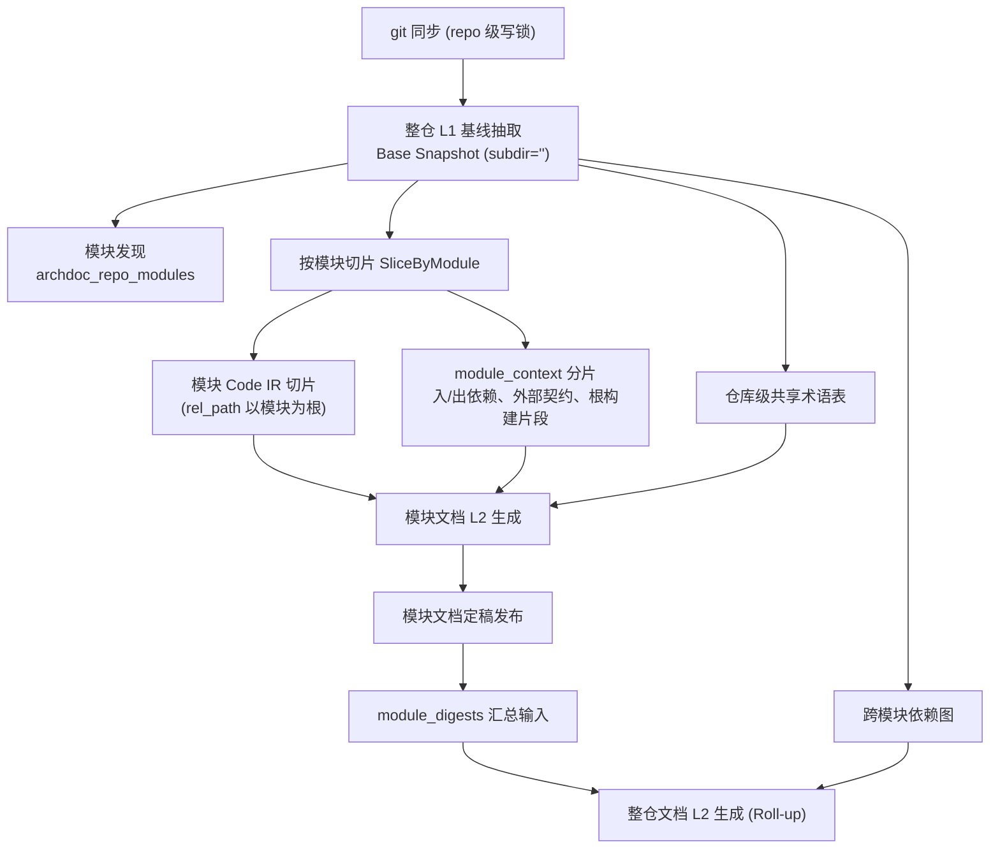

# ADR-04: Monorepo 一层模块范围发现、整仓抽取按模块切片与层级文档汇总

- **文档编号**：`04-module-scope-discovery-and-hierarchical-docs.md`
- **日期**：2026-11-20
- **状态**：提议 (Proposed) —— 待评审通过后同步修订阶段一矩阵、阶段二设计与阶段三契约
- **关联议题**：[`01-feature-matrix.md`](../01-features/01-feature-matrix.md) (`KA-04`, `F-01`, `F-04`, `F-05`, `F-12`, `F-13`, `F-27`, `Non-Goal 1`, `Non-Goal 7`)；[`ADR-02`](./02-cpp-parser-and-code-ir-storage.md)（Code IR 分片存储）；[`ADR-03`](./03-evidence-anchor-and-publish-mount.md)（证据锚点与发布布局）

---

## 1. 背景与问题陈述 (Context & Problem Statement)

### 1.1 业务现实

团队绝大多数代码仓是**多模块 Monorepo**：**仓库的一层子目录即一个功能模块**（如 `order/`、`pay/`、`common/`），设计文档也主要以「一层模块」为粒度编写和维护；整仓文档则承担「模块全景 + 模块间关系」的总览职责。

### 1.2 现状实现（v0.3.1 / M7 交付基线）

`code-archdoc` 已将 `(repo_id, subdirectory, ref_name)` 作为一等分析范围贯穿全链路：

| 环节 | 现状 | 代码位置 |
| :--- | :--- | :--- |
| 范围来源 | 仅读取共享表 `architecture_elements` 的 `RepoID + Subdirectory`；每仓固定 1 行整仓 + 每个已登记元素 1 行子目录 | `services/repo_service.go` `buildCoverageRows` |
| 数据模型 | `archdoc_documents` / `archdoc_repo_snapshots` / `archdoc_gen_tasks` 的唯一键或索引均含 `subdirectory`（整仓为 `""`） | `models/document.go`、`models/snapshot.go`、`models/task.go` |
| L1 抽取 | 同仓共享 `repo_<id>` 克隆；`FileWalker.Walk` 的扫描根收敛为 `repoRoot/subdir`，`rel_path` 以子目录为根 | `pkg/sandbox/walker.go`、`services/snapshot_service.go` |
| L2 读源码 | 受限只读工具 `ScopeRoot` 同样收敛于子目录 | `pkg/llm/source_tools.go` |
| 权限 | 三层 RBAC，第 3 层为子目录负责人严格全等匹配 | `services/rbac.go` |
| 发布 | `<repo>/sub/<subdir>/<doctype>.md` | `pkg/publisher/fs_sink.go` |
| Code Drift | 按仓 `ls-remote` + 整仓 diff，仅匹配 `subdir + anchor.file_path` | `pkg/drift/code_drift.go` |

即：**「把子目录当作一个独立的小仓库」**。单模块单篇文档链路可用，但对「一层模块」这一主流场景存在以下结构性缺口。

### 1.3 问题清单

| 编号 | 问题 | 严重度 | 根因 |
| :--- | :--- | :---: | :--- |
| **P-1** | **模块不可见**：仓库若未在 `code-bench` 登记 `architecture_elements`，覆盖视图仅有整仓 1 行；API 允许对任意合法子目录生成文档，但未登记子目录的文档不会出现在覆盖视图中，形成孤儿文档 | 🔴 | 范围来源单一，无「一层目录即模块」约定与自动发现 |
| **P-2** | **无批量生成**：1 个任务只对应 1 个 `(repo, subdir)`，为 20 个模块生成需手工触发 20 次 | 🔴 | 任务模型无父子/批次概念 |
| **P-3** | **模块上下文孤岛**：扫描根硬收敛于子目录，导致：① 对兄弟模块的 `#include` / `import` 无法解析为模块级依赖（`InternalModuleEdge` 仅为子目录内部目录间边）；② 根 `CMakeLists.txt`（`add_subdirectory`）、公共 `proto/`、`include/` 等仓库级共享资产不可见；③ 兄弟模块公共接口变更不触发本模块漂移 | 🔴 | 抽取与证据锚点的「根」只有子目录一级 |
| **P-4** | **整仓文档与模块文档割裂**：整仓快照对大 Monorepo 全量抽取并全量喂给 L2，易触发 `F-27` 预算熔断；整仓文档不复用模块文档，与模块结论可能矛盾；术语表按子目录快照各生成一份，术语不一致且重复消耗 Token；发布 README 仅为平铺列表，缺少模块导航 | 🟠 | 无层级（Repo → Module）文档模型 |
| **P-5** | **并发竞态**：`gitsync.Sync` 仅在同步期间持有路径锁；`singleflight` 键含 `subdir`，不同模块任务各自同步。模块 A 同步完成后进入 L1 抽取期间，模块 B 的同步可能将工作区切换到新提交（含 `CleanUntracked`），导致 A 读到的文件内容与其记录的 `commit_sha` 不一致 | 🟠 | 工作区「同步 → 读取」区间无读写互斥 |
| **P-6** | **模块迁移无路径**：模块目录重命名后，旧文档成为孤儿，无范围迁移机制 | 🟡 | 范围以路径字符串为唯一身份 |

---

## 2. 决策概览 (Decision Summary)



| 决策 | 要点 | 解决问题 |
| :--- | :--- | :--- |
| **D-1 模块发现策略** | 按仓配置 `arch_elements` / `top_level_dirs` / `merged`，派生模块索引表；覆盖视图以「模块索引 ∪ 已有文档范围」渲染 | P-1、P-6 |
| **D-2 整仓一次抽取 + 按模块切片** | 同仓同提交仅 1 次同步、1 次整仓 L1 抽取；模块快照为基线快照的确定性切片；引入仓库级工作区读写锁 | P-3（基础）、P-4（成本）、P-5 |
| **D-3 模块外部上下文** | 新增第 10 个派生分片 `module_context`；证据锚点新增 `scope` 字段支持仓库级锚点；Code Drift 纳入外部契约变更 | P-3 |
| **D-4 层级文档汇总** | 仓库级共享术语表；整仓 `DocType` 声明式消费 `module_digests`；模块文档发布联动整仓文档漂移；发布自动生成模块导航 | P-4 |
| **D-5 批量生成** | 批次父任务 + 模块子任务，共享基线快照，批次级预算前置熔断，级联取消 | P-2 |

---

## 3. 决策 D-1：模块发现策略与派生模块索引

### 3.1 候选方案

| 方案 | 描述 | 结论 |
| :--- | :--- | :--- |
| A. 仅依赖 `architecture_elements`（现状） | 要求所有模块先在 `code-bench` 登记 | ❌ 登记缺失普遍，P-1 无解 |
| B. 每次请求实时扫描一层目录 | 无持久化，覆盖视图实时 `ReadDir` | ❌ 依赖沙箱目录存在（LRU 回收后不可用），且无法承载状态与迁移 |
| **C. 按仓策略 + 派生模块索引表** | 从整仓基线 Code IR 的 `tree` 分片派生一层模块，与 `architecture_elements` 合并，持久化为 `archdoc_` 派生索引 | ✅ **采纳** |

### 3.2 数据模型（新增 2 张 `archdoc_` 表）

```go
// RepoModulePolicy 仓库级模块发现策略（缺省行即默认策略，管理员/仓库负责人可配置）
type RepoModulePolicy struct {
    ID              uint           `gorm:"primaryKey"`
    RepoID          uint           `gorm:"not null;uniqueIndex"`
    Strategy        string         `gorm:"size:20;not null;default:'merged'"` // arch_elements | top_level_dirs | merged
    ExcludeGlobs    datatypes.JSON `gorm:"type:jsonb;not null;default:'[]'"` // 叠加默认排除名单
    MinEffectiveFiles int          `gorm:"not null;default:3"`               // 降噪后有效文件数下限
    UpdatedBy       uint
    CreatedAt, UpdatedAt time.Time
}
func (RepoModulePolicy) TableName() string { return config.TablePrefix + "repo_module_policies" }

// RepoModule 派生模块索引（非主数据：负责人与中文名仍以 architecture_elements 为唯一事实源）
type RepoModule struct {
    ID              uint      `gorm:"primaryKey"`
    RepoID          uint      `gorm:"not null;uniqueIndex:idx_archdoc_repo_module,priority:1"`
    Subdirectory    string    `gorm:"size:512;not null;uniqueIndex:idx_archdoc_repo_module,priority:2"` // 规范化路径
    Source          string    `gorm:"size:20;not null"`   // arch_element | discovered
    ArchElementID   *uint     `gorm:"index"`
    Status          string    `gorm:"size:16;not null;default:'active'"` // active | missing | ignored
    EffectiveFiles  int       `gorm:"not null;default:0"`
    TotalLOC        int       `gorm:"not null;default:0"`
    LastSeenCommit  string    `gorm:"size:40;default:''"`
    LastSeenAt      time.Time
    CreatedAt, UpdatedAt time.Time
}
func (RepoModule) TableName() string { return config.TablePrefix + "repo_modules" }
```

**默认排除名单**（`ExcludeGlobs` 在其上叠加，大小写不敏感）：`docs`、`doc`、`scripts`、`tools`、`third_party`、`thirdparty`、`vendor`、`external`、`build`、`out`、`dist`、`test`、`tests`、`examples`、`samples`、`benchmark(s)`、`.*`、`_*`。

### 3.3 发现规则

1. **零额外成本**：每次构建整仓基线快照（D-2）后，从 `tree` 分片的 `Directories` 聚合出一层目录的有效文件数与 LOC（已经过 Layer 1 + `.archdocignore` 降噪），无需额外 Git/文件系统操作。
2. **合并语义**：
   - `arch_elements`：仅登记元素（现状行为，向后兼容）；
   - `top_level_dirs`：仅一层目录（满足 `MinEffectiveFiles` 且不在排除名单）；
   - `merged`（**新仓默认**）：二者并集；同一规范化路径以 `arch_element` 来源为准并关联 `ArchElementID`；登记元素可为多级路径（如 `svc/order`），原样保留。
3. **状态流转**：目录在新基线中消失 → `missing`（文档保留、覆盖视图标灰）；用户手工忽略 → `ignored`（不再展示，可恢复）；目录重新出现 → `active`。
4. **覆盖视图渲染**：`RepoModule(active|missing) ∪ DISTINCT(archdoc_documents.subdirectory)`；后者未命中模块索引时以 `scope_status = "orphan"` 展示，**彻底消除不可见孤儿文档**。
5. **刷新触发**：生成任务构建基线快照时自动刷新；仓库负责人可手动 `POST /api/repos/:repo_id/modules/refresh`（仅执行同步 + 零 LLM 的 L1 抽取）。`F-25` 巡检仍只做 `ls-remote`，不触发抽取。

### 3.4 权限边界（不变）

- 模块负责人**仍仅**来源于 `architecture_elements.OwnerID` 严格全等匹配（遵循 `Non-Goal 1`，不在 `archdoc_repo_modules` 中复制负责人字段）。
- `discovered` 来源且未登记的模块，仅仓库级负责人 / 关联成员 / 管理员可写。
- 策略配置接口：仓库级写者可改本仓策略，审计接入 `commonAudit`。

### 3.5 模块迁移（P-6）

新增 `POST /api/repos/:repo_id/modules/migrate`（`{from_subdir, to_subdir}`，仓库级写者）：

- 将该范围下全部 `archdoc_documents.subdirectory` 原子改写为新路径，旧发布文件按 ADR-03 §3.1 规则「先落新、后删旧」迁移；
- 证据锚点 `file_path` 以模块为根（ADR-03 §2.1），**目录整体改名时锚点天然保持有效**，无需改写；
- 唯一键冲突（目标范围已存在同 `DocType` 文档）返回 `409`；全程字段级审计。

---

## 4. 决策 D-2：整仓一次同步与抽取 + 按模块确定性切片

### 4.1 候选方案

| 方案 | 描述 | 结论 |
| :--- | :--- | :--- |
| A. 维持按子目录独立抽取（现状） | 每模块各自扫描子目录 | ❌ 无法提供跨模块事实（P-3），N 个模块 N 次同步并存在竞态（P-5） |
| B. 子目录抽取 + 额外轻量全仓依赖扫描 | 模块内照旧，另扫描全仓 `include/import` | ⚠️ 两套扫描逻辑重复，违背代码精简原则；仅作为 D-2 超限降级路径 |
| **C. 整仓基线抽取 + 按模块切片** | 同提交 1 次整仓 L1 抽取，模块快照由纯函数切片得到 | ✅ **采纳** |

### 4.2 基线快照与切片快照

- **基线快照**：`archdoc_repo_snapshots(subdirectory = "")`，`rel_path` 以仓库根为基准，包含完整 9 大分片（L1 零 LLM，仅 CPU/IO 成本）。
- **切片快照**：`archdoc_repo_snapshots(subdirectory = "<module>")` **保留现有行结构与唯一键**，新增可空列 `base_snapshot_id` 指向基线快照。分片由纯函数生成：

```go
// pkg/codeir/slice.go —— 纯函数，零 IO，零数据库依赖（遵守 pkg/ 防腐红线）
// SliceByModule 按规范化模块路径前缀切出模块视图：
//  1. 仅保留 span.file_path 以 subdir/ 为前缀的事实，并将路径重写为以模块为根（兼容 ADR-03 锚点契约）；
//  2. tree 分片重新汇总统计；deps.InternalModules 重算为模块内部边；
//  3. 同时生成 module_context 分片（见 D-3）。
func SliceByModule(base *CodeIRBundle, subdir string, modules []string) (*CodeIRBundle, *ModuleContextFacet, error)
```

- **下游零改动**：生成编排、单槽位重试、Verifier、Code Drift 仍按 `snapshot_id` 加载切片快照，读取路径与现状一致。
- **预算熔断口径**：`F-27` 预算预检以**切片**的有效文件数与估算 Token 计算，基线抽取不计入 LLM 预算。

### 4.3 超大仓库降级

当基线抽取有效文件数超过 `extract.max_repo_files`（新增配置，默认 `50000`）或抽取耗时超过 `extract.max_repo_duration`（默认 `10m`）时：

- 退化为**现状的按子目录独立抽取**（方案 A），并额外执行一次仅含 `include/import/proto import` 解析的**轻量全仓依赖索引**（复用现有提取器的依赖边逻辑，不另写扫描器），以构建降级版 `module_context`；
- 快照 `stats_json` 记录 `degraded_reason`，工作台展示「跨模块上下文为降级精度」提示。

### 4.4 工作区并发互斥（修复 P-5）

1. `SnapshotService` 内维护进程级 `repoWorktreeLocks map[repoID]*sync.RWMutex`：
   - **写锁**：`gitSyncer.Sync`（在 `gitsync` 路径锁之外再包一层，保证「同步 → 读取」区间可见性）；
   - **读锁**：L1 基线抽取、源码预览、L2 只读源码工具调用。
2. `singleflight` 键由 `repo|subdir|branch` 调整为 **`repo|branch`**（同步 + 基线抽取）与 **`base_snapshot_id|subdir`**（切片），同仓多模块并发 / 批量生成只触发 1 次同步与 1 次整仓抽取。
3. 读锁持有期间，同仓新同步排队等待，确保任一快照记录的 `commit_sha` 与其抽取内容严格一致。

### 4.5 Schema 版本

新增 `module_context` 分片与切片语义，`codeir.SchemaVersion` 由 `1.0` 升至 **`1.1`**。旧版本快照因快照键含 `ir_schema_version` 自动失效，首次访问时重新抽取（零 LLM 成本）；已有文档修订与证据锚点不受影响。

---

## 5. 决策 D-3：模块外部上下文 (`module_context`) 与仓库级证据锚点

### 5.1 `module_context` 分片契约（第 10 个派生分片，仅对切片快照生成）

```go
type ModuleContextFacet struct {
    SchemaVersion     string                `json:"schema_version"`
    Module            string                `json:"module"`              // 规范化模块路径
    OutboundDeps      []ModuleDepEdge       `json:"outbound_deps"`       // 本模块 -> 兄弟模块
    InboundDeps       []ModuleDepEdge       `json:"inbound_deps"`        // 兄弟模块 -> 本模块
    ExportedSurface   []ExternalSymbolRef   `json:"exported_surface"`    // 本模块被兄弟模块引用的符号 / RPC
    ConsumedContracts []ExternalSymbolRef   `json:"consumed_contracts"`  // 本模块引用的模块外符号 / 公共 proto / RPC
    RepoBuildContext  []BuildContextSnippet `json:"repo_build_context"`  // 根构建文件中引用本模块的片段
    Truncated         bool                  `json:"truncated"`
}

type ModuleDepEdge struct {
    Module      string   `json:"module"`        // 对端模块；模块外公共目录记为 "<shared>/proto" 等
    Kind        string   `json:"kind"`          // include | import | proto_import | build_link
    Weight      int      `json:"weight"`
    SampleFiles []string `json:"sample_files"`  // 仓库根相对路径，≤ 3 个
    Confidence  Confidence `json:"confidence"`
}

type ExternalSymbolRef struct {
    FQSymbol  string     `json:"fq_symbol"`
    Kind      string     `json:"kind"`
    Signature string     `json:"signature,omitempty"`
    Module    string     `json:"module"`
    Span      SourceSpan `json:"span"`      // file_path 为仓库根相对路径
    ContentFingerprint string `json:"content_fingerprint,omitempty"`
}

type BuildContextSnippet struct {
    FilePath  string `json:"file_path"`      // 如 CMakeLists.txt、BUILD.bazel、pom.xml（仓库根相对）
    LineStart int    `json:"line_start"`
    LineEnd   int    `json:"line_end"`
    Snippet   string `json:"snippet"`        // 经 SecretRedactor 脱敏，≤ 400 字符
}
```

**依赖归属解析规则**（全部确定性、零 LLM）：

| 语言 / 来源 | 解析方式 | 可信度 |
| :--- | :--- | :---: |
| C/C++ `#include "x/y.h"` | 依次按「当前文件目录 → `compile_commands.json` / CMake `target_include_directories` / `-I` 目录 → 仓库根」查找真实文件，按其所属一层模块归属 | 命中真实文件 `exact`，否则 `heuristic` |
| Java `import a.b.C` | 基线 `symbols` 分片建立「包名 → 模块」映射 | `exact` |
| Python `import a.b` / `from a import b` | 基线 `tree` 分片按包路径映射 | `heuristic` |
| Proto `import "x.proto"` | 按基线 `idl_contracts` 文件路径归属 | `exact` |
| 构建系统 | CMake `add_subdirectory` / `target_link_libraries` 本地目标、Bazel `deps` 标签、Maven `<modules>` | `exact` |

**体积约束**：`OutboundDeps`/`InboundDeps` 按权重取 Top-20，`ExportedSurface`/`ConsumedContracts` 各取 Top-50，序列化后上限约 **4K Token**，超限截断并置 `Truncated = true`。

### 5.2 Prompt 注入方式

- `module_context` 作为独立上下文块注入 L2 槽位 Prompt，与源码同样包裹在随机 `nonce` 数据栅栏内，并显式标注「**模块外部上下文：仅用于描述依赖与集成关系，不得作为本模块内部实现的事实依据**」。
- `DocType` 通过声明式 `meta.json` 字段控制是否注入（遵循 `Non-Goal 7`）：

```json
{ "context_inputs": ["code_ir", "module_context"] }
```

  内置 `system-architecture`、`data-and-contract`、`agents-context` 默认启用；`code-walkthrough` 默认不启用。

- **受限只读工具扩展**：`source_tools` 新增「外部上下文白名单」——仅允许读取 `module_context` 中出现的仓库根相对路径（仍经 `SafeJoin(repoRoot, …) + EvalSymlinks` 校验），其余模块外路径一律拒绝。

### 5.3 证据锚点扩展（向后兼容 ADR-03）

在 `EvidenceAnchor` 中新增可选字段 `scope`：

| 取值 | `file_path` 基准 | 说明 |
| :--- | :--- | :--- |
| `module`（缺省） | 模块根（与 ADR-03 一致） | 存量锚点无需迁移 |
| `repo` | 仓库根 | 仅允许引用 `module_context` 中出现的外部符号 / 文件 |

- `anchor_key` 对 `scope = repo` 的锚点追加前缀：`repo::<symbol_kind>::<file_path>::<fq_symbol>`，与模块内锚点不冲突。
- **Verifier 新增规则**：`scope = repo` 的锚点必须命中 `module_context` 白名单，否则判为 `error`（防止 L2 借外部上下文虚构模块内事实）。
- 深链（ADR-03 §2.2）对 `scope = repo` 的锚点追加 `&scope=repo`，源码抽屉按仓库根解析。

### 5.4 Code Drift 扩展

- `DetectCodeDrift` 对 `scope = repo` 锚点直接以 `file_path` 作为仓库相对路径匹配 `ChangedFiles`，复用既有符号指纹比对流程。
- 新增漂移原因 `external_contract_modified` / `external_contract_removed`，**优先级低于**模块内 `symbol_*` 原因，在漂移雷达中以「外部依赖变更」标签区分展示。

---

## 6. 决策 D-4：层级文档汇总 (Repo → Module Roll-up)

### 6.1 候选方案

| 方案 | 描述 | 结论 |
| :--- | :--- | :--- |
| A. 整仓文档全量读源码（现状） | 整仓快照全量喂给 L2 | ❌ 大仓易熔断，结论与模块文档可能矛盾 |
| B. 整仓文档仅汇总模块文档文本 | 不读 IR，只拼接模块文档 | ❌ 丢失跨模块依赖等确定性事实，且模块缺稿时无法生成 |
| **C. 模块摘要 + 跨模块依赖图 + 整仓精简 IR** | 以已发布模块文档摘要和基线快照的模块依赖图为主输入，整仓 IR 仅保留 `tree`/`build`/`deps` 等全景分片 | ✅ **采纳** |

### 6.2 仓库级共享术语表

- 术语表 `glossary.json.gz` 由**基线快照**生成 1 次，切片快照共享引用（`EnsureGlossary` 的 `singleflight` 键改为 `base_snapshot_id`）。
- 模块槽位 Prompt 注入「仓库术语表 + 本模块 `module_summaries` 条目」，保证同仓各模块术语一致，并消除 N 次重复的术语表 LLM 调用。

### 6.3 `module_digests` 声明式汇总输入

- 整仓级 `DocType` 在 `meta.json` 中声明：

```json
{
  "context_inputs": ["code_ir:tree,build,deps", "module_digests"],
  "module_digest_source": { "doc_type": "system-architecture", "slot_id": "overview" }
}
```

- **模块摘要构建规则**（确定性、零 LLM）：对每个 `active` 模块，取其指定 `DocType` **已发布修订**中 `slot_id` 槽位正文（截断至 ≤ 600 字）；若该模块尚无已发布文档，则回退为仓库术语表中的 `module_summaries` 条目，并标注「未定稿」。
- 汇总输入同时附带基线快照的**跨模块依赖图**（由各模块 `module_context.OutboundDeps` 聚合）。
- 整仓文档引用模块摘要时，使用新锚点类型 `symbol_kind = "module_doc"`、`fq_symbol = <module_subdir>`、`content_fingerprint = <被引用槽位 content_sha256>`。

### 6.4 漂移联动

- 模块文档发布新修订后，`DriftOrchestrator.OnDocumentPublished` 对同仓整仓文档执行 `module_doc` 锚点比对：指纹变化 → 在 `code` 维度（`DriftTypeCode`）下以漂移原因 `module_digest_changed` 记录受影响槽位，由负责人通过既有增量刷新（`SC-11`）仅重生成受影响章节。
- 模块 `missing` / 新增模块 → 整仓文档「模块全景」类槽位标记漂移。

### 6.5 发布与导航

- 整仓文档发布时，由渲染器（非 LLM）在文末追加「模块导航」节：按模块列出各已发布模块文档的相对链接（指向 ADR-03 §3.1 的 `sub/<subdir>/<doctype>.md`）与状态徽标。
- 模块文档 Frontmatter 追加通用键（对 `code-bench` `D-02` 透明，零改造）：

```yaml
scope_type: "module"          # repo | module
module: "order"
parent_doc: "../../system-architecture.md"
```

- 仓库级 `README.md` 索引按「整仓文档 → 模块列表」两级组织。

---

## 7. 决策 D-5：批量生成 (Batch Generation)

### 7.1 接口契约

```http
POST /api/tasks/generate-batch
{
  "repo_id": 12,
  "subdirectories": ["order", "pay"],   // 与 all_modules 二选一
  "all_modules": false,                  // true 时取该仓全部 active 模块
  "include_repo_scope": true,            // 是否在全部模块完成后追加整仓文档生成
  "doc_types": ["system-architecture", "data-and-contract"],
  "mode": "generate"
}
```

### 7.2 任务模型

- `archdoc_gen_tasks` 新增可空列 `parent_task_id`（索引）与 `task_kind = "batch"`：批次父任务不直接调用 LLM，仅聚合子任务状态与进度。
- 每个模块生成 1 个子任务（沿用现有 `generate` 状态机与槽位子任务）；`include_repo_scope = true` 时，整仓子任务**在全部模块子任务进入终态后**才入队，以便消费最新 `module_digests`。
- 全部子任务共享同一基线快照（D-2 `singleflight`），同步与整仓抽取各仅 1 次。

### 7.3 权限、预算与调度

1. **权限前置**：对每个目标范围逐一执行 `CheckScopeWritePermission`；任一无权 → 整批 `403` 并返回无权范围列表（不做部分提交，避免批次语义含糊）。
2. **预算前置熔断（延续 `SC-09` 语义）**：在任何 LLM 请求发出前，汇总各子任务预估 Token，超过新增配置 `llm.max_tokens_per_batch` → 整批失败并返回按模块分解的 `budget_advice`，**0 次 LLM 请求**。
3. **调度**：子任务以既有优先级 `batch`（`models.TaskPriorityBatch`，低于 `interactive`）入队，共享全局 LLM 并发信号量，避免批量任务饿死交互式操作。
4. **取消与重试**：取消父任务级联取消全部未终态子任务；子任务失败不影响兄弟子任务，可沿用单槽位独立重试。

### 7.4 前端

`RepoCoveragePage` 的单仓范围视图（`GET /api/repos/:repo_id/scopes`）支持模块多选与「为全部模块生成」，批次进度以父任务聚合进度条 + 子任务列表展示。

---

## 8. 决策后果与约束 (Consequences & Guardrails)

### 8.1 正向收益

1. 未登记模块可见、可生成，孤儿文档消失（P-1、P-6）。
2. 同仓 N 个模块：Git 同步 **N → 1**，L1 抽取 **N → 1**，术语表 LLM 调用 **N → 1**（P-2、P-4、P-5）。
3. 模块文档可准确描述「我依赖谁 / 谁依赖我 / 如何集成到仓库构建」，并对外部契约变更保鲜（P-3）。
4. 整仓文档与模块文档结论同源、可追溯，且不再因全量读源码触发预算熔断（P-4）。

### 8.2 代价与风险

| 风险 | 缓解措施 |
| :--- | :--- |
| 超大 Monorepo 整仓 L1 抽取耗时 / 内存上升 | §4.3 阈值降级为按子目录抽取 + 轻量依赖索引；基线快照受 `F-27` LRU 与活跃租约管理 |
| 仓库级写锁导致同步排队 | 读锁仅覆盖 L1 抽取与短时源码读取；L2 生成阶段只读 FacetStore，不持工作区锁 |
| 外部上下文诱导 L2 虚构模块内事实 | `nonce` 栅栏 + 显式语义标注 + Verifier `scope=repo` 白名单校验 |
| `SchemaVersion` 升级导致缓存全量失效 | 零 LLM 成本的一次性重抽取；可在低峰期由管理员预热 |
| 表数量 16 → 18、新增列 2 个 | 全部为 `archdoc_` 前缀派生数据；**不对共享表执行任何 DDL**，不替代 `architecture_elements` 主数据地位（遵循 `ADR-01`、`Non-Goal 1`） |

### 8.3 架构红线（纳入 `make lint-arch`）

1. `pkg/codeir/slice.go` 与 `module_context` 构建逻辑为纯函数，严禁导入 `models`、`gorm`、`gin`。
2. 模块负责人判定**只允许**读取 `architecture_elements`，`archdoc_repo_modules` 不得出现负责人字段。
3. 仓库级工作区读写锁由 `SnapshotService` 唯一持有，`handlers/` 与 `pkg/` 不得直接操作沙箱工作区。
4. 依赖边解析复用既有提取器，严禁为降级路径复制第二套扫描器。

---

## 9. TDD 先行测试清单（实施时须先红后绿）

| 编号 | 场景 | 断言 |
| :--- | :--- | :--- |
| **T-ADR04-01** | `merged` 策略：仓库含 `order/`、`pay/`、`docs/`、`third_party/`，仅 `svc/order` 已登记 | 模块索引为 `order`、`pay`、`svc/order`；`docs`、`third_party` 被排除 |
| **T-ADR04-02** | 文档范围 `legacy/` 未命中模块索引 | 覆盖视图出现该行，`scope_status = "orphan"` |
| **T-ADR04-03** | 同仓 5 个模块并发生成 | `GitSyncer.Sync` 计数 = 1，整仓 L1 抽取计数 = 1，术语表 LLM 调用 = 1 |
| **T-ADR04-04** | 模块 A 抽取期间模块 B 触发同步且远端已前进 | A 快照 `commit_sha` 与其抽取内容一致（写锁等待读锁释放） |
| **T-ADR04-05** | `SliceByModule` 路径重写 | 切片中全部 `span.file_path` 以模块为根，且与旧版按子目录抽取的结果逐分片等价（Golden 对比） |
| **T-ADR04-06** | `order/a.cpp` `#include "pay/api.h"`（经 `-I` 解析命中真实文件） | `order` 的 `OutboundDeps` 含 `pay`（`exact`），`pay` 的 `InboundDeps` 含 `order` |
| **T-ADR04-07** | `scope=repo` 锚点引用的 `pay/api.h::PayClient::Charge` 指纹变化 | `order` 文档记录 `external_contract_modified`，仅引用该锚点的章节受影响 |
| **T-ADR04-08** | L2 输出 `scope=repo` 锚点不在 `module_context` 白名单 | Verifier 判 `error`，`can_approve = false` |
| **T-ADR04-09** | 模块 `order` 发布新修订，`overview` 槽位内容变化 | 整仓文档记录 `module_digest_changed`，仅引用 `order` 摘要的章节受影响 |
| **T-ADR04-10** | 批量生成预估 Token 超 `max_tokens_per_batch` | 整批失败，返回按模块分解的 `budget_advice`，LLM HTTP 请求数 = 0 |
| **T-ADR04-11** | 子目录负责人对含其他模块的批次发起请求 | `403`，返回无权范围列表，无任何任务落库 |
| **T-ADR04-12** | 模块迁移 `order` → `trade/order` | 文档范围改写、发布文件迁移且旧路径零残留，存量锚点在新范围下仍可深链定位 |

---

## 10. 落地计划与文档同步

### 10.1 建议里程碑（接续 M7）

| 里程碑 | 范围 | 前置 |
| :--- | :--- | :--- |
| **M8** | D-1 模块发现与迁移、D-5 批量生成、§4.4 工作区读写锁（含 P-5 修复） | — |
| **M9** | D-2 基线抽取与切片、§4.3 降级路径、D-3 `module_context` / `scope=repo` 锚点 / Drift 扩展 | M8 |
| **M10** | D-4 仓库级术语表、`module_digests`、层级漂移联动与模块导航 | M9 |

> M8 不依赖 Code IR 结构变更，可先行独立交付，直接解决「模块不可见、只能逐个触发」的最高频痛点。

### 10.2 本 ADR 采纳后需同步修订的文档

| 文档 | 修订内容 |
| :--- | :--- |
| `01-features/01-feature-matrix.md` | `KA-04` 明确「一层模块」为默认粒度；新增 `F-28` 模块发现与迁移、`F-29` 批量生成、`F-30` 模块外部上下文、`F-31` 层级文档汇总；新增对应 `SC-14`~`SC-18` |
| `02-design/02-extraction-and-generation-engine.md` | 基线/切片快照、`module_context` 分片、工作区读写锁、Prompt 注入与工具白名单 |
| `02-design/03-doctype-drift-and-publishing.md` | `context_inputs` / `module_digest_source` 声明式字段、外部契约与模块摘要漂移、模块导航与 Frontmatter 扩展 |
| `02-design/05-database-schema.md` | 新增 2 张表、`base_snapshot_id` 与 `parent_task_id` 两列，ER 图更新（16 → 18 张表） |
| `03-api/01-http-api-contract.md` | 模块列表 / 刷新 / 迁移 / 策略配置、`generate-batch` 接口与错误码 |
| `03-api/02-data-model-and-dto-contract.md` | `EvidenceAnchor.scope`、`ModuleContextFacet`、覆盖视图 `scope_status` |
| `04-tasks/` | 新增 M8~M10 作战卡（含本 ADR §9 测试清单） |
