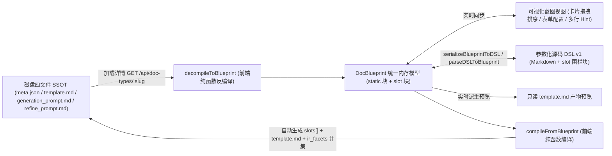

# ADR-05: 文档类型（DocType）蓝图化双模融合编辑器与 Spec Drift 模板判定精化

- **文档编号**：`05-doctype-blueprint-dual-mode-editor.md`
- **日期**：2026-11-21
- **状态**：已采纳 (Accepted) —— 已按代码基线完成检视修正，并同步修订阶段一矩阵、阶段二设计、阶段三契约、M11 作战卡与阶段六运维手册（暂不实施）
- **关联议题**：[`01-feature-matrix.md`](../01-features/01-feature-matrix.md) (`F-03`, `F-10`, `F-12`, `F-32`, `SC-08`, `SC-19`, `Non-Goal 7`)；[`03-doctype-drift-and-publishing.md`](../02-design/03-doctype-drift-and-publishing.md)；[`04-workbench-and-security.md`](../02-design/04-workbench-and-security.md)；[`ADR-03`](./03-evidence-anchor-and-publish-mount.md)；[`ADR-04`](./04-module-scope-discovery-and-hierarchical-docs.md)；[`02-code-ir-facets-subscription-guide.md`](../06-ops/02-code-ir-facets-subscription-guide.md)

---

## 1. 背景与问题陈述 (Context & Problem Statement)

### 1.1 现状实现基线

当前 `code-archdoc` 已基于 `ADR-03` 与 `W2 (M5)` 落地了 `DocType` 目录即唯一事实源（SSOT）注册表与管理员 Web 全生命周期编辑界面。现行实现与磁盘物理文件一一对应：

| 维度 / 环节 | 现状实现 | 代码 / 文档位置 |
| :--- | :--- | :--- |
| **Web 编辑器结构** | 抽屉划分为 4 个 Tab：`基础元数据` / `槽位构建器` / `模板与提示词资产`（下挂 `template.md`、`generation_prompt.md`、`refine_prompt.md` 三个子 Tab）/ `修订历史` | `frontend/src/components/doctype/DocTypeEditorDrawer.tsx` |
| **槽位配置表单** | `SlotsSchemaBuilder` 以卡片表单维护 `slots[]`（`slot_id` 锁定防误改、`title`、`ownership`、`required`、`ir_facets`、`token_budget`、`min_chars`、`instruction_hint`） | `frontend/src/components/doctype/SlotsSchemaBuilder.tsx` |
| **目录四文件 SSOT** | `<data_dir>/doc_types/<slug>/` 下存放 `meta.json`、`template.md`、`generation_prompt.md`、`refine_prompt.md`；确定性有序计算 `aggregate_hash` 与 `prompt_hash` | `pkg/doctype/schema.go`、`pkg/doctype/registry.go`、`pkg/doctype/writer.go` |
| **文档拼装与校验** | 写盘时校验 `ValidateTemplateSlots(templateMD, meta.Slots)` 强制包含全部 `<!-- slot:<slot_id> -->`；生成完毕后 `assembleFullMarkdown` 按 `template.md` 占位符位置替换拼装全文 | `pkg/doctype/schema.go`、`services/generation_service.go` (`assembleFullMarkdown`) |
| **Spec Drift 检测** | 比对新旧 `DocTypeRevision`，通过 `slotSpecChanged` 与 `globalPromptChanged` 判定受影响槽位 | `pkg/drift/spec_drift.go` (`ComputeSpecDrift`) |
| **写请求 DTO** | `CreateDocTypeRequest` 包含基础元数据与 `slots` / 资产文件；`UpdateDocTypeRequest` 传完整 `meta` 与三份 Markdown 资产 | `services/doctype_service.go` |

### 1.2 核心问题清单

当前编辑器的 Tab 组织方式直接映射磁盘物理文件布局，而非「编写并调优一份文档模板」的真实心智流，导致以下 5 项结构性摩擦：

| 编号 | 问题 | 严重度 | 根因分析 |
| :--- | :--- | :---: | :--- |
| **P-1** | **双源维护与隐性错位** | 🔴 | 5 个内置 `DocType` 的 `template.md` 实质上只是将 `meta.slots[]` 中的 `title` 与 `<!-- slot:slot_id -->` 按顺序复写了一遍，但编辑器中两者互不联动。在「槽位构建器」调整槽位顺序，因 `template.md` 未重排导致 `assembleFullMarkdown` 输出顺序**实际不生效**；修改槽位 `title` 后 `template.md` 标题不同步，导致工作台目录树与发布产出 `## 标题` 分叉；增删槽位则触发 `ValidateTemplateSlots` 报错拦截，迫使管理员反复切 Tab 手工修改或点击「补全模板占位标记」。 |
| **P-2** | **顶层与槽位 `ir_facets` 重复维护** | 🟠 | 运行时真正控制 Prompt 注入、Token 预算估算、Chat 精修上下文与 Spec Drift 判定的均为 `meta.slots[].ir_facets`；顶层 `meta.ir_facets` 仅作文档级总声明与列表展示，且运维手册明确建议其保持为所有槽位分片的并集。当前迫使用户在「基础元数据」和「槽位构建器」两个 Tab 之间手工勾选两遍。 |
| **P-3** | **提示词上下文物理割裂** | 🟠 | 文档级指令（`generation_prompt.md`、`refine_prompt.md`）位于「模板与提示词资产」Tab，而直接协同生效的章节级写作指令（`slots[].instruction_hint`）藏在「槽位构建器」每张卡片最底部的单行 `<input>` 中，调优 Prompt 时无法在同一视野内通盘审阅、对比或批量编辑。 |
| **P-4** | **后端已落地能力在 Web UI 中隐身、新建/编辑能力不对称，且 `SlotsSnapshotJSON` 丢失源码工具配置** | 🔴 | ① 后端 `SlotSpec` 已支持 `enable_source_tools`、`max_tool_rounds`，`Meta` 已支持 `repo_ir_facets`、`verify_policy`、`scope_profile`、`context_inputs`、`module_digest_source`，并已应用于 5 类内置模板；但 Web 表单未透出这些配置入口；<br>② `CreateDocTypeRequest` 尚未透传 `repo_ir_facets` / `context_inputs` / `module_digest_source`，且 `pkg/doctype/schema.go` 的 `Meta.Validate` 对 `context_inputs` 仅允许 `module_context` / `module_digests` 而漏掉了 `ADR-04` 声明的 `"code_ir"`；<br>③ **`models.SlotDefinition`（`models/json_types.go`）缺少 `EnableSourceTools` 与 `MaxToolRounds` 字段，且 `services/doctype_service.go` 的 `toModelSlotDefs` 映射时未拷贝这两个字段**，导致 `archdoc_doc_type_revisions.slots_snapshot`、`GET /api/doc-types/:slug` 返回的 `detail.slots` 及 `unmarshalSpecSlotMetas` 均丢失了槽位的只读源码工具配置！ |
| **P-5** | **`Spec Drift` 对局部模板标题变更误报全篇漂移** | 🟠 | `pkg/llm/prompt.go` 并不向大模型注入 `template.md`（仅在 `assembleFullMarkdown` 拼装输出时使用），但 `pkg/drift/spec_drift.go` 中 `globalPromptChanged := boundPromptHash != latestPromptHash || boundTemplateMD != latestTemplateMD`。一旦将槽位与模板融合编辑，只要修改 1 个槽位标题（同步修改了 `template.md` 对应 `## 标题`）或增删 1 个槽位，就会触发 `boundTemplateMD != latestTemplateMD`，将整篇文档所有未修改的兄弟非锁定槽位全部误标为 `prompt_changed`。 |

---

## 2. 决策概览与候选方案对比 (Decision Summary & Alternatives)

### 2.1 整体架构视图



### 2.2 候选方案评估

| 候选方案 | 核心做法 | 优点 | 缺点与风险 | 结论 |
| :--- | :--- | :--- | :--- | :---: |
| **方案 A：前端蓝图融合 + 可视化/参数化源码双模同步** | 保持磁盘四文件 SSOT 与数据库零破坏；前端引入统一 `DocBlueprint` IR，在一个「文档蓝图」主视图内融合全局 Prompt、`template.md` 骨架与 `slots[]`，并提供「可视化编排」与「参数化源码 DSL v1」双向实时切换。 | 彻底消除双源割裂；同时兼顾表单低门槛点选与纯文本批量参数填写（含 AI 生成后整段粘贴）；后端与存量模板 100% 向后兼容。 | 需维护零依赖纯 TS 的蓝图编解码与 DSL 解析器，并需妥善处理存量自由排版模板的无损往返与 `slot_id` 跨模式防误改。 | ✅ **采纳** |
| **方案 B：仅保留表单，后台自动派生 `template.md`** | 取消「模板与提示词资产」中的 `template.md` 编辑，由「槽位构建器」单向覆盖生成 `template.md`。 | 改造工作量最小。 | 不支持在同一文档文本中以参数化形式直接编写/批量编辑模板与槽位参数，也无法方便整篇复制或由 LLM 一键生成导入。 | ❌ 放弃 |
| **方案 C：纯源码 DSL 优先并变更磁盘存储格式** | 废弃 `meta.json` + `template.md` 双文件，磁盘改存单一新格式文件。 | 磁盘与界面完全同构。 | 破坏 `ADR-03` 冻结的四文件 SSOT、`aggregate_hash` 计算规则与已有全部线上目录资产、单测夹具，迁移成本过高。 | ❌ 放弃 |

### 2.3 核心决策摘要

| 决策 | 核心要点 | 解决问题 |
| :--- | :--- | :--- |
| **D-1 统一蓝图 IR 与存储边界** | 保持后端四文件 SSOT 与 `ExtraFields` 双轨无损机制不变；前端通过确定性纯函数 `decompileToBlueprint` / `compileFromBlueprint` 实现 `DocBlueprint` 与 `(template.md, slots[])` 双向幂等转换。 | P-1 |
| **D-2 参数化源码 DSL v1** | 定义 `Blueprint Source DSL v1`（Markdown + ```` ```slot <slot_id> ```` 围栏块），零第三方 npm 依赖实现行号级校验与规范序列化。 | P-1、P-3 |
| **D-3 融合 UI、DTO 补齐与防误改门禁** | 抽屉收敛为 3 Tab（`文档蓝图` / `基础信息与策略` / `修订历史`）；顶层 `ir_facets` 默认自动聚合槽位并集；高级治理策略折叠透出（含 `repo_ir_facets`、`context_inputs`、`module_digest_source`、`verify_policy`、`scope_profile`）；修复 `models.SlotDefinition` 与 `toModelSlotDefs` 丢失 `EnableSourceTools` / `MaxToolRounds` 缺陷并补齐 `CreateDocTypeRequest`；建立跨模式统一的 `persistedSlotIds` 风险拦截。 | P-1、P-2、P-3、P-4 |
| **D-4 `Spec Drift` 静态骨架归一化** | 剥离 `template.md` 中绑定到已声明槽位的 `<!-- slot:id -->` 及其紧邻 `##~####` 标题行，仅当剩余静态骨架或 `PromptHash` 变更时才判定 `prompt_changed`，同步将 `EnableSourceTools` / `MaxToolRounds` 从补全后的 `SlotsSnapshotJSON` 贯通至 `SpecSlotMeta` 与 `slotSpecChanged`。 | P-4、P-5 |

---

## 3. 决策 D-1：存储层零破坏边界与统一蓝图中间表示 (`DocBlueprint` IR)

### 3.1 存储与协议零破坏边界

1. **目录 SSOT 不变**：服务端 `<data_dir>/doc_types/<slug>/` 继续严格维持 `meta.json`、`template.md`、`generation_prompt.md`、`refine_prompt.md` 四文件结构；`ComputeAggregateHash`、`ComputePromptHash` 与 `archdoc_doc_type_revisions` 表结构保持不变。
2. **未知扩展字段保护不变**：`pkg/doctype/schema.go` 的 `ExtraFields` 双轨编解码及前端提交 `baseMeta` 合并 `loadedDetail.meta` 的机制保持不变，任何仅存在于磁盘的高级字段绝不因前端保存而丢失。
3. **运行时拼装不变**：`services/generation_service.go` 中的 `assembleFullMarkdown` 与 `pkg/doctype/schema.go` 中的 `ValidateTemplateSlots` 无需变更；前端编译出的 `(template_md, slots)` 天然满足后端所有契约。

### 3.2 `DocBlueprint` TypeScript 数据契约

在零外部依赖的纯函数模块 `frontend/src/utils/docTypeBlueprint.ts` 中定义统一内存模型：

```typescript
export type BlueprintHeadingLevel = 2 | 3 | 4;

export interface StaticBlueprintBlock {
  kind: 'static';
  /** 前端渲染稳定 React key（不写入磁盘或 DSL） */
  key: string;
  /** 静态 Markdown 段落（如 # 文档主标题、导语、免责声明或分割线） */
  markdown: string;
}

export interface SlotBlueprintBlock {
  kind: 'slot';
  /** 前端渲染稳定 React key */
  key: string;
  /** true 表示该槽位拥有紧邻上方的 ##~#### 标题行并由 slot.title 统一驱动 */
  emitHeading: boolean;
  /** 当 emitHeading 为 true 时输出到 template.md 的标题层级，默认 2 */
  headingLevel: BlueprintHeadingLevel;
  /** 完整的后端 SlotDefinition 契约对象 */
  slot: SlotDefinition;
  /** 仅反编译期使用：若存量 template.md 紧邻标题文本与 slot.title 不一致，记录原文本供 UI 温和提示 */
  divergedTemplateHeading?: string;
}

export type BlueprintBlock = StaticBlueprintBlock | SlotBlueprintBlock;

export interface DocBlueprint {
  blocks: BlueprintBlock[];
}
```

### 3.3 反编译规则 (`decompileToBlueprint(templateMD, slots)`)

将存量或刚加载的 `(templateMD, slots)` 确定性转换为 `DocBlueprint`：

1. **换行与标记扫描**：将 `templateMD` 中 `\r\n` 统一归一化为 `\n`，按行扫描精确匹配独立标记行 `^\s*<!--\s*slot:([a-z][a-z0-9_]{1,48})\s*-->\s*$`。
2. **紧邻标题吸附规则（Heading Binding）**：
   - 当匹配到 `slot_id` 且该 `slot_id` 存在于 `slots[]` 中（首次出现）时，向上回溯跳过纯空行查找紧邻的上一非空行：
   - **情况 A（标准绑定）**：若该非空行匹配 `^(#{2,4})\s+(.+?)\s*$`，则将该标题行吸收为该 `SlotBlueprintBlock` 的绑定标题：`emitHeading = true`、`headingLevel = len(#)`（2/3/4），标题行不再重复落入前置 `static` 块；若捕获的标题文本与 `slot.title` 去空白后不一致，记录 `divergedTemplateHeading`（编辑与保存以 `slot.title` 为准并在 UI 展示对齐提醒）。
   - **情况 B（自由内嵌槽位）**：若上一非空行不存在（位于文件首行）或不是 2~4 级标题（例如前置是一段固定声明文字或 1 级标题 `# ...`），则置 `emitHeading = false`、`headingLevel = 2`，前置文本完整保留为 `StaticBlueprintBlock`，保障复杂手写自由排版模板 **100% 无损往返**。
3. **文首 H1 与纯静态夹层**：两槽位之间或首个槽位之前非被吸收的文本，裁剪首尾多余连续空行后，若非空则保留为 `StaticBlueprintBlock`。新建 DocType 时默认初始蓝图为：`[static("# ${displayName}"), slot(overview_summary)]`，并在用户未手工修改 H1 文本前保持 `# 主标题` 与 `display_name` 联动更新。
4. **缺漏与孤儿兜底**：
   - 若 `slots[]` 中存在 `templateMD` 未包含标记的槽位（如手工改坏的磁盘资产），按 `slots[]` 原顺序追加至蓝图末尾（`emitHeading = true, headingLevel = 2`），并产生一条 `warning` 诊断提示用户检查；
   - 若 `templateMD` 中存在未在 `slots[]` 中声明的注释标记或重复同一 `slot_id` 的多余标记，保留在静态文本中并在诊断栏给出 `warning`，防止静默丢弃或误替换。

### 3.4 编译规则 (`compileFromBlueprint(blueprint)`)

将 `DocBlueprint` 确定性编译为写盘所需的 `{ slots, templateMD }`：

1. **槽位列表生成**：按 `blueprint.blocks` 顺序提取所有 `kind === 'slot'` 节点的 `slot` 对象组成 `slots: SlotDefinition[]`，确保 `meta.json` 中的 `slots[]` 顺序与最终渲染顺序严格一致。
2. **模板正文生成**：
   - `static` 块：去除首尾多余空行后按原样输出；
   - `slot` 块：若 `emitHeading === true`，输出 `${'#'.repeat(headingLevel)} ${slot.title.trim()}\n<!-- slot:${slot.slot_id} -->`；若 `emitHeading === false`，仅输出 `<!-- slot:${slot.slot_id} -->`；
   - 相邻非空块之间统一以 `\n\n`（单个空行）连接，全篇以单个 `\n` 结尾。
3. **幂等性与契约保障**：
   - 连续执行 `compileFromBlueprint(decompileToBlueprint(tpl, slots))` 产生字节级完全一致的稳定输出，避免无谓空格波动引发无效 `DocTypeRevision`；
   - 编译输出天然保证 `slots[]` 中每个 `slot_id` 在 `templateMD` 中均有精确的 `<!-- slot:<slot_id> -->` 占位符，彻底消除前端「补全模板占位标记」按钮与缺标记保存失败。

---

## 4. 决策 D-2：参数化模板源码 DSL 规范 (`Blueprint Source DSL v1`)

### 4.1 语法形态选型

对比三种常见文本融合表达方式：

| 语法形态 | 示例片段 | 评估结论 |
| :--- | :--- | :--- |
| HTML 注释内嵌 YAML | `<!-- slot:id facets=[tree] -->` | 多行 `hint` 与复杂参数可读性差，且无法规避 `-->` 冲突 |
| 模板插值语法 | `{{slot id=...}}` | 易与 Markdown 正文或代码文档中的模板示例（Go template / Jinja / Mustache）冲突 |
| **CommonMark 围栏块（` ```slot <slot_id> `）** | 围栏头携带 `slot_id`，围栏体内以轻量 Key-Value / 列表书写参数 | ✅ **采纳**：静态 Markdown 正文与给 AI 的指令参数硬隔离、支持 ` ````slot ` 多反引号逃逸、视觉层次清晰且极易由大模型整篇生成后直接粘贴 |

### 4.2 语法示例

#### 4.2.1 完整标准语法示例（对应内置 `system-architecture` 前两章）

````markdown
# 系统架构与核心链路

## 1. 系统定位与模块分层边界

```slot overview_boundaries
ownership: auto
required: true
ir_facets: [tree, deps, build]
token_budget: 8000
min_chars: 40
enable_source_tools: false
hint: |
  结合目录树、构建目标与模块依赖边说明系统职责边界，
  并输出 Mermaid flowchart 模块拓扑图。
```

## 2. 运行时并发、进程/线程、锁与共享内存模型

```slot runtime_concurrency
ownership: auto
required: true
ir_facets: [runtime_primitives, symbols]
token_budget: 10000
min_chars: 40
enable_source_tools: true
max_tool_rounds: 4
hint: |
  基于 runtime_primitives 与 symbols 详述线程、锁粒度、原子操作、共享内存/IPC、
  事件循环、定时器与信号处理机制，必要时调用只读源码工具核实关键锁作用域与并发控制实现。
```
````

#### 4.2.2 极简手写语法（依赖安全默认值与标题继承）

管理员手工新增或由 LLM 辅助生成时，只需写明标题、`slot_id`、订阅分片与提示要点，其余字段全部自动回填标准默认值：

````markdown
## 3. 对外暴露面与鉴权入口

```slot attack_surface
ir_facets: [http_routes, idl_contracts, config_keys]
hint: 梳理全部外部 HTTP/RPC 入口及其鉴权中间件与敏感配置默认值。
```
````

### 4.3 参数字典、别名与缺省值规范

| 字段 / 位置 | 别名 | 类型与约束 | 缺省值（省略时） | 说明 |
| :--- | :--- | :--- | :--- | :--- |
| 围栏头 `<slot_id>` | — | 必填字符串，匹配 `^[a-z][a-z0-9_]{1,48}$`，全篇唯一 | 无（必填） | 跨修订主键；支持 3 个及以上反引号围栏（如 ````` ````slot id `````）以兼容含反引号内容 |
| `title` | — | 字符串 `1~120` 字符（不可含换行） | 若紧邻上方为 `##~####` 标题行，自动继承其文本并置 `emitHeading=true` | 当上方无紧邻标题（自由内嵌槽位 `emitHeading=false`）时**必填**，用于工作台大纲导航；若同时存在上方标题且显式写了 `title:`，以显式 `title:` 为准并在可视化同步更新上方标题 |
| `ownership` | — | 枚举：`auto \| hybrid \| locked` | `auto` | 章节默认所有权模式 |
| `required` | — | 布尔：`true \| false` | `true` | 是否纳入 Verifier Gate 2 完备度门禁 |
| `ir_facets` | `facets` | 9 大规范分片数组（支持 `[a, b]` 行内数组或 `- a` 多行列表） | `[]`（建议至少 1 项，空列表触发 `warning`） | 允许值：`tree`, `build`, `deps`, `config_keys`, `symbols`, `idl_contracts`, `http_routes`, `data_models`, `runtime_primitives`；自动去重；**拒绝 `module_context`**（见 `02-code-ir-facets-subscription-guide.md`） |
| `token_budget` | `budget` | 整数 `500 ~ 64000` | `8000` | 单槽位 IR 序列化预算上限 |
| `min_chars` | — | 整数 `0 ~ 10000` | `40` | 必填章节有效字符数下限 |
| `enable_source_tools` | `source_tools` | 布尔：`true \| false` | `false` | 是否为该槽位开放受限只读源码工具 |
| `max_tool_rounds` | `tool_rounds` | 整数 `0 ~ 6` | 当 `enable_source_tools=true` 且省略时默认 `4`；否则 `0` | 源码工具最大调用轮次（若 `enable_source_tools=false` 时强制规范化为 `0`） |
| `hint` | `instruction_hint` | 字符串 `0 ~ 1000` 字符（支持单行字符串或 `\|` 多行缩进块） | `""` | 对应 `SlotDefinition.instruction_hint` |

### 4.4 解析器安全、诊断契约与规范序列化

1. **零第三方依赖实现**：`parseDSLToBlueprint(source)` 与 `serializeBlueprintToDSL(blueprint)` 均在 `frontend/src/utils/docTypeBlueprint.ts` 中以纯 TypeScript 实现（约 250~350 行），**不引入 `js-yaml` 等第三方 npm 包**，零安全漏洞面、零包体积膨胀且便于直接使用 `node --test` 运行单元测试。
2. **非 `slot` 围栏完整透传**：诸如 ```` ```mermaid ````、```` ```json ````、```` ```cpp ```` 等普通 Markdown 代码块作为静态正文处理；状态机在处于普通代码围栏内部时，**忽略内部可能出现的示例性 ` ```slot ` 文本**，仅当同级别或更长反引号围栏闭合后才恢复蓝图解析。
3. **严格错误拦截与精确行号诊断 (`BlueprintDiagnostic`)**：
   - 诊断结构：`{ line: number; severity: 'error' | 'warning'; code: string; message: string }`；
   - **严格拒绝未知键**：如将 `token_budget` 误拼为 `token_budegt`，**禁止静默丢弃**，必须报错并精准指出行号与合法键名清单；
   - **枚举纠错建议**：如 `ir_facets` 中误写 `symbol`（缺 `s`）或 `http_route`，解析器计算轻量 Levenshtein 编辑距离并在报错文案中给出最相近合法分片建议（如 `未知分片 "symbol"，是否指 "symbols"？`）；
   - **完整前置校验**：拦截未闭合 `slot` 围栏、非法或重复 `slot_id`、越界 `token_budget` / `min_chars` / `max_tool_rounds`、非布尔/非整数类型、`hint` 超长（>1000 字符）、无紧邻标题槽位缺失 `title:` 等所有非法状态；
   - **阻塞保护**：只要源码解析存在任意 `severity === 'error'` 诊断，编辑器保留当前源码草稿，**禁止切回可视化视图与点击保存**，直至用户修正错误，杜绝静默覆盖或数据丢失。
4. **规范化序列化 (`serializeBlueprintToDSL`)**：
   - 字段按固定规范顺序输出：`ownership`、`required`、`ir_facets`、`token_budget`、`min_chars`、`enable_source_tools`（始终显式输出布尔值；仅当 `enable_source_tools === true` 时紧接输出 `max_tool_rounds: <1~6>`，当 `enable_source_tools === false` 时省略 `max_tool_rounds`）、`hint`（当 `instruction_hint` 非空时输出，为空串时省略）；
   - 当 `emitHeading === true` 时省略冗余 `title:` 行，章节标题仅在上方 `##~####` 出现一次；当 `emitHeading === false` 时首行显式输出 `title: <slot.title>`；
   - 当 `hint` 包含换行符或超过 80 字符时自动采用 `hint: |` 加 2 空格缩进的多行块格式输出；单行短 `hint`（`1~80` 字符且不含换行）输出为 `hint: <text>`（若首尾含空格或以 `|` 开头则自动转多行 `hint: |` 块避免歧义）；若 `hint` 内容本身包含 `N`（`N >= 3`）个连续反引号串，自动将外层 `slot` 围栏升级为 `N + 1` 个反引号防逃逸；
   - 连续执行 `parseDSLToBlueprint` 与 `serializeBlueprintToDSL` 严格满足字节级幂等。

---

## 5. 决策 D-3：融合编辑器信息架构、双模交互与防误改门禁

### 5.1 三 Tab 信息架构重组（原 4 Tab → 3 Tab）

```text
DocTypeEditorDrawer（支持右上角切换：xl 标准宽度 ↔ full 宽屏编排）
├── 顶部身份摘要条（在「文档蓝图」Tab 亦可见 slug / display_name / model_tier 摘要，点击可直跳基础信息）
├── Tab 1: 文档蓝图 (Blueprint) —— 编辑既有 DocType 时默认激活；新建模式引导填完基础信息后一键进入
│   ├── 顶部折叠区：全局指令资产
│   │   ├── generation_prompt.md（默认展开适中高度，支持快捷折叠）
│   │   └── refine_prompt.md（可选；默认折叠，显示「已配置 N 字 / 未配置」徽标）
│   ├── 蓝图编排工具栏
│   │   ├── 左侧模式切换：[可视化编排] | [参数化源码] | [预览 template.md]
│   │   ├── 中部实时指标：槽位数 · 各槽位预算总和 · 订阅分片去重数
│   │   └── 右侧上下文操作：
│   │       ├── 可视化模式：[+ 新增章节槽位] [+ 插入固定文本块]
│   │       └── 参数化源码模式：[+ 插入槽位片段] [格式化源码] [DSL 语法速查]
│   ├── 视图 1：可视化编排流
│   │   ├── StaticBlockCard（静态 Markdown 块，含文首 # 主标题与可选章节间固定文本，支持编辑/上移/下移/删除）
│   │   └── SlotBlockCard（拟真章节卡）
│   │       ├── 标题栏：标题层级(H2/H3/H4 或无标题内嵌) + 内联可编辑章节标题 + 上移/下移/展开收起/删除
│   │       ├── 参数胶囊条：slot_id（既有加锁/确认解锁）· ownership · required 开关 · token_budget · 源码工具开关 & max_tool_rounds(0~6) · 更多设置(min_chars)
│   │       ├── 订阅 Code IR 分片 (ir_facets) Chip 组（按轻量/中等/较重分级标识；勾选重分片且预算 < 10000 时显示温和提示）
│   │       └── 章节写作提示 (instruction_hint)：多行自适应 textarea（取代单行 input）
│   ├── 视图 2：参数化源码编辑器（DSL v1）
│   │   ├── 等宽代码编辑区（支持 Tab 缩进辅助与快捷片段插入至光标处）
│   │   └── 实时诊断条（200ms 防抖解析：红色 error 精准定位行号并阻断切换/保存；黄色 warning 仅提醒）
│   └── 视图 3：只读 template.md 产物预览（实时展示 compileFromBlueprint 生成结果，方便运维核验）
│
├── Tab 2: 基础信息与策略 (Metadata & Policy) —— 新建 DocType 时默认激活
│   ├── 基础身份与运行参数：slug / display_name / short_name / category / description / model_tier / timeout_seconds / max_output_tokens / is_active
│   ├── 顶层 Code IR 分片声明 (meta.ir_facets)
│   │   ├── 默认开启「自动聚合自全部章节槽位（推荐）」：以只读徽标展示有序并集，随蓝图实时更新
│   │   └── 支持切换「手动覆写」开关（加载存量资产时，若磁盘 meta.ir_facets 与槽位并集存在差异且非空，自动保持手动模式并展示「一键对齐并集」按钮）
│   └── 折叠面板「高级治理策略（可选）」—— 默认折叠，不干扰常规操作
│       ├── repo_ir_facets（多模块整仓汇总裁剪白名单 + 一键应用「仅保留轻量与契约分片」预设）
│       ├── context_inputs & module_digest_source（多模块上下文输入开关 module_context / module_digests，及整仓汇总摘要源 doc_type_slug / slot_id / max_chars）
│       ├── verify_policy（strict_symbol_check / require_mermaid / allowed_mermaid_types / max_mermaid_nodes / max_mermaid_edges / block_on_secret_leak）
│       └── scope_profile（include_globs / exclude_globs / max_depth / include_tests / include_legacy_docs）
│
└── Tab 3: 修订历史 (Revisions) —— 仅编辑模式可见，保留不可变快照审计视图
```

### 5.2 跨模式统一的 `persistedSlotIds` 防误改确认门禁

`slot_id` 是文档跨修订合并、`locked` 锁定豁免、Spec Drift 追踪与孤立章节（Orphan Sections）保护的主键，绝对不能因为切换到源码模式自由编辑而失去防护：

1. **可视化模式**：完全沿用现有 `persistedSlotIds` 保护交互——既有 `slot_id` 输入框默认锁定，点击「解锁修改」或删除既有槽位必须通过 `useConfirm` 明确确认风险后方可变更。
2. **源码模式实时侦测**：每当编辑源码解析出最新 `SlotBlueprintBlock[]` 时，与初始化加载的 `persistedSlotIds` 比对计算差集 `unconfirmedMissingIds = persistedSlotIds \ currentSlotIds \ confirmedSlotChanges`。
3. **底部状态栏强预警**：当 `unconfirmedMissingIds.length > 0` 时，抽屉底部状态栏实时显示风险徽标（例如：`源码中修改或移除了 N 个既有 slot_id`），列出具体受影响的 `slot_id`。
4. **切换与保存双重门禁**：用户尝试从源码模式切回可视化模式或点击「保存并同步修订」时，若存在未确认的既有 `slot_id` 变更/删除，必须弹出 `useConfirm` 风险确认弹窗，明确列出所有将被移除或改名的 `slot_id` 及其对已发布文档的 Spec Drift / 孤立章节后果；仅当用户确认后才记入 `confirmedSlotChanges` 并放行操作（若在未保存前把 `slot_id` 改回原值，警示自动消除）。

### 5.3 抽屉宽屏适配与样式合规

1. **双宽度预设切换**：复用 `@code/common` `Drawer` 原生支持的 `width` 预设（`DrawerWidthPreset`: `'xl'` 与 `'full'`），在抽屉标题栏右侧 `extra` 区域提供「宽屏编排 / 标准宽度」切换按钮，解决多栏提示词与参数化源码的横向视野限制。
2. **主题与样式规范**：全部新增样式类遵循扁平 BEM `.code-archdoc-blueprint-*` 命名，100% 使用 `theme.css` `--color-*` 语义 Token（`--color-bg-surface`、`--color-bg-muted`、`--color-bg-input`、`--color-text-primary`、`--color-text-secondary`、`--color-border-primary`、`--color-danger`、`--color-warning`、`--color-primary-subtle` 等），严格适配亮/暗双模主题；严禁静态内联 `style={{ ... }}`、严禁 JS 模拟 hover 伪类、严禁 TypeScript `any`。

### 5.4 后端 `SlotDefinition` 映射修复与新建/编辑 DTO 对齐（极小增量）

经代码基线检视发现，当前后端与前端在 `SlotDefinition` 快照映射与 `CreateDocTypeRequest` 上存在三处对称性缺口，必须在 M11-A 一并闭环：

1. **修复 `models.SlotDefinition` 与 `toModelSlotDefs` 丢失源码工具配置缺陷**：
   - 在 `models/json_types.go` 的 `SlotDefinition` 结构体中补齐：
     - `EnableSourceTools bool`（`json:"enable_source_tools,omitempty"`）
     - `MaxToolRounds int`（`json:"max_tool_rounds,omitempty"`）
   - 在 `services/doctype_service.go` 的 `toModelSlotDefs(specs []doctype.SlotSpec) []models.SlotDefinition` 中补齐 `EnableSourceTools: sl.EnableSourceTools` 与 `MaxToolRounds: sl.MaxToolRounds` 拷贝；
   - 这样 `archdoc_doc_type_revisions.slots_snapshot`、`GET /api/doc-types/:slug` 返回的 `detail.slots`、`GET /api/doc-types/:slug/revisions` 返回的 `slots_snapshot` 以及 `unmarshalSpecSlotMetas` 均可完整获取槽位的只读源码工具配置，前端融合编辑器直接消费 `detail.slots` 即可无损回显。
2. **补齐 `CreateDocTypeRequest` 与 `Meta.Validate` 白名单**：
   - 在 `services/doctype_service.go` 中为 `CreateDocTypeRequest` 增量补充可选字段，并在 `DocTypeService.Create` 中透传至 `doctype.Meta`：
     - `RepoIRFacets []string`（`json:"repo_ir_facets,omitempty"`）
     - `ContextInputs []string`（`json:"context_inputs,omitempty"`）
     - `ModuleDigestSource *doctype.ModuleDigestSourceSpec`（`json:"module_digest_source,omitempty"`）
   - 在 `pkg/doctype/schema.go` 的 `Meta.Validate` 中，将 `context_inputs` 允许值白名单对齐 `ADR-04 §5.2`（允许 `"code_ir"`、`"module_context"`、`"module_digests"`）。
3. **补齐前端 TypeScript 强类型接口**：
   - 在 `frontend/src/types/domain.ts` 中新增 `CanonicalFacetName`（9 大可订阅规范分片联合类型，排除仅内部派生的 `'module_context'`）、`ContextInputName`（`'code_ir' | 'module_context' | 'module_digests'`）、`ScopeProfileConfig`、`VerifyPolicyConfig`、`ModuleDigestSourceConfig`、`DocTypeMeta` 接口；
   - 在 `frontend/src/types/api.ts` 中为 `CreateDocTypePayload` 补齐可选字段 `scope_profile?: ScopeProfileConfig`、`verify_policy?: VerifyPolicyConfig`、`repo_ir_facets?: CanonicalFacetName[]`、`context_inputs?: ContextInputName[]`、`module_digest_source?: ModuleDigestSourceConfig`。

---

## 6. 决策 D-4：`Spec Drift` 模板静态骨架归一化与零误报优化

### 6.1 根因回顾

`pkg/llm/prompt.go` (`BuildSlotMessages`) 仅消费 `generation_prompt.md` 与当前槽位元信息，不向大模型注入 `template.md`；`template.md` 仅在全篇组装阶段（`assembleFullMarkdown`）用于将各槽位产物嵌入对应 `<!-- slot:<slot_id> -->` 位置。但 `pkg/drift/spec_drift.go` 当前实现为：

```go
globalPromptChanged := boundPromptHash != latestPromptHash || boundTemplateMD != latestTemplateMD
```

在融合编辑器落地后，修改第 1 章槽位标题或新增第 6 章槽位时，编译器会同步更新 `template.md`。按旧逻辑，这会导致 `boundTemplateMD != latestTemplateMD` 成立，从而误将第 2、3、4 章等**完全未受影响的非锁定兄弟槽位**全部标为 `reason: "prompt_changed"`，引发无意义的增量刷新与 Token 浪费。

### 6.2 `normalizeTemplateStaticSkeleton` 纯函数规范

在 `pkg/drift/spec_drift.go` 中新增无副作用纯函数 `normalizeTemplateStaticSkeleton(templateMD string, slots []SpecSlotMeta) string`：

1. 将 `\r\n` 统一归一化为 `\n` 后按行切片；
2. 构造 `declaredSlots` 集合（基于传入的 `slots[]`）；
3. 自上而下扫描标记行：凡匹配独立槽位注释 `^\s*<!--\s*slot:([a-z][a-z0-9_]{1,48})\s*-->\s*$` 且 `slot_id` 属于 `declaredSlots` 首次出现时：
   - 标记移除该 `<!-- slot:<slot_id> -->` 行；
   - 向上跳过纯空行查找紧邻上一非空行：若该行匹配 `^#{2,4}\s+.+$`（与前端 D-1 紧邻标题吸附规则完全同构），**一并标记移除该绑定标题行**；
4. 过滤掉所有被移除的行后，将连续多个空行折叠为单个空行并裁剪首尾空白，得到剥离了「槽位占位标记及其绑定章节标题」后的**纯粹文档级静态骨架**。

### 6.3 判定规则升级（保持 API 契约 100% 向后兼容）

1. **静态骨架比对替代裸 `TemplateMD` 比对**：
   ```go
   boundSkeleton := normalizeTemplateStaticSkeleton(boundTemplateMD, boundSlots)
   latestSkeleton := normalizeTemplateStaticSkeleton(latestTemplateMD, latestSlots)
   globalPromptChanged := boundPromptHash != latestPromptHash || boundSkeleton != latestSkeleton
   ```
2. **槽位级字段全链路补全**：基于 §5.4 补齐后的 `models.SlotDefinition`，在 `SpecSlotMeta`（`pkg/drift/spec_drift.go`）与 `unmarshalSpecSlotMetas`（`services/doctype_service.go`）中同步补充 `EnableSourceTools bool` 与 `MaxToolRounds int` 两个字段，并在 `slotSpecChanged` 中纳入比对（当 `EnableSourceTools == false` 时将 `MaxToolRounds` 归一化为 `0` 后比对）。确保管理员通过融合编辑器开启/关闭某槽位的只读源码工具或调整最大工具轮次时，精确将该槽位标为 `slot_modified`。
3. **API 枚举兼容**：不新增或修改 `Reason` / `ChangeKind` 枚举值（仍为 `slot_added` / `slot_removed` / `slot_modified` / `prompt_changed`），保证前端 `DriftRadarPage` 与所有历史漂移快照完全兼容。

### 6.4 典型变更行为对照矩阵

| 管理员编辑动作 | 触发 `template.md` 变化 | 旧实现判定结果 | 本 ADR 优化后判定结果 |
| :--- | :---: | :--- | :--- |
| 仅修改槽位 A 的章节标题 | 是（绑定 `## 标题` 变更） | 槽位 A `slot_modified` + **所有兄弟非锁定槽位误报 `prompt_changed`** | **仅槽位 A 触发 `slot_modified`**，兄弟槽位零误报 |
| 新增槽位 E | 是（文末新增 `## E` + 标记） | 槽位 E `slot_added` + **所有既有非锁定槽位误报 `prompt_changed`** | **仅槽位 E 触发 `slot_added`**，既有槽位零误报 |
| 删除槽位 C | 是（移除 `## C` + 标记） | 槽位 C `slot_removed` + **所有既有非锁定槽位误报 `prompt_changed`** | **仅槽位 C 触发 `slot_removed`**，既有槽位零误报 |
| 调整槽位顺序（未改静态文本） | 是（槽位块重排） | **所有非锁定槽位误报 `prompt_changed`** | **静态骨架不变，不触发全篇 LLM 重生成**（`assembleFullMarkdown` 按最新 `template.md` 组装，或后续由发布/人工决定） |
| 修改文首导语/免责声明/H1 标题等静态文本 | 是（静态骨架变更） | 所有非锁定槽位 `prompt_changed` | 静态骨架变化，**准确触发所有非锁定槽位 `prompt_changed`** |
| 修改 `generation_prompt.md` / `refine_prompt.md` | 否 | 所有非锁定槽位 `prompt_changed` | `PromptHash` 变化，**准确触发所有非锁定槽位 `prompt_changed`** |
| 为槽位 B 开启 `enable_source_tools` | 否 | **漏报（未对比该字段）** | **准确识别仅槽位 B 为 `slot_modified`** |

---

## 7. 决策后果、风险缓解与架构红线 (Consequences & Guardrails)

### 7.1 正向收益

1. **心智合一**：编辑 DocType 从「跨 4 个 Tab 对照文件拼装」收敛为「在 1 张文档蓝图里自上而下编排标题、分片、预算与提示词」。
2. **双模互补**：日常调优可用可视化卡片点选分片、拖拽排序；批量改参数、跨模板复用或让 LLM 辅助起草新 DocType 时，切入「参数化源码」即可一次粘贴生效。
3. **零双源同步错误**：`template.md`、`meta.slots[]` 与顶层 `meta.ir_facets` 并集自动保持严格一致，彻底消灭缺标记报错、排序失效与标题分叉。
4. **Spec Drift 精准度提升**：修改单一章节标题或增删槽位不再误炸整篇文档的非锁定章节。

### 7.2 代价与风险缓解

| 风险点 | 潜在影响 | 缓解措施 |
| :--- | :--- | :--- |
| **存量自由排版 `template.md` 破坏** | 若历史或手工编辑的 `template.md` 在槽位前有复杂静态文案或无标题嵌套，`decompile` 若强行改写会导致原文丢失。 | 严格实行「仅吸附紧邻 `##~####` 标题行」原则；其余任何前置/中间文本一律保留为 `StaticBlueprintBlock` 且对应槽位设 `emitHeading=false`，通过 `T-ADR05-02` 守护 100% 无损往返。 |
| **手写参数化源码误改既有 `slot_id`** | 源码编辑器为自由文本，无输入框 `disabled` 保护，手误修改 `slot_id` 可能导致线上已发布文档产生大量孤立章节。 | 实时差集比对 `persistedSlotIds` + 底部警告徽标 + 切回可视化与保存前的 `useConfirm` 高风险强制弹窗确认。 |
| **DSL 解析宽容度失衡** | 若静默忽略拼写错误的键或非法参数值，用户配置会在不知不觉中丢失。 | 严格模式解析：任何未知键、非法枚举、越界数值、未闭合围栏均标为阻断级 `error` 并精确到行号，同时锁定保存/切换防止草稿被覆盖。 |
| **前端打包体积或依赖污染** | 引入 YAML 解析库会增加安全审计与包体积开销。 | 全量采用约 300 行纯 TS 零依赖解析器实现 `DSL v1`，可直接在 `node --test` 下毫秒级跑完测试。 |

### 7.3 架构红线

1. **纯函数隔离红线**：`frontend/src/utils/docTypeBlueprint.ts` 必须保持纯 TypeScript 零副作用函数（不导入 React、DOM 或第三方解析库），确保在 Node 原生测试运行器下直接可执行。
2. **SSOT 与持久化零修改红线**：严禁修改 `<data_dir>/doc_types/<slug>/` 四文件协议、`ComputeAggregateHash` 算法、`ExtraFields` 保留机制及数据库表结构。
3. **后端包边界红线**：`pkg/drift/spec_drift.go` 遵循 `code-archdoc/AGENTS.md` 红线 1，严禁导入 `models`、`services`、`handlers`、`gorm` 或 `gin`。
4. **样式与类型安全红线**：融合编辑器全部 UI 组件严格使用 `--color-*` Token 与 `.code-archdoc-*` Flat BEM 类名，适配亮/暗双模主题；严禁使用 TypeScript `any`、静态内联 `style={{ ... }}` 或 JS 模拟 hover。

---

## 8. TDD 先行测试清单 (T-ADR05-01 ~ T-ADR05-12)

实施阶段必须严格遵守「先写失败测试 (Red) → 编写实现通过测试 (Green) → 重构优化 (Refactor)」：

| 编号 | 测试范围 | 测试场景 | 预期断言 |
| :--- | :--- | :--- | :--- |
| **T-ADR05-01** | 前端纯函数<br>(`docTypeBlueprint.ts`) | 5 类内置 DocType（`system-architecture`、`data-and-contract`、`ops-and-config`、`code-walkthrough`、`agents-context`）的 `template.md` + `slots` 执行 `decompileToBlueprint` → `compileFromBlueprint` | 5 套内置资产均识别出全部 `SlotBlueprintBlock`（`emitHeading=true`）与文首 H1 `StaticBlueprintBlock`，编译结果与原始 `template.md`、`slots` 完全一致且连续往返幂等 |
| **T-ADR05-02** | 前端纯函数 | 复杂存量 `template.md`：包含前置多段导语、章节间固定免责声明、`###` 3 级标题绑定槽位、以及无紧邻标题的自由内嵌槽位 | 自由内嵌槽位准确识别为 `emitHeading=false`，3 级标题记录 `headingLevel=3`，静态片段 100% 保留为 `static` 块，编译往返无损一致 |
| **T-ADR05-03** | 前端纯函数 | 在 `DocBlueprint` 中调整槽位块顺序并修改某槽位 `title` 后执行 `compileFromBlueprint` | 编译产出的 `slots[]` 顺序与 `templateMD` 中 `<!-- slot:... -->` 出现顺序及 `## 标题` 100% 同步一致 |
| **T-ADR05-04** | 前端纯函数 | `parseDSLToBlueprint` 解析含完整字段、别名（`facets`/`budget`/`source_tools`/`instruction_hint`）、单行数组与多行 `-` 列表、`hint: \|` 多行缩进块、4 反引号围栏及最小缺省写法的 DSL 文本 | 全部合法语法 `diagnostics` 无 `error`；缺省字段按表 4.3 正确填充默认值；普通代码围栏（如 ` ```mermaid ` / ` ```markdown ` 内的示范 text）不误解析为槽位 |
| **T-ADR05-05** | 前端纯函数 | `serializeBlueprintToDSL` 导出与连续往返幂等校验 | `emitHeading=true` 的槽位不输出冗余 `title:` 行；多行 `hint` 输出规范 `hint: \|` 块；含反引号的 `hint` 自动升级外层围栏；连续 `serialize(parse(serialize(bp)))` 字节完全相等 |
| **T-ADR05-06** | 前端纯函数 | DSL 非法输入诊断测试：未知键 `token_budegt`、非法 `slot_id`、重复 `slot_id`、非法分片名 `symbol`、未闭合 `slot` 围栏、无标题槽位缺 `title`、越界 `token_budget=100` / `max_tool_rounds=9` | 全部产生 `severity='error'` 诊断并准确指向对应行号（`line`）；`symbol` 给出 `symbols` 纠错建议 |
| **T-ADR05-07** | 前端纯函数 | 顶层 `ir_facets` 自动并集与存量手动模式判定 | 并集按标准分片字典序去重汇总；当存量 `meta.ir_facets` 与槽位并集不等且非空时，判定初始处于手动保留模式而非强制覆盖 |
| **T-ADR05-08** | 前端纯函数 | 跨模式 `persistedSlotIds` 变更差集检测 | 源码中删除或重命名既有 `slot_id` 时准确识别出 `unconfirmedMissingIds`；若改回原 `slot_id` 则差集自动清零 |
| **T-ADR05-09** | Go `pkg/drift` | 修改单个槽位 A 的 `title`（同步修改 `template.md` 中紧邻绑定 `## 标题`），兄弟槽位 B/C 与静态文本不变 | `ComputeSpecDrift` 仅返回槽位 A（`reason="slot_modified"`），兄弟槽位 B/C 零误报 |
| **T-ADR05-10** | Go `pkg/drift` | 新增槽位 E 或删除槽位 C（同步增删 `template.md` 中绑定 `## 标题` 与标记） | 仅槽位 E 报 `slot_added` / 仅槽位 C 报 `slot_removed`，其余未修改槽位零漂移 |
| **T-ADR05-11** | Go `pkg/drift` | ① 修改 `template.md` 中的静态导语/H1 标题或修改 `generation_prompt.md`；② 仅开启槽位 B 的 `enable_source_tools=true` 或调整 `max_tool_rounds` | ① 所有非锁定槽位均准确标为 `prompt_changed`（`locked` 豁免）；② 仅槽位 B 标为 `slot_modified`，其他槽位零漂移 |
| **T-ADR05-12** | Go `services` / `handlers` | `POST /api/admin/doc-types` 携带可选 `repo_ir_facets`、`context_inputs`、`module_digest_source`、`scope_profile`、`verify_policy` 及槽位 `enable_source_tools=true, max_tool_rounds=4` 创建并回读；传入非法 `repo_ir_facets` | 合法请求返回 `201`，落盘 `meta.json`、`GetDetail` 回读的 `detail.slots` 与 `latest_revision.slots_snapshot` 均完整保留 `enable_source_tools` / `max_tool_rounds` 及高级策略；非法分片返回 `400` 且无目录残留 |

---

## 9. 落地计划与同步修订文档清单

### 9.1 里程碑规划（接续 M10）

| 里程碑 | 范围 | 交付内容 | 前置依赖 |
| :---: | :--- | :--- | :---: |
| **M11-A** | **核心底座与后端漂移精化** | 1. 实现 `frontend/src/utils/docTypeBlueprint.ts` 及 `T-ADR05-01`~`08`（纳入 `npm test`）；<br>2. 实现 `pkg/drift/spec_drift.go` 静态骨架归一化与 `EnableSourceTools` / `MaxToolRounds` 对比及 `T-ADR05-09`~`11`；<br>3. 修复 `models.SlotDefinition` / `toModelSlotDefs` 映射，补齐 `CreateDocTypeRequest` 与前端强类型契约及 `T-ADR05-12`。 | M10 |
| **M11-B** | **融合编辑器 UI 全量重构与验收** | 1. 重构 `DocTypeEditorDrawer.tsx` 为三 Tab 结构，拆分 `BlueprintVisualEditor.tsx`、`BlueprintSourceEditor.tsx`、`DocTypePolicyPanel.tsx` 子组件；<br>2. 落地顶层 `ir_facets` 自动并集、高级策略折叠面板、跨模式 `persistedSlotIds` 防误改弹窗与抽屉宽屏切换；<br>3. 完善亮/暗双模主题样式并通过 `make lint-arch && make test && make lint && make build`。 | M11-A |

### 9.2 已同步修订的 SDD 文档清单

1. [`docs/01-features/01-feature-matrix.md`](../01-features/01-feature-matrix.md)：升级至 v0.5.0，新增 `F-32`（`DocType` 蓝图化双模融合编辑器与 `Spec Drift` 模板静态骨架归一化）与核心验收场景 `SC-19`；
2. [`docs/02-design/03-doctype-drift-and-publishing.md`](../02-design/03-doctype-drift-and-publishing.md)：补充 §1.2 `SlotSpec` / `Meta` 完整 Schema、§4.3 `Spec Drift` 模板静态骨架归一化算法（`normalizeTemplateStaticSkeleton`）与 §7 ADR-05 蓝图编解码架构设计；
3. [`docs/02-design/04-workbench-and-security.md`](../02-design/04-workbench-and-security.md)：更新 §2.4 `AdminDocTypesPage` / `DocTypeEditorDrawer` 三 Tab 融合蓝图组件树与跨模式 `persistedSlotIds` 防误改交互门禁；
4. [`docs/03-api/01-http-api-contract.md`](../03-api/01-http-api-contract.md) 与 [`docs/03-api/02-data-model-and-dto-contract.md`](../03-api/02-data-model-and-dto-contract.md)：补齐 `POST /api/admin/doc-types` 可选治理字段、`models.SlotDefinition` 源码工具字段及前端 `DocBlueprint` / `CreateDocTypePayload` TypeScript 强类型契约；
5. [`docs/04-tasks/01-roadmap.md`](../04-tasks/01-roadmap.md) 及新增 [`docs/04-tasks/12-m11-doctype-blueprint-editor.md`](../04-tasks/12-m11-doctype-blueprint-editor.md) TDD 作战卡（含 `M11-A` / `M11-B` 任务拆解与 `T-ADR05-01`~`12` 测试规范）；
6. [`docs/06-ops/02-code-ir-facets-subscription-guide.md`](../06-ops/02-code-ir-facets-subscription-guide.md) 与 [`docs/README.md`](../README.md)：更新第 5 节 Web 管理端操作指南（可视化编排 + 参数化源码 DSL v1 + 顶层 `ir_facets` 自动并集）及知识库目录树。
