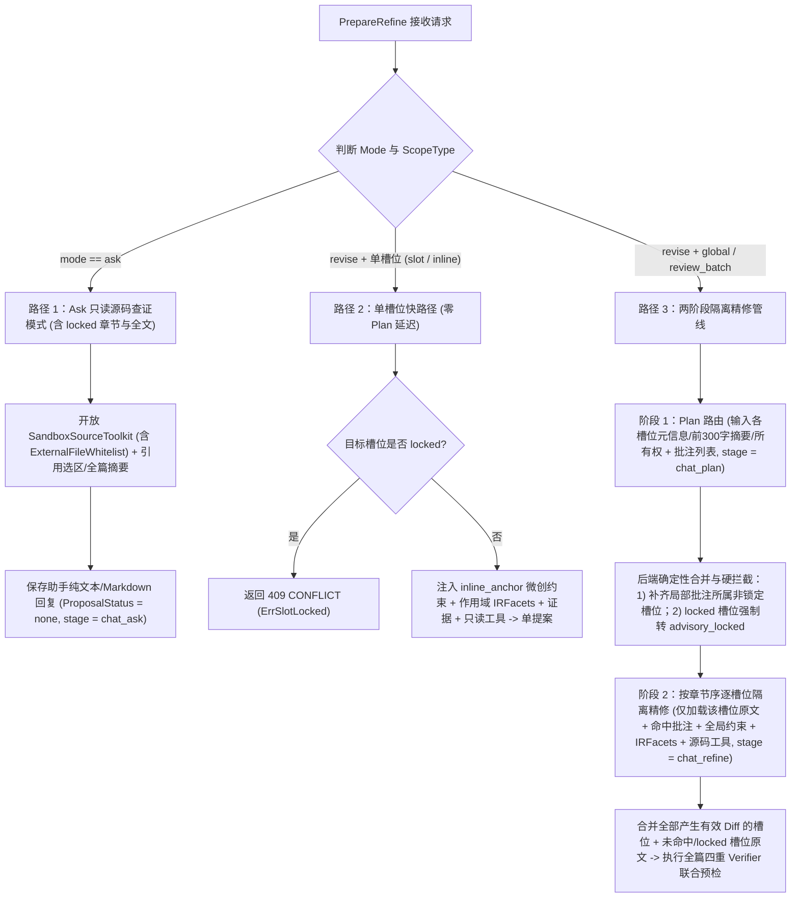

# ADR-06: Canvas Studio 审阅批注篮、多槽位综合精修与文档级审校工作台架构

- **文档编号**：`06-document-review-and-refine-studio.md`
- **日期**：2026-11-21
- **状态**：已采纳 (Accepted) —— 已同步更新阶段一~四 SDD 规范与 M12 作战卡，进入 TDD 实施阶段
- **关联议题**：[`01-feature-matrix.md`](../01-features/01-feature-matrix.md) (`F-08`, `F-09`, `F-10`, `F-13`, `F-15`, `F-26`, `F-30`, `F-31`, `SC-05`, `SC-12`, `SC-13`, `Non-Goal 6`)；[`04-workbench-and-security.md`](../02-design/04-workbench-and-security.md)；[`05-database-schema.md`](../02-design/05-database-schema.md)；[`01-http-api-contract.md`](../03-api/01-http-api-contract.md)；[`02-data-model-and-dto-contract.md`](../03-api/02-data-model-and-dto-contract.md)；[`ADR-01`](./01-microfrontend-and-table-prefix-isolation.md)；[`ADR-03`](./03-evidence-anchor-and-publish-mount.md)；[`ADR-04`](./04-module-scope-discovery-and-hierarchical-docs.md)；[`ADR-05`](./05-doctype-blueprint-dual-mode-editor.md)

---

## 1. 背景与问题陈述 (Context & Problem Statement)

### 1.1 现状实现基线

当前 `code-archdoc` 已在 `W2 (M5)` 落地了基于「单槽位对话 + SSE Diff 提案」的 `Chat 精修` 能力，整体技术架构围绕 `CanvasStudioPage` 展开，现行关键实现如下：

| 维度 / 环节 | 现状实现 | 代码 / 文档位置 |
| :--- | :--- | :--- |
| **前端右侧辅助抽屉** | `RightUtilityDrawer` 固定 `440px` 宽，含 `源码证据`、`修订历史`、`Chat 精修` 3 个 Tab，顶栏按钮点击直跳目标章节 | `frontend/src/components/studio/RightUtilityDrawer.tsx`、`frontend/src/pages/CanvasStudioPage.css` |
| **Chat 精修面板与 SSE 解析** | `ChatRefineTab` 顶部放置「目标精修章节 `<select>` + 会话 `<select>`」，流式等待期间直接以 `<pre>` 展示 LLM 原始文本输出；`sseParser.ts` 通过固定 7 事件 `switch` 白名单解析 SSE 帧 | `frontend/src/components/studio/ChatRefineTab.tsx`、`frontend/src/utils/sseParser.ts`、`frontend/src/types/sse.ts` |
| **提案审阅卡片** | `DiffProposalCard` 在 `max-height: 240px` 源码框中展示单槽位 `UnifiedDiff` 与 `Verifier` 预检，仅支持「全盘拒绝 / 全盘采纳 (Accept)」 | `frontend/src/components/studio/DiffProposalCard.tsx` |
| **画布正文渲染与内联编辑** | `SectionMarkdownRenderer` 基于零 `dangerouslySetInnerHTML` 纯函数 AST 解析器渲染标题、段落、表格、代码块与 `MermaidZoomViewer`；`SectionInlineEditor` 仅绑定 `PUT /api/documents/:id/sections/:slot_id` 手工直编 | `frontend/src/components/studio/SectionMarkdownRenderer.tsx`、`frontend/src/utils/markdown.ts`、`frontend/src/components/studio/SectionCard.tsx`、`frontend/src/components/studio/SectionInlineEditor.tsx` |
| **后端精修编排** | `PrepareRefine` 强制校验非空 `prompt` 并绑定单一 `target_slot_id`（遇 `locked` 无条件返 `409`）；`ExecuteRefineStream` 调用 `pkg/llm/chat_refine.go` 与 `SandboxSourceToolkit`，当 `afterMD` 为空时直接报 `EMPTY_PROPOSAL` | `handlers/chat.go`、`services/chat_service.go`、`pkg/llm/chat_refine.go`、`pkg/llm/source_tools.go`、`pkg/llm/tool_loop.go` |
| **持久化与修订管线** | 共有 18 张 `archdoc_*` 表（由 `models/models_test.go` `TestAll18TablesPrefixAndAutoMigrate` 守护）；Chat 模型为 `archdoc_chat_sessions` 与 `archdoc_chat_messages`（每条助手消息仅存 1 个槽位 Diff 且未持久化 `cited_anchors`）；`AcceptProposal` 调 `RevisionService.ApplySectionChange` 生成 1 个单槽位不可变修订 | `models/db.go`、`models/chat.go`、`models/stores.go`、`services/revision_service.go` |

### 1.2 核心问题清单

在真实「通读生成文档 → 多处指正修改 → 补充业务背景 → 审阅确认定稿」的审核场景下，结合代码基线深度检视，现行设计暴露出以下 **7 项核心摩擦与基线缺陷**：

| 编号 | 问题 | 严重度 | 根因分析 |
| :--- | :--- | :---: | :--- |
| **P-1** | **手眼割裂，缺乏“指哪改哪”的正文锚定** | 🔴 | 用户在中央画布阅读时划选一段文本（如某句冗余统计或错误表述）或悬停某张 Mermaid 图/表格，界面无任何审阅交互；必须切到右侧顶部下拉框选 `target_slot_id`，再用文字反复复述原句位置。 |
| **P-2** | **单点单轮阻塞阅读心流，产生碎片修订** | 🔴 | 通读一篇技术文档通常发现 4~8 处修改意见（措辞精简、源码纠错、知识补充、图表补全）。现有模式每发现一处就必须中断阅读、发起一次 SSE 请求、等待完成并点一次 `Accept`，导致频繁打断且堆出大量碎片化 `Revision`。 |
| **P-3** | **强绑定单槽位 + 强制产出 Diff，缺全局意见与纯查证问答** | 🔴 | ① `PrepareRefine` 强绑定单个 `target_slot_id`（且遇 `locked` 章节一律 `409` 拦截），无法处理跨章节/全局性评论（如“全文去除 LOC/bytes 统计”、“整篇补充越权与降级边界”），也无法针对 `locked` 章节发起只读源码查证；<br>② 若用户仅想划选某句向 AI 查证源码一致性（不改稿），`ExecuteRefineStream` 一旦未提取出非空 `afterMD` 即报错 `EMPTY_PROPOSAL`（`services/chat_service.go`）。 |
| **P-4** | **窄栏源码 Diff 难审阅，流式阶段裸露原始 JSON** | 🟠 | ① `440px` 窄栏内的 `240px` 高行级 Diff 框难以审阅长段、Markdown 表格或 Mermaid 图变更，且采纳前无法针对 10% 细节进行微调；<br>② LLM 输出为 `{"reply": ..., "markdown": ..., "cited_anchors": ...}`，流式 `delta` 事件直接把 JSON 协议字符与转义换行渲染在 `<pre>` 气泡中，阅读体验割裂。 |
| **P-5** | **人工业务经验与全局规范无法沉淀复用** | 🟠 | 审校过程中负责人常补充源码中无法体现的隐性业务约束或全文口径规范。当前精修仅作用于单次对话，下次重生成、增量刷新或单槽位失败重试时若未将整章置为 `locked`，人工经验极易被覆盖流失。 |
| **P-6** | **缺乏结构化审阅记录载体** | 🟡 | 修改意见散落在多轮对话气泡中，缺少按“待处理 / 已出提案 / 已解决 / 已忽略”追踪的批注清单，也缺少向后续 `F-22` 全员只读读者纠错反馈平滑演进的实体底座。 |
| **P-7** | **代码基线隐蔽缺陷：采纳/直编丢失非内联证据锚点，且 Chat 精修与 `ADR-04` 多模块上下文断链** | 🔴 | ① **证据锚点丢失**：`ChatMessage` 未落库 `cited_anchors`，`AcceptProposal` 调 `ApplySectionChange` 时未传 `CitedAnchors`，且 `ApplySectionChange`（`services/revision_service.go:663-675`）对所有未修改章节传 `CitedAnchors: nil`；当快照 `irBundle != nil` 时重跑 `Verifier` 会导致未修改章节（及被采纳章节）丢失非内联反引号类的结构化锚点（如 `module_doc`、`proto_rpc`、`http_route`、`config_key`）；<br>② **`ADR-04` 多模块断链**：`ChatService.ExecuteRefineStream` 初始化 `SandboxSourceToolkit` 时遗漏了 `prep.ModuleContext` 的 `ExternalFileWhitelist`，`BuildChatRefineMessages` 未注入 `ModuleContext` / `ModuleDigests` 与 `RepoIRFacets` 过滤，且 `ChatService` 与 `RevisionService.verifyAndAppend` 调 `Verifier.Verify` 时均未传入 `ModuleDigests`，导致子模块跨模块契约工具查阅被拒、整仓汇总文档精修/直编后 `module_doc` 锚点校验失配。 |

---

## 2. 决策概览与候选方案对比 (Decision Summary & Alternatives)

### 2.1 整体架构视图

结合用户确认的**「审阅批注篮为主视图、精修对话为辅；首期仅面向文档负责人/管理员（`ScopeWrite`）自审与 AI 精修」**核心产品方向，本 ADR 将右侧面板与中央画布联动升级为**「文档审校精修台（Review & Refine Studio）」**：

```mermaid
flowchart LR
    Canvas["中央画布 (划词悬浮条 / 块级 + 入口)"] -->|"捕获 anchor_json 与 scope_type"| Basket["审阅批注篮主视图 (archdoc_review_comments)"]
    ChatUI["精修对话辅视图 (Ask 查证 / 单点快修)"] -->|"引用锚点或挂载上下文"| Engine
    Basket -->|"一键综合精修 (局部批注 + 全局评论)"| Engine["两阶段隔离精修引擎 (Plan -> Scoped Slot Refine)"]

    Engine -->|"mode = ask"| AskOut["只读源码查证回答 (不强求 Diff / 一键转修订)"]
    Engine -->|"单槽位快路径"| SlotLoop["单槽位隔离精修 (含微创提示 + 只读源码工具)"]
    Engine -->|"多槽位 / 全局批注"| PlanStage["阶段 1：Plan 路由 (命中非 locked 槽位)"]

    PlanStage -->|"locked 槽位硬降级"| Advisory["advisory_locked 人工修改建议 (零篡改)"]
    PlanStage -->|"逐个命中槽位隔离执行"| SlotLoop
    SlotLoop --> StreamSplit["双段流式切分器 (正文说明实时推送 + Payload 屏蔽 JSON)"]
    StreamSplit --> Verifier["全篇联合四重 Verifier 预检"]
    Verifier --> ProposalGroup["多槽位提案组 (archdoc_chat_proposal_items)"]

    ProposalGroup -->|"画布原地审阅 (红绿对比 / 渲染态 / 微调后采纳)"| ApplyTx["ApplyMultiSectionChanges (乐观锁 + 原子单 Revision)"]
    ApplyTx -->|"关联批注 -> resolved"| Basket
    Basket -->|"persist_for_regen = true"| RegenInject["未来重生成 / 增量刷新尾部上下文注入 (不破坏 KV Cache 前缀)"]
```



### 2.2 候选方案评估

| 候选方案 | 核心做法 | 优点 | 缺点与风险 | 结论 |
| :--- | :--- | :--- | :--- | :---: |
| **方案 A：审阅批注篮为主 + 对话为辅 + 两阶段隔离精修引擎** | 新增结构化 `archdoc_review_comments`（支持划词/块级/章节/全局）与 `archdoc_chat_proposal_items`（多槽位提案组）；后端采用 `Plan -> Scoped Slot Refine` 保证 `locked` 与未命中槽位字节级不变；前端画布支持划词/块级批注、原地渲染对比与采纳前微调。 | 贴合“先通读批注、再批量综合精修、集中审阅一次落版”的真实审校心流；100% 兼容既有 `slot_id` 隔离、`locked` 保护、乐观锁与 Verifier 体系；纯自研零重型依赖，完美契合 `Non-Goal 6`。 | 新增 2 张 `archdoc_*` 表及多阶段 SSE 事件状态管理，需分 `M12-A / B / C` 渐进交付。 | ✅ **采纳** |
| **方案 B：仅增加划词引用 + 将整篇全文一次性送 LLM 重写** | 保留纯 Chat 对话为主，划词只把文本塞进输入框；遇全局修改时把整篇 `FullMarkdown` 送给单次 LLM 请求重生成全部内容。 | 实现最简单，无需建批注表与多槽位提案表。 | 仍强迫单点逐条问答、打断通读；整篇重写极易发生模型漏改、越权篡改 `locked` 章节、超出单次输出 Token 上限及破坏非目标章节字节级不变量。 | ❌ **放弃** |
| **方案 C：引入富文本协同编辑器（TipTap / ProseMirror）重造画布** | 用富文本编辑器框架重构整个 `SectionMarkdownRenderer`，内置原生 Track Changes 与划词评论插件。 | 编辑与划词体验原生化，类似 Google Docs。 | 严重违背 `Non-Goal 6` 与现有自定义安全 AST + `MermaidZoomViewer` + 证据深链架构；Markdown 双向序列化失真风险高，且无法直接与 `slot_id` / `Code IR` / `Verifier` 解耦协作。 | ❌ **放弃** |

### 2.3 核心决策摘要

| 决策 | 核心要点 | 解决问题 |
| :--- | :--- | :--- |
| **D-1 结构化审阅批注、文档内单调编号与前端零依赖锚定** | 新增第 19 张表 `archdoc_review_comments`（含文档内单调递增 `comment_no`、支持 `inline` / `section` / `global` 与 5 类语义标签 + `persist_for_regen` 及提案 `superseded` 自动回退 `open` 状态机）；前端扩展 `markdown.ts` 块级行号（含递归 `blockquote` 行号偏移）并沉淀纯函数 `reviewAnchor.ts`，实现划词与块级捕获、跨行内节点偏移区间投影高亮与三级降级定位。 | P-1、P-2、P-5、P-6 |
| **D-2 两阶段隔离精修引擎、多模块上下文对齐与去 JSON 化流式协议** | 扩展 `ChatRefineRequest` 兼容 `mode` (`revise\|ask`) 与批注批量入口；实现 `Ask` 纯查证模式（含 `locked` 章节）、单槽位微创快路径、全局/多批注 `Plan -> Scoped Slot Refine` 两阶段引擎（`locked` 槽位强制降级为 `advisory_locked` 建议，阶段 2 串行或互斥流式输出并支持部分成功）；贯通 `ADR-04` `ModuleContext` 工具白名单与 `ModuleDigests`；引入支持多轮 Tool-Calling 轮次重置的双段流式切分器屏蔽原始 JSON 裸露。 | P-2、P-3、P-4、P-7 |
| **D-3 多槽位提案组、证据锚点无损保留与单事务原子批量采纳** | 新增第 20 张表 `archdoc_chat_proposal_items`（持久化 `cited_anchors`）并微扩展 `archdoc_chat_messages`；新增多提案组按子集/人工微调后一次采纳接口，后端收口于 `RevisionService.ApplyMultiSectionChanges`（单事务 + 乐观锁 + 未改动与已采纳槽位证据锚点无损继承 + 全篇 Verifier + 单次新 Revision + 关联批注状态闭环）。 | P-2、P-4、P-7 |
| **D-4 「批注篮为主、对话为辅」双视图与画布联动** | 重构 `ChatRefineTab` 为 `审校精修` Tab（主视图：审阅批注篮；辅视图：精修对话；抽屉支持 `440px <-> 680px` 展宽）；画布实现划词悬浮条、块级 `+` 入口、正文 `#N`（`comment_no`）双向定位与章节内原地审阅态（红绿 Diff / 渲染态对比 / 微调暂存或即时采纳）。 | P-1、P-2、P-4 |
| **D-5 审校记忆三路径沉淀与首期 RBAC 边界** | 首期全部审阅与精修 API 严格复用 `ScopeWrite`（仓库/子目录负责人与管理员），预留 `origin_role` 兼容后续 `F-22` 协作；支持将非 `dismissed` 的 `persist_for_regen` 规范/背景按作用域注入未来全量重生成、增量刷新与单槽位失败重试 3 条 L2 生成路径的尾部上下文，绝不破坏 `BuildSlotMessages` 的 KV Cache 前缀（NFR-6）。 | P-5、P-6 |

---

## 3. 决策 D-1：结构化审阅批注模型与前端鲁棒锚定机制

### 3.1 新增数据模型：`archdoc_review_comments`（第 19 张自有表）

遵循 `ADR-01` 表前缀规范，在 `models/` 中新增 `ReviewComment`（表名 `archdoc_review_comments`），作为文档审核意见、划词锚点、全局补充与持久约束的统一事实源：

```go
package models

import (
	"time"
	"code-archdoc/config"
	"gorm.io/datatypes"
)

// ReviewScopeType 审阅批注作用域枚举
const (
	ReviewScopeInline  = "inline"  // 画布正文划词或块级（表格/Mermaid/段落）批注，必有 slot_id
	ReviewScopeSection = "section" // 章节级批注，必有 slot_id
	ReviewScopeGlobal  = "global"  // 全局评论、全文口径或跨章补充，slot_id 为空
)

// ReviewCategory 审阅批注语义分类（指导 LLM 权重与后续沉淀）
const (
	ReviewCategoryCorrection = "correction"  // 纠错修正（代码事实有误，优先触发只读源码工具核查）
	ReviewCategorySupplement = "supplement"  // 知识补充（业务背景/隐性约束，忠实融入且建议关注 hybrid）
	ReviewCategoryConcise    = "concise"     // 精简改写（篇幅/表述/格式调整，严禁篡改既有技术事实）
	ReviewCategoryGlobalRule = "global_rule" // 全局规范（跨章节统一风格/删减口径）
	ReviewCategoryQuestion   = "question"    // 疑问待核（查证备忘或待人工核实）
)

// ReviewCommentStatus 审阅批注生命周期状态
const (
	ReviewStatusOpen      = "open"      // 待处理（仍在审阅批注篮激活区）
	ReviewStatusProposed  = "proposed"  // 已送入综合精修并产出 pending 提案，待审阅采纳
	ReviewStatusResolved  = "resolved"  // 关联提案已采纳生效或手工直编确认已解决
	ReviewStatusDismissed = "dismissed" // 已忽略 / 撤回取消
)

// ReviewOriginRole 批注来源角色（首期恒为 owner，为 P1 F-22 读者协审预留零破坏演进位）
const (
	ReviewOriginOwner    = "owner"
	ReviewOriginReviewer = "reviewer"
)

// ReviewCommentAnchor 存储在 archdoc_review_comments.anchor_json 中的 W3C TextQuoteSelector 风格定位器
type ReviewCommentAnchor struct {
	BlockIndex      int    `json:"block_index,omitempty"`       // 对应 SectionMarkdownRenderer 顶层块序（0-based）
	BlockType       string `json:"block_type,omitempty"`        // paragraph | list | table | mermaid | code | blockquote | heading
	Quote           string `json:"quote,omitempty"`             // 划选原文摘录（纯文本/源码片段，长度上限 500 字符）
	Prefix          string `json:"prefix,omitempty"`            // 选区前导上下文（最多 48 字符，消除同词歧义）
	Suffix          string `json:"suffix,omitempty"`            // 选区后继上下文（最多 48 字符）
	SourceLineStart int    `json:"source_line_start,omitempty"` // 该块在章节原始 Markdown 中的起止行号（1-based）
	SourceLineEnd   int    `json:"source_line_end,omitempty"`
}

// ReviewComment 文档审阅批注实体（第 19 张 archdoc_* 自有表）
type ReviewComment struct {
	ID                 uint           `gorm:"primaryKey" json:"id"`
	DocumentID         uint           `gorm:"not null;uniqueIndex:idx_archdoc_rc_doc_no,priority:1;index:idx_archdoc_rc_doc_status,priority:1" json:"document_id"`
	CommentNo          int            `gorm:"not null;default:0;uniqueIndex:idx_archdoc_rc_doc_no,priority:2" json:"comment_no"` // 文档内单调递增短编号 (#1, #2...)
	BaseRevisionNo     int            `gorm:"not null;default:0" json:"base_revision_no"`
	AuthorID           uint           `gorm:"not null;index" json:"author_id"`
	OriginRole         string         `gorm:"size:16;not null;default:'owner'" json:"origin_role"`
	ScopeType          string         `gorm:"size:16;not null;default:'inline'" json:"scope_type"`
	SlotID             string         `gorm:"size:64;not null;default:'';index" json:"slot_id"`
	AnchorJSON         datatypes.JSON `gorm:"type:jsonb;not null;default:'{}'" json:"anchor"`
	Category           string         `gorm:"size:24;not null;default:'correction'" json:"category"`
	Content            string         `gorm:"type:text;not null" json:"content"`
	PersistForRegen    bool           `gorm:"default:false;not null;index" json:"persist_for_regen"`
	Status             string         `gorm:"size:20;not null;default:'open';index:idx_archdoc_rc_doc_status,priority:2" json:"status"`
	ProposalGroupMsgID *uint          `gorm:"index" json:"proposal_group_msg_id,omitempty"`
	ResolvedRevisionID *uint          `json:"resolved_revision_id,omitempty"`
	CreatedAt          time.Time      `json:"created_at"`
	UpdatedAt          time.Time      `json:"updated_at"`
}

func (ReviewComment) TableName() string { return config.TablePrefix + "review_comments" }
```

**批注编号与状态机核心不变量**：
1. **文档级单调短编号 (`CommentNo`)**：新建批注时在事务内对目标 `Document` 行加锁（或基于 `(document_id, comment_no)` 唯一索引重试），按 `COALESCE(MAX(comment_no), 0) + 1` 分配文档内唯一短编号（`#1, #2, #3...`）。确保画布角标 `<sup className="code-archdoc-review-pin">#1</sup>`、批注篮卡片与 AI 修改说明引用的 `#N` 简短一致且永久稳定（不暴露全局数据库自增 ID `#147`，也不因中途删除/解决其他批注而发生编号漂移）；
2. **草稿创建与编辑**：新建批注默认状态为 `open`，支持编辑正文、切换 `category`、`persist_for_regen`、手动流转状态（`resolved` / `dismissed` / `open`）或物理删除（仅限 `open`/`dismissed` 且未绑定已采纳历史修订的草稿）；
3. **送修与异常回滚**：发起 `review_batch` 综合精修且成功产出至少 1 条关联 `ChatProposalItem` 后，仅将该提案项实际覆盖的 `open` 批注更新为 `proposed` 并关联 `proposal_group_msg_id`（未被任何提案项改变的槽位所关联批注保持 `open`）；若中途取消 SSE 或模型调用失败，所有批注保持为 `open`；
4. **采纳、拒绝与取代（Superseded）全闭环**：
   - 当关联提案项被 **采纳（Apply）** 时，该提案项覆盖的批注全部转为 `resolved` 并记录 `resolved_revision_id`；
   - 当某提案项在批量采纳中**未被勾选**、被显式 **拒绝（Reject）**，或因用户随后执行**手工直编（`UpdateDocumentSection`）**、**采纳同槽位新提案（`SupersedePendingProposals`）**、**版本回滚（`RollbackRevision`）**、**重生成**导致该 `pending` 提案项转为 `superseded` 时，其关联且仍处于 `proposed` 状态的批注**必须自动回退为 `open`（并清空 `proposal_group_msg_id`）**，彻底杜绝批注卡死在 `proposed` 悬空状态。

### 3.2 前端零依赖锚定与三级降级匹配 (`frontend/src/utils/reviewAnchor.ts`)

为保持 [markdown.ts](file:///home/fugui/codes/code-archdoc/frontend/src/utils/markdown.ts) 零第三方重型编辑器与零 `dangerouslySetInnerHTML` 的安全基线，采用轻量、可单测的纯函数锚定体系：

1. **块级 AST 增补行号元信息（兼容递归 `blockquote`）**：
   - 在 `parseMarkdownBlocks(markdown: string, baseLineOffset = 0)` 的 `MarkdownBlockNode` 各分支上补充可选元数据 `startLine?: number` / `endLine?: number`（1-based 章节内源码行号）；
   - 当解析 `blockquote` 递归调用 `parseMarkdownBlocks(quoteLines.join('\n'), quoteStartLine - 1)` 时传入基准行号偏移，保证嵌套引用块同样具备准确的章节内绝对行号；在 `SectionMarkdownRenderer` 中仅对顶层块容器渲染 `data-block-index={idx}` 与 `data-block-type={block.type}`，对现有渲染逻辑 100% 向后兼容。
2. **双入口精准捕获**：
   - **划词捕获**：在 `SectionMarkdownRenderer` 外层容器（带 `data-slot-id={section.slot_id}`）监听 `onMouseUp`，通过 `window.getSelection()` 判断选区非空且起止节点落在同一 `data-slot-id` 容器内（若用户跨章节拖拽选区，轻提示「跨章节选区已自动转为全局意见」并降级为 `global`）；从最近的顶层 `[data-block-index]` DOM 节点读取 `block_index`、`block_type`、`startLine`、`endLine`，从该块扁平化纯文本中提取 `quote`（≤ 500 字符）及选区前后各最多 48 字符 `prefix` / `suffix`。
   - **块级悬浮 `+` 入口**：针对 `mermaid` 图、`table` 表格、`code` 代码块等不易划选文字的块，在每个顶层块级容器渲染悬浮 `+ 批注` 微按钮；点击后直接生成 `quote = "[Mermaid 图表]"` 或 `"[表格: 列1 / 列2...]"` 的块级锚点。
3. **三级降级定位与跨行内节点零 XSS 高亮投影**：
   - 渲染章节时，根据当前待处理/待审阅（`open` / `proposed`）的批注，通过纯函数 `locateAnchorInBlocks(blocks, anchor)` 按以下顺序定位：
     1. **Level 1（同块精确上下文命中）**：在 `blocks[block_index]` 提取的扁平纯文本 `extractBlockPlainText(block)` 中优先匹配 `prefix + quote + suffix`，次选同块唯一 `quote`，返回块内字符偏移区间 `[startOffset, endOffset]`；
     2. **Level 2（跨块重排滑窗容错）**：当人工直编增删前置段落导致 `block_index` 偏移时，遍历同 `slot_id` 全部块，按 `prefix + quote + suffix` 滑窗评分重新绑定到新 `blockIndex` 与 `[startOffset, endOffset]`；
     3. **Level 3（块级整体 / 失锚降级）**：对于 `mermaid` / `table` / `code` 块级批注（或跨表格单元格选区），直接命中对应 `blockIndex` 并以块级外框高亮（`.code-archdoc-review-block--highlighted`）+ 块右上角 `#N` 角标呈现；若因章节大幅重写导致文本彻底失配，标记为 `detached`，不强行错位高亮，而是在章节正文顶部以 `失锚待核批注 (#N)` 聚合条展示，支持一键编辑、转全局或标记已解决。
   - **跨行内节点偏移区间投影**：由于一段 Markdown 文本常被 `parseInlineMarkdown` 拆分为相邻的 `text`、`code`、`strong`、`em`、`link` 节点，若划选范围跨越了行内代码或加粗标签，单纯在单个 `text` 节点内做子串匹配会失效。`SectionMarkdownRenderer` 在 `renderInlines` 渲染已命中块时维护递增的块内字符游标 `[nodeStart, nodeEnd]`：凡与目标高亮区间 `[startOffset, endOffset]` 相交的文本切片均安全包裹于 `<mark className="code-archdoc-review-mark">`，并在区间末端 `endOffset` 处插入 `<sup className="code-archdoc-review-pin">#{comment_no}</sup>` 定位角标，**全程纯 React 节点树构造，严禁任何 HTML 字符串拼接**。

---

## 4. 决策 D-2：两阶段隔离精修引擎 (`Plan → Scoped Slot Refine`)、`Ask` 查证模式与去 JSON 化流式协议

### 4.1 `ChatRefineRequest` 契约向后兼容扩展与前置校验规则

保留既有字段零破坏，在 `services.ChatRefineRequest` 与前端 `ChatRefinePayload` 中增量扩展：

```go
type ChatRefineRequest struct {
	SessionID      *uint                        `json:"session_id"`
	Mode           string                       `json:"mode"`            // "revise" (默认，兼容旧请求) | "ask" (纯查证讨论)
	ScopeType      string                       `json:"scope_type"`      // "slot" (默认) | "inline" | "global" | "review_batch"
	TargetSlotID   string                       `json:"target_slot_id"`  // slot/inline 必填；global/review_batch 可为空
	BaseRevisionNo int                          `json:"base_revision_no"`
	Prompt         string                       `json:"prompt"`          // 用户补充指令（review_batch 下可为空，由批注篮汇总驱动）
	CommentIDs     []uint                       `json:"comment_ids"`     // review_batch 时指定要综合处理的批注 ID 列表
	InlineAnchor   *models.ReviewCommentAnchor  `json:"inline_anchor"`   // inline 快修或划词查证时携带的选区上下文
}
```

**`PrepareRefine` 参数归一化与前置守卫规则**：
1. **默认值归一化**：`mode` 为空时默认 `"revise"`（仅允许 `"revise"` | `"ask"`）；`scope_type` 为空时默认 `"slot"`（仅允许 `"slot"` | `"inline"` | `"global"` | `"review_batch"`）。
2. **按作用域校验 `prompt`、`target_slot_id` 与 `comment_ids`**：
   - 当 `scope_type` 为 `"slot"` 或 `"inline"` 时：`prompt` 必填；`target_slot_id` 必须存在于当前修订章节中（为空时兼容旧行为默认取首章节）；若 `mode == "revise"` 且目标章节为 `locked`，立即返回 `409 CONFLICT (ErrSlotLocked)`；**若 `mode == "ask"`，即使目标章节为 `locked` 也正常放行**（支持对锁定章节发起源码一致性查证）；
   - 当 `scope_type == "global"` 时：`prompt` 必填，`target_slot_id` 允许为空；
   - 当 `scope_type == "review_batch"` 时：`comment_ids` 必须非空（去重后上限 20 条），且校验全部属于当前 `docID`、状态非 `resolved`/`dismissed`；此时 `prompt` 允许为空，若 `prompt` 为空则自动合成可读的用户消息正文（如 `"【批注篮综合精修】综合处理 N 条审阅批注（#1, #2...）"`）写入 `userMsg.Content` 与会话默认标题，防止会话历史出现空白气泡或在上下文拼接时被过滤。
3. **全面对齐 `ADR-04` 多模块上下文与工具白名单（修复 P-7 ②）**：
   - 子模块文档（`doc.Subdirectory != ""`）：若 `DocType.Meta.ContextInputs` 包含 `"module_context"`，向 `BuildChatRefineMessages` 注入 `ModuleContext` 分片；同时在构造 `SandboxSourceToolkit` 时，从 `ModuleContext.ExternalFileWhitelist` 与 `ModuleContext.ReferencedExtSymbols` 提取 `ExternalFileWhitelist` 传入 `SandboxToolkitConfig`（与 `GenerationOrchestrator.executeSlotLLM` 保持严格同构），确保 Chat 精修与 `Ask` 查证可合法查阅跨模块外部契约文件；
   - 整仓汇总文档（`doc.Subdirectory == ""`）：若 `DocType.Meta.ContextInputs` 包含 `"module_digests"`，按 `filterSlotSpecForScope`（`RepoIRFacets`）裁剪注入槽位的 IR 分片以防整仓 `symbols` 撑爆上下文，并向 `BuildChatRefineMessages` 及 `Verifier.Verify` 传入 `ModuleDigests`，确保整仓汇总文档在精修预检与采纳时能正确对齐 `symbol_kind = "module_doc"` 证据锚点。

### 4.2 三条执行路径与硬安全守卫



核心硬规则说明：
1. **`locked` 章节不可被 AI 改写的绝对红线**：
   - 在单槽位直修路径中，保持现有 `ErrSlotLocked`（HTTP `409`）硬拦截不变；
   - 在 `global` / `review_batch` 综合精修中，即便 Plan 阶段或某条局部批注指向了某个 `locked` 槽位，后端也**绝不生成写入该槽位的 `Diff` 提案**，而是将其归类为 `advisory_locked` 写入 `plan_summary_json` 与回复说明（提示负责人：“以下意见涉及已锁定章节 `xxx`，已严格保留原文未改，建议您解锁或使用手工直编调整”），且指向该 `locked` 槽位的批注保持 `open`，确保批量/全局精修 100% 遵守 `F-10` 锁定豁免。
2. **Plan 阶段防漏改确定性兜底**：
   - 阶段 1 `Plan`（在 `pkg/llm/review_plan.go` 中实现纯函数解析与 Prompt 组装，调用耗时记入 `LLMUsageLog.Stage = "chat_plan"`）仅向模型传递文档大纲（`slot_id`、`title`、`ownership`、每章前 300 字摘录）+ 批注篮内容，输出 `target_slots: [{slot_id, reason, comment_ids}]`。
   - 为避免模型路由漏掉用户明确标在某章上的批注，后端执行**确定性并集兜底**：凡用户提交的 `inline` / `section` 批注指向某非 `locked` 槽位，强制将其纳入 `target_slots`；仅当存在 `global` 意见时由 `Plan` 自动筛选相关非锁定槽位（单次最多允许精修 **≤ 6 个**非锁定槽位，优先保障局部批注直接命中的槽位，超出部分在 `plan_summary_json` 中提示分批）。
   - 若所有批注均仅命中 `locked` 槽位导致可执行非锁定 `target_slots` 为空，阶段 2 无需发起槽位重写调用，直接将 `advisory_locked` 建议写入助手消息（`ProposalStatus = "none"`）并正常推送 `plan -> delta -> done`，不报 `EMPTY_PROPOSAL`。
3. **阶段 2 顺序隔离执行、SSE 写锁安全与部分成功容错**：
   - **顺序执行与 SSE 互斥写保护**：由于 HTTP `gin.ResponseWriter` 非并发安全，且并发交错推送多个章节的 `delta` 会导致前端流式文本混杂，阶段 2 对命中的 `target_slots` **按文档章节顺序依次串行执行**（同时在 `emit` 闭包外层加 `sync.Mutex` 保护）。同一文档相邻槽位共享相同的仓库快照与活跃租约（`AcquireRepoLease` 在整个 `ExecuteRefineStream` 生命周期内统一持有 1 次），每完成 1 个槽位即刻持久化该条 `ChatProposalItem` 并推送 `proposal_item` 事件，用户可在画布上“边出边审”。
   - **无差异与部分失败容错（Partial Success）**：在多槽位精修中，若某个目标槽位经模型评估认为无需改动（`strings.TrimSpace(afterMD) == strings.TrimSpace(beforeMD)`）或单槽位解析为空，跳过为该槽位生成 `ChatProposalItem`，其专属批注维持 `open`；只要本次请求有 **≥ 1 个槽位**产出了有效 `ChatProposalItem`（或产出了 `advisory_locked` 建议），整次综合精修即视为成功，仅在所有命中非锁定槽位均未产出有效修订且无锁定建议时才返回 `EMPTY_PROPOSAL`。
4. **单槽位微创约束**：
   - 当请求携带 `inline_anchor` 或局部 `inline` 批注时，Prompt 明确注入指令：“仅围绕定位摘录与上下文实施精准微创修订，严禁随意改写、重排或删减本章节其他无关段落”，避免 AI 为改一句话而重写整节引发大面积 Diff 噪音。
5. **`Ask` 纯查证模式闭环**：
   - 允许在任何槽位（包括 `locked` 章节）或全文作用域下以 `mode = "ask"` 发起提问（`LLMUsageLog.Stage = "chat_ask"`）；流式推送 `delta` 与 `tool_call` 轨迹，结束时不解析 `afterMD`、不写入任何 `ChatProposalItem`，助手消息 `Intent = "ask"`、`ProposalStatus = "none"`。前端在查证回复气泡底部提供 **「按此查证结论生成修正提案」** 与 **「转为审阅批注」** 两个快捷动作。

### 4.3 双段流式输出协议与增量切分器 (`pkg/llm/stream_splitter.go`)

针对当前流式阶段直接向用户 `<pre>` 暴露 `{"reply": "...", "markdown": "..."}` 原始 JSON 的体验缺陷（**P-4**），统一约定新版分隔式输出协议并保持对多轮 Tool-Calling 及内网弱指令遵循模型的 100% 向下兼容：

1. **LLM 双段分隔输出格式（仅 `mode == "revise"` 阶段 2 使用；`mode == "ask"` 直接输出纯 Markdown）**：
   ```text
   <<<ARCHDOC_REPLY>>>
   （面向负责人的清晰中文修改综述，逐字通过 SSE delta 实时流式推送给前端渲染）
   <<<ARCHDOC_PAYLOAD_JSON>>>
   {"markdown": "修订后的章节完整 Markdown 正文（不含一级标题）", "cited_anchors": [{"file_path": "...", "fq_symbol": "...", "symbol_kind": "...", "scope": "..."}]}
   ```
   - 同步微调 `pkg/llm/prompt.go` 中的 `sourceToolsGuidancePrompt` 与 `pkg/llm/tool_loop.go` 中的 `toolLoopFinalizeNotice`：将末尾硬编码的“严格按第 4 条输出最终合法 JSON 对象”统一泛化为 **“核实完毕后停止调用工具，严格按 system 规定的最终输出格式返回结果”**，彻底消除多轮工具收敛提示与双段分隔协议及 `Ask` 纯文本模式之间的指令冲突。
2. **纯 Go 增量切分状态机 (`StreamSplitFilter`) 与多轮 Tool-Calling 协同**：
   - 在 `pkg/llm/stream_splitter.go` 实现带滑动尾部缓冲（长度 `len("<<<ARCHDOC_PAYLOAD_JSON>>>") - 1`）的流式过滤器，能够正确处理 `<<<ARCHDOC_REPLY>>>` 或 `<<<ARCHDOC_PAYLOAD_JSON>>>` 被任意拆分跨越多个 SSE chunk 的边界情况；
   - **多轮 Tool-Calling 轮次隔离**：在 `RunToolLoopStream` 中，模型可能在第 1 轮先发出 `tool_calls`（部分模型会附带简短过渡文本），在第 2 轮才输出最终修订。当 `OnToolEvent` 触发或新一轮 LLM 请求开始时，`StreamSplitFilter` 确保前序轮次的残留缓冲不误触发 `payload` 截断；
   - 在遇到 `<<<ARCHDOC_PAYLOAD_JSON>>>` 之前：自动剥离前导 `<<<ARCHDOC_REPLY>>>` 标记，将人类可读的修改说明实时通过 `emit("delta", {"text": chunk, "slot_id": slotID})` 推送；
   - 一旦检测到 `<<<ARCHDOC_PAYLOAD_JSON>>>`：立即停止向用户气泡推送后续 JSON 字符，切换推送状态事件 `emit("stage", {"stage": "drafting_diff", "slot_id": slotID})`，后端在内存中继续收齐 JSON 载荷；
   - **向后兼容降级与补偿推送**：`ParseChatRefineOutput(raw string)` 升级为优先按 `<<<ARCHDOC_PAYLOAD_JSON>>>` 切分提取 `replyText` 与 JSON 载荷；若部分内网模型未输出分隔符而从首非空字符直接输出 `{`（旧版 JSON 格式），`StreamSplitFilter` 检测到首非空字符为 `{` 时自动转入静默缓存模式（推送 `stage = "drafting_diff"` 而非裸 JSON `delta`），待流结束后由 `ParseChatRefineOutput` 解析出 `reply` 与 `markdown`，并在下发 `proposal_item` 前**补偿推送一条包含 `replyText` 的 `delta` 事件**，确保无论模型走新版双段协议还是旧版纯 JSON，前端气泡始终只展示干净的中文说明！
3. **升级后的 SSE 事件契约**（完全兼容既有 `meta` / `tool_call` / `delta` / `diff_proposal` / `verifier_preview` / `done` / `error`，同步扩展前端 `frontend/src/utils/sseParser.ts` 与 `frontend/src/types/sse.ts`）：

| SSE `event` 名称 | 新增 / 现有 | 核心载荷字段与前端语义 |
| :--- | :---: | :--- |
| **`meta`** | 现有增强 | `session_id`, `message_id`, `slot_id`, `mode`, `scope_type`, `base_revision_no`, `model_tier` |
| **`plan`** | **新增** | `target_slots: [{slot_id, title, comment_ids, reason}]`, `skipped_locked_slots: [{slot_id, title, advice}]` |
| **`stage`** | **新增** | `stage` (`planning` \| `refining_slot` \| `drafting_diff` \| `verifying`), `slot_id`, `index`, `total` |
| **`tool_call`** | 现有增强 | `round`, `tool_name`, `summary`, `is_error`, `duration_ms`, `slot_id?`（前端默认折叠展示） |
| **`delta`** | 现有净化 | `text`, `slot_id?`（仅含人类可读说明文本，零 JSON 转义噪音） |
| **`proposal_item`** | **新增** | 单个 `ChatProposalItemVO`（`item_id`, `message_id`, `slot_id`, `slot_title`, `before_md`, `after_md`, `unified_diff`, `cited_anchors`, `verifier_preview`, `addressed_comment_ids`, `status`） |
| **`diff_proposal`** | 现有保留 | 当仅产出 1 个槽位提案时同步下发（`proposal_id: assistantMsg.ID`），确保既有单槽位调用方与存量测试零破坏 |
| **`verifier_preview`** | 现有增强 | 全篇联合预检结果 `ChatVerifierPreviewVO`（基于所有受影响新槽位 + 其余未变槽位共同验证） |
| **`done`** | 现有 | `message_id`, `prompt_tokens`, `cached_prompt_tokens`, `completion_tokens`, `latency_ms` |
| **`error`** | 现有 | `code`, `message` |

---

## 5. 决策 D-3：多槽位提案组、证据锚点无损保留与单事务原子批量采纳

### 5.1 新增数据模型与 `archdoc_chat_messages` 增量扩展

1. **现有表增量列（`models/chat.go` `ChatMessage`，100% 向后兼容）**：
   - `Intent` (`string`, `size:16`, `not null`, `default:'revise'`): `revise` | `ask`
   - `ScopeType` (`string`, `size:20`, `not null`, `default:'slot'`): `slot` | `inline` | `global` | `review_batch`
   - `PlanSummaryJSON` (`datatypes.JSON`, `type:jsonb`, `not null`, `default:'{}'`): 记录阶段 1 路由目标槽位、未修改原因及对 `locked` 槽位的 `advisory_locked` 建议
   - `ContextRefsJSON` (`datatypes.JSON`, `type:jsonb`, `not null`, `default:'[]'`): 记录本次提问引用的选区锚点、槽位与 `comment_ids`
   > 说明：单槽位路径与多槽位路径下，每个产出有效 Diff 的槽位均落库一条 `archdoc_chat_proposal_items` 记录；当消息仅含 1 个槽位提案时，同步回填 `ChatMessage` 的 `TargetSlotID`、`ProposedBeforeMD`、`ProposedAfterMD`、`UnifiedDiff` 字段；`ListSessions` 返回 `ChatMessageVO` 时统一附带 `proposal_items: []ChatProposalItemVO`（对升级前仅有 `ChatMessage.ProposedAfterMD` 而无子表记录的历史消息，在 `ListSessions` 读取时自动内存派生 1 条虚拟 `ChatProposalItemVO` 返回），确保历史数据无须破坏性迁移即可一致渲染。

2. **新增表 `archdoc_chat_proposal_items`（第 20 张自有表）**：

```go
// ChatProposalItem 一次精修消息下包含的单槽位 Diff 提案项（第 20 张 archdoc_* 自有表）
type ChatProposalItem struct {
	ID                      uint           `gorm:"primaryKey" json:"id"`
	MessageID               uint           `gorm:"not null;uniqueIndex:idx_archdoc_cpi_msg_slot,priority:1;index" json:"message_id"`
	DocumentID              uint           `gorm:"not null;index:idx_archdoc_cpi_doc_slot_status,priority:1" json:"document_id"`
	SlotID                  string         `gorm:"size:64;not null;uniqueIndex:idx_archdoc_cpi_msg_slot,priority:2;index:idx_archdoc_cpi_doc_slot_status,priority:2" json:"slot_id"`
	BaseRevisionNo          int            `gorm:"not null;default:0" json:"base_revision_no"`
	ProposedBeforeMD        string         `gorm:"type:text;not null;default:''" json:"proposed_before_md"`
	ProposedAfterMD         string         `gorm:"type:text;not null;default:''" json:"proposed_after_md"`
	FinalAppliedMD          string         `gorm:"type:text;not null;default:''" json:"final_applied_md"` // 记录采纳时实际落库正文（含人工微调 override_markdown）
	UnifiedDiff             string         `gorm:"type:text;not null;default:''" json:"unified_diff"`
	CitedAnchorsJSON        datatypes.JSON `gorm:"type:jsonb;not null;default:'[]'" json:"cited_anchors"` // 持久化候选/对齐证据锚点（修复旧版 Accept 丢失 cited_anchors 缺陷）
	VerifierPreviewJSON     datatypes.JSON `gorm:"type:jsonb;not null;default:'{}'" json:"verifier_preview"`
	AddressedCommentIDsJSON datatypes.JSON `gorm:"type:jsonb;not null;default:'[]'" json:"addressed_comment_ids"`
	Status                  string         `gorm:"size:20;not null;default:'pending';index:idx_archdoc_cpi_doc_slot_status,priority:3" json:"status"` // pending | accepted | rejected | superseded
	AppliedRevisionID       *uint          `json:"applied_revision_id,omitempty"`
	CreatedAt               time.Time      `json:"created_at"`
	UpdatedAt               time.Time      `json:"updated_at"`
}

func (ChatProposalItem) TableName() string { return config.TablePrefix + "chat_proposal_items" }
```

### 5.2 HTTP API 增量契约（均挂载 `ScopeWrite` 守卫）

在保留原有 `/api/documents/:id/chat/*` 4 个接口 100% 向后兼容的基础上，新增以下 6 条 REST 接口（模块总接口数由 54 条增至 60 条）：

| 方法 | 路径 | 权限 | 审计等级 | 职责说明 |
| :--- | :--- | :---: | :---: | :--- |
| `GET` | `/api/documents/:id/review-comments` | `ScopeWrite` | — | 获取文档审阅批注列表（按 `comment_no ASC` 排序，支持按 `status` / `scope_type` / `slot_id` / `persist_for_regen` 筛选） |
| `POST` | `/api/documents/:id/review-comments` | `ScopeWrite` | — | 新建划词、块级、章节或全局审阅批注（分配单调 `comment_no`，校验 `slot_id` 合法性、`quote <= 500` 字符、`content` 非空） |
| `PATCH` | `/api/documents/:id/review-comments/:comment_id` | `ScopeWrite` | — | 修改批注正文、分类标签、`persist_for_regen` 开关或手动流转状态（`resolved` / `dismissed` / `open`） |
| `DELETE` | `/api/documents/:id/review-comments/:comment_id` | `ScopeWrite` | — | 删除未绑定已采纳历史修订的批注草稿（`open` / `dismissed`） |
| `POST` | `/api/documents/:id/chat/messages/:msg_id/apply` | `ScopeWrite` | `P1` | **统一提案组批量/微调采纳**：请求体 `{ base_revision_no, change_summary?, items: [{ item_id?, slot_id?, override_markdown? }] }`（`items` 为空时默认采纳该消息下全部 `pending` 提案项），单事务合并生成 1 个新修订 |
| `POST` | `/api/documents/:id/chat/proposal-items/:item_id/reject` | `ScopeWrite` | — | 拒绝提案组内的单个槽位提案项（同消息下其余未处置项保持 `pending`），将该项关联的 `proposed` 批注自动回退为 `open` |

> **向后兼容保障**：旧版 `POST /api/documents/:id/chat/messages/:msg_id/accept` 内部直接委托给 `ApplyProposalItems`（采纳该消息下全部 `pending` 项）；旧版 `POST /api/documents/:id/chat/messages/:msg_id/reject` 拒绝该消息下全部 `pending` 提案项并将其关联的 `proposed` 批注回退为 `open`，确保现有前端与存量单测零破坏。

### 5.3 `RevisionService.ApplyMultiSectionChanges` 统一事务核心与证据无损保留

在 [revision_service.go](file:///home/fugui/codes/code-archdoc/services/revision_service.go) 中抽象统一的多槽位原子更新方法 `ApplyMultiSectionChanges`（现有 `ApplySectionChange` 直接委托给单元素切片调用，**消除重复逻辑并一并修复 P-7 ① 证据锚点丢失缺陷**）：

1. **前置校验与去重**：校验 `base_revision_no > 0` 及目标 `changes` 列表非空、无重复 `slot_id` 且全部属于当前文档；在 `source == "chat_refine"` 下若任一目标槽位当前为 `locked`，拒绝写入并返回 `409 CONFLICT (ErrSlotLocked)`；
2. **乐观锁并发拦截**：校验 `doc.CurrentRevisionNo == base_revision_no`，不一致立即返回 `409 OPTIMISTIC_LOCK_CONFLICT`（携带服务端最新 `current_revision_no`）；
3. **非目标槽位字节级不变与全篇证据锚点无损继承（修复 P-7 ①）**：
   - 深拷贝 `prevRev` 章节快照切片，仅对本次采纳的 `slot_id` 集合更新 `Markdown`（若携带非空 `override_markdown` 则采用人工微调后的正文，否则采用 `proposed_after_md`）、`ContentSHA256 = sha256Hex(markdown)`、`ManuallyEdited = true`（若指定了合法的 `Ownership` 则同步更新）；**其余所有未选中及 `locked` 槽位的 `Markdown` 与 `ContentSHA256` 逐字节原样保留**；
   - **证据锚点无损构造**：构造 `verifier.SectionInput` 时：
     - 对于**本次修改的槽位**：传入本次提案持久化的 `CitedAnchors` 候选列表；
     - 对于**未修改的槽位**：从上一修订 `prevEvs` 中提取该槽位已有的 `EvidenceAnchor` 列表转换为 `verifier.CitedAnchorCandidate` 传入 `SectionInput.CitedAnchors`，并在 `verifyAndAppend` 组装 `SectionEvidence` 时，对未修改槽位若 `vRes.SectionEvidences[slotID]` 为空则兜底保留 `prevEvMap[slotID]`，确保局部精修或手工直编绝不会导致其他未修改章节丢失 `module_doc`、`proto_rpc`、`http_route`、`config_key` 等证据锚点！
4. **联合重跑四重 Verifier 与单一修订落盘**：合并全篇运行 `verifier.Verify()`（整仓文档且开启 `module_digests` 时同步加载传入 `ModuleDigests`），在单事务内生成 **仅 1 条** `revision_no = base + 1` 的不可变 `DocumentRevision`；
5. **提案、批注状态机与指标联动**：
   - 将本次采纳的 `ChatProposalItem` 标记为 `accepted` 并记录 `FinalAppliedMD` 与 `AppliedRevisionID`；
   - 收敛父 `ChatMessage.ProposalStatus`：若该消息下所有 `ChatProposalItem` 均已处于终态（存在至少 1 项 `accepted` 且其余无 `pending` 时父消息置为 `accepted`；全部为 `rejected` 时置为 `rejected`；若用户仅采纳了子集、尚余其他槽位未决，也可将未勾选的其余项一并置为 `rejected` 或保留 `pending` 供继续审阅——默认勾选采纳提交时：被勾选项置 `accepted`，未勾选但属于同一批次显式排除的项保持 `pending` 且其专属批注退回 `open`）；
   - 同文档同受影响槽位的其他旧 `pending` 提案项（及父消息）标记为 `superseded`，**同时将被 `superseded` 提案项所关联的 `proposed` 批注自动回退为 `open`**；
   - 将本次已采纳提案项覆盖的 `archdoc_review_comments`（含该槽位关联的局部批注，以及当全局批注关联的所有命中提案项均已处置完毕时的全局批注）置为 `resolved` 并记录 `resolved_revision_id = &newRev.ID`；
   - 按实际采纳的提案项写入 `F-26` `QualityMetric`（`metric_event = "chat_proposal_resolved"`, `chat_accepted = true`），并记录一条包含变更槽位清单与前后 SHA256 摘要的 `P1` 审计日志。

---

## 6. 决策 D-4：「审阅批注篮为主、精修对话为辅」双视图交互与画布联动

### 6.1 工作台整体视觉与组件结构设计

将右侧抽屉原 `Chat 精修` 标签升级为 **`审校精修`**（存在待处理 `open` 批注或 `pending` 提案时展示数字徽标，如 `审校精修 (3)`），并在抽屉顶栏右侧增加 **`440px ↔ 680px` 展宽切换按钮**（同步在 `CanvasStudioPage.css` 扩展 `.code-archdoc-studio-grid--with-drawer-wide { grid-template-columns: 252px minmax(0, 1fr) 680px; }`）：

```text
┌─────────────────── 中央文档画布 (Center Canvas) ──────────────────┐┌────────── 右侧：审校精修台 (440px <-> 680px) ─────────────┐
│  1.2 核心模块与文件职责                                            ││ [源码证据]  [修订历史]  [● 审校精修 (3)]        [⤢ 展宽] [×] │
│  • 页面层：src/pages 共 9 个文件。DeveloperDocs.tsx               │├────────────────────────────────────────────────────────────┤
│    ┌───────────────────────────────────────────────────┐          ││  [ 审阅批注篮 (3) ]   [ 精修对话 ]         [🕒 会话历史 ▾]  │
│    │ 💬 添加批注  |  ✨ AI 立即修正  |  ❓ 查证源码       │          │├────────────────────────────────────────────────────────────┤
│    └────────────────────────┬──────────────────────────┘          ││  ● 全局评论与约束 · 1 条                       [+ 添全局]   │
│    【体量最大（1,919 LOC / 74,901 bytes）】 [ #1 ] ;     (+)       ││  ┌──────────────────────────────────────────────────────┐ │
│    FeedbackCenter.tsx (1,142 LOC)...                              ││  │ #1 [全局规范] 全文不要罗列 LOC 和 bytes 数值，改职责   │ │
│                                                                   ││  │ ☑ 记为文档持久约束（重生成时自动保留）        [编辑][×] │ │
│  • 组件层：DynamicRemoteApp.tsx ...                      (+)       ││  └──────────────────────────────────────────────────────┘ │
│                                                                   ││                                                            │
│  [ Mermaid 图表 / 表格区域 ]                             (+)       ││  ● 局部指点清单 · 2 条                       按章节 / 顺序 ▾ │
│    ↑ 鼠标悬停任何段落/表格/Mermaid 时右侧出现 (+) 块级批注按钮       ││  ┌──────────────────────────────────────────────────────┐ │
│                                                                   ││  │ #2  1. 仓库目录职责 · [精简改写 ▾]            [定位]  │ │
│  ────────── 当存在待审阅提案时，章节顶栏展开审阅条 ──────────       ││  │ ┃ “体量最大（1,919 LOC / 74,901 bytes）”              │ │
│  [🔍 有 1 项 AI 提案待审阅 (解决批注 #1, #2)]                      ││  │ 改为说明该页面承载了文档展示与编辑编排，不必强调体积。     │ │
│  切换视图：[红绿 Diff] [渲染态对比] [微调正文]                     ││  └──────────────────────────────────────────────────────┘ │
│  [拒绝本节]                [暂存微调] [立即采纳本节 (生成新修订)]   ││  ┌──────────────────────────────────────────────────────┐ │
│                                                                   ││  │ #3  2. 核心请求链路 · [知识补充 ▾]            [定位]  │ │
│                                                                   ││  │ ┃ [Mermaid 时序图]                                   │ │
│                                                                   ││  │ 补充 401 Token 过期时的自动跳转登录逻辑。               │ │
│                                                                   ││  └──────────────────────────────────────────────────────┘ │
│                                                                   │├────────────────────────────────────────────────────────────┤
│                                                                   ││  补充汇总指令（可选）：如优先保留简洁表格形式...             │
│                                                                   ││  [仅查证源码]              [✨ 一键综合精修 (处理 3 条意见)] │
└───────────────────────────────────────────────────────────────────┘└────────────────────────────────────────────────────────────┘
```

### 6.2 核心交互流转明细

1. **主视图：审阅批注篮 (`ReviewBasketPanel.tsx`)**
   - **进入即用**：打开右侧「审校精修」默认进入审阅批注篮，顶部按「全局评论与约束」与「局部指点清单（按章节与阅读序排列，显示文档内稳定编号 `#1, #2...`）」分层展示，并支持切换查看「已解决 / 持久约束」；
   - **快捷画布采集**：用户在中央画布通读全文，**划选文本**弹出轻气泡（`💬 添加批注` / `✨ AI 立即修正` / `❓ 查证源码`），或悬停段落/Mermaid/表格点击右侧 **`+`** 直接就地填入意见回车入篮，视线无需离开正文；
   - **全局评论入口**：随时点击顶部 **`+ 添全局`** 添加全局评论/背景补充，可勾选 **`记为文档持久约束`**（`persist_for_regen = true`）；
   - **批注卡片操作**：每张卡片支持点击「定位」平滑滚动并高亮闪烁画布对应锚点、切换分类胶囊（`纠错修正` / `知识补充` / `精简改写` / `全局规范` / `疑问待核`）、直接编辑/忽略/删除，或勾选子集；
   - **一键综合精修（主 CTA）**：点击底部 **`✨ 一键综合精修 (处理 N 条意见)`**，自动切换至「精修对话」实时追踪 `Plan 路由 -> 逐章节修改说明流式推送 -> 只读源码工具轨迹（默认折叠） -> 多槽位提案组 + Verifier 联合预检`；
   - **提案组汇总审阅卡 (`ProposalGroupCard.tsx`)**：综合精修产出多槽位提案后，展示汇总卡（含命中的章节清单、`advisory_locked` 锁定章节人工修改建议、全篇 Verifier 预检结果），支持勾选全部或子集章节（自动携带用户在画布上暂存的 `override_markdown` 微调内容），一键执行 **「采纳所选提案 (共 M 个章节 · 合并生成 1 个修订)」**。

2. **辅视图：精修对话 (`ChatRefineThreadPanel.tsx`)**
   - **释放垂直空间**：将原本占高 60px+ 的双 `<select>` 收纳为顶部紧凑的 **`🕒 会话历史 ▾`** 下拉与 **`+ 新会话`** 按钮；
   - **作用域胶囊栏**：输入框上方以紧凑胶囊切换 `[🌐 全文自动路由]` / `[§ 指定章节 ▾]` + 可挂载划词引用标签 `[📎 "体量最大..." ×]`；
   - **双意图按钮**：底部并列 **`[仅查证源码]`**（触发 `mode = "ask"`，即使当前章节为 `locked` 亦可用）与 **`[发送精修]`**（触发 `mode = "revise"`），附带常用快捷指令芯片（如「精简冗余数字」「核对源码一致性」「补充异常处理链路」）；
   - **可折叠工具轨迹与结构化进度**：工具调用与 Stage 进度以紧凑时间条呈现，完全告别裸露 JSON。

3. **画布原地审阅态 (`SectionReviewOverlay` 集成于 `SectionCard.tsx`)**
   - 只要某章节存在 `pending` 状态的 `ChatProposalItem`，该章节卡片顶栏自动展开「待审阅 AI 提案」状态条，支持在宽阔的中央画布区**原地切换 3 种审阅视角**：
     - **`红绿 Diff`**：宽幅自动换行的行级差异对比；
     - **`渲染态对比`**：以 `SectionMarkdownRenderer` 渲染修改前后的真实排版效果（**重点解决 Mermaid 图表与 Markdown 表格无法从源码 Diff 直观审查的痛点**）；
     - **`微调正文`**：复用并扩展 `SectionInlineEditor`（新增可选 `initialMarkdown` 属性以载入 `proposed_after_md` 或已暂存的 `override_markdown`），支持两种落库方式：
       1. **「暂存微调」**（多槽位综合审阅推荐）：将微调后的 Markdown 暂存至前端 `overrideMarkdownByItemId[item.id]` 状态，随后在右侧提案组汇总卡点击「一键采纳所选提案」，将多章微调与原提案合并为 **1 个不可变 Revision** 一次性落库；
       2. **「立即采纳本节」**：直接调用 `POST /api/documents/:id/chat/messages/:msg_id/apply` 携带该单项 `{ item_id, override_markdown }` 立即落库并关闭该节关联批注。

### 6.3 视觉与前端工程合规约束

严格遵循工作区 `AGENTS.md` 与 `Non-Goal 6`：
- **零重型 UI 库**：全部由原生 React 18 + Vanilla CSS（`CanvasStudioPage.css` 及拆分样式）+ `@code/common` 基础组件 + `lucide-react` 图标构建；
- **100% 双模主题 Token**：划词气泡、高亮 `<mark>`、编号角标、提案卡片必须使用 `--color-*` 语义变量（如 `--color-bg-surface`、`--color-warning-subtle`、`--color-primary-subtle`、`--color-border-primary`、`--shadow-lg`），禁止任何硬编码 `#fff`、`#000` 或 `rgba(...)`；
- **Flat BEM 与类型安全**：新增样式统一归属 `.code-archdoc-review-*` 命名空间，禁止静态内联 `style={{ ... }}`（仅划词悬浮条的真动态视口坐标 `left`/`top` 例外）、禁止 JS 模拟 hover 伪类、TypeScript 严格零 `any`。

---

## 7. 决策 D-5：文档级审校记忆沉淀与三层 RBAC 边界

### 7.1 首期权限边界与未来协作预留

1. **首期严格对齐 `ScopeWrite`**：按照当前决策范围，所有新增接口（`/api/documents/:id/review-comments*`、`/api/documents/:id/chat/messages/:msg_id/apply`、`/api/documents/:id/chat/proposal-items/:item_id/reject`）统一复用 `handlers/document.go` 中的 `resolveDocumentAccess(c, true, false)`，即**仅允许所属仓库负责人（`Repository.Owner` / `RelatedMembers`）、对应子目录负责人（`ArchitectureElement.Owner`）及管理员（`archdoc_admin` / `super_admin`）访问与操作**；
2. **普通用户红线不变**：普通登录用户在未发布草稿上依然返回 `403 DRAFT_ACCESS_DENIED`，在已发布文档上依然只读浏览且不展示审校精修入口；
3. **平滑演进位**：`archdoc_review_comments.origin_role`（`owner | reviewer`）与 `author_id` 字段在数据库层预先就位，未来迭代 `F-22`（全员只读读者纠错反馈）时，仅需放开已发布文档上普通用户的只读批注 `POST` 权限并加标 `origin_role = "reviewer"`，无需重构表结构与主流程。

### 7.2 文档级持久审校约束 (`persist_for_regen`) 与三路径知识回流

1. **严格作用域隔离与状态过滤**：
   - 标记了 `persist_for_regen = true` 且状态非已忽略（`status <> 'dismissed'`，即处于 `open`、`proposed` 或 `resolved`）的审阅批注，作为当前 `DocumentID` 的持久审校记忆；
   - **绝不反向污染全局 `DocType` 模板**，也绝不绕过目标章节的 `locked` 豁免机制（仅注入给 `auto` 与 `hybrid` 槽位）；
   - **按作用域精准匹配槽位**：
     - `scope_type == "global"`（`slot_id == ""`）的持久批注：注入给该文档的所有非 `locked` 槽位；
     - `scope_type IN ("section", "inline")`（`slot_id != ""`）的持久批注：仅注入给匹配的 `slot_id` 槽位；
     - 按 `comment_no ASC, id ASC` 确定性排序拼接，单槽位硬截断上限为 `2000` 字符（Runes）。
2. **全量覆盖 3 条 L2 生成与重试路径**：
   - 在 `GenerationOrchestrator` 的 `slotExecInput` 与 [pkg/llm/prompt.go](file:///home/fugui/codes/code-archdoc/pkg/llm/prompt.go) 的 `SlotPromptInput` 中新增可选字段 `ReviewGuidance string`；
   - 在以下 **全部 3 条 L2 槽位生成入口** 中统一查询当前文档（若文档已存在）的 `persist_for_regen` 批注并组装 `ReviewGuidance`：
     1. **全量生成 / 重新生成**（`executeGenerateTask`）；
     2. **章节级漂移增量刷新**（`executeIncrementalRefreshTask`）；
     3. **单槽位失败独立重试**（`executeSingleSlotRetry`）——确保单个失败槽位重试时同样携带持久审校约束，不发生口径退化。
3. **保护 KV Cache 前缀命中率 (`NFR-6`)**：
   - 在 `BuildSlotMessages` 中**严禁修改第 1 段 `system` 与第 2 段共享 `shared_glossary` / `shared_ir_overview` / `cross_module_context` / `module_architecture_digests` 稳定前缀**；
   - 必须将 `ReviewGuidance` 追加至用户消息第 3 段（槽位专属尾部，紧随 `prior_hybrid` 之后、最终 JSON 输出指令之前），并采用 `<untrusted_repo_data nonce="..." label="persistent_review_guidance:<slot_id>">` 数据栅栏包裹，确保跨槽位并发生成的 Prompt KV Cache 前缀命中率 100% 不受影响。
4. **所有生成物仍受 Verifier 硬门禁控制**：即使人工注入了补充背景或规则，L2 产出依然必须通过四重确定性 Verifier（符号路径存在性、必填槽位完备度、Mermaid 门禁、凭据零泄漏），杜绝因不当指令引发幻觉或凭据外泄。
5. **`hybrid` 所有权友好联动**：当负责人采纳了包含 `category == "supplement"` 的提案项，且目标章节当前为 `auto` 模式时，前端在成功 Toast 后提供一键将本章节切换为 `人机协同 (hybrid)` 的快捷动作；并在批注篮顶部提供「持久约束管理」查看与开关入口。

---

## 8. 决策后果、风险缓解与架构红线 (Consequences & Guardrails)

### 8.1 正向收益

1. **审校心流无缝闭环**：实现类似 GitHub PR Review + 飞书划词批注的“边通读边标记、全局+局部统一综合精修、画布原地渲染对比与微调暂存、一键单修订落库”完整体验。
2. **精确度与可控性跃升**：划词与块级锚定将 AI 修订聚焦到具体段落或 Mermaid 图；`Ask` 模式实现零改稿纯源码查证（含 `locked` 章节）；双段流式协议彻底消除流式阶段裸露 JSON。
3. **版本历史与证据锚点完整可溯**：一次综合审校处理 5~10 条意见只生成 **1 个** 清晰的 `DocumentRevision`，与解决的 `archdoc_review_comments`（`#1, #2...`）双向可追溯，且彻底修复了局部采纳/直编丢失非内联证据锚点及 `ADR-04` 多模块上下文断链的基线缺陷。
4. **知识可持续积累**：文档级持久约束（`persist_for_regen`）跨全量重生成、增量刷新与单槽位重试保留，大幅减少重复审校劳动。

### 8.2 代价与风险缓解

| 风险点 | 潜在影响 | 缓解措施 |
| :--- | :--- | :--- |
| **多槽位精修触发 LLM 耗时增加或并发写 SSE 竞态** | 一条全局评论若命中所有槽位并并发写 `gin.ResponseWriter` 会造成 SSE 帧交错或超时。 | ① Plan 阶段强制限制单次综合精修最多命中非锁定槽位 **≤ 6 个**（优先直连批注槽位，超出提示分批）；<br>② 阶段 2 按章节顺序串行执行（最大化同文档 KV Cache 复用并保证 SSE 事件流按章节有序），`emit` 外层加 `sync.Mutex` 保护并受 `AbortController` 秒级中断保护；<br>③ 每个槽位完成即持久化 `ChatProposalItem` 并下发 `proposal_item` 事件供画布先看先审。 |
| **全局指令诱导模型篡改 `locked` 章节** | 负责人提交全局规则后误以为锁定章节也被改写或担心模型越界篡改。 | 后端 `PrepareRefine` 与 `Plan` 后置校验对 `locked` 槽位实行**硬隔离**，只生成 `advisory_locked` 纯文字提醒而不产生任何 `ChatProposalItem`；`ApplyMultiSectionChanges` 再次校验禁止修改 `locked` 内容并保持未选定槽位字节级不变。 |
| **划词锚点因跨行内标签或用户直编而失配** | 选区跨越 `<code>`/`<strong>` 或文档改动后，旧 `quote` / `block_index` 可能无法匹配。 | 采用块级扁平纯文本字符偏移区间投影（支持跨行内标签安全拆分 `<mark>`）+ `prefix + quote + suffix` 三级滑窗降级定位；彻底失配时退化至章节顶部「失锚批注」条供用户确认或清理。 |
| **部分内网小模型不严格输出分隔符 `<<<ARCHDOC_PAYLOAD_JSON>>>`** | 切分状态机误判或漏解析导致丢失 Diff 或气泡空白。 | `StreamSplitFilter` 识别首个非空字符：若为 `{` 直接进入静默缓存转交 `ParseChatRefineOutput`，解析完成后补偿推送一条含 `replyText` 的 `delta` 事件；若全流无 Payload 分隔符则平滑退化为既有 JSON/纯 Markdown 解析逻辑，保持 100% 兼容。 |
| **待审提案被手工直编或新提案取代导致批注卡在 `proposed`** | 用户发起综合精修后未点采纳/拒绝，而是直接手工编辑了章节或发起了新一轮精修。 | 凡 `pending` 状态的 `ChatProposalItem` 因手工直编、新提案采纳、回滚或重生成转为 `superseded` 时，自动将其关联且尚未 `resolved` 的 `proposed` 批注回退为 `open` 并清空 `proposal_group_msg_id`。 |
| **表数量从 18 增至 20 对迁移与单测的影响** | `models/db.go` `AllOwnModels()` 须注册新模型，`models/models_test.go` 表数量断言需同步更新。 | 仅新增 `archdoc_review_comments` 与 `archdoc_chat_proposal_items` 两张带 `archdoc_` 前缀的新表及 `archdoc_chat_messages` 带默认值的兼容列；同步将 `TestAll18TablesPrefixAndAutoMigrate` 升级为 20 表断言，不触碰任何公共共享表。 |

### 8.3 架构红线（不可妥协）

1. **包边界隔离红线（`code-archdoc/AGENTS.md` 红线 1）**：`pkg/llm/stream_splitter.go`、`pkg/llm/review_plan.go`、`pkg/llm/chat_refine.go` 严禁导入 `models`、`services`、`handlers`、`gorm` 或 `gin`；`services/chat_service.go` 与 `services/revision_service.go` 严禁直接访问全局 `models.DB`，必须通过扩展 `ChatRepo` / `ReviewCommentRepo` / `DocumentRepo` 接口依赖注入。
2. **字节级与证据无损边界红线（`F-07` / `F-09` / `F-10`）**：`ApplyMultiSectionChanges` 必须确保所有未被采纳的槽位与所有 `locked` 槽位在 `DocumentRevision` 中保持 **SHA256 字节级绝对不变**，且未修改槽位已有的 `SectionEvidence` 证据锚点无损保留；任何 AI 生成分支不得直接写入 `locked` 槽位正文。
3. **XSS 与样式安全红线（`Non-Goal 6`）**：`frontend/src/utils/reviewAnchor.ts` 与 `SectionMarkdownRenderer` 严禁引入 `dangerouslySetInnerHTML` 或第三方富文本重依赖；全量新增 UI 仅使用 `--color-*` Token 与 `.code-archdoc-review-*` BEM 类名。
4. **安全脱敏与注入防线（`SC-13`）**：批注正文、划词摘录与持久审校约束在注入 LLM 时，必须包裹于带随机 128-bit `nonce` 的 `<untrusted_repo_data>` 数据栅栏中（防止用户误粘贴含恶意指令的外部代码片段形成二次注入），并继续强制通过四重 Verifier 才允许发布。
5. **向后兼容红线**：既有的单槽位 `POST /api/documents/:id/chat/refine`（不传 `mode` 与 `scope_type`）及 `.../accept`、`.../reject` 契约与语义必须保持 100% 向后兼容。

### 8.4 跨阶段 SDD 文档与存量测试同步更新清单

本 ADR 评审确认后，需按 SDD 规范同步更新以下上下游文档与存量测试基线：

| 阶段 / 目录 | 目标文件 | 同步更新要点 |
| :--- | :--- | :--- |
| **阶段一 (`01-features`)** | [`01-feature-matrix.md`](../01-features/01-feature-matrix.md) | 升级 `F-08` / `F-09` / `F-15`（或新增 `F-33` `Canvas Studio 审阅批注篮、多槽位综合精修与持久审校记忆`，纳入 `P0 / M12`），新增核心验收场景 `SC-20`。 |
| **阶段二 (`02-design`)** | [`04-workbench-and-security.md`](../02-design/04-workbench-and-security.md)<br>[`05-database-schema.md`](../02-design/05-database-schema.md) | 更新 Canvas Studio 右侧「审校精修」双视图组件树、画布原地三态审阅、双段流式 SSE 协议；将自有表总数由 18 张更新为 **20 张**，补齐 `archdoc_review_comments` 与 `archdoc_chat_proposal_items` ER 图及字段字典。 |
| **阶段三 (`03-api`)** | [`01-http-api-contract.md`](../03-api/01-http-api-contract.md)<br>[`02-data-model-and-dto-contract.md`](../03-api/02-data-model-and-dto-contract.md) | 接口总数由 54 条更新为 **60 条**（新增 4 条 `review-comments` 接口 + `messages/:msg_id/apply` + `proposal-items/:item_id/reject`，扩展 `chat/refine` 入参与 SSE 事件帧）；更新 20 表索引不变量、`ReviewCommentRepo` / `ChatRepo` 接口与前端 TypeScript 类型字典。 |
| **阶段四 (`04-tasks`)** | [`01-roadmap.md`](../04-tasks/01-roadmap.md)<br>`13-m12-review-and-refine-studio.md` | 在路线图 DAG 中接续 `M11` 规划 `M12 (M12-A / M12-B / M12-C)` 并新建 `13-m12-review-and-refine-studio.md` 作战卡。 |
| **存量单测与门禁** | `models/models_test.go`<br>`AGENTS.md` | `models/models_test.go` 中 `TestAll18TablesPrefixAndAutoMigrate` 同步更新为 20 张 `archdoc_*` 自有表校验；`code-archdoc/AGENTS.md` 表数量描述同步由 18 张更新为 20 张。 |

---

## 9. TDD 先行测试清单 (T-ADR06-01 ~ T-ADR06-15)

实施阶段严格遵守「先写失败测试 (Red) → 编写实现通过测试 (Green) → 重构优化 (Refactor)」：

| 编号 | 测试范围 | 测试场景 | 预期断言 |
| :--- | :--- | :--- | :--- |
| **T-ADR06-01** | 前端纯函数<br>(`markdown.ts` / `reviewAnchor.ts`) | 解析含标题、列表、嵌套 `blockquote`、GFM 表格、Mermaid 围栏、代码块的 Markdown 并构建 `ReviewCommentAnchor` | 所有顶层块与递归 `blockquote` 子块均返回准确 1-based `startLine`/`endLine`；同 `slot_id` 选区（含跨 `<code>`/`<strong>` 行内标签选区）正确截取 `quote`/`prefix`/`suffix`（`quote <= 500` 字符）；块级锚点准确记录 `block_index` 与 `block_type` |
| **T-ADR06-02** | 前端纯函数<br>(`reviewAnchor.ts`) | 三级定位降级与跨行内节点偏移区间投影：① 同块精确上下文匹配（跨越普通文本与行内 `code`）；② 章节前部插入新段落导致 `block_index` 后移；③ 目标文本被完全删改 | ① Level 1 返回准确块内字符偏移 `[startOffset, endOffset]` 并安全切分高亮节点；② Level 2 在新块索引上准确重新绑定高亮；③ Level 3 判定为 `detached` 而不错误高亮其他文本 |
| **T-ADR06-03** | Go 纯函数<br>(`pkg/llm/stream_splitter.go`) | ① 标准双段输出，且 `<<<ARCHDOC_PAYLOAD_JSON>>>` 被任意切割跨越 2~3 个相邻 chunk；② 多轮 Tool-Calling 第 1 轮调用工具、第 2 轮输出双段内容；③ 旧版模型从首字节输出 `{...}` JSON；④ `Ask` 态仅输出纯文本无 Payload 标记 | ① `delta` 仅收到干净中文说明（零 JSON 片段），`payload` 完整提取；② 跨工具轮次缓冲正确重置；③ 兼容态静默屏蔽原始 JSON，经 `ParseChatRefineOutput` 解析成功后补偿推送 `replyText`；④ `Ask` 态完整流式输出 Markdown |
| **T-ADR06-04** | Go 纯函数<br>(`pkg/llm/review_plan.go`) | 全局批注 + 局部批注混合 Plan 解析：LLM 路由漏掉某局部批注槽位，且把一个 `locked` 槽位放入了 `target_slots`，同时总候选超过 6 个 | 解析器确定性补齐局部批注所属非锁定槽位（优先保留并截断上限 ≤ 6），同时强制把 `locked` 槽位从可执行列表移除并移入 `advisory_locked` 列表 |
| **T-ADR06-05** | Go `handlers` / `services`<br>(`testdb`) | 审阅批注 CRUD、文档内单调 `comment_no` 分配及三层 RBAC：`POST/GET/PATCH/DELETE /api/documents/:id/review-comments`；删除 `#1` 后再新建批注；普通用户或跨子目录负责人提交请求 | 同文档 `comment_no` 从 `#1, #2...` 单调递增且删除 `#1` 后新批注不复用旧号、既有 `#2` 不跳号；普通用户或跨子目录负责人操作均返回 `403`；引用不存在的 `slot_id` 或超长 `quote` 返回 `400` |
| **T-ADR06-06** | Go `services`<br>(`chat_service.go`) | 发起 `mode = "ask"` 纯源码查证请求（覆盖**指向 `locked` 章节**的查证与 `scope_type = "global"` 全文查证），Mock `httptest` LLM 触发 1 轮只读源码工具后返回纯 Markdown 回答 | `locked` 章节在 `ask` 模式下不返 `409`；SSE 不报 `EMPTY_PROPOSAL`，不写入任何 `ChatProposalItem`，助手消息 `intent="ask"`, `proposal_status="none"`，`LLMUsageLog` 记录 `stage="chat_ask"`，文档修订零变化 |
| **T-ADR06-07** | Go `services`<br>(`chat_service.go`) | 兼容老接口与 `ADR-04` 多模块上下文：① 不传 `mode` 与 `scope_type`，仅传 `target_slot_id` + `prompt`（及带 `inline_anchor` 微创场景）；② 子模块文档开启 `module_context` 时工具读取 `ExternalFileWhitelist` 跨模块文件 | ① 跳过阶段 1 Plan（Mock LLM 仅收到 1 次精修调用），Prompt 含选区锚定与微创指令，同时下发 `proposal_item` 与 `diff_proposal`；② `SandboxSourceToolkit` 允许读取白名单跨模块契约文件并拒绝非白名单外部文件 |
| **T-ADR06-08** | Go `services`<br>(`chat_service.go`) | 批注篮综合精修（`scope_type="review_batch"`, `prompt=""`）：包含 1 条全局意见 + 2 条非锁定局部批注 + 1 个命中 `locked` 章节 | 自动合成可读用户消息正文；阶段 1 Plan（`stage="chat_plan"`）后按章节顺序对命中非锁定槽位执行阶段 2（`stage="chat_refine"`）；生成 1 条父消息带 2 条 `ChatProposalItem`（含持久化 `cited_anchors`）；`locked` 槽位写入 `plan_summary.advisory_locked` 且无提案项；命中非锁定槽位的批注流转为 `proposed`，`locked` 槽位批注维持 `open` |
| **T-ADR06-09** | Go `services`<br>(`chat_service.go`) | 客户端在 `review_batch` SSE 执行中途触发 `context.Canceled`（模拟中止生成） | 立即取消上游 LLM 请求，清理占位消息与未完成提案项，关联批注状态回滚/维持 `open`，零残留 `pending` 提案 |
| **T-ADR06-10** | Go `handlers` / `services`<br>(`revision_service.go`) | `POST /api/documents/:id/chat/messages/:msg_id/apply` 选中 2 个提案项，其中 1 项携带人工微调后的 `override_markdown`，第 3 项未选；同时验证未修改章节含 `module_doc` / `proto_rpc` 证据锚点 | 单事务仅生成 **1 条** 新 `DocumentRevision`（`revision_no = base + 1`）；未选中槽位与 `locked` 槽位 SHA256 字节级不变，且**未修改槽位与已采纳槽位的 `SectionEvidence` 证据锚点无损保留**；已采纳项关联批注转 `resolved`，未采纳项关联批注回退 `open`；`F-26` 指标与 `P1` 审计日志记录准确 |
| **T-ADR06-11** | Go `handlers` / `services` | ① 并发乐观锁冲突：在提交 `apply` 前文档已被手工编辑推进至 `base + 1`；② 手工直编或采纳新提案导致旧 `pending` 提案项变为 `superseded`；③ 调用 `proposal-items/:item_id/reject` 拒绝单项 | ① 过期 `apply` 返回 `409 OPTIMISTIC_LOCK_CONFLICT`；② 被 `superseded` 的旧提案项所关联的 `proposed` 批注自动回退为 `open`；③ `reject` 仅把对应项置 `rejected`、同消息其余项仍为 `pending`、关联批注回退 `open` 且写入 `chat_accepted=false` |
| **T-ADR06-12** | Go `pkg/llm` & `services` | 将 1 条 `global_rule`（`slot_id=""`）、1 条章节级 `supplement`（`slot_id="runtime_concurrency"`）与 1 条 `dismissed` 批注标记 `persist_for_regen=true`，分别触发：① 全量重生成；② 增量刷新；③ 单槽位失败独立重试 (`RetrySlotTask`) | ① `BuildSlotMessages` 稳定 `system` 与 `shared_glossary` / `shared_ir_overview` 前缀字节级完全不变；② `global_rule` 注入全部非 `locked` 槽位尾部、章节级 `supplement` 仅注入 `runtime_concurrency` 槽位尾部、`dismissed` 批注不被注入，且全部包裹随机 Nonce 数据栅栏；③ 全量重生成、增量刷新与单槽位重试 3 条路径均生效，`locked` 槽位仍被字节级跳过 |
| **T-ADR06-13** | 前端纯函数<br>(`sseParser.ts`) | 解析新增的 `plan`、`stage`、`proposal_item` 及既有的 `meta`、`tool_call`、`delta`、`diff_proposal`、`verifier_preview`、`done`、`error` SSE 事件帧 | 10 类事件均被准确解析为强类型 `ChatRefineSSEEvent`，未知事件安全忽略返回 `null` |
| **T-ADR06-14** | Go 架构防腐测试<br>(`make lint-arch`) | 在全部新增 `pkg/llm/*`、`models/*`（20 张自有表）、`services/*` 落地后执行架构检查与全量隔离测试 | `pkg/llm` 零数据库/HTTP 依赖，20 张自有表均含 `archdoc_` 前缀，`services` 无 `models.DB` 引用，`make test` 100% 通过 |
| **T-ADR06-15** | 前端构建与类型检查<br>(`npm test` & `make lint`) | 执行纯函数单测、`tsc --noEmit`、`eslint` 与 `make build` | 零 TypeScript `any`、零静态内联 `style`、零硬编码色值、双模主题样式通过且单二进制打包成功 |

---

## 10. 建议分阶段实施规划（接续 M11 → M12）

本 ADR 评审通过后，建议同步修订阶段一~三 SDD 文档并拆分为 **3 个可独立验收交付的 M12 子波次**：

| 里程碑 | 范围 | 核心交付内容 | 前置依赖 |
| :---: | :--- | :--- | :---: |
| **M12-A** | **批注底座、前端锚定与双段流式净化** | 1. 新增第 19 张表 `archdoc_review_comments`（含文档内单调 `comment_no`）、仓储接口与 `review-comments` CRUD API（`ScopeWrite` + `T-ADR06-05`）；<br>2. 扩展 `markdown.ts` 行号元信息（含递归 `blockquote` 偏移）与 `reviewAnchor.ts` 跨行内节点偏移区间锚定纯函数（`T-ADR06-01`~`02`）；<br>3. 实现 `pkg/llm/stream_splitter.go`（`T-ADR06-03`）、`mode = "ask"` 纯查证模式（含 `locked` 章节，`T-ADR06-06`）、单槽位 `inline_anchor` 微创精修与 `ADR-04` `ModuleContext` 白名单对齐（`T-ADR06-07`），扩展 `sseParser.ts`（`T-ADR06-13`）。 | M11 |
| **M12-B** | **审阅批注篮 UI、多槽位综合精修与画布原地审阅** | 1. 新增第 20 张表 `archdoc_chat_proposal_items`（持久化 `cited_anchors`）、`Plan -> Scoped Slot Refine` 两阶段引擎（`T-ADR06-04`、`08`、`09`）与 `ApplyMultiSectionChanges` 统一事务批量/微调采纳及证据锚点无损继承、提案 `superseded` 批注自动回退（`T-ADR06-10`、`11`）；<br>2. 重构 `ChatRefineTab` 为「审阅批注篮为主、精修对话为辅」双视图 + `440px <-> 680px` 抽屉展宽；<br>3. 落地画布划词悬浮条、Mermaid/表格块级 `+` 入口、正文 `#N` 高亮双向定位与画布原地三态审阅（红绿 Diff / 渲染态对比 / 微调暂存与即时采纳）。 | M12-A |
| **M12-C** | **持久审校记忆三路径沉淀与全链路门禁收口** | 1. 打通 `persist_for_regen` 文档级审校约束按作用域注入 `GenerationOrchestrator` 的全量重生成、增量刷新与单槽位失败重试 3 条路径（`T-ADR06-12`）；<br>2. 补充采纳 `supplement` 后一键切 `hybrid` 轻量提示与持久约束管理开关；<br>3. 执行 `T-ADR06-14`~`15` 全量隔离库单测、`make lint-arch && make test && make lint && make build`。 | M12-B |
