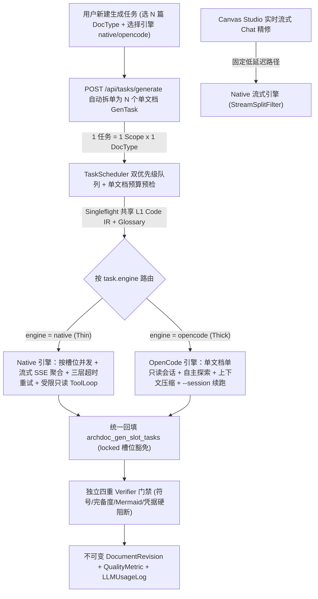

# ADR-08: 单文档粒度任务编排、Native 引擎加固与 OpenCode 双引擎文档反推架构

- **文档编号**：`08-dual-engine-doc-generation.md`
- **日期**：2026-11-22
- **状态**：拟议待审 (Proposed) —— 一次统筹规划 M14（Native 加固 + 单文档拆单 + OpenCode 双引擎 + 前端可选引擎），待审阅确认后冻结 `01-features` ~ `04-tasks`（M14 作战卡）进入 TDD 实施
- **关联议题**：[`01-feature-matrix.md`](../01-features/01-feature-matrix.md) (`F-05`, `F-07`, `F-09`, `F-12`, `F-14`, `F-27`, `F-31`, `SC-02`, `SC-04`, `SC-09`, `SC-13`, `SC-18`)；[`02-extraction-and-generation-engine.md`](../02-design/02-extraction-and-generation-engine.md)；[`05-database-schema.md`](../02-design/05-database-schema.md)；[`01-http-api-contract.md`](../03-api/01-http-api-contract.md)；[`02-data-model-and-dto-contract.md`](../03-api/02-data-model-and-dto-contract.md)；[`ADR-01`](./01-microfrontend-and-table-prefix-isolation.md)；[`ADR-04`](./04-module-scope-discovery-and-hierarchical-docs.md)；[`ADR-06`](./06-document-review-and-refine-studio.md)；[`ADR-07`](./07-single-repo-branch-switch.md)

---

## 1. 背景与问题陈述 (Context & Problem Statement)

### 1.1 现状实现基线

`code-archdoc` 现行 L2 文档生成链路完全构建于自研 OpenAI Compatible HTTP 客户端（`pkg/llm`）与任务编排器（`services/generation_service.go`）之上，关键组件基线如下：

| 组件 / 环节 | 现状实现 | 代码位置 |
| :--- | :--- | :--- |
| **任务提交与执行粒度** | `SubmitGenerateTask` 将用户一次勾选的 `1..N` 个 `doc_types` 写入同一条 `GenTask`，在 `executeGenerateTask` 内一次性累加全部分片预算并并发调度全部文档的槽位；`SubmitBatchGenerateTask` 同样按 `(subdir)` 合并多 `doc_types` 创建子任务 | `services/generation_service.go`、`services/batch_generation.go` |
| **生成前预算预检** | `EstimateAndCheckBudget` 遍历所选全部 `DocType` 的活跃槽位累加预估 Token 并对比单模型 `max_tokens_per_task`（默认 200,000）；`computeTopDirectories` 对全仓 `IR.Tree.Files` 统计目录体积 | `pkg/llm/budget.go` |
| **Native HTTP 客户端** | `Client.executeWithRetry` 为每次尝试派生带超时的 `reqCtx`，并在 `doOnce` 内通过 `isTimeoutErr(err) && ctx.Err() == nil` 判定网络超时是否可重试；槽位生成调用非流式 `ChatCompletion`（`stream: false`） | `pkg/llm/client.go` |
| **上下文装配与 Tool Loop** | `serializeSlotFacets` 将 IR 分片序列化后在超限时直接切片 `serialized[:maxChars]`；开启 `enable_source_tools` 的槽位经 `RunToolLoop` 开放 4 个受限只读工具（硬上限 4~6 轮、累计输出 36 KB） | `pkg/llm/prompt.go`、`pkg/llm/tool_loop.go` |
| **数据模型与配置** | 共有 20 张 `archdoc_*` 表（含 `archdoc_gen_tasks`、`archdoc_gen_slot_tasks`、`archdoc_llm_configs`、`archdoc_llm_usage_logs`）；前端 `GenerateTaskModal` 未提供执行引擎选项 | `models/task.go`、`models/governance.go`、`frontend/src/components/GenerateTaskModal.tsx` |

### 1.2 核心问题与根因剖析 (`P-1` ~ `P-6`)

结合近期真实生产任务（如 `fmt` 仓任务 `#3`、`#5`）故障排查与代码审计，当前文档生成链路暴露出 **6 项结构性瓶颈与缺陷**：

| 编号 | 问题现象 | 严重度 | 根因分析 |
| :---: | :--- | :---: | :--- |
| **P-1** | **多文档混杂于单任务，导致预算误熔断与故障域耦合** | 🔴 | 在 `fmt` 仓同时勾选 5 类 `DocType` 提交任务 `#3` 时，因单任务把 5 篇文档全部槽位的保守预估值叠加至 `205,769 Tokens`，直接越过单模型 `201,000` 上限并触发 `TOKEN_BUDGET_EXCEEDED`（0 次 LLM 调用即整体失败）。事实上拆为单文档后每篇仅 1~5.5 万 Tokens，完全可正常执行，且单任务混跑导致一篇失败或需重试/取消时连带影响其他文档。 |
| **P-2** | **Native 客户端超时零重试 Bug 与非流式死等** | 🔴 | 在 `pkg/llm/client.go` 中，`executeWithRetry` 创建了带单次超时 `TimeoutSeconds` 的 `reqCtx` 并传入 `doOnce`；当该次请求超时时，`reqCtx.Err()` 必为 `context.DeadlineExceeded`，导致 `doOnce` 内的 `isTimeoutErr(err) && ctx.Err() == nil` 恒为 `false`。实测 `fmt` 仓任务 `#5` 配置了 `max_retries = 3`，3 个槽位遭遇超时后全部 `attempt_count = 1` 直接失败（0 次重试）。同时槽位生成走非流式请求，缺少首包与空闲心跳检测，上游卡死时只能干等满 180 秒。 |
| **P-3** | **Push 模式暴力字符截断与预算估算失真** | 🟠 | ① `serializeSlotFacets` 在超出 `slot.TokenBudget * 3` 字符时直接硬切片 `serialized[:maxChars]`，直接腰斩 JSON 结构并丢失尾部关键符号；<br>② `computeTopDirectories` 未应用 `DocType.scope_profile`（如 `include_tests: false`）即统计 Top 目录，导致预算建议误报已过滤目录（如 `test/gtest`）；<br>③ 按 `MaxOutputTokens / len(slots)` 均分单槽位输出配额时若过小，容易触发长章节截断。 |
| **P-4** | **自研 Function Calling 天花板偏低，缺乏长程上下文管理** | 🔴 | `pkg/llm/tool_loop.go` 硬限制 4~6 轮与 36 KB 累计工具输出，且没有**上下文自动压缩（Compaction）**与**会话断点续跑（Session Continuation）**机制。面对大型 C++/Java/Go 仓库跨多层文件追踪调用链、状态机与并发原语时，有限的 Push 切片与短轮次 Tool Loop 无法支撑高质量深度反推。 |
| **P-5** | **批量编排子任务粒度与单文档理念不统一** | 🟡 | `services/batch_generation.go` 仍按 `(subdir)` 为单位将多 `doc_types` 塞入单个子任务，未能贯彻单文档粒度的状态监控、独立预算与失败重跑边界。 |
| **P-6** | **前端缺少任务级引擎选择与多文档拆单监控体验** | 🟡 | 新建生成任务弹窗仅能选范围、分支、生成模式与 `DocType`，无法在触发时按仓库复杂度自主选择轻量快速的 `Native` 引擎或深度探索型的 `OpenCode` Agent 引擎，也未承载多文档拆单后的并行任务列表反馈。 |

---

## 2. 决策概览与整体架构 (Decision Summary & Architecture)

### 2.1 异构双引擎整体架构

本 ADR 确立**「任务单文档粒度不变量 + Native 底座加固（第一步）+ OpenCode 深度 Agent 双引擎（第二步）」**的一体化演进方案：

- **职责正交定位**：
  - **Native 引擎（Thin / 直连 OpenAI Compatible）**：主打低延迟、KV Cache 前缀命中、流式交互与强数据脱敏边界，负责日常轻量/常规单文档生成、**Canvas Studio 实时流式 Chat 精修**、以及跨文档复用的 **Snapshot 级共享术语表（Glossary）**。
  - **OpenCode 引擎（Thick Agent / 只读 CLI 会话）**：主打 Pull 模式深度代码理解——下发 L1 Code IR 骨架、共享术语表与全篇非锁定槽位契约，由 OpenCode 在受限只读沙箱内自主执行 `read` / `grep` / `glob` / `list` 多轮探索、原生上下文压缩及 `--session` 断点续跑，一次性产出该文档全部非锁定槽位的结构化结果。
- **下游质量与治理完全归一**：无论上游采用 Native 还是 OpenCode，输出均统一汇入既有的 `GenSlotTask` 追踪、`locked` 槽位字节级保护、`MergeGeneratedWithLockedAndOrphans`、独立于 LLM 的**四重确定性 Verifier 门禁**以及不可变 `DocumentRevision` 落库流水线。



### 2.2 候选方案评估

| 候选方案 | 核心做法 | 优点 | 缺点与风险 | 结论 |
| :--- | :--- | :--- | :--- | :---: |
| **方案 A：单文档拆单 + Native 加固 + OpenCode 文档级会话双引擎** | 无论勾选几篇文档或批量任务，一律按 `(Scope, DocType)` 拆单为独立任务；修复 Native 超时重试/流式超时/JSON 裁剪；引入 `pkg/opencode` 按**单文档单会话**执行并统一汇入槽位表与 Verifier；前端新建任务显式可选引擎。 | 彻底解决多文档预算误熔断与故障域耦合；兼顾 Native 低延迟（Chat/Glossary/常规文档）与 OpenCode 深度代码探索能力；单文档会话避免按槽位重复扫仓造成 5 倍成本膨胀；100% 复用既有锁定与 Verifier 体系。 | 需同时推进 Native 修 Bug、OpenCode CLI 进程治理及少量表列演进，分 `M14-A/B/C` 渐进交付。 | ✅ **采纳** |
| **方案 B：仅优化自研 Native 引擎与 Tool Loop，放弃 OpenCode** | 仅修复 `client.go` 与 `budget.go`，继续扩写自研 `tool_loop.go` 支持更多轮次与上下文摘要压缩。 | 无需引入外部 CLI 进程与配置桥接。 | 在复杂 C++/Java 大仓跨文件追查上仍受限于自研轮次上限、缺乏成熟上下文压缩与工具生态，长期重复造轮子且文档深度仍不足。 | ❌ **放弃** |
| **方案 C：全量替换为 OpenCode，并按 Slot 逐个拉起 OpenCode 进程** | 废弃 Native 生成路径，每篇文档的每个槽位各启动一个 `opencode run` 进程。 | 无需维护双引擎路由，代码表面最简。 | 5 槽位文档会拉起 5 个独立进程重复读同一代码仓，耗时与 Token 成本倍增；且无 OpenCode 环境或高敏隔离场景失去兜底；Chat 实时流式体验也会严重退化。 | ❌ **放弃** |

### 2.3 核心决策摘要 (`D-1` ~ `D-5`)

| 决策 | 核心要点 | 解决问题 |
| :--- | :--- | :--- |
| **D-1 单文档任务不变量与多文档自动拆单** | 确立 `1 GenTask = 1 Scope × 1 DocType` 硬不变量；`POST /api/tasks/generate` 勾选 `N` 篇文档时原子校验队列容量并创建 `N` 个独立任务（响应体向下兼容首任务字段并扩展 `tasks[]`）；`generate-batch` 按 `(subdir, doc_type)` 拆分子任务；复用 `SnapshotService` 三层 `singleflight` 与共享 Glossary 零重复抽取。 | P-1、P-5 |
| **D-2 Native 引擎底座全面加固（第一步）** | 修复 `client.go` `reqCtx` 遮蔽导致超时零重试的 Bug；升级为带随机抖动的指数退避（含 `Retry-After`）；槽位生成升级内部 `stream: true` 聚合 + 首包/空闲/总超时三层护栏（不支持流式网关自动降级）；`budget.go` 按 `scope_profile` 过滤目录；`serializeSlotFacets` 改用结构化条目优先级裁剪保持合法 JSON。 | P-2、P-3 |
| **D-3 OpenCode 深度 Agent 引擎架构（第二步）** | 新增纯领域包 `pkg/opencode/`；支持模式 A（零配置自动桥接 `archdoc_llm_configs` 至临时 `0600` `OPENCODE_CONFIG`）与模式 B（原生 `provider/model`）；单文档单只读会话（禁写/禁 Shell + `XDG_DATA_HOME` 隔离 + `--file` 大 Prompt + `Setpgid` 进程组强杀 + Idle 看门狗）；解析事件流 Usage 与 `sessionID` 并支持 `--session` 断点续跑及缺失槽位补全。 | P-4 |
| **D-4 数据模型增量、配置治理与双引擎 API 契约** | 保持 20 张 `archdoc_*` 表零增表，仅向 `archdoc_gen_tasks` / `archdoc_llm_usage_logs` 增补 `engine` 列及 `archdoc_llm_configs` 增补可选 `opencode_model` 列；`config.yaml` 新增 `opencode:` 配置段与独立 `opencodeSem` 限流器；新增 `GET /api/engines` 与扩展生成/批量/增量刷新/任务查询契约。 | P-4、P-6 |
| **D-5 前端新建任务引擎选择器与多任务拆单视图** | `GenerateTaskModal` 增加「执行引擎」分段选择器（实时探测可用性 + 记忆偏好 + 只读/耗时提示）；勾选多篇文档时展示「创建 N 个文档生成任务」与多任务队列监控视图；`TaskCenterPage` 展示引擎徽标与筛选器；`AdminLLMConfigPage` 增加可选 `opencode_model` 映射字段。 | P-5、P-6 |

---

## 3. 决策 D-1：单文档任务不变量与多文档自动拆单

### 3.1 单文档任务不变量

无论是 `Native` 还是 `OpenCode`，系统确立统一的任务领域不变量：

1. **单文档唯一绑定**：每一个非批量父任务（`task_kind` 为 `generate`、`regenerate` 或 `incremental_refresh`）严格对应 **1 个目标范围 `(repo_id, subdirectory, ref_name)` × 1 个 `doc_type_slug`**，其 `doc_types_json` 数组长度固定为 `1`。
2. **故障域与重试边界隔离**：`EstimateAndCheckBudget` 仅对单篇文档计算文件数与 Token 预算，彻底消除多文档累加误熔断；若某仓库需生成 5 篇文档，每篇拥有独立的任务 ID、进度条、取消开关、失败原因与重跑生命周期，互不拖累。
3. **共享缓存零重复计算（`SC-02` 不变量）**：同一批次拆出的 `N` 个单文档任务在进入 `extracting` 阶段时，并发命中 `SnapshotService.EnsureSnapshot` 的进程内 `singleflight`（键 `base:<repo_id>|<branch>` 与 `slice:<base_id>|<subdir>`）与 `EnsureGlossary` 的 `glossary:<base_id>` 缓存，**Git 同步、L1 Code IR 抽取与全仓共享术语表仍严格只执行 1 次**。

### 3.2 `POST /api/tasks/generate` 拆单与向下兼容契约

为保持既有 API 调用方与单元测试零破坏，同时支撑前端多选拆单：

1. **请求入参扩展（`GenerateTaskRequest`）**：
   - 保留 `doc_types: string[]`，并新增可选 `doc_type?: string`（两者合并去重）与可选 `engine?: "native" | "opencode"`（留空时取服务端 `config.OpenCode.EffectiveDefaultEngine()`）。
2. **原子入队与回滚保护**：
   - 完成仓库解析、DocType 全部校验、分支校验与引擎可用性校验后，先逐个构建 `N` 条任务并预先计算 `TaskScheduler` 队列容量需求；
   - 新增 `TaskScheduler.ReserveAndEnqueueBatch(jobs []ScheduledJob)`（在单次互斥锁内检查 `len(highQ) + len(jobs) <= InteractiveQueueCap`）：若队列余量不足以容纳全部 `N` 个任务，直接整体拒绝并返回 `429 QUEUE_FULL`，绝不产生“半数入库、半数丢弃”的脏状态；
   - 在数据库事务内一次性插入 `N` 条 `GenTask` 记录，提交后再将 `N` 个 `ScheduledJob` 统一入队执行。
3. **响应体向下兼容结构（`GenerateTaskSubmitResponse`）**：
   ```json
   {
     "id": 101,
     "repo_id": 167,
     "subdirectory": "",
     "ref_name": "main",
     "task_kind": "generate",
     "engine": "opencode",
     "doc_types": ["system-architecture"],
     "status": "pending",
     "created_count": 3,
     "tasks": [
       { "id": 101, "engine": "opencode", "doc_types": ["system-architecture"], "status": "pending" },
       { "id": 102, "engine": "opencode", "doc_types": ["code-walkthrough"], "status": "pending" },
       { "id": 103, "engine": "opencode", "doc_types": ["agents-context"], "status": "pending" }
     ]
   }
   ```
   - 顶层内嵌 `GenTaskDetailVO`（为 `tasks[0]`，使现有仅解析 `resp.id` 的单测与客户端 100% 兼容），同时携带 `created_count` 与完整 `tasks[]` 数组供前端展示拆单队列。

### 3.3 `POST /api/tasks/generate-batch` 对齐单文档子任务

1. `BatchGenerateRequest` 新增可选 `engine?: "native" | "opencode"`，记录于批量父任务及所有派发子任务的 `Engine` 字段。
2. `executeBatchGenerateTask` 拆单调整：
   - **阶段 1（子模块）**：为每个 `(subdir, slug)` 组合创建 1 个单文档子任务（共 `len(moduleSubdirs) × len(slugs)` 个子任务）；
   - **阶段 2（整仓上卷）**：在所有阶段 1 子任务进入终态后，若勾选 `include_repo_scope`，为每个 `("", slug)` 创建 1 个整仓单文档子任务。
3. 批前总预算预检 `estimateBatchTokens` 仍汇总全部子模块与整仓文档的预估总和对照 `scheduler.max_tokens_per_batch`（默认 `1,000,000`），避免因单次批量勾选过多模块导致失控消费。

---

## 4. 决策 D-2：Native 引擎底座全面加固（第一步）

### 4.1 修复超时零重试 Bug 与升级退避机制 (`pkg/llm/client.go`)

1. **区分父取消与单次 Attempt 超时**：
   - 将调用方传入的 `parentCtx` 与单次请求创建的 `attemptCtx, cancel := context.WithTimeout(parentCtx, timeout)` 明确分离传递；
   - 在 `doOnce` 中仅当 **`parentCtx.Err() != nil`** 时判定为调用方主动取消或全局超时（不可重试，立即退出）；若仅是 **`attemptCtx.Err() == context.DeadlineExceeded`**（或底层 `net.Error` Timeout、`io.EOF` / `unexpected EOF` / `connection reset`），均判定为 **`retryable = true`** 并进入下一次重试。
2. **重试上限与 Jitter 指数退避**：
   - `MaxRetries` 允许上限由 `3` 放宽至 `5`（合法范围 `0..5`，默认值仍为 `3`）；
   - 退避间隔调整为基准 `1s * 2^attempt` 并叠加 `±20%` 随机抖动（单次最大等待上限 `30s`）；若上游 HTTP `429` / `503` 返回整数或 HTTP-date 格式的 `Retry-After` 响应头，在不超过 `30s` 护栏且响应 `parentCtx.Done()` 前提下优先遵循该退避时长。

### 4.2 槽位生成内部流式聚合与三层超时护栏

1. **槽位生成默认走流式读取 (`stream: true`)**：
   - 新增 `Client.ChatCompletionAggregatedStream(ctx, cfg, req)`（或在 `ChatCompletion` 内基于配置自动切换）：底层以 `stream: true` 发起 HTTP 请求并复用 `parseSSEResponse` 实时接收增量块，边接收边刷新**活跃心跳时间戳（Last Activity Timestamp）**，同时在 `req.Stream` 上保持上层调用零侵入。
   - **网关兼容性自动降级**：若流式首轮遭遇不支持 `stream: true` 或流式报错（HTTP `400`/`422`/`501` 且报错提及 `stream`，或 `Content-Type` 为 `application/json` 同步响应），自动降级以 `stream: false` 执行并继续受单次超时保护。
2. **三层超时看门狗**：
   - **首包超时 (`first_byte_timeout_seconds`，默认 `90s`)**：建立连接并发送请求后超过 90s 未收到首个有效字节/SSE chunk，主动断开本次连接并标记 `retryable = true` 触发重试；
   - **流式空闲超时 (`idle_timeout_seconds`，默认 `60s`)**：相邻两个 SSE chunk 间隔超过 60s 无输出（如模型推理僵死），立即中断本次流连接并触发重试；
   - **单次总超时 (`timeout_seconds`，默认 `180s`，取自模型配置)**：单次请求总墙钟耗时封顶，避免慢速滴水无限占用槽位。
3. **输出长度截断保护**：
   - 在 `GenerationOrchestrator` 为槽位设置 `MaxTokens` 时，不再将 `DocType.MaxOutputTokens / len(slots)` 无底线切小：当 `MaxOutputTokens > 0` 时单槽位输出上限取 `max(perSlot, 4096)`；且当响应 `FinishReason == "length"` 时记录结构化告警日志并提示（后续可扩展自动续写）。

### 4.3 单文档预算校准与结构化合法 JSON 裁剪 (`pkg/llm/budget.go` & `pkg/llm/prompt.go`)

1. **`EstimateAndCheckBudget` 精准对齐 `scope_profile`**：
   - 调用 `computeTopDirectories(in.IR, in.DocTypes, 5)` 时，先应用当前单文档 `DocType.Meta.ScopeProfile` 过滤出有效文件后再按目录统计，彻底避免被 `include_tests: false` 排除的 `test/` 目录干扰预算建议与统计误判。
2. **结构化条目级 JSON 裁剪替代字符串硬截断**：
   - 重构 `pkg/llm/prompt.go` 的 `serializeSlotFacets`：
     - 删除粗暴破坏 JSON 语法的 `serialized[:maxChars]` 字节截断；
     - 在超出 `slot.TokenBudget` 字符预算时，按槽位订阅的 `ir_facets` 固定重要性顺序与各列表字段优先级（优先保留 `Tree.Directories`、`Build.BuildSystems/Targets`、`Deps.InternalModules`、`IDLContracts.Services`、`HTTPRoutes.Routes` 等核心骨架，对体积最大的 `Symbols.Symbols` / `DataModels.Entities` / `RuntimePrimitives.Primitives` 按预算上限逐条截断列表元素），并附加 `"_meta": {"truncated": true, "omitted_counts": {...}}` 字段；
     - 当 `EnableSourceTools == true` 且发生条目裁剪时，明确提示模型：未全量内联的符号与源码可通过 `get_symbol_impl` / `grep_in_sandbox` / `read_file_lines` 按需检索。

---

## 5. 决策 D-3：OpenCode 深度 Agent 引擎架构（第二步）

### 5.1 纯领域包 `pkg/opencode/` 分层设计

严格遵守 `code-archdoc/AGENTS.md` 与 `make lint-arch` 架构红线（`pkg/*` 严禁导入 `models`、`services`、`handlers`、`gorm`、`gin`；严禁在 `pkg/` 中调用 `gitsync.Sync`）：

```text
pkg/opencode/
├── runner.go          # Runner 接口、DocGenRequest/DocGenResult/SlotOutput/ErrorClass 与 CLI 探测缓存
├── config_bridge.go   # 双模式临时配置目录生成（0700 目录 + 0600 opencode.json / auth.json 孤立注入）
├── process.go         # 子进程生命周期管理（--file 大 Prompt、Setpgid 强杀、Idle/总超时看门狗）
├── event_parser.go    # OpenCode --format json JSONL 事件流解析（sessionID / final text / Usage / 错误分级）
├── prompt.go          # 单文档多槽位任务规约 Prompt 构造器与严格 JSON 解析器（含修复容错）
└── opencode_test.go   # 基于 Fake `opencode` 脚本与临时沙箱的全量零外部依赖单测
```

核心契约定义：

```go
package opencode

type ErrorClass string

const (
	ErrorClassNone             ErrorClass = ""
	ErrorClassCanceled         ErrorClass = "canceled"
	ErrorClassTimeout          ErrorClass = "timeout"
	ErrorClassIdleTimeout      ErrorClass = "idle_timeout"
	ErrorClassRateLimited      ErrorClass = "rate_limited"
	ErrorClassAuth             ErrorClass = "auth"
	ErrorClassNetworkTransient ErrorClass = "network_transient"
	ErrorClassContentFiltered  ErrorClass = "content_filtered"
	ErrorClassOutputMissing    ErrorClass = "output_missing"
	ErrorClassCLINotFound      ErrorClass = "cli_not_found"
	ErrorClassUnknown          ErrorClass = "unknown"
)

type SlotTaskSpec struct {
	SlotID          string
	Title           string
	Ownership       string
	InstructionHint string
	IRFacets        []string
	PriorHybridMD   string
	ReviewGuidance  []string
}

type DocGenRequest struct {
	WorkDir                string                  // 沙箱作用域物理目录（已通过 SafeJoin 校验的 repoRoot/subdir）
	RepoRoot               string                  // 仓库根物理目录（支持跨模块白名单说明）
	Subdirectory           string
	DocTypeSlug            string
	DocTypeDisplayName     string
	TemplateMD             string
	GenerationPromptMD     string
	ActiveSlots            []SlotTaskSpec          // 仅含非 locked 待生成槽位（locked 已在编排层豁免）
	Glossary               *codeir.GlossaryCache
	IR                     *codeir.CodeIRBundle
	ModuleContext          *codeir.ModuleContextFacet
	ModuleDigests          []codeir.ModuleDigestInput
	CrossModuleGraph       []codeir.CrossModuleEdge
	ModelName              string                  // 对应 LLMConfig.ModelName
	BaseURL                string                  // 模式 A 注入 @ai-sdk/openai-compatible
	APIKey                 string                  // 仅写入 0600 临时配置文件，绝不进 argv/日志
	UserAgent              string
	OpenCodeModelOverride  string                  // 可选模式 B：provider/model
	TimeoutSeconds         int
	IdleTimeoutSeconds     int
	ContinuationEnabled    bool
	ContinuationMaxSeconds int
}

type SlotOutput struct {
	Markdown     string
	CitedAnchors []verifier.CitedAnchorCandidate
}

type DocGenResult struct {
	SessionID         string
	Slots             map[string]SlotOutput // slot_id -> output
	MissingSlotIDs    []string              // 模型漏填或未产出的槽位 ID
	InputTokens       int
	CachedInputTokens int
	OutputTokens      int
	LatencyMs         int64
	Continuations     int
	TerminationReason string
}
```

### 5.2 双模式模型配置桥接与进程级只读隔离 (`config_bridge.go`)

借鉴 `code-shield/services/invoker/opencode.go` 的成熟工程经验并结合 `code-archdoc` 动态模型池特性，彻底消除部署与并发冲突隐患：

1. **双模式模型映射（兼容现有 `archdoc_llm_configs` 零门槛开箱即用）**：
   - **模式 A（默认自动桥接模式 — 当 `LLMConfig.OpenCodeModel == ""`）**：
     - 在 `os.MkdirTemp("", "archdoc-oc-*")` 创建权限为 `0700` 的本次调用专属隔离目录；
     - 写入权限为 `0600` 的临时 `opencode.json`，在 `provider.archdoc_ep` 下使用 `@ai-sdk/openai-compatible` 动态声明 `baseURL`、`apiKey`、`headers.User-Agent` 及当前 `model_name`，同时内联声明专属只读 Agent `archdoc-readonly-docgen`；
     - 启动子进程时通过环境隔离变量注入 `OPENCODE_CONFIG=<tmpDir>/opencode.json` 与 `XDG_DATA_HOME=<tmpDir>/xdg_data`，并以 `--pure --agent archdoc-readonly-docgen --model archdoc_ep/<model_name>` 启动；
     - **优势**：管理员无需登录服务器手工配置 `~/.config/opencode/` 或 `auth.json`；**API Key 仅存在于受 `0600` 保护且 `defer os.RemoveAll` 清理的临时文件中，绝对不会出现在 `ps` 命令行参数、环境变量或系统日志中**。
   - **模式 B（可选原生 Provider 直连 — 当 `LLMConfig.OpenCodeModel != ""`）**：
     - 直接以 `--model <OpenCodeModel>` 启动，仅向临时隔离目录写入只读 Agent 配置，并将宿主机 `~/.local/share/opencode/auth.json`（或 `$XDG_DATA_HOME/opencode/auth.json`）以只读方式软链/拷贝至隔离 `XDG_DATA_HOME/opencode/auth.json`，继续隔离 SQLite 会话库以彻底杜绝并发 `database is locked`。
2. **强制进程级只读权限矩阵（不修改宿主机全局配置）**：
   ```json
   "agent": {
     "archdoc-readonly-docgen": {
       "description": "Code-Archdoc Read-Only Documentation Reverse-Engineering Agent",
       "tools": {
         "read": true, "grep": true, "glob": true, "list": true,
         "edit": false, "write": false, "bash": false, "webfetch": false
       },
       "permission": {
         "*": "deny",
         "read": "allow", "grep": "allow", "glob": "allow", "list": "allow"
       }
     }
   }
   ```
   - 严禁传入 `--auto` 或 `--thinking`，通过 `--pure` 禁用外部不可控插件，确保 OpenCode 绝不执行 Shell、网络抓包或修改源码工作区。

### 5.3 单文档单会话执行、`--file` 大载荷传输与 `--session` 断点续跑

1. **进程执行与生命周期治理 (`process.go`)**：
   - **大 Prompt 安全传输**：待发送规约超过 `64 KB`（远低于 Linux `MAX_ARG_STRLEN` 128 KB 限制）时，自动落盘至隔离目录 `0600` 临时 `.md` 文件，通过 `--file <promptPath>` 附件传入，主消息仅传简短引导指令；
   - **进程组强杀与取消语义**：`exec.Command` 挂载 `SysProcAttr{Setpgid: true, Pdeathsig: syscall.SIGKILL}`；当父 `ctx.Done()`（用户点击取消任务或服务优雅停机）或触发总超时/空闲超时（`idle_timeout_seconds` 内无 stdout/stderr 活动）时，调用 `syscall.Kill(-pgid, syscall.SIGKILL)` 秒级回收整个子进程树；
   - **工作区租约与读锁保护**：`GenerationOrchestrator` 在运行 OpenCode 期间全程持有 `ActiveLeaseManager.AcquireRepo` 租约，并通过 `SnapshotService.WithRepoReadLock` 持读锁（允许多个只读分析并发，阻断 `ResourceReaper` 回收及 `gitsync` 并发写覆盖）。
2. **单文档 Prompt 规约与结构化输出契约 (`prompt.go`)**：
   - Prompt 按固定结构下发：
     1. 只读分析与凭据零泄漏硬约束；
     2. `DocType` 业务指令（`generation_prompt.md`）与完整模板骨架（`template_md`）；
     3. 当前作用域与 L1 高层索引（目录树 `Tree.Directories`、`Build`、共享 `Glossary`、`ModuleContext` / `ModuleDigests` + `CrossModuleGraph`，按需截断避免初始上下文过胖，引导 OpenCode 使用 `read`/`grep`/`glob` 按需追查源码细节）；
     4. 全部非锁定 `ActiveSlots` 清单（`slot_id`、`title`、`instruction_hint`、`hybrid` 历史稿、`persist_for_regen` 长期审阅指导）；
     5. 唯一合法输出契约：作为最后一条消息直接返回纯 UTF-8 JSON（禁止写盘或代码块包裹）：
        ```json
        {
          "slots": {
            "<slot_id>": {
              "markdown": "章节完整 Markdown 正文（不含一级标题）",
              "cited_anchors": [
                {"file_path": "相对路径", "fq_symbol": "全限定符号或空", "symbol_kind": "可选类型", "scope": "module|repo"}
              ]
            }
          }
        }
        ```
   - `ParseOpenCodeDocOutput` 兼容纯 JSON、`` ```json `` 代码围栏及前后夹杂简短文本时的最外层 JSON 对象提取，并按 `ActiveSlots` 逐一校验非空状态，统计 `MissingSlotIDs`。
3. **JSONL 事件流解析与成本回写 (`event_parser.go`)**：
   - 使用带扩容缓冲的 `bufio.Scanner` 逐行读取 `--format json` 输出流：
     - 捕获并更新最新 `sessionID`；
     - 按 `messageID` 聚合助手 `type=="text"` 分片，提取末条助手消息作为候选结果；
     - 累加 `step_finish`（或模型 usage 事件）中的 `input` / `output` / `cache.read` Token 数，映射填充至 `llm.UsageMetrics` 写入 `archdoc_llm_usage_logs`，保证成本看板双引擎统一可观测；
     - 结合进程退出码、stderr 与 stdout 样本完成结构化错误分级（`ErrorClass`）。
4. **`--session` 轻量级断点续跑（Continuation）**：
   - 当满足以下任一可恢复条件，且已捕获有效 `SessionID`、`ContinuationEnabled == true`、剩余父上下文时间 `>= 60s` 时，自动在隔离目录内使用 `--session <SessionID>` 发起 **至多 1 次轻量续跑**：
     - **场景 A（中断/超时/无 JSON 出力）**：首轮遭遇 `timeout` / `idle_timeout` / `rate_limited`（先退避 2.5s）/ `output_missing`，续跑提示明确禁止重新扫描仓库，要求直接基于已有会话分析结论输出全部 `ActiveSlots` 的 JSON；
     - **场景 B（部分槽位漏填）**：首轮返回了合法 JSON 但 `len(MissingSlotIDs) > 0`，续跑提示仅针对缺失的 `MissingSlotIDs` 要求补齐输出并与首轮结果合并，避免整篇重跑浪费。

### 5.4 与既有槽位记录、单槽位重试及增量刷新的融合

- **槽位级可观测性与部分失败兼容**：OpenCode 执行前同样初始化所有 `archdoc_gen_slot_tasks`（`locked` 标 `skipped_locked`）；执行完毕后按 `SlotOutput` 逐一回填 `completed` / `failed` 及 `CitedAnchorsJSON`（`ModelName` 标注 `[opencode] <model>`）。
- **单槽位独立重试 (`RetrySlotTask`)**：沿用所属 `GenTask.Engine`：若原任务为 `opencode`，则仅把该失败 `slot_id` 作为单槽位列表交由 OpenCode 会话定向补齐，合入文档后重跑全篇 `Verifier`（其余已完成/锁定槽位字节级不变）。
- **章节级增量刷新 (`IncrementalRefresh`)**：支持入参指定或继承引擎，将受影响的非锁定 `targetSlots` 一次性交给单次 OpenCode 会话合并生成，未受影响与 `locked` 章节保持字节级不变。
- **Canvas Studio 实时 Chat 精修保持 Native**：`ChatService` 依赖毫秒级 SSE `delta` 实时推送与 `StreamSplitFilter` 交互体验，继续固定走加固后的 Native 流式引擎，不做无谓进程拉起开销。

---

## 6. 决策 D-4：数据模型增量、配置治理与 HTTP API 契约

### 6.1 数据模型演进（零新增表，坚守 20 张 `archdoc_*` 表基线）

本 ADR 不新增数据库表，仅对现有 3 张自有表执行向后兼容的增量列扩展（全自带 `default` 值，支持 GORM `AutoMigrate` 无损平滑升级）：

| 表名 / 模型 | 新增字段 / 枚举 | 列定义与默认值 | 说明 |
| :--- | :--- | :--- | :--- |
| `archdoc_gen_tasks` (`models.GenTask`) | `Engine` | `varchar(20) not null default 'native'`, `index` | 记录本任务使用的生成引擎（`native` \| `opencode`） |
| `archdoc_llm_usage_logs` (`models.LLMUsageLog`) | `Engine` | `varchar(20) not null default 'native'`, `index` | 区分 Native 与 OpenCode 成本用量；`Stage` 枚举新增 `doc_gen_opencode`、`doc_gen_opencode_continue`、`slot_retry_opencode` |
| `archdoc_llm_configs` (`models.LLMConfig`) | `OpenCodeModel` | `varchar(128) not null default ''` | 可选原生 OpenCode `provider/model` 覆盖标识；留空时自动通过模式 A 桥接 `base_url` / `model_name` / `api_key` |
| `models/enums.go` | `EngineNative`, `EngineOpenCode`, `IsValidEngine` | `"native"` / `"opencode"` | 领域强类型引擎常量校验 |

### 6.2 `config.yaml` 配置扩展 (`config/config.go`)

在 `LLMSection` 增量流式超时配置，并新增顶层 `OpenCodeSection`：

```yaml
llm:
  user_agent: "Code-Archdoc/dev"
  first_byte_timeout_seconds: 90   # Native 流式首包超时（默认 90s）
  idle_timeout_seconds: 60         # Native 流式块间空闲超时（默认 60s）

opencode:
  enabled: true                    # 总开关，false 时禁止选择 opencode 引擎
  binary_path: ""                  # 可选显式路径；留空默认通过 PATH 查找 "opencode"
  default_engine: "native"         # 未传 engine 参数时的默认引擎 (native | opencode)
  max_concurrency: 2               # OpenCode CLI 子进程最大并发数（默认 2，防 CPU/内存过载）
  timeout_seconds: 600             # 单次 OpenCode 文档生成超时（默认 600s）
  idle_timeout_seconds: 120        # 无 stdout/stderr 活动空闲看门狗超时（默认 120s）
  continuation_enabled: true       # 是否允许 --session 断点续跑（默认 true）
  continuation_max_seconds: 180    # 续跑阶段预算上限（默认 180s）
```

### 6.3 双层信号量并发控制 (`services/scheduler_service.go` / `services/generation_service.go`)

- 保留全局 `TaskScheduler`（`max_llm_concurrency`，默认 `8`）控制总任务/API 并发；
- 在 `GenerationOrchestrator` 新增独立的 `opencodeSem chan struct{}`（容量 `config.AppConfig.OpenCode.EffectiveMaxConcurrency()`，默认 `2`）：每个 OpenCode 文档会话执行前同时受单用户限流与 `opencodeSem` 约束，避免重型 CLI 进程并发堆积拖垮宿主机，也防止阻塞 Native 槽位或 Chat 实时响应。

### 6.4 HTTP API 增量契约

| 方法与路径 | 权限 | 请求 / 查询扩展 | 响应增量与错误码规范 |
| :--- | :---: | :--- | :--- |
| **`GET /api/engines`** *(新增)* | `JWT` | — | 返回可用引擎清单与默认引擎：<br>`{ "default_engine": "native", "engines": [{ "id": "native", "label": "Native 直连引擎", "available": true, "default_model": "glm5.3-flash" }, { "id": "opencode", "label": "OpenCode 深度 Agent", "available": true, "version": "1.18.21", "reason": "", "default_model": "glm5.3-flash" }] }`（内置 30s TTL CLI 探活缓存） |
| **`POST /api/tasks/generate`** | `ScopeWrite` | 新增可选 `doc_type?: string`、`engine?: "native" \| "opencode"` | 校验 `engine` 合法性（非法返回 `400 INVALID_PARAM`；选 `opencode` 但未安装/禁用返回 `400 ENGINE_UNAVAILABLE`）；多文档拆单返回 `202 Accepted`（顶层兼容首任务 VO + `created_count` + `tasks[]`） |
| **`POST /api/tasks/generate-batch`** | `ScopeWrite` | 新增可选 `engine?: "native" \| "opencode"` | 按 `(Scope, DocType)` 拆单创建子任务并透传 `engine`；`opencode` 不可用时前置拦截返回 `400 ENGINE_UNAVAILABLE` |
| **`GET /api/tasks` & `GET /api/tasks/:task_id`** | `JWT` | `GET /api/tasks` 新增可选 Query `?engine=native\|opencode` | `GenTaskDetailVO` 新增 `engine` 字段，用于任务中心列表徽标与详情抽屉展示 |
| **`POST /api/documents/:id/incremental-refresh`** | `ScopeWrite` | 请求体新增可选 `engine?: "native" \| "opencode"` | 指定后按对应引擎合并生成受影响非锁定槽位 |
| **`POST/PUT /api/admin/llm-configs` & `GET`** | `Admin` | 新增可选 `opencode_model?: string` | 校验长度 ≤ 128；`LLMConfigVO` 与审计快照暴露 `opencode_model`（绝不涉及凭据） |

---

## 7. 决策 D-5：前端交互设计（可选引擎与多文档拆单监控）

### 7.1 `GenerateTaskModal` 新建生成任务交互

1. **执行引擎选择器（配置态）**：
   - 打开弹窗（非监控态）时请求 `GET /api/engines`（失败时静默降级为仅 `Native` 可用，不阻断提交），渲染双引擎分段卡片选择器：
     - **Native 直连引擎（Thin）**：展示说明「基于 Code IR 分片并行生成，速度快、KV Cache 命中率高、入参严格脱敏」。
     - **OpenCode 深度 Agent（Thick）**：展示版本号（如 `v1.18.21`）与说明「按单文档发起只读沙箱会话，自主读码追查跨文件链路，支持会话压缩与断点续跑，适合复杂核心模块」；若 `available === false`，该选项置灰禁用并展示明确不可用原因。
   - **安全与耗时微提示**：选中 OpenCode 时在引擎区下方展示轻量提示条（说明“OpenCode 将以只读方式直接在本地沙箱内读取仓库源码并自动经过 Verifier 凭据阻断门禁，单篇文档耗时通常为 1~5 分钟”）。
   - **偏好记忆**：记住用户上次选择的可用引擎（`localStorage` 键 `archdoc.preferred_gen_engine`）。
2. **多文档拆单交互与提交后监控态**：
   - 提交按钮文案随选中文档数动态更新：单选时显示「开始生成 (1 篇)」，多选 `N > 1` 篇（或批量模式）时明确显示「创建 N 个文档生成任务」 /「提交批量编排任务」。
   - 当非批量模式下拆单返回 `created_count > 1`（即 `tasks.length > 1`）时，弹窗自动切换为**多文档任务队列监控视图**：
     - 展示汇总徽标（总任务数 / 运行中 / 已完成 / 失败）与逐文档任务行（任务 `#ID`、文档类型名、引擎徽标、状态标签、进度条、查看槽位明细与独立取消按钮）；
     - 点击某行「查看明细」切入该单文档任务详情（含槽位表与单槽位重试），顶部提供「返回拆单队列」与「前往任务中心」。

### 7.2 `TaskCenterPage` 与 `AdminLLMConfigPage` 协同更新

1. **任务中心 (`TaskCenterPage.tsx`)**：
   - 筛选栏新增「全部引擎 / Native / OpenCode」下拉框（同步至 URL Search Params）；
   - 任务列表「任务 ID & 类型」或「状态与进度」列展示紧凑引擎标签（`Native` / `OpenCode`）；
   - 批量父任务详情的子任务表新增展示单文档 `DocType` 徽标，契合 `(Scope, DocType)` 拆单模型。
2. **LLM 模型配置 (`AdminLLMConfigPage.tsx`)**：
   - 模型新增/编辑弹窗的「高级设置」折叠区增加可选字段 `OpenCode 原生模型映射 (provider/model)`，并注明“留空时系统自动将上方 BaseURL、ModelName 与 APIKey 桥接给 OpenCode 使用，无需额外配置”。
3. **样式规范遵守**：全部新增标签、卡片与状态提示严格复用 `@code/common` 基础类及 `theme.css` `--color-*` 语义 Token，严禁静态内联 `style` 与硬编码色值，完整兼容亮/暗双模主题。

---

## 8. 安全合规、权衡边界与架构防腐红线

1. **明示安全权衡（OpenCode 入参边界 vs Native 数据栅栏）**：
   - **差异事实**：Native 引擎在进程内对每次送入 LLM 的源码切片与工具输出均执行 `pkg/security.SecretRedactor` 三级脱敏，并包裹 128-bit 随机 `nonce` 的 `<untrusted_repo_data>` 防注入栅栏；而 OpenCode 通过内置 `read`/`grep`/`glob` 直接读取本地沙箱目录文件，**不会经过 `SecretRedactor` 入参脱敏与 `nonce` 栅栏**，从而直接将沙箱源码发送至所配置的模型服务端。
   - **纵深缓解措施**：
     1. **只读沙箱硬隔离**：OpenCode Agent 权限策略白名单仅开放 `read`/`grep`/`glob`/`list`，显式 `deny` 所有 `edit`/`write`/`bash`/`webfetch`，且工作目录严格经 `SafeJoin` 锁定于当前目标作用域；
     2. **输出侧硬阻断不妥协**：无论上游由哪个引擎生成，全部产出必须经过独立于 LLM 的 **Verifier 四重门禁（Gate 4 `SecretScanner`）**，一旦命中疑似明文密码、私钥或高熵 Token 立即标 `can_approve = false` 并由发布接口返回 `422` 硬阻断；
     3. **显式前端知情选择**：高安全合规或严格要求外发前入参脱敏的仓库，管理员与研发可在新建任务时选择 `Native` 引擎或通过配置关闭 `opencode.enabled`。
2. **临时凭据零泄漏**：
   - 模式 A 生成的含明文 `apiKey` 的 `opencode.json` 仅写入 `0700` 临时目录下权限 `0600` 的随机文件，进程退出后立即在 `defer` 中 `os.RemoveAll` 彻底销毁；绝不写入仓库工作区、命令行参数（`argv`）、系统日志或持久化 DB 调试字段。
3. **命令行与环境变量防注入**：
   - `opencode` 进程一律通过 `exec.Command(binary, args...)` 参数数组直接调起（禁止 `sh -c`）；`--dir` 仅传递已通过 `NormalizeSubdir` + `SafeJoin` 校验的物理路径；日志仅输出经摘要脱敏后的参数概要。
4. **`make lint-arch` 架构红线守护**：
   - `pkg/opencode/` 严禁导入 `code-archdoc/models`、`services`、`handlers`、`gorm` 或 `gin`；
   - `pkg/opencode/` 与 `handlers/` 严禁直接调用 `gitsync.Sync`，所有沙箱同步、工作区锁与租约管理继续收口在 `services.SnapshotService` 与 `services.ActiveLeaseManager`。

---

## 9. 分阶段实施路线图与 TDD 验收清单 (`M14`)

为实现“第一步止血立竿见影、第二步双引擎稳健落地”，M14 划分为 **3 个正交子里程碑（`M14-A` / `M14-B` / `M14-C`）**，全程严格遵循 **SDD 契约先行 + TDD 红绿重构** 推进：

| 子阶段 | 核心交付范围 | 对应问题 / 决策 |
| :--- | :--- | :--- |
| **M14-A（第一步：Native 加固与单文档拆单）** | 1. 修复 `pkg/llm/client.go` 超时不重试 Bug，升级 Jitter 指数退避 + `Retry-After`；<br>2. 槽位调用升级内部流式聚合 + 首包/空闲/总超时三层护栏与网关自动降级；<br>3. 修复 `pkg/llm/budget.go` 按 `scope_profile` 统计 Top 目录；重构 `pkg/llm/prompt.go` 结构化条目裁剪保持合法 JSON；<br>4. 改造 `GenerationOrchestrator` 与 `batch_generation.go` 落实 `1 Task = 1 Scope × 1 DocType` 拆单与响应兼容结构，`TaskScheduler` 支持批量原子入队校验。 | D-1、D-2<br>(P-1, P-2, P-3, P-5) |
| **M14-B（第二步后端：OpenCode 引擎与双引擎编排）** | 1. `models` 增量列（`GenTask.Engine`、`LLMUsageLog.Engine`、`LLMConfig.OpenCodeModel`）与 `config.yaml` `opencode:` 配置段；<br>2. 新增纯领域包 `pkg/opencode/`（双模式配置桥接、只读 Agent 隔离、JSONL 事件流解析、Usage 提取、进程组强杀、Idle 看门狗与 `--session` 断点续跑）；<br>3. `GenerationOrchestrator` 接入 `opencodeSem`、单文档 OpenCode 执行路径、单槽位重试与增量刷新适配；<br>4. 新增 `GET /api/engines` 与扩展生成/批量/任务/模型配置接口。 | D-3、D-4<br>(P-4, P-6) |
| **M14-C（第二步前端与全链路交付）** | 1. 更新 `frontend/src/types/` 与 `src/api/`；新增纯函数 `src/utils/taskSubmitUtils.ts`（含 `node --test` 单测）；<br>2. `GenerateTaskModal.tsx` 增加引擎选择器与多文档拆单队列监控视图；<br>3. `TaskCenterPage.tsx` 增加引擎筛选与徽标；`AdminLLMConfigPage.tsx` 增加 `opencode_model` 高级配置；<br>4. 全量隔离测试、构建与架构门禁验收。 | D-5<br>(P-5, P-6) |

### TDD 验收测试用例清单 (`T-ADR08-01` ~ `T-ADR08-16`)

> 说明：所有涉及 OpenCode CLI 的单测均通过临时目录注入 **Fake `opencode` Shell 脚本**（覆写 `PATH` 或 `BinaryPath`）模拟事件流、超时、限流、`--session` 续跑与信号强杀，**100% 离线可重复执行，零外部模型依赖**。

| 用例编号 | 归属阶段 | 覆盖包 / 模块 | 核心测试场景与硬断言 |
| :--- | :---: | :--- | :--- |
| **`T-ADR08-01`** | `M14-A` | `pkg/llm` | **超时重试回归验证**：Mock `httptest` Server 首两次请求超时、第 3 次成功，`attempt` 计数严格为 `3`（证明修复 `reqCtx` 遮蔽 Bug）；父 `ctx` 主动取消时立即终止且不触发后续重试。 |
| **`T-ADR08-02`** | `M14-A` | `pkg/llm` | **流式三层超时与降级**：Mock SSE 慢首包触发 `FirstByteTimeout` 重试；模拟流式中途卡死触发 `IdleTimeout` 重试；模拟网关返 `400 unsupported stream` 时自动平滑降级为非流式成功返回。 |
| **`T-ADR08-03`** | `M14-A` | `pkg/llm` | **JSON 合法结构化裁剪与预算校准**：极大 `Symbols` 切片经 `serializeSlotFacets` 裁剪后 `json.Valid == true` 且含 `_meta.truncated == true`；`EstimateAndCheckBudget` 应用 `include_tests: false` 后不再将 `test/` 计入 `TopDirectories`。 |
| **`T-ADR08-04`** | `M14-A` | `handlers` / `services` | **多文档拆单与共享缓存验证**：`POST /api/tasks/generate` 传入 3 个 `doc_types` 返回 `created_count == 3`、`len(tasks) == 3` 且各自 `len(doc_types) == 1`；全链路 `gitsync` 与 `glossary` 调用次数严格为 `1`（`SC-02`）；旧格式仅读顶层 `id` 仍兼容。 |
| **`T-ADR08-05`** | `M14-A` | `services` / `handlers` | **批量拆单与原子排队保护**：`generate-batch` 对 `2 模块 × 3 DocType + 整仓` 准确创建 `6 + 3` 个单文档子任务；当 `InteractiveQueueCap` 剩余空间不足 `N` 时整体返 `429 QUEUE_FULL` 且 DB 创建 `0` 条任务。 |
| **`T-ADR08-06`** | `M14-B` | `pkg/opencode` | **双模式配置桥接与零凭据泄漏**：模式 A 生成 `0600` 临时 `opencode.json` 含 `@ai-sdk/openai-compatible` 与只读 Agent 白名单，启动 `argv` 与环境打印脱敏摘要中 `0` 次出现明文 `APIKey`，调用返回后临时目录完全清理；模式 B 正确传入 `--model <provider/model>` 并隔离 `XDG_DATA_HOME`。 |
| **`T-ADR08-07`** | `M14-B` | `pkg/opencode` | **只读权限与大 Prompt `--file` 传输**：校验 Agent 配置包含 `edit: false, write: false, bash: false` 与 `permission."*": "deny"`；Prompt 超 `64 KB` 时自动走 `--file` 传入，不进入 `argv`。 |
| **`T-ADR08-08`** | `M14-B` | `pkg/opencode` | **JSONL 事件流、Usage 提取与多种格式容错**：正确从多条分片事件恢复末条助手文本、累计 `input/output/cache_read` Token；兼容纯 JSON、`` ```json `` 围栏与前后带说明文本提取全部 `slots`。 |
| **`T-ADR08-09`** | `M14-B` | `pkg/opencode` | **`--session` 断点续跑与缺槽位补齐**：Fake 脚本首轮返回 `sessionID` 后模拟超时或漏掉 1 个 `slot_id`，验证自动以 `--session <id>` 触发续跑并最终补齐全部 `ActiveSlots`（不超 1 次续跑）。 |
| **`T-ADR08-10`** | `M14-B` | `pkg/opencode` | **进程组取消与 Idle 看门狗**：Fake 脚本启动子进程休眠，触发 `ctx.Cancel()` 或 `IdleTimeout` 后，父子进程组在 1 秒内全部被回收（无僵尸/孤儿进程残留）。 |
| **`T-ADR08-11`** | `M14-B` | `handlers` / `services` | **OpenCode 单文档全链路端到端（含锁定与 Verifier）**：`POST /api/tasks/generate` 指定 `engine: "opencode"`：验证 `locked` 槽位不下发给 OpenCode 且保持字节不变、生成结果经过 Verifier 四重门禁（含模拟凭据泄漏触发 `can_approve=false` 硬阻断）、Usage 准确落库 `engine="opencode"`。 |
| **`T-ADR08-12`** | `M14-B` | `handlers` / `services` | **OpenCode 失败单槽位重试与 `opencodeSem` 并发隔离**：首轮故意让 1 个槽位缺失标 `failed`，调用 `/slots/:id/retry` 后仅重跑该缺失槽位；验证 `opencode.max_concurrency=1` 时多任务串行排队不突破上限。 |
| **`T-ADR08-13`** | `M14-B` | `handlers` | **引擎可用性探活与参数校验**：`GET /api/engines` 准确反映 `opencode` 可用性与版本号；显式传 `engine: "opencode"` 且未安装/禁用时返 `400 ENGINE_UNAVAILABLE`；非法 `engine` 返 `400 INVALID_PARAM`；Admin 模型配置支持保存 `opencode_model`。 |
| **`T-ADR08-14`** | `M14-C` | `frontend` (`node --test`) | **前端纯函数单测 (`taskSubmitUtils.ts`)**：测试引擎默认回退与 `localStorage` 偏好校验、多文档拆单响应归一化（单任务 vs 多任务）及进度聚合计算。 |
| **`T-ADR08-15`** | `M14-C` | `frontend` (`npm run lint`) | **前端类型安全与构建校验**：`tsc --noEmit`、`eslint` 零警告通过，Vite 生产构建成功，亮/暗主题 CSS Token 零硬编码色值。 |
| **`T-ADR08-16`** | 全局 | `code-archdoc` | **架构与全量回归门禁**：`make lint-arch`（确认 `pkg/opencode/` 零 DB/Gin 依赖）、`TEST_DB_DSN="..." make test` 全量物理隔离测试全绿、`make build && make clean` 单二进制构建通过。 |

#### 质量门禁命令清单

```bash
make lint-arch
TEST_DB_DSN="host=127.0.0.1 port=5432 user=postgres password=<PWD> dbname=postgres sslmode=disable" make test
cd frontend && npm test && cd ..
make lint
make build && make clean
```
