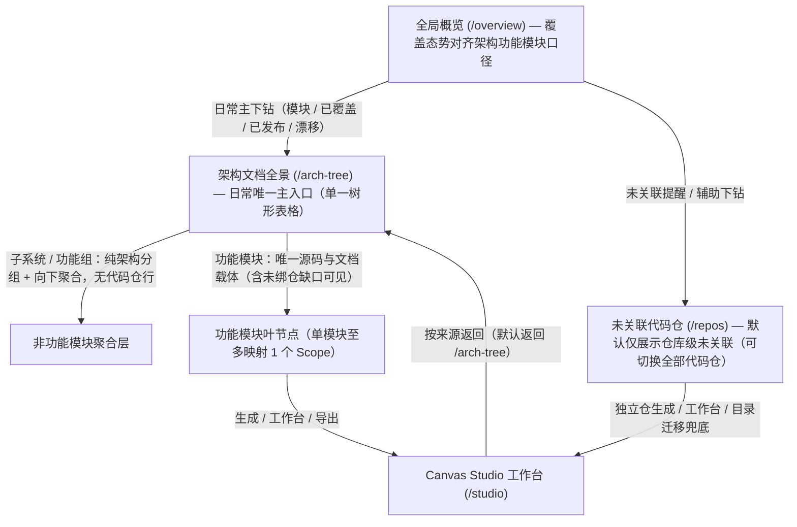

# ADR-09: 架构文档全景主视图树表化重构与未关联代码仓定位收敛

- **文档编号**：`09-arch-tree-primary-view-and-unassigned-repos.md`
- **日期**：2026-11-23
- **状态**：提议中 (Proposed — 待架构组评审)
- **关联议题**：[`01-feature-matrix.md`](../01-features/01-feature-matrix.md) (`F-01`, `F-26`)；[`04-workbench-and-security.md`](../02-design/04-workbench-and-security.md)；[`01-http-api-contract.md`](../03-api/01-http-api-contract.md)；[`02-data-model-and-dto-contract.md`](../03-api/02-data-model-and-dto-contract.md)；[`ADR-01`](./01-microfrontend-and-table-prefix-isolation.md)；[`ADR-04`](./04-module-scope-discovery-and-hierarchical-docs.md)；[`ADR-07`](./07-single-repo-branch-switch.md)

---

## 1. 背景与问题陈述 (Context & Problem Statement)

### 1.1 现状实现基线

`code-archdoc` 当前在「文档全景」分组下同时提供两个围绕范围覆盖的视图，并由「全局概览」与「工作台」联动跳转，现状代码分布如下：

| 入口 / 组件 | 现状行为与职责 | 代码位置 |
| :--- | :--- | :--- |
| **架构文档全景 (`/arch-tree`)** | 前端按 `subsystem` → `group` → `module` 逐层嵌套圆角卡片，且每个携带 `scopes[]` 的节点内嵌一个独立的 `<ScopeCoverageTable compact />`（带完整 `<thead>` 表头）；树底部额外渲染一张全宽「未归类代码仓与目录 (`unassigned_scopes`)」表格。 | `frontend/src/pages/ArchTreeCoveragePage.tsx`、`frontend/src/components/coverage/ArchTreeView.tsx` |
| **架构树后端聚合 (`GetArchTree`)** | 先通过 `buildCoverageData` 生成全量「整仓 (`repo`) + 一级自动发现/登记子目录 (`subdir`)」范围行，再按 `ArchElementID` → 父仓挂载节点 (`repoAttachNodeID`) → `SubsystemID` 依次挂入任意类型节点，未命中者归入 `unassigned_scopes`。 | `services/repo_service.go` (`GetArchTree`)、`handlers/repo.go` (`GetArchTree`) |
| **仓库文档覆盖 (`/repos`)** | 以平铺/可展开表格展示全部活跃仓库的整仓与 Monorepo 子目录，承载批量生成、分支切换及「模块发现与目录迁移 (`ModuleGovernanceModal`)」入口，并支持 `arch_binding=all \| bound \| unbound`（范围级）筛选。 | `frontend/src/pages/RepoCoveragePage.tsx`、`services/repo_service.go` (`ListRepoCoverage`) |
| **全站导航、概览与工作台动线** | 侧边栏依次排列「全局概览 → 仓库文档覆盖 → 架构文档全景」；`QualityMetricsPage` 首屏 4 张覆盖卡片有 3 张下钻至 `/repos`；`CanvasStudioPage` 返回按钮（`handleBackToRepos`）固定跳转至 `/repos`，侧边栏激活态亦将 `/studio` 归属到「仓库文档覆盖」。 | `frontend/src/menu.ts`、`frontend/src/App.tsx`、`frontend/src/pages/QualityMetricsPage.tsx`、`frontend/src/pages/CanvasStudioPage.tsx` |

### 1.2 核心痛点与根因剖析 (`P-1` ~ `P-5`)

对照实际页面表现与业务演进方向，现有双视图与树视图存在 **5 项结构性信息架构与交互问题**：

| 编号 | 问题现象 | 严重度 | 根因分析 |
| :---: | :--- | :---: | :--- |
| **P-1** | **多层卡片套嵌子表格，视觉割裂与重复表头轰炸** | 🔴 | 在 `ArchTreeView.tsx` 中，外层容器卡片 → 子系统卡片 → 功能组卡片 → 嵌套子表格，以及功能模块卡片 → 仅有 1 行的嵌套子表格，导致每出现一个绑定源码的节点就重复渲染 1 组完整表头（`仓库/子目录范围 \| 负责人与提交 \| 文档覆盖 \| 操作`），列宽无法跨层对齐，页面信息密度极低、纵向高度膨胀。 |
| **P-2** | **非功能模块吸附整仓与零散目录，聚合统计失真** | 🔴 | `GetArchTree` 将绑定在「功能组」或其下属仓库上的整仓行与未登记功能模块的自动发现目录一并吸附到非功能模块节点下。以生产实景 `code-bench` 为例：`门户功能组 (BENCH)` 下实际仅拆解了 `门户前端`（`frontend`）与 `门户业务`（`handlers`）2 个功能模块，但因混入了 `code-bench` 整仓、`models`（3 文件 / 542 LOC）及 `templates`（3 文件 / 9 LOC），导致节点徽标误报为 `范围 1/5`（页面顶部亦显示 `范围 13`），非功能模块下出现不应存在的源码列表。 |
| **P-3** | **同质字段重复展示且夹杂工程治理噪声** | 🟠 | 平台共享表 `architecture_elements`（`code-bench/models/models.go` `ArchitectureElement`）中每个「功能模块 (`module`)」天然最多只映射 1 个 `(repo_id, subdirectory)`。目前模块节点头已显示名称与 `owner_name`，内部 1 行子表格又重复渲染 `owner_name`、`范围 1/1`、`草稿 2` 等状态，并混入 `一级目录` 来源标签、所属部门 `基础架构部` 等工程治理字段；`0/5` 未覆盖行仍占据两行高度并显示不可点击的置灰导出按钮。 |
| **P-4** | **主次入口倒置与页面职责重叠** | 🔴 | 团队内几乎所有代码仓均服务于特定架构元素，日常研发与架构师的核心诉求是从「架构文档全景」出发按子系统/功能组/功能模块查看与编写设计文档；但当前「仓库文档覆盖 (`/repos`)」与「架构文档全景 (`/arch-tree`)」职责高度重叠，概览下钻、工作台返回、侧边栏排序均偏向前者，且 `/arch-tree` 底部又冗余平铺「未归类代码仓与目录」大表。 |
| **P-5** | **目录级未关联判定引入无意义辅助目录噪声** | 🟠 | 一个已由「功能模块」拆解纳管的代码仓内常伴随辅助目录（如 `models/`、`templates/`、`scripts/`、`config/`）。若按「目录级补集」定义未关联清单，这些无需独立建模块与架构文档的辅助目录会持续涌入未关联视图，削弱「待治理代码仓」清单的信号纯度。 |

---

## 2. 决策概览与整体信息架构 (Decision Summary & Information Architecture)

### 2.1 互补式双视图信息架构

本 ADR 确立**「以架构文档全景为日常唯一主入口，以未关联代码仓为 MECE 仓库级补集与工程兜底」**的信息架构收敛方案：

### 2.2 候选方案评估

| 候选方案 | 核心做法 | 优点 | 缺点与风险 | 结论 |
| :--- | :--- | :--- | :--- | :---: |
| **方案 A：全景主入口树表化 + 非功能模块去代码仓化 + `/repos` 收敛为「未关联代码仓」** | `/arch-tree` 重构为单一 4 列树表、非功能模块不挂代码仓、移除底部未归类大表；`/repos` 更名为「未关联代码仓」，默认仅展示**仓库级未关联**代码仓（只要仓内任一目录已绑定 `module` 即认为该仓已被处理），并在筛选栏保留极轻量「全部代码仓」切换承接低频工程治理；全站动线迁向 `/arch-tree`。 | 彻底消除卡片套表格与重复表头；两视图遵循 **MECE（相互独立、完全穷尽）** 分工，零噪音且不重不漏；保留全部低频工程治理能力（目录迁移、整仓 Roll-up、批量生成）无任何功能倒退。 | 需同步演进 `GetArchTree` / `ListRepoCoverage` 聚合口径与前端树表组件；历史书签访问 `/repos` 的用户默认看到未关联列表，需提供清晰筛选提示与切换入口。 | ✅ **提议采纳** |
| **方案 B：仅做前端视觉压缩，保留非功能模块代码仓与底部未归类表** | 保留现有后端 `GetArchTree` 与双层结构，仅隐藏子表格多余表头或折叠图例。 | 后端改动最小。 | 无法解决功能组混入整仓/辅助目录导致的统计失真（`范围 1/5`），两页面依然职责打架、心智混乱。 | ❌ **放弃** |
| **方案 C：将 `/repos` 彻底改造为按「目录级」严格过滤的未关联清单，并删除全仓列表** | `/repos` 仅展示所有未绑定 `module` 的零散目录，且移除全仓视图切换。 | 表面规则机械一致。 | `models/`、`templates/` 等无足轻重辅助目录会淹没页面；且导致 `ModuleGovernanceModal` 目录迁移与 ADR-04 整仓 Roll-up 入口彻底丢失。 | ❌ **放弃** |

### 2.3 核心决策摘要 (`D-1` ~ `D-5`)

| 决策编号 | 决策主题 | 核心要点 | 解决问题 |
| :---: | :--- | :--- | :---: |
| **D-1** | **架构树承载模型收敛与模块级统计口径** | 非功能模块（`subsystem`、`group`）不再挂接任何代码仓，仅作为层级容器向上聚合；「功能模块 (`module`)」成为唯一的代码与文档承载叶节点；**未关联代码仓的功能模块计入覆盖率分母**以真实暴露资产缺口。 | P-2、P-3 |
| **D-2** | **「架构文档全景」单一统一树形表格重构** | 摒弃卡片套表格，改为全页单表头的 4 列树形表格（Tree Table）；去除顶部图例栏、底部「未归类代码仓与目录」及所有工程噪音标签；非功能模块操作列保持纯空（不设一键打包下载）。 | P-1、P-3、P-4 |
| **D-3** | **「未关联代码仓」仓库级 MECE 判定与低频兜底** | 确立**仓库级未关联准则**：只要一个仓库自身或其任意子目录已关联至少 1 个 `module` 架构元素，即视为已处理；`/repos` 默认只列完全未绑定 `module` 的仓库，筛选栏保留「仅未关联 (默认) / 全部代码仓」轻量切换以承接目录迁移与整仓 Roll-up。 | P-4、P-5 |
| **D-4** | **全站导航与交互动线向全景主入口倾斜** | 侧边栏置顶「架构文档全景」、退后「未关联代码仓」；工作台返回与高亮默认归属 `/arch-tree`；「全局概览」覆盖卡片与快捷链接以架构模块视图为主导下钻目标。 | P-4 |
| **D-5** | **API 契约增量演进与零数据库 DDL 原则** | 严格遵循 `ADR-01` 零建表/零改表；`GET /api/arch-tree` 收敛节点统计与单 `scope` 载体结构；`GET /api/repos` 扩展 `arch_binding=unbound_repo` 查询模式。 | P-2、P-5 |

---

## 3. 核心决策详解 (Detailed Decisions)

### 3.1 决策 D-1：架构树承载模型收敛与模块级统计口径

1. **架构叶节点唯一承载原则**：
   - 平台业务现实中，子系统（`subsystem`）与功能组（`group`）关联的整仓均由其下属功能模块（`module`）进一步分解；每个「功能模块 (`type = "module"`)」在共享表 `architecture_elements`（`code-bench/models/models.go` `ArchitectureElement`）中至多绑定 1 个 `(repo_id, subdirectory)`（既覆盖 Monorepo 子目录绑定，也兼容单仓即单模块时 `repo_id != nil && subdirectory == ""` 的整仓绑定）。
   - 因此，在 `GetArchTree` 构造架构树时：
     - **非功能模块 (`subsystem` / `group`)**：**严禁挂载任何代码仓范围（`scopes` 恒为空）**，即使该节点在平台元表中历史上曾填写 `repo_id` 或有仓库通过 `ServiceGroup` 指向该子系统，也不再在此层渲染代码仓行，其职责纯粹为组织树结构并向下聚合子孙功能模块指标。
     - **功能模块 (`module`)**：直接解析其自身的 `(repo_id, subdirectory)` 覆盖数据并附着为单作用域实体；若该功能模块尚未绑定 `repo_id`（`repo_id == null`）或所绑仓库已停用，仍作为树内合法叶节点保留展示（标识「未关联代码仓」）。
     - **不再吸纳未建架构元素的自动扫描目录**：像 `models`、`templates` 这类仅由静态扫描发现但未在架构管理中设立 `module` 的辅助目录，不再强行挂载到子系统或功能组下。

2. **统一模块级聚合统计口径（含未绑仓缺口暴露）**：
   - 每个树节点 `stats` 统一按子孙「功能模块 (`type == "module"`)」口径聚合：
     - `module_count`：子树下功能模块总数（**包含 `repo_id == null` 的未绑仓模块**，以此真实反映架构蓝图的文档覆盖率分母）；
     - `bound_module_count`：已绑定有效活跃代码仓的功能模块数（供 tooltip 展示“已绑源码 X / 总模块 Y”）；
     - `covered_module_count`：至少产出 1 篇对当前用户可见文档的功能模块数（**普通用户依然严格隔离 `draft` 未发布文档**，保持既定安全红线不变）；
     - `approved_doc_count`、`draft_doc_count`、`drifted_doc_count`、`blocked_doc_count`：仅统计来自上述功能模块节点的文档计数。
   - **顶部摘要微标口径对齐**：`ArchTreeResponse.summary` 同步对齐上述全树功能模块口径（页面顶部展示 `功能模块 N`、`已覆盖 M`、`已发布 P`、`漂移 D`），消除过去顶部 `范围 13` 与树内 `范围 1/5` 互相矛盾的割裂感。

---

### 3.2 决策 D-2：「架构文档全景 (`/arch-tree`)」单一统一树形表格规范

1. **视觉结构重构：单一 4 列 Tree Table**：
   彻底拆除外层套嵌卡片、节点内嵌 `<ScopeCoverageTable>` 与重复表头，整棵架构树渲染在**同一张拥有 1 个顶部表头的 4 列树形表格**中：

| 架构层级 / 关联源码 | 负责人与基线 | 文档覆盖（N 类） | 操作 |
| :--- | :--- | :--- | :--- |
| `▾` `子系统` **AI辅助研发子系统** `RND_AI` | 管理员 | 模块覆盖 `1 / 3` `[███░░░░░]` · `草稿 2` | — |
| &emsp;`▾` `功能组` **门户功能组** `BENCH` | 管理员 | 模块覆盖 `1 / 3` `[███░░░░░]` · `草稿 2` | — |
| &emsp;&emsp;`功能模块` **门户前端** `BENCH_FRONT`   &emsp;&emsp;`code-bench / frontend` · `main` · 41 文件 / 14,866 LOC | 管理员   `Commit: 73d3e2f3` | `2 / 5` `[████░░░░]`   `[代码导读 草稿v1]` `[系统架构 草稿v1]` `[+3 待生成 ▾]` | `[工作台]` `[生成]` |
| &emsp;&emsp;`功能模块` **门户业务** `BENCH_SERVICE`   &emsp;&emsp;`code-bench / handlers` · `main` · 15 文件 / 5,597 LOC | 管理员   `Commit: -` | `0 / 5` `[░░░░░░░░]` `[+5 待生成 ▾]` | `[生成]` `[工作台]` |
| &emsp;&emsp;`功能模块` **权限中心** `BENCH_AUTH`   &emsp;&emsp;*未关联代码仓* | 张三 | `—` | *未绑定源码* |

2. **明确裁剪清单与交互约束**：
   - **层级区分**：通过固定阶梯缩进、左侧细引导竖线与轻量底色微差（严格使用 `theme.css` `--color-*` 语义 Token 适配亮/暗双模）区分 `子系统`、`功能组`、`功能模块` 三层，所有 4 列纵向对齐。
   - **顶部工具栏瘦身**：删除独立树形图例横条（行内已带节点类型图标与徽标），将「全部展开」「全部收起」按钮直接收拢至筛选栏最右侧，顶部区由 3 层横条精简为 2 层。
   - **完全移除底部「未归类代码仓与目录」区域**：`/arch-tree` 专注已纳管架构资产，不再在页面底部堆叠任何未归类代码仓大表或引导横幅，未关联代码仓交由 `/repos` 专门承接。
   - **行内工程噪音清除**：功能模块行移除重复负责人显示、移除 `范围 1/1` / `范围 0/1` 计数、移除 `一级目录` 来源徽标、移除部门名 `基础架构部`；当已生成文档数为 `0` 时，进度条与 `+N 待生成 ▾` 紧凑单行排布；无已发布文档时隐藏置灰的 `ZIP` 导出图标（仅 `approved > 0` 时展示）。
   - **主次按钮自适应与非功能模块留空**：`0` 篇文档模块突出「生成」为主按钮，已有文档模块突出「工作台」为主按钮；保留点击 `[+N 待生成 ▾]` 展开行内全量文档卡片网格（`ScopeDocExpandedGrid`）能力；**子系统与功能组行操作列保持纯空（不提供一键打包下载等聚合操作）**，维持视图极简度。
   - **空节点与筛选剪枝规则**：无筛选状态下保留空子系统/空功能组（展示 `0 模块` 提示架构占位）；开启任意筛选条件后自动剪枝无匹配功能模块的非叶节点（沿用既有 `pruneArchTreeNode` 语义）。

---

### 3.3 决策 D-3：「未关联代码仓 (`/repos`)」仓库级 MECE 判定准则与低频治理兜底

1. **仓库级未关联判定规则（MECE 不重不漏）**：
   - **判定定义**：对于平台中每一个活跃代码仓 `repo`：
     - **已关联（已处理）**：在全量 `architecture_elements` 中存在任意一条记录满足 `el.type == "module"` 且 `el.repo_id == repo.ID`（无论该模块绑定的是整仓 `subdirectory == ""` 还是仓内某个子目录 `subdirectory != ""`）。
     - **未关联（待处理）**：不存在任何 `type == "module"` 的架构元素指向该 `repo.ID`（即使该仓库在旧数据中设置了 `repositories.service_group`，或有 `subsystem`/`group` 非叶节点曾误填过 `repo_id`，因在 `/arch-tree` 中不承接代码仓渲染，按 MECE 原则同样归入「未关联代码仓」，确保全平台代码仓不重不漏、零监管盲区）。
   - **消除辅助目录噪声**：以 `code-bench` 为例，因其 `frontend`、`handlers` 已绑定功能模块，故整个 `code-bench` 仓库视为已被处理，其辅助目录 `models`、`templates` 等**不再出现在「未关联代码仓」默认视图中**。

2. **页面收敛与低频工程治理能力兜底**：
   - 原 `/repos` 页面在 UI 定位上更名为 **「未关联代码仓」**（副标题明确为：展示尚未关联任何架构功能模块的独立或待归类代码仓库，支持直接生成与审校文档）。
   - 默认加载模式为 **「仅未关联代码仓 (默认)」**（只展示仓库级未关联的仓整仓行及对应可选发现子目录），平时团队中几乎所有代码仓关联完功能模块后，此页面仅剩少量独立工具仓或新导入待归类仓，极简克制。
   - 在筛选栏右侧保留一个极轻量的视图开关（如分段/下拉切换：**`仅未关联 (默认)` ↔ `全部代码仓`**）：
     - 切换到「全部代码仓」时保留既有完整的仓库与子目录矩阵，确保 **3 项低频仓库级工程能力**——① `ModuleGovernanceModal`（目录重命名文档无损迁移与模块发现策略配置）、② `ADR-04` 整仓 Roll-up 汇总文档生成、③ 同仓多模块批量生成——在架构主视图弱化仓库概念后依然有明确、零损失的可达入口。

---

### 3.4 决策 D-4：全站导航与交互动线向全景主入口倾斜

为避免前端页面定位更新后出现导航与跳转割裂，全站 4 处动线同步对齐：

| 触点 | 调整前 | 调整后 | 涉及文件 |
| :--- | :--- | :--- | :--- |
| **侧边栏「文档全景」顺序与文案** | `全局概览` → `仓库文档覆盖` → `架构文档全景` | `全局概览` → **`架构文档全景`**（置顶为主视图）→ **`未关联代码仓`**（弱化排后） | `frontend/src/menu.ts`、`frontend/src/App.tsx` |
| **工作台返回路径与侧边栏激活态** | `CanvasStudioPage.handleBackToRepos` 固定跳转 `/repos`；`App.tsx` 进入 `/studio` 时高亮「仓库文档覆盖」 | 默认返回 **`/arch-tree`**（支持通过路由 `state` / `from` 优先返回来源页如 `/repos`）；独立调试模式进入 `/studio` 默认高亮「架构文档全景」 | `frontend/src/pages/CanvasStudioPage.tsx`、`frontend/src/App.tsx` |
| **全局概览 (`/overview`) 覆盖卡片与快捷链接** | 覆盖卡片 `total_scopes` / `approved_docs` / `drifted_docs` 均跳往 `/repos`；右上角链接先「仓库文档覆盖」后「架构文档全景」 | 覆盖卡片统计口径与「架构文档全景」一致，点击「功能模块总数 / 已覆盖 / 已发布 / 存在漂移」默认下钻至 **`/arch-tree`**（携带对应 `status` 参数）；右上角链接主推「架构文档全景」，次推「未关联代码仓」 | `frontend/src/pages/QualityMetricsPage.tsx` |
| **历史兼容链接 `/repos?view=arch`** | 重定向至 `/arch-tree` | 保持重定向至 `/arch-tree`，兼容历史分享链接与测试 | `frontend/src/pages/RepoCoveragePage.tsx` |

---

### 3.5 决策 D-5：API 契约演进与零数据库 DDL 原则

1. **零数据库结构变更**：完全复用既有 `architecture_elements`（只读共享表）、`archdoc_documents`、`archdoc_repo_modules`、`archdoc_repo_snapshots` 与 `archdoc_gen_tasks`，**不新增表、不修改任何 DDL**，100% 遵守 [`ADR-01`](./01-microfrontend-and-table-prefix-isolation.md)。

2. **`GET /api/arch-tree` 契约演进**：
   - **过滤能力**：在既有 `search`、`subsystem_id`、`doc_type`、`status` 基础上，遵循既有口径筛选功能模块节点并执行 `pruneArchTreeNode` 剪枝。
   - **节点与统计 DTO（`ArchTreeNodeVO` / `ArchTreeStatsVO`）**：
     - 非功能模块节点（`subsystem`、`group`）：仅输出 `children[]` 与聚合后 `stats`，不再挂载 `scopes[]`（可置空数组 `[]`）。
     - 功能模块节点（`module`）：新增单作用域字段 `scope?: RepoScopeCoverageVO | null`（若需要向后兼容旧客户端读取 `scopes[0]`，可在过渡期同时保留 `scopes` 最多 1 项或于契约升级中统一切换至 `scope`），当 `repo_id == null` 时 `scope = null`。
     - `ArchTreeStatsVO`：使用清晰语义字段 `module_count`、`bound_module_count`、`covered_module_count`、`approved_doc_count`、`draft_doc_count`、`drifted_doc_count`、`blocked_doc_count`（`Summary` 同步对齐 `total_modules` / `covered_modules` / `approved_docs` / `drifted_docs` 或沿用兼容字段映射，具体字段命名于阶段三 API 契约冻结）。
     - `unassigned_scopes`：收敛为空数组（或标记 deprecated 并逐步移除渲染依赖）。

3. **`GET /api/repos` 契约演进**：
   - `parseRepoCoverageFilter` 中的 `arch_binding` 参数在既有 `all | bound | unbound` 之外，新增枚举值 **`unbound_repo`（仓库级未关联）**：
     - 当 `arch_binding=unbound_repo` 时，后端基于全量 `architecture_elements` 构建「已存在 `type == "module"` 绑定的 `repo_id` 集合 `boundModuleRepoIDs`」，过滤掉所有 `row.RepoID ∈ boundModuleRepoIDs` 的仓库行（包含其整仓与子目录），仅保留尚未被任何功能模块认领的代码仓库。
     - `/repos` 前端页面在未显式选择「全部代码仓」时默认请求 `arch_binding=unbound_repo`（URL 参数兼容不传与显式切换，不影响已有 `arch_binding=bound` / `unbound` API 调用方）。

---

## 4. 影响范围、兼容性与风险缓解

### 4.1 预期影响模块清单

| 层级 | 涉及文件 / 模块 | 变更摘要 |
| :--- | :--- | :--- |
| **后端服务与接口** | `services/repo_service.go`、`handlers/repo.go`、`handlers/arch_tree_test.go` | `GetArchTree` 改为仅由 `module` 节点承载单 `scope` 与模块级统计；`parseRepoCoverageFilter` / `filterCoverageRows` 支持 `arch_binding=unbound_repo` 仓库级未关联筛选；更新对应单测与契约断言。 |
| **前端页面与组件** | `ArchTreeCoveragePage.tsx`、`ArchTreeView.tsx`、`RepoCoveragePage.tsx`、`RepoCoveragePage.css`、`QualityMetricsPage.tsx`、`CanvasStudioPage.tsx`、`menu.ts`、`App.tsx`、`types/domain.ts`、`utils/urlQuery.ts` | `/arch-tree` 改为单一 4 列树形表格、去除底部未归类大表及冗余栏；`/repos` 更名为「未关联代码仓」并增加轻量范围切换；更新导航顺序、概览下钻与工作台返回动线。 |
| **SDD 规范文档** | `docs/02-design/04-workbench-and-security.md`、`docs/03-api/01-http-api-contract.md`、`docs/03-api/02-data-model-and-dto-contract.md`、`docs/04-tasks/01-roadmap.md` & 新建 `M15` 作战卡 | 在架构组确认本 ADR 后，同步更新设计与 API 契约并冻结 TDD 实施作战卡。 |

### 4.2 边界场景与风险缓解

| 边界 / 风险点 | 处理策略 |
| :--- | :--- |
| **多模块指向同一 `(repo_id, subdirectory)` 的架构配置异常** | 在 `GetArchTree` 中每个 `module` 节点独立解析其指向的 `(repo_id, subdirectory)` 覆盖信息，不因去重而丢失其中一个模块；同时保持 `Summary` 按功能模块去重计数或与树内叶节点总和严格一致，避免出现总数对不上账的现象。 |
| **未关联任何模块但仅设了 `ServiceGroup` 或绑定在 `group` 上的仓库** | 按 D-3 严格以「是否绑定 `type == "module"`」为准：此类仓库不会出现在 `/arch-tree` 中，但一定出现在「未关联代码仓 (`/repos`)」默认列表中，防止仓库落入两边都不显示的“黑洞”。 |
| **用户想对已关联功能模块的 Monorepo 做目录重命名迁移或生成整仓 Roll-up 文档** | 通过 `/repos` 页面筛选栏切换至「全部代码仓」，仍可完整使用 `ModuleGovernanceModal`（发现策略、扫描、忽略、目录迁移）与整仓生成/批量生成弹窗。 |
| **普通用户草稿隔离安全红线** | 延续现有红线：`GetArchTree` 与 `ListRepoCoverage` 在构建 `DocStatuses` 时对 `!canWrite && d.Status != "approved"` 的文档继续过滤，普通用户不会在模块统计数字（`covered_module_count`、`draft_doc_count`、`blocked_doc_count`）或树表中看到任何未发布草稿信息。 |
| **既有单测与 E2E 回归兼容性** | `handlers/arch_tree_test.go`（`TestRepoCoverageArchAssociationAndArchTreeAPI`）与 `frontend/src/utils/archdocUtils.test.ts` 将随阶段三/四一并更新以覆盖新口径；既有 `arch_binding=bound\|unbound` 行为保留向后兼容。 |

---

## 5. 提请架构组评审议题 (Architecture Review Checklist)

请架构组重点讨论并确认以下 **4 项关键决策**：

1. **【节点承载边界】** 是否同意非功能模块（子系统 / 功能组）在「架构文档全景」中彻底**不挂载、不展示代码仓与未建模块的扫描目录**，仅由「功能模块 (`module`)」作为唯一的代码与文档承载叶节点？
2. **【覆盖率统计分母】** 是否同意将**尚未绑定代码仓的功能模块（`repo_id == null`）计入架构覆盖率分母**（如 `模块覆盖 1 / 3`），以在全景树中直接暴露“有架构定义但缺源码实现或待补充绑定”的资产缺口？
3. **【未关联判定口径】** 是否同意「未关联代码仓 (`/repos`)」采用**仓库级未关联准则**（只要仓库整仓或任一子目录已绑定至少 1 个 `module`，即认为该仓库已被处理，不再将其内部辅助目录列为未关联），并在页面内保留「仅未关联 (默认) / 全部代码仓」的轻量切换作为低频工程治理兜底？
4. **【全站主次动线】** 是否同意将「架构文档全景 (`/arch-tree`)」确立为日常文档消费与生产的主入口，并将侧边栏排序、全局概览下钻与工作台默认返回路径统一迁向 `/arch-tree`？

---

## 6. 后续实施路径 (Next Steps)

待架构组评审通过本 ADR（状态变更为 `Accepted`）后，按工作区 SDD + TDD 规范推进落地：
1. 更新 [`04-workbench-and-security.md`](../02-design/04-workbench-and-security.md)、[`01-http-api-contract.md`](../03-api/01-http-api-contract.md) 与 [`02-data-model-and-dto-contract.md`](../03-api/02-data-model-and-dto-contract.md)，冻结前端组件树、API DTO 与筛选参数契约；
2. 更新 [`01-roadmap.md`](../04-tasks/01-roadmap.md) 并拆解 `M15` TDD 作战卡；
3. 先补充/调整前后端测试用例（Red），再实施后端 `GetArchTree` / `ListRepoCoverage` 与前端统一树表及导航动线重构（Green），完成 `make test && make lint && make build` 全门禁验证后交付。
