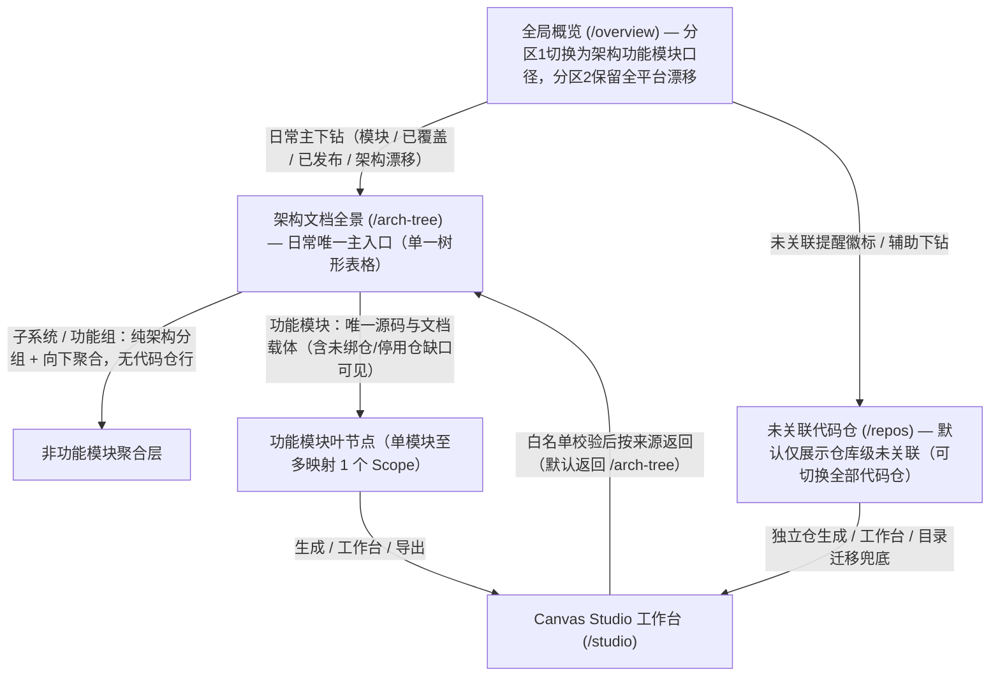

# ADR-09: 架构文档全景主视图树表化重构与未关联代码仓定位收敛

- **文档编号**：`09-arch-tree-primary-view-and-unassigned-repos.md`
- **日期**：2026-11-23
- **状态**：提议中 (Proposed — 已完成代码基线核对与契约细化，待架构组评审)
- **关联议题**：[`01-feature-matrix.md`](../01-features/01-feature-matrix.md) (`F-01`, `F-26`)；[`04-workbench-and-security.md`](../02-design/04-workbench-and-security.md)；[`01-http-api-contract.md`](../03-api/01-http-api-contract.md)；[`02-data-model-and-dto-contract.md`](../03-api/02-data-model-and-dto-contract.md)；[`ADR-01`](./01-microfrontend-and-table-prefix-isolation.md)；[`ADR-04`](./04-module-scope-discovery-and-hierarchical-docs.md)；[`ADR-07`](./07-single-repo-branch-switch.md)；[`ADR-08`](./08-dual-engine-doc-generation.md)（与 `M14` 文件边界正交，可独立并行/接续演进）

---

## 1. 背景与问题陈述 (Context & Problem Statement)

### 1.1 现状实现基线

`code-archdoc` 当前在「文档全景」分组下同时提供两个围绕范围覆盖的视图，并由「全局概览」与「工作台」联动跳转，经代码基线逐行核对，现状分布如下：

| 入口 / 组件 | 现状行为与职责 | 代码位置 |
| :--- | :--- | :--- |
| **架构文档全景 (`/arch-tree`)** | 前端按 `subsystem` → `group` → `module` 逐层嵌套圆角卡片，且每个携带 `scopes[]` 的节点内嵌一个独立的 `<ScopeCoverageTable compact />`（带完整 `<thead>` 表头）；树底部额外渲染一张全宽「未归类代码仓与目录 (`unassigned_scopes`)」表格。顶部微标调用 `buildCoverageMicroPills`，仍显示「范围 (`total_scopes`)」。 | `frontend/src/pages/ArchTreeCoveragePage.tsx`、`frontend/src/components/coverage/ArchTreeView.tsx`、`frontend/src/components/OverviewMicroPills.tsx` |
| **架构树后端聚合 (`GetArchTree`)** | 先通过 `buildCoverageData` 生成全量「整仓 (`repo`) + 一级自动发现/登记子目录 (`subdir`)」范围行，再按 `ArchElementID` → 父仓挂载节点 (`repoAttachNodeID`) → `SubsystemID` 依次挂入任意类型节点，未命中者归入 `unassigned_scopes`。 | `services/repo_service.go` (`GetArchTree`)、`handlers/repo.go` (`GetArchTree`)、`models/shared.go` (`ArchitectureElement`) |
| **仓库文档覆盖 (`/repos`)** | 以平铺/可展开表格展示全部活跃仓库的整仓与 Monorepo 子目录，承载批量生成、分支切换及「模块发现与目录迁移 (`ModuleGovernanceModal`)」入口，并支持 `arch_binding=all \| bound \| unbound`（范围级）筛选；URL 序列化时省略 `arch_binding=all`。 | `frontend/src/pages/RepoCoveragePage.tsx`、`frontend/src/utils/urlQuery.ts`、`services/repo_service.go` (`ListRepoCoverage`) |
| **全站导航、概览与工作台动线** | 侧边栏依次排列「全局概览 → 仓库文档覆盖 → 架构文档全景」；`QualityMetricsPage` 分区 1 调用 `listRepos({ page: 1, pageSize: 15 })` 驱动首屏 4 张覆盖卡片（3 张下钻至 `/repos`，仅「已覆盖范围」跳 `/arch-tree`），分区 2 调用 `getDriftSummary()` 展示全平台漂移；`CanvasStudioPage.handleBackToRepos` 硬编码跳转至 `/repos`，`StudioTopBar.tsx` 返回按钮 tooltip 为“返回仓库与文档覆盖矩阵”，`CanvasStudioPage.tsx` 路由参数缺失提示仍提及“仓库覆盖矩阵”，`App.tsx` 进入 `/studio` 时高亮「仓库文档覆盖」。 | `frontend/src/menu.ts`、`frontend/src/App.tsx`、`frontend/src/pages/QualityMetricsPage.tsx`、`frontend/src/pages/CanvasStudioPage.tsx`、`frontend/src/components/studio/StudioTopBar.tsx` |

### 1.2 核心痛点与根因剖析 (`P-1` ~ `P-5`)

对照实际页面表现与业务演进方向，现有双视图与树视图存在 **5 项结构性信息架构与交互问题**：

| 编号 | 问题现象 | 严重度 | 根因分析 |
| :---: | :--- | :---: | :--- |
| **P-1** | **多层卡片套嵌子表格，视觉割裂与重复表头轰炸** | 🔴 | 在 `ArchTreeView.tsx` 中，外层容器卡片 → 子系统卡片 → 功能组卡片 → 嵌套子表格，以及功能模块卡片 → 仅有 1 行的嵌套子表格，导致每出现一个绑定源码的节点就重复渲染 1 组完整表头（`仓库/子目录范围 \| 负责人与提交 \| 文档覆盖 \| 操作`），列宽无法跨层对齐，页面信息密度极低、纵向高度膨胀。 |
| **P-2** | **非功能模块吸附整仓与零散目录，聚合统计失真** | 🔴 | `GetArchTree` 将绑定在「功能组」或其下属仓库上的整仓行与未登记功能模块的自动发现目录一并吸附到非功能模块节点下。以生产实景 `code-bench` 为例：`门户功能组 (BENCH)` 下实际仅拆解了 `门户前端`（`frontend`）与 `门户业务`（`handlers`）2 个功能模块，但因混入了 `code-bench` 整仓、`models`（3 文件 / 542 LOC）及 `templates`（3 文件 / 9 LOC），导致节点徽标误报为 `范围 1/5`（页面顶部亦显示 `范围 13`），非功能模块下出现不应存在的源码列表。 |
| **P-3** | **同质字段重复展示且夹杂工程治理噪声** | 🟠 | 平台共享表 `architecture_elements`（`models/shared.go` `ArchitectureElement`，只读映射 `code-bench` 主数据）中每个「功能模块 (`module`)」天然最多只映射 1 个 `(repo_id, subdirectory)`。目前模块节点头已显示名称与 `owner_name`，内部 1 行子表格又重复渲染 `owner_name`、`范围 1/1`、`草稿 2` 等状态，并混入 `一级目录` 来源标签、所属部门 `基础架构部` 等工程治理字段；`0/5` 未覆盖行仍占据两行高度并显示不可点击的置灰导出按钮。 |
| **P-4** | **主次入口倒置与页面职责重叠** | 🔴 | 团队内几乎所有代码仓均服务于特定架构元素，日常研发与架构师的核心诉求是从「架构文档全景」出发按子系统/功能组/功能模块查看与编写设计文档；但当前「仓库文档覆盖 (`/repos`)」与「架构文档全景 (`/arch-tree`)」职责高度重叠，概览下钻、工作台返回、侧边栏排序均偏向前者，且 `/arch-tree` 底部又冗余平铺「未归类代码仓与目录」大表。 |
| **P-5** | **目录级未关联判定引入无意义辅助目录噪声** | 🟠 | 一个已由「功能模块」拆解纳管的代码仓内常伴随辅助目录（如 `models/`、`templates/`、`scripts/`、`config/`）。若按「目录级补集」定义未关联清单，这些无需独立建模块与架构文档的辅助目录会持续涌入未关联视图，削弱「待治理代码仓」清单的信号纯度。 |

---

## 2. 决策概览与整体信息架构 (Decision Summary & Information Architecture)

### 2.1 互补式双视图信息架构

本 ADR 确立**「以架构文档全景为日常唯一主入口，以未关联代码仓为 MECE 仓库级补集与工程兜底」**的信息架构收敛方案：



### 2.2 候选方案评估

| 候选方案 | 核心做法 | 优点 | 缺点与风险 | 结论 |
| :--- | :--- | :--- | :--- | :---: |
| **方案 A：全景主入口树表化 + 非功能模块去代码仓化 + `/repos` 收敛为「未关联代码仓」** | `/arch-tree` 重构为单一 4 列树表、非功能模块不挂代码仓、移除底部未归类大表；`/repos` 更名为「未关联代码仓」，默认仅展示**仓库级未关联**代码仓（只要仓内任一目录已绑定 `module` 即认为该仓已被处理），并在筛选栏保留极轻量「全部代码仓」切换承接低频工程治理；全站动线迁向 `/arch-tree`。 | 彻底消除卡片套表格与重复表头；两视图遵循 **MECE（相互独立、完全穷尽）** 分工，零噪音且不重不漏；保留全部低频工程治理能力（目录迁移、整仓 Roll-up、批量生成）无任何功能倒退。 | 需同步演进 `GetArchTree` / `ListRepoCoverage` 聚合口径与前端树表组件；历史书签访问 `/repos` 的用户默认看到未关联列表，需提供清晰筛选提示与切换入口。 | ✅ **提议采纳** |
| **方案 B：仅做前端视觉压缩，保留非功能模块代码仓与底部未归类表** | 保留现有后端 `GetArchTree` 与双层结构，仅隐藏子表格多余表头或折叠图例。 | 后端改动最小。 | 无法解决功能组混入整仓/辅助目录导致的统计失真（`范围 1/5`），两页面依然职责打架、心智混乱。 | ❌ **放弃** |
| **方案 C：将 `/repos` 彻底改造为按「目录级」严格过滤的未关联清单，并删除全仓列表** | `/repos` 仅展示所有未绑定 `module` 的零散目录，且移除全仓视图切换。 | 表面规则机械一致。 | `models/`、`templates/` 等无足轻重辅助目录会淹没页面；且导致 `ModuleGovernanceModal` 目录迁移与 ADR-04 整仓 Roll-up 入口彻底丢失。 | ❌ **放弃** |

### 2.3 核心决策摘要 (`D-1` ~ `D-5`)

| 决策编号 | 决策主题 | 核心要点 | 解决问题 |
| :---: | :--- | :--- | :---: |
| **D-1** | **架构树承载模型收敛与模块级统计口径** | 非功能模块（`subsystem`、`group`）不再挂接任何代码仓，仅作为层级容器向上聚合；「功能模块 (`module`)」成为唯一的代码与文档承载叶节点；区分 `bound` / `unbound` / `repo_inactive` 三态并将未绑仓功能模块计入覆盖率分母；先剪枝叶节点再聚合统计，并对 `ignored` / 未扫描绑定目录提供实时兜底构造。 | P-2、P-3 |
| **D-2** | **「架构文档全景」单一统一树形表格重构** | 摒弃卡片套表格，改为全页单表头的 4 列树形表格（Tree Table）；去除顶部图例栏、底部「未归类代码仓与目录」及所有工程噪音标签；保留活跃任务、自定义分支与缺失目录关键状态；非功能模块操作列保持纯空。 | P-1、P-3、P-4 |
| **D-3** | **「未关联代码仓」仓库级 MECE 判定与低频兜底** | 确立**仓库级未关联准则**：只要一个仓库自身或其任意子目录已关联至少 1 个 `module` 架构元素，即视为已处理；`/repos` 默认请求 `unbound_repo`（不计入用户主动筛选），切换至「全部代码仓」时显式持久化 `arch_binding=all` 至 URL，无损承接目录迁移与整仓 Roll-up。 | P-4、P-5 |
| **D-4** | **全站导航与交互动线向全景主入口倾斜** | 侧边栏置顶「架构文档全景」、退后「未关联代码仓」；`/overview` 分区 1 数据源切换为 `getArchTree({})` 并携带未关联仓库提醒徽标；工作台按经安全白名单校验的来源返回，默认回到 `/arch-tree`。 | P-4 |
| **D-5** | **API 契约直接冻结与零数据库 DDL 原则** | 严格遵循 `ADR-01` 零建表/零改表；直接冻结 `GET /api/arch-tree` 与 `GET /api/repos` 的全部精确 JSON/TS/Go 契约字段与枚举（`binding_status`、`scope`、`ArchTreeSummaryVO`、`ArchTreeStatsVO`、`arch_binding=unbound_repo`），消除实施期歧义。 | P-2、P-5 |

---

## 3. 核心决策详解 (Detailed Decisions)

### 3.1 决策 D-1：架构树承载模型收敛、实时兜底解析与筛选剪枝语义

1. **架构叶节点唯一承载原则与三态模型 (`binding_status`)**：
   - 平台业务现实中，子系统（`subsystem`）与功能组（`group`）关联的整仓均由其下属功能模块（`module`）进一步分解；每个「功能模块 (`type = "module"`)」在共享表 `architecture_elements`（`models/shared.go` `ArchitectureElement`）中至多绑定 1 个 `(repo_id, subdirectory)`（既覆盖 Monorepo 子目录绑定，也兼容单仓即单模块时 `repo_id != nil && subdirectory == ""` 的整仓绑定）。
   - 因此，在 `GetArchTree` 构造架构树时：
     - **非功能模块 (`subsystem` / `group`)**：**严禁挂载任何代码仓范围（`scopes` 恒为空，`scope` 为 `null`）**，即使该节点在平台元表中历史上曾填写 `repo_id` 或有仓库通过 `ServiceGroup` 指向该子系统，也不再在此层渲染代码仓行，其职责纯粹为组织树结构并向下聚合子孙功能模块指标。
     - **不再吸纳未建架构元素的自动扫描目录**：像 `models`、`templates` 这类仅由静态扫描发现但未在架构管理中设立 `module` 的辅助目录，不再强行挂载到子系统或功能组下。
     - **功能模块 (`module`) 明确区分三种绑定态（`binding_status`）**：
       - `"bound"`：`el.RepoID != nil` 且对应仓库在平台活跃仓库集合（`is_active == true`）中存在，`scope` 非空，作为完整可交互模块展示源码基线与文档覆盖；
       - `"unbound"`：`el.RepoID == nil`（尚未绑定任何代码仓），`scope = null`，仍作为树内合法叶节点保留展示，页面标识「*未关联代码仓*」；
       - `"repo_inactive"`：`el.RepoID != nil` 但所绑仓库不存在或已停用（`is_active == false`），`scope = null`，仍作为叶节点保留展示，但页面明确标识「*所绑仓库已停用*」（而非误导为未配置绑定）。

2. **已绑仓模块 `scope` 实时兜底构造（消除 `ignored` / 未扫描漏行缺陷）**：
   - 现状 `buildCoverageData` 在 `len(repoMods) > 0`（仓库已执行过模块刷新扫描）时，会跳过 `archdoc_repo_modules.status == "ignored"` 的子目录；且对于尚未重新执行扫描的新增 `architecture_elements` 子目录绑定，也不会出现在 `repoMods` 行列表中。若 `GetArchTree` 仅从预构建行中查表，会导致这些已合法绑定 `module` 的源码范围意外丢失 `scope`。
   - **硬规则**：`GetArchTree` 加载全量活跃仓库元数据与批量文档/快照/任务/漂移索引后，按 `(repo_id, sandbox.NormalizeSubdir(el.Subdirectory))` 匹配预构建 `RepoScopeCoverageVO`；**若未命中但目标 `repo_id` 在活跃仓库集合中存在，必须调用 `buildSingleScopeRow` 实时兜底构造该 `module` 的 `RepoScopeCoverageVO`**（若在 `repoMods` 中存在对应记录，同时补齐 `ScopeStatus`、`EffectiveFiles`、`TotalLOC` 与 `ModuleSource`），确保 100% 展示真实文档、最新快照提交、活跃任务与写权限。

3. **三层 RBAC 零回归与负责人展示回退（`SC-12`）**：
   - 兜底构造与预构建共享同一权限判定准则：整仓绑定模块（`NormalizeSubdir(el.Subdirectory) == ""`）写权限 `can_write` 严格遵循仓库级权限（`super_admin` / `archdoc_admin` / `repo.OwnerID` / `repo.RelatedMembers`）；子目录绑定模块遵循 `repoLevelWrite || (el.OwnerID != nil && *el.OwnerID == user.ID)`；普通用户视图继续对 `!canWrite && d.Status != "approved"` 的未发布草稿严格过滤，绝不泄露草稿数量与文档明细。
   - `node.owner_name` 优先解析 `el.OwnerID` 对应用户姓名；若 `el.OwnerID == nil` 且 `scope != null`，前端可回退展示 `scope.owner_name`（仓库负责人），避免负责人列出现不必要空白。

4. **任意深度树兼容、多模块同 Scope 独立解析与「先筛选剪枝，后向上聚合」不变量**：
   - 架构树递归构造与统计不硬编码 3 层深度，兼容跳过 `group`（`subsystem -> module`）、多层嵌套 `group` 及顶层游离 `module`。
   - **异常多模块复用同一 `(repo_id, subdirectory)`**：每个 `module` 节点独立绑定自身对应的 `scope` 实例并各自计入聚合，不因全局去重而丢失任一模块。
   - **先剪枝、后聚合不变量**：`GetArchTree` 在构造完整树节点后，**必须先按筛选条件剪枝不匹配的 `module` 叶节点与空非叶分支，然后再自底向上执行 `aggregateArchTreeStats` 与全树 `summary` 汇总**。由此保证无论是否开启筛选，顶部 `summary` 微标、任意父节点 `stats` 与树内实际可见的功能模块叶节点 100% 账实相符。
   - **子系统筛选选项口径对齐**：`GET /api/arch-tree` 返回的 `subsystems[]`（`ArchSubsystemOptionVO`）新增 `module_count` 字段统计该子系统子树下的全部 `module` 节点数（含 `unbound` / `repo_inactive`），同时向后兼容填充 `scope_count = module_count`，确保子系统下拉选项括号数字与树内模块总数完全一致（`GET /api/repos` 的 `subsystems[]` 保持原有范围计数逻辑不变）。

5. **`GET /api/arch-tree` 筛选与剪枝精确语义**：

   | 筛选参数 | 功能模块 (`module`) 匹配规则 | 非功能模块 (`subsystem` / `group`) 保留规则 |
   | :--- | :--- | :--- |
   | **无任何筛选** | 全部保留（包含 `bound`、`unbound`、`repo_inactive`）。 | 全部保留（含 `0 模块` 的空子系统/空功能组，提示架构占位）。 |
   | **`subsystem_id`** | 仅保留归属于该子系统子树下的模块。 | 仅保留目标子系统及其后代子树，其余根节点裁剪。 |
   | **`search`** | 匹配节点 `name_cn` / `name_en` / `identifier`（大小写不敏感），或 `scope != null` 时匹配 `scope.repo_name` / `scope.subdirectory`。 | 若存在命中子节点则保留祖先链；若仅 `search`（无 `status` / `department_id` / `arch_binding` / `scope_type` 限制）且自身名称/标识命中 `search`，即使子树为空亦保留该非叶节点。 |
   | **`status`**（`approved \| draft \| drifted \| missing`）+ 可选 **`doc_type`** | **仅匹配 `binding_status == "bound"`（即 `scope != null`）且满足 `matchesStatusFilter(scope.DocStatuses, docType, status)` 的模块**。`unbound` / `repo_inactive` 模块因无活跃源码不可直接生成文档，在文档状态筛选下不匹配。 | 仅保留存在至少 1 个匹配叶节点的祖先路径（空节点剪除）。 |
   | **`department_id`** | 仅匹配 `binding_status == "bound"` 且 `scope.DepartmentID == *filter.DepartmentID` 的模块。 | 仅保留存在至少 1 个匹配叶节点的祖先路径。 |
   | **`arch_binding`** | API 兼容与增强：非法值返回 `400 INVALID_PARAM`；`bound` 仅保留 `binding_status == "bound"` 模块；`unbound` 仅保留 `binding_status != "bound"`（即 `unbound` 与 `repo_inactive` 缺口模块）；`all`/空不过滤。 | 仅保留存在至少 1 个匹配叶节点的祖先路径。 |
   | **`scope_type`** | 兼容参数：若传入 `repo` 或 `subdir`，仅保留 `scope != null` 且 `scope.ScopeType == scope_type` 的模块；`all`/空不过滤。 | 仅保留存在至少 1 个匹配叶节点的祖先路径。 |

---

### 3.2 决策 D-2：「架构文档全景 (`/arch-tree`)」单一统一树形表格规范

1. **视觉结构重构：单一 4 列 Tree Table**：
   彻底拆除外层套嵌卡片、节点内嵌 `<ScopeCoverageTable>` 与重复表头，整棵架构树渲染在**同一张拥有 1 个顶部表头的 4 列树形表格**中：

   | 架构层级 / 关联源码 | 负责人与基线 | 文档覆盖（N 类） | 操作 |
   | :--- | :--- | :--- | :--- |
   | `▾` `子系统` **AI辅助研发子系统** `RND_AI` | 管理员 | 模块覆盖 `1 / 4` `[██░░░░░░]` · `草稿 2` | — |
   | &emsp;`▾` `功能组` **门户功能组** `BENCH` | 管理员 | 模块覆盖 `1 / 4` `[██░░░░░░]` · `草稿 2` | — |
   | &emsp;&emsp;`功能模块` **门户前端** `BENCH_FRONT` `任务 #42` <br> &emsp;&emsp;`code-bench / frontend` · `develop · 自定义` · 41 文件 / 14,866 LOC | 管理员 <br> `Commit: 73d3e2f3` | `2 / 5` `[████░░░░]` <br> `[代码导读 草稿v1]` `[系统架构 草稿v1]` `[+3 待生成 ▾]` | `[工作台]` `[生成]` |
   | &emsp;&emsp;`功能模块` **门户业务** `BENCH_SERVICE` <br> &emsp;&emsp;`code-bench / handlers` · `main` · 15 文件 / 5,597 LOC | 管理员 <br> `Commit: -` | `0 / 5` `[░░░░░░░░]` `[+5 待生成 ▾]` | `[生成]` `[工作台]` |
   | &emsp;&emsp;`功能模块` **权限中心** `BENCH_AUTH` <br> &emsp;&emsp;*未关联代码仓* | 张三 | `—` | *未绑定源码* |
   | &emsp;&emsp;`功能模块` **旧计费引擎** `BILLING_LEGACY` <br> &emsp;&emsp;*所绑仓库已停用* | 李四 | `—` | *仓库已停用* |

2. **明确裁剪清单与交互约束**：
   - **层级区分与 CSS Token 规范**：通过 CSS 变量 `--tree-depth` 控制阶梯缩进、左侧细引导竖线与轻量底色微差区分 `子系统`、`功能组`、`功能模块` 三层，所有 4 列纵向严格对齐。所有样式类采用 `.code-archdoc-tree-*` 命名并严格复用 `theme.css` `--color-*` 语义 Token 适配亮/暗双模，禁止静态内联 `style`（动态缩进与进度条百分比宽度通过 `--tree-depth` / 已有进度条宽度类处理）与硬编码颜色。
   - **顶部工具栏与摘要微标更新**：删除独立树形图例横条（行内已带节点类型图标与徽标），将「全部展开」「全部收起」按钮直接收拢至筛选栏最右侧，顶部区由 3 层横条精简为 2 层。顶部摘要新增 `buildArchTreeMicroPills`（从 `OverviewMicroPills.tsx` 导出，与 `/repos` 的 `buildCoverageMicroPills` 解耦），展示 **`功能模块`、`已覆盖`、`已发布`、`漂移`** 4 项微标，且继续支持点击「已发布 / 漂移」快捷切换筛选。
   - **完全移除底部「未归类代码仓与目录」区域**：`/arch-tree` 专注已纳管架构资产，不再在页面底部堆叠任何未归类代码仓大表或引导横幅，未关联代码仓交由 `/repos` 专门承接。
   - **行内工程噪音清除 vs 必保关键工程状态**：
     - **清除冗余噪声**：功能模块行移除重复负责人显示、移除 `范围 1/1` / `范围 0/1` 计数、移除 `一级目录` / `架构元表` 来源徽标、移除部门名 `基础架构部`。
     - **必保 3 项关键工程状态（零回归）**：
       1. **`active_task_id` 活跃任务徽标**：模块正在执行生成任务时保留 `任务 #id` 可点击胶囊，点击打开 `GenerateTaskModal` 实时查看流式/轮询进度（兼容 `M14` 拆单子任务展示）；
       2. **`is_branch_overridden` 分支状态与弹窗切分支**：在源码副行显示当前跟踪分支，自定义分支时保留 `· 自定义` 高亮样式；点击「生成」打开 `GenerateTaskModal` 后仍可通过内置 `RepoBranchSelector` 切换分支并联动刷新 `/arch-tree`（ADR-07）；
       3. **`scope_status === "missing"` 目录缺失告警**：当模块绑定的目录在最新提交中已缺失时保留 `目录已缺失` 告警徽标，tooltip 提示前往「未关联代码仓 → 全部代码仓」执行目录迁移（ADR-04）。
   - **树节点展开态提升与默认展开阈值**：
     - 将 `expandedNodeIds` 状态提升至 `ArchTreeCoveragePage` 受控管理，使筛选栏最右侧的「全部展开」「全部收起」按钮可直接驱动树表展开/折叠；
     - **默认展开策略**：无筛选条件下，当全树功能模块总数 `<= 50` 时默认展开所有可展开非叶节点（开屏即见模块与文档覆盖，无需人工逐层点开）；当功能模块总数 `> 50` 时默认仅展开第 1 层 `subsystem`（防止超大企业树首屏过长）；开启任意筛选条件后自动全量展开所有匹配路径。
   - **行内全量文档卡片网格与防 Key 冲突**：
     - 保留点击 `[+N 待生成 ▾]` 展开行内全量文档卡片网格（`ScopeDocExpandedGrid`），在树表对应模块行下方插入 `<tr className="code-archdoc-coverage-expanded-row"><td colSpan={4}>...</td></tr>`；
     - **行 Key 唯一性**：树表行 `key` 与 `expandedRowKeys` 统一使用 **`module:${node.id}`**（而非 `${repo_id}:${subdirectory}`），避免多个模块误绑同一 `(repo_id, subdir)` 时出现 React Key 冲突或联动误展开。
   - **主次按钮自适应、权限边界与非功能模块留空**：
     - **按钮样式**：当 `scope.can_write && generatedCount === 0` 时，突出「生成」为主按钮（`code-archdoc-row-btn--primary`），「工作台」为次按钮；若已有文档（`generatedCount > 0`）或当前用户对模块为只读（`!scope.can_write`），则「工作台」为主按钮，禁用态「生成」保持普通样式并携带权限 tooltip；
     - **ZIP 导出按钮**：`0` 篇已发布文档时不展示置灰图标（直接隐藏），仅当 `approvedCount > 0` 时展示导出按钮；
     - **非功能模块行**：操作列保持纯空（`—`，不设一键打包下载），`stats.module_count === 0` 时在文档覆盖列展示 `0 模块` 提示架构占位；非空非叶节点展示 `模块覆盖 covered / total` + 轻量进度条 + 状态计数微标（`已发布` / `草稿` / `漂移` / `阻断`，严格受普通用户草稿隔离保护），悬停显示「已绑定活跃代码仓 `bound_module_count` / `module_count` 个模块」。

---

### 3.3 决策 D-3：「未关联代码仓 (`/repos`)」仓库级 MECE 判定与低频治理兜底

1. **仓库级未关联判定规则（MECE 不重不漏）**：
   - **判定定义**：基于平台**全量** `architecture_elements`（不受当前 `department_id` 筛选影响）构建集合 `boundModuleRepoIDs = { *el.RepoID | el.Type == "module" && el.RepoID != nil && *el.RepoID > 0 }`，对每个活跃代码仓 `repo`：
     - **已关联（已处理）**：`repo.ID ∈ boundModuleRepoIDs`（无论该模块绑定的是整仓 `subdirectory == ""` 还是仓内某个子目录 `subdirectory != ""`，也无论该子目录当前是 `active` 还是 `missing`）。
     - **未关联（待处理）**：`repo.ID ∉ boundModuleRepoIDs`（即使该仓库在旧数据中设置了 `repositories.service_group`，或有 `subsystem`/`group` 非叶节点曾误填过 `repo_id`，因在 `/arch-tree` 中不承接代码仓渲染，按 MECE 原则同样归入「未关联代码仓」，确保全平台代码仓不重不漏、零监管盲区）。
   - **消除辅助目录噪声**：以 `code-bench` 为例，因其 `frontend`、`handlers` 已绑定功能模块，故整个 `code-bench` 仓库视为已被处理，其辅助目录 `models`、`templates` 等**不再出现在「未关联代码仓」默认视图中**。

2. **页面收敛、URL 状态闭环与防筛选陷阱规则**：
   - 原 `/repos` 页面在 UI 定位上更名为 **「未关联代码仓」**（副标题明确为：展示尚未关联任何架构功能模块的独立或待归类代码仓库，支持直接生成与审校文档；切换至「全部代码仓」可进行模块治理与整仓汇总）。
   - **默认模式与 URL 持久化**：
     - 在筛选栏右侧提供轻量分段/模式开关：**`仅未关联 (默认)` ↔ `全部代码仓`**；
     - URL 不携带 `arch_binding` 时，前端默认以「仅未关联 (默认)」模式加载，向后端请求 `arch_binding=unbound_repo`；
     - 当用户切换至「全部代码仓」时，**必须将 `arch_binding=all` 显式写入 URL**（修正此前 `serializeRepoFilterParams` 忽略 `'all'` 不写入 URL 的行为，使刷新页面与分享链接可准确保持「全部代码仓」视图）；切换回「仅未关联 (默认)」时移除 URL 中的 `arch_binding` 参数（或允许历史 `arch_binding=bound|unbound` 参数透传兼容）。
   - **避免默认模式误触发 `hasActiveFilters` 陷阱**：
     - 默认的 `unbound_repo` 属于视图基础模式，**绝对不得计入 `hasActiveFilters` 或 `advancedFilterCount`**（仅显式选择了 `arch_binding=all|bound|unbound` 以外的筛选条件，或显式切到非默认模式时才视作模式切换；建议 `arch_binding` 从 `advancedFilterCount` 中剥离，由顶部范围分段开关独立承担），从而保证默认进入 `/repos` 时**不自动展开高级筛选面板**，且**按仓库折叠子目录（`subdirCountsByRepo`）机制正常工作**。
     - 在默认「仅未关联」模式下，高级筛选面板隐藏无意义的 `subsystem_id` 与 `arch_binding` 下拉（仅保留 `scope_type`），切换至「全部代码仓」后恢复完整高级筛选。
     - 点击「重置筛选」仅清空 `search`、`department_id`、`doc_type`、`status`、`scope_type`，保持用户当前选中的视图模式（`仅未关联` 或 `全部代码仓`）。
   - **正向空态与低频工程治理兜底**：
     - 当默认视图下全部活跃代码仓均已绑定 `module`（`total === 0` 且无搜索/状态筛选）时，展示清晰的正向空态提示（如“全部活跃代码仓均已关联架构功能模块”），并提供一键切换至「查看全部代码仓」按钮。
     - 切换到「全部代码仓」后完整保留 **3 项低频仓库级工程能力**：① `ModuleGovernanceModal`（目录重命名文档无损迁移与模块发现策略配置）、② `ADR-04` 整仓 Roll-up 汇总文档生成、③ 同仓多模块批量生成。

---

### 3.4 决策 D-4：全站导航、概览数据源切换与工作台安全返回动线

为消除重构后导航、统计口径与页面回跳的割裂，全站 5 处触点同步对齐（**`/overview` 继续保持为模块默认首页路由**）：

| 触点 | 调整前 | 调整后 | 涉及文件 |
| :--- | :--- | :--- | :--- |
| **侧边栏「文档全景」顺序、文案与高亮** | `全局概览` → `仓库文档覆盖` → `架构文档全景`；`/studio` 高亮「仓库文档覆盖」 | `全局概览` → **`架构文档全景`**（置顶为主视图）→ **`未关联代码仓`**（弱化排后）；`App.tsx` 独立调试模式中 `/studio` 与 `/docs/*` 默认高亮「架构文档全景」，`topbarTitle` 兜底文案更新为 `'未关联代码仓'`。 | `frontend/src/menu.ts`、`frontend/src/App.tsx` |
| **全局概览 (`/overview`) 分区 1 数据源与口径** | 调用 `listRepos({ page: 1, pageSize: 15 })` 读取 `summary`；4 张覆盖卡片有 3 张下钻至 `/repos`；右上角先「仓库文档覆盖」后「架构文档全景」 | 1. **数据源切换**：分区 1 改为调用 **`getArchTree({})`** 消费 `ArchTreeResponse.summary`（架构功能模块口径），与下方分区 2 `getDriftSummary()`（全平台已发布文档漂移健康度，含独立未关联仓）形成清晰分工；<br>2. **4 张覆盖卡片与下钻**：① **架构功能模块总数**（`total_modules`，副标题 `总体覆盖率 X% · 已绑源码 bound / total`）→ `/arch-tree`；② **已覆盖功能模块**（`covered_modules`）→ `/arch-tree`；③ **已发布架构文档**（`approved_docs`，副标题注明“架构功能模块已发布定稿”）→ `/arch-tree?status=approved`；④ **架构漂移文档**（`drifted_docs`，副标题注明“架构功能模块待刷新；全平台含独立仓见下方漂移区”）→ `/arch-tree?status=drifted`；<br>3. **右上角快捷入口**：主推「**架构文档全景**」，次推「**未关联代码仓**」（当 `summary.unassigned_repo_count > 0` 时附带轻量提醒徽标，零额外请求兑现未关联提醒）。 | `frontend/src/pages/QualityMetricsPage.tsx` |
| **工作台 (`CanvasStudioPage`) 来源返回与安全校验** | `handleBackToRepos` 固定跳转 `/repos`；`StudioTopBar` tooltip 为“返回仓库与文档覆盖矩阵”；错误提示提及“仓库覆盖矩阵” | 1. 各入口（`ArchTreeCoveragePage`、`RepoCoveragePage`、`TaskCenterPage`、`DriftRadarPage`）跳转 Studio 时通过路由 `state: { from: currentPathWithSearch, fromLabel }` 传递来源；<br>2. 新增纯函数 `resolveSafeStudioBackTarget(state, isEmbedded)`，对 `state.from` 执行模块内路径白名单校验（仅匹配 `^(/archdoc)?/(arch-tree\|repos\|tasks\|drift\|overview)(\?[^#]*)?$`），缺省或非法时安全回落至 `/arch-tree`（嵌入态 `/archdoc/arch-tree`）；<br>3. 更新 `StudioTopBar.tsx` 返回按钮文案/tooltip 与 `CanvasStudioPage.tsx` 缺参提示。 | `frontend/src/pages/CanvasStudioPage.tsx`、`frontend/src/components/studio/StudioTopBar.tsx`、`frontend/src/utils/urlQuery.ts` 及 4 个入口页 |
| **历史兼容链接 `/repos?view=arch`** | 重定向至 `/arch-tree` | 保持重定向至 `/arch-tree`，兼容历史分享链接与测试。 | `frontend/src/pages/RepoCoveragePage.tsx` |
| **独立/嵌入态默认路由** | `/` 重定向至 `/overview` | 保持 `/` 重定向至 `/overview` 不变。 | `frontend/src/App.tsx` |

---

### 3.5 决策 D-5：冻结的 API DTO 契约与零数据库 DDL 原则

1. **零数据库结构变更**：完全复用既有 `architecture_elements`（只读共享表）、`archdoc_documents`、`archdoc_repo_modules`、`archdoc_repo_snapshots` 与 `archdoc_gen_tasks`，**不新增表、不修改任何 DDL**，100% 遵守 [`ADR-01`](./01-microfrontend-and-table-prefix-isolation.md)。

2. **`GET /api/arch-tree` 冻结契约（Go VO 与 TypeScript 类型对齐）**：
   - `ArchTreeResponse`：
     - `summary`: 独立结构 **`ArchTreeSummaryVO`**（不再复用 `RepoCoverageSummaryVO`，彻底消除语义混用）；
     - `subsystems`: `ArchSubsystemOptionVO[]`（新增 `module_count`，同时填充 `scope_count = module_count` 兼容）；
     - `nodes`: `ArchTreeNodeVO[]`；
     - `unassigned_scopes`: 固定返回空数组 `[]`（Go/TS 标注 `// @deprecated: 由 GET /api/repos?arch_binding=unbound_repo 承接，固定返回空数组`）。

```go
// services/repo_service.go — ADR-09 冻结契约

type ArchSubsystemOptionVO struct {
	ID          uint   `json:"id"`
	Identifier  string `json:"identifier"`
	NameCn      string `json:"name_cn"`
	NameEn      string `json:"name_en"`
	ModuleCount int    `json:"module_count"`
	ScopeCount  int    `json:"scope_count"` // 向后兼容镜像 ModuleCount；/api/repos 中保持范围数
}

type ArchTreeSummaryVO struct {
	TotalModules        int `json:"total_modules"`
	BoundModules        int `json:"bound_modules"`
	CoveredModules      int `json:"covered_modules"`
	ApprovedDocs        int `json:"approved_docs"`
	DraftDocs           int `json:"draft_docs"`
	DriftedDocs         int `json:"drifted_docs"`
	UnassignedRepoCount int `json:"unassigned_repo_count"` // 按全量活跃仓口径统计，不受当前树筛选影响
}

type ArchTreeStatsVO struct {
	ModuleCount        int `json:"module_count"`
	BoundModuleCount   int `json:"bound_module_count"`
	CoveredModuleCount int `json:"covered_module_count"`
	ApprovedDocCount   int `json:"approved_doc_count"`
	DraftDocCount      int `json:"draft_doc_count"`
	DriftedDocCount    int `json:"drifted_doc_count"`
	BlockedDocCount    int `json:"blocked_doc_count"`
}

type ArchTreeNodeVO struct {
	ID            uint                  `json:"id"`
	Identifier    string                `json:"identifier"`
	NameCn        string                `json:"name_cn"`
	NameEn        string                `json:"name_en"`
	Type          string                `json:"type"` // "subsystem" | "group" | "module"
	ParentID      *uint                 `json:"parent_id"`
	OwnerID       *uint                 `json:"owner_id"`
	OwnerName     string                `json:"owner_name"`
	RepoID        *uint                 `json:"repo_id"`
	Subdirectory  string                `json:"subdirectory"`
	Description   string                `json:"description"`
	BindingStatus string                `json:"binding_status,omitempty"` // 仅 module: "bound" | "unbound" | "repo_inactive"
	Scope         *RepoScopeCoverageVO  `json:"scope,omitempty"`          // 仅 module 且 binding_status=="bound" 时非空
	Stats         ArchTreeStatsVO       `json:"stats"`
	Scopes        []RepoScopeCoverageVO `json:"scopes"`   // @deprecated: 固定返回 []，不再挂载代码仓数组
	Children      []*ArchTreeNodeVO     `json:"children"`
}

type ArchTreeResponse struct {
	Summary          ArchTreeSummaryVO       `json:"summary"`
	Subsystems       []ArchSubsystemOptionVO `json:"subsystems"`
	Nodes            []*ArchTreeNodeVO       `json:"nodes"`
	UnassignedScopes []RepoScopeCoverageVO   `json:"unassigned_scopes"` // @deprecated: 固定返回 []
}
```

3. **`GET /api/repos` 契约演进**：
   - `parseRepoCoverageFilter` 中的 `arch_binding` 参数在既有 `all | bound | unbound` 之外，新增枚举值 **`unbound_repo`（仓库级未关联）**：
     - 合法枚举白名单：`"" | "all" | "bound" | "unbound" | "unbound_repo"`，非法值继续返回 `400 INVALID_PARAM`；
     - 当 `arch_binding=unbound_repo` 时，后端基于全量 `architecture_elements` 构建 `boundModuleRepoIDs`（所有 `type == "module" && repo_id != nil` 指向的仓库 ID 集合），过滤掉所有 `row.RepoID ∈ boundModuleRepoIDs` 的仓库行（包含其整仓与子目录），仅保留尚未被任何功能模块认领的代码仓库；
     - `/repos` 前端页面在「仅未关联 (默认)」模式下默认请求 `arch_binding=unbound_repo`；在「全部代码仓」模式下请求 `arch_binding=all` 并显式同步到 URL；不影响已有 `arch_binding=bound` / `unbound` API 调用方。

---

## 4. 安全合规、影响范围与风险缓解

### 4.1 安全合规与架构防腐红线检查

| 红线 / 安全项 | 本 ADR 约束与防护措施 |
| :--- | :--- |
| **共享表零 DDL 与零膨胀 (`ADR-01`)** | 不对 `users`、`departments`、`repositories`、`architecture_elements` 执行任何 DDL，不新增表。 |
| **核心引擎零 DB 耦合 (`AGENTS.md`)** | `pkg/*` 不受本 ADR 改动影响；所有树聚合、兜底构造与筛选逻辑收敛在 `services/repo_service.go`。 |
| **普通用户草稿隔离红线 (`SC-12`)** | `GetArchTree` 对 `module` 节点的 `scope`（含兜底构造路径）严格执行 `!canWrite && d.Status != "approved"` 过滤，确保普通用户在 `ArchTreeStatsVO`（`covered_module_count`、`draft_doc_count`、`blocked_doc_count`）、`ArchTreeSummaryVO`（`covered_modules`、`draft_docs`）及前端树表行中均零泄露未发布草稿。 |
| **开放重定向与 XSS 防护** | `CanvasStudioPage` 的来源返回地址通过 `resolveSafeStudioBackTarget` 执行模块内固定路径白名单正则校验，拒绝任意外域 URL、`javascript:` 或协议相对路径 `//`；前端纯 React JSX 渲染，零 `dangerouslySetInnerHTML`。 |
| **双模主题与样式规范** | 树表缩进、引导竖线与微差底色全部使用 `theme.css` `--color-*` 语义 Token 与 `.code-archdoc-tree-*` 类，完成亮色/暗黑双模视觉验证，零硬编码颜色。 |

### 4.2 预期影响模块清单

| 层级 | 涉及文件 / 模块 | 变更摘要 |
| :--- | :--- | :--- |
| **后端服务与接口** | `services/repo_service.go`、`handlers/repo.go`、`handlers/arch_tree_test.go` | `GetArchTree` 重构为仅由 `module` 节点承载单 `scope` + `binding_status`（含 `ignored`/未扫描目录实时兜底构造）、先剪枝后聚合与 `ArchTreeSummaryVO`；`parseRepoCoverageFilter` / `filterCoverageRows` 支持 `arch_binding=unbound_repo`；更新并扩充隔离库单测。 |
| **前端页面与组件** | `ArchTreeCoveragePage.tsx`、`ArchTreeView.tsx`、`RepoCoveragePage.tsx`、`RepoCoveragePage.css`、`OverviewMicroPills.tsx`、`QualityMetricsPage.tsx`、`CanvasStudioPage.tsx`、`StudioTopBar.tsx`、`TaskCenterPage.tsx`、`DriftRadarPage.tsx`、`menu.ts`、`App.tsx` | `/arch-tree` 重构为单一 4 列树表（受控展开、行 Key `module:${id}`、主次按钮自适应、移除底部未归类大表与图例）；`OverviewMicroPills.tsx` 新增 `buildArchTreeMicroPills`；`/repos` 更名为「未关联代码仓」并增加轻量范围切换；`/overview` 分区 1 切换数据源为 `getArchTree({})`；`CanvasStudioPage` / `StudioTopBar` 实现安全来源返回；调整导航与默认高亮。 |
| **前端类型、API 与纯函数测试** | `frontend/src/types/domain.ts`、`frontend/src/types/api.ts`、`frontend/src/api/repos.ts`、`frontend/src/utils/urlQuery.ts`、`frontend/src/utils/archTreeUtils.ts`（或归入 `docTypeUtils.ts`）、`frontend/src/utils/archdocUtils.test.ts` | 对齐冻结 DTO 类型与 `unbound_repo` 枚举；更新 `serializeRepoFilterParams` 显式保留 `arch_binding=all`；新增 `flattenArchTreeRows`、`collectArchTreeExpandableIds`、`resolveSafeStudioBackTarget` 纯函数与单测。 |
| **SDD 规范文档** | `docs/02-design/04-workbench-and-security.md`、`docs/03-api/01-http-api-contract.md`、`docs/03-api/02-data-model-and-dto-contract.md`、`docs/04-tasks/01-roadmap.md` & 新建 `M15` 作战卡 | 在架构组确认本 ADR 后，同步更新设计与 API 契约并冻结 TDD 实施作战卡。 |

### 4.3 边界场景与风险缓解

| 边界 / 风险点 | 处理策略 |
| :--- | :--- |
| **模块绑定了 `repo_modules` 中被标记为 `ignored` 或尚未扫描的子目录** | `GetArchTree` 不再依赖 `repoMods` 是否存在或忽略标记，未在预构建行中命中时通过 `buildSingleScopeRow` 实时兜底构造该 `module` 的 `scope`，确保架构树内功能模块永不丢失文档、快照与写权限。 |
| **多模块指向同一 `(repo_id, subdirectory)` 的架构配置异常** | 在 `GetArchTree` 中每个 `module` 节点独立解析其指向的 `(repo_id, subdirectory)` 覆盖信息并各自计入聚合统计，保证父节点与顶部 `Summary` 对账一致；前端行与展开态 Key 使用 `module:${node.id}` 防止 React Key 碰撞。 |
| **功能模块绑定了已停用仓库（`is_active == false`）** | `binding_status` 明确设为 `"repo_inactive"`，`scope = null`，UI 渲染为「*所绑仓库已停用*」而非「*未关联代码仓*」，既计入分母暴露异常，又方便管理员准确排查元表绑定。 |
| **未关联任何模块但仅设了 `ServiceGroup` 或绑定在 `group` 上的仓库** | 按 D-3 严格以「是否绑定 `type == "module"`」为准：此类仓库不会出现在 `/arch-tree` 中，但一定出现在「未关联代码仓 (`/repos`)」默认列表中，防止仓库落入两边都不显示的“黑洞”。 |
| **`/overview` 分区 1 与分区 2 的漂移数字差异预期管理** | 分区 1「架构漂移文档」仅统计 `/arch-tree` 下架构功能模块范围（`drifted_docs`），分区 2「待治理漂移文档」统计全平台全部已发布文档（含未关联独立仓整仓文档），在两张卡片副标题中明确标注口径范围，消除用户对数字差异的困惑。 |
| **用户想对已关联功能模块的 Monorepo 做目录重命名迁移或生成整仓 Roll-up 文档** | 通过 `/repos` 页面顶部切换至「全部代码仓」（显式同步 `arch_binding=all` 至 URL），仍可完整使用 `ModuleGovernanceModal` 与整仓生成/批量生成弹窗。 |
| **与 `M14`（ADR-08）并行演进的文件冲突隔离** | ADR-09 改动聚焦 `RepoService.GetArchTree` / `ListRepoCoverage`、`ArchTree*`、`RepoCoveragePage`、`QualityMetricsPage`、`CanvasStudioPage` 路由返回；`M14` 聚焦 `GenerationOrchestrator`、`pkg/opencode`、`GenerateTaskModal` 引擎选择器与 `TaskCenterPage`，核心文件边界高度正交；仅需注意 `ScopeIdentityCell` / `ArchTreeView` 中的 `active_task_id` 胶囊保持透传兼容 `M14` 拆单子任务。 |

---

## 5. TDD 先行验收测试清单 (`T-ADR09-01` ~ `T-ADR09-12` & `SC-23`)

实施阶段（`M15`）严格遵守先写失败测试（Red）再实现（Green）的 TDD 规范，全部后端隔离库单测落位于 `handlers/arch_tree_test.go`，前端纯函数单测落位于 `frontend/src/utils/archdocUtils.test.ts`：

| 用例编号 | 类型 | 验证点与核心断言 | 目标文件 |
| :---: | :---: | :--- | :--- |
| **`T-ADR09-01`** | 隔离库 API | **非功能模块零挂仓与辅助目录隔离**：仓库挂 `ServiceGroup`、`group` 绑整仓、`repoMods` 含未建模块的 `discovered` 目录（如 `models`/`templates`）时，`GetArchTree` 返回的所有 `subsystem`/`group` 节点 `scopes == []`、`scope == nil`，且 `unassigned_scopes == []`。 | `handlers/arch_tree_test.go` |
| **`T-ADR09-02`** | 隔离库 API | **三态模块与实时兜底构造**：覆盖 `bound`（含整仓模块、子目录模块、被 `repoMods` 标 `ignored` 的绑定目录、未刷新扫描的新绑定目录）、`unbound`（`repo_id == nil`）、`repo_inactive`（`is_active == false`）三态，断言 `binding_status`、`scope` 及写权限精确无误。 | `handlers/arch_tree_test.go` |
| **`T-ADR09-03`** | 隔离库 API | **先剪枝后聚合与分母口径一致**：无筛选时 `unbound`/`repo_inactive` 计入 `module_count` 与 `summary.total_modules`；开启 `status=approved` / `drifted` / `department_id` 筛选后，`unbound`/`repo_inactive` 与空分支被剪除，且父节点 `stats` 与 `summary` 严格等于可见 `module` 之和；校验 `subsystems[].module_count` 一致性。 | `handlers/arch_tree_test.go` |
| **`T-ADR09-04`** | 隔离库 API | **普通用户草稿隔离红线 (`SC-12`)**：非负责人/非成员查询 `GET /api/arch-tree` 时，`draft_doc_count == 0`、`blocked_doc_count == 0`、`summary.draft_docs == 0`，仅草稿的模块 `covered_module_count` 不计入，且 `scope.doc_statuses` 不含任何 `draft`。 | `handlers/arch_tree_test.go` |
| **`T-ADR09-05`** | 隔离库 API | **`arch_binding` tree 筛选与非法参数拦截**：`GET /api/arch-tree?arch_binding=unbound` 仅返回 `unbound`/`repo_inactive` 缺口模块；`arch_binding=bound` 仅返回 `bound` 模块；非法枚举返回 `400 INVALID_PARAM`。 | `handlers/arch_tree_test.go` |
| **`T-ADR09-06`** | 隔离库 API | **仓库级 MECE 判定 (`arch_binding=unbound_repo`)**：仓内任一子目录或整仓已绑 `module` 的仓库（含其未绑辅助目录）从 `unbound_repo` 中整体排除；无任何 `module` 绑定（即使设了 `ServiceGroup` 或 `group` 绑仓）的活跃仓库必出现在 `unbound_repo` 列表且与 `summary.unassigned_repo_count` 一致。 | `handlers/arch_tree_test.go` |
| **`T-ADR09-07`** | 隔离库 API | **任意深度与多模块同 Scope 独立计账**：验证跳过 `group`（`subsystem -> module`）直挂场景及两模块同指一 `(repo_id, subdir)` 场景，均正确建树与独立计数。 | `handlers/arch_tree_test.go` |
| **`T-ADR09-08`** | 前端纯函数 | **树表扁平化与默认展开阈值**：`flattenArchTreeRows` 与 `collectArchTreeExpandableIds` 正确计算 `depth`、支持跳过 `group`；验证 `moduleCount <= 50` 全展开、`> 50` 仅展第 1 层及筛选态全展开规则。 | `frontend/src/utils/archdocUtils.test.ts` |
| **`T-ADR09-09`** | 前端纯函数 | **`/repos` URL 序列化往返与筛选陷阱防护**：`serializeRepoFilterParams({ archBinding: 'all' })` 显式输出 `arch_binding=all`；默认（无 `arch_binding`）解析一致，且与 `hasActiveFilters` 判定解耦。 | `frontend/src/utils/archdocUtils.test.ts` |
| **`T-ADR09-10`** | 前端纯函数 | **Studio 来源安全返回白名单校验**：`resolveSafeStudioBackTarget` 对模块内合法路径（`/repos?page=2`、`/archdoc/tasks?status=failed`）原样返回；对缺失 `state`、外域 URL（`https://evil.com`）、`//evil` 或 `javascript:` 全部安全回落至 `/arch-tree`（或 `/archdoc/arch-tree`）。 | `frontend/src/utils/archdocUtils.test.ts` |
| **`T-ADR09-11`** | 前端纯函数 | **架构全景微标与概览下钻**：`buildArchTreeMicroPills` 输出「功能模块 / 已覆盖 / 已发布 / 漂移」文案与点击切换状态；`buildOverviewDrilldownPath` 对 `/arch-tree` 带参数下钻独立/嵌入态均正确。 | `frontend/src/utils/archdocUtils.test.ts` |
| **`T-ADR09-12`** | 全量门禁 | **端到端质量门禁 (`SC-23`)**：`make lint-arch && make test && TEST_DB_DSN=... make test && make lint && make build && make clean` 全绿通过，无警告、无静态样式/硬编码颜色违规。 | 全仓 CI 门禁 |

---

## 6. 提请架构组评审议题 (Architecture Review Checklist)

请架构组重点讨论并确认以下 **4 项关键决策**：

1. **【节点承载边界】** 是否同意非功能模块（子系统 / 功能组）在「架构文档全景」中彻底**不挂载、不展示代码仓与未建模块的扫描目录**，仅由「功能模块 (`module`)」作为唯一的代码与文档承载叶节点（含对 `ignored`/未扫描绑定目录的实时兜底解析）？
2. **【覆盖率统计分母】** 是否同意将**尚未绑定代码仓及所绑仓库已停用的功能模块计入架构覆盖率分母**（如 `模块覆盖 1 / 4`），以在全景树与 `/overview` 分区 1 中直接暴露“有架构定义但缺源码实现或仓库异常”的资产缺口，并严格遵循「先筛选剪枝、后向上聚合」？
3. **【未关联判定口径】** 是否同意「未关联代码仓 (`/repos`)」采用**仓库级未关联准则**（只要仓库整仓或任一子目录已绑定至少 1 个 `module`，即认为该仓库已被处理，不再将其内部辅助目录列为未关联），并在页面内保留「仅未关联 (默认) / 全部代码仓（URL 显式同步 `arch_binding=all`）」的轻量切换作为低频工程治理兜底？
4. **【全站主次动线】** 是否同意保持 `/overview` 为默认落脚页、将「架构文档全景 (`/arch-tree`)」确立为日常文档消费与生产的主入口，并将侧边栏排序、`/overview` 分区 1 覆盖卡片下钻与工作台安全返回路径统一迁向 `/arch-tree`？

---

## 7. 后续实施路径 (Next Steps)

待架构组评审通过本 ADR（状态变更为 `Accepted`）后，按工作区 SDD + TDD 规范推进落地：
1. 更新 [`04-workbench-and-security.md`](../02-design/04-workbench-and-security.md)、[`01-http-api-contract.md`](../03-api/01-http-api-contract.md) 与 [`02-data-model-and-dto-contract.md`](../03-api/02-data-model-and-dto-contract.md)，落盘冻结的组件树、API DTO 与筛选参数契约；
2. 更新 [`01-roadmap.md`](../04-tasks/01-roadmap.md) 并拆解 `M15` TDD 作战卡（与 `M14` 文件边界正交）；
3. 先补充/调整前后端测试用例（`T-ADR09-01` ~ `T-ADR09-11` Red），再实施后端 `GetArchTree` / `ListRepoCoverage` 与前端统一树表及导航动线重构（Green），完成 `T-ADR09-12`（`make lint-arch && make test && TEST_DB_DSN=... make test && make lint && make build && make clean`）全门禁验证后交付。
