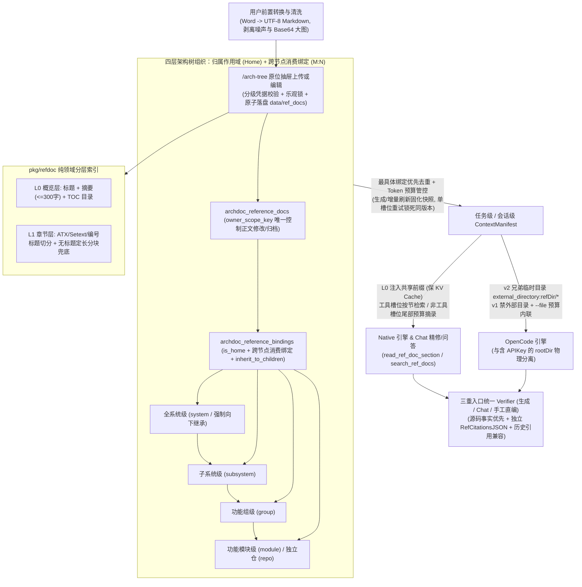

# ADR-10: 基于架构树层级的 Markdown 参考文档组织与双引擎上下文引用架构

- **文档编号**：`10-arch-reference-docs-and-context-injection.md`
- **日期**：2026-11-24（经代码基线走查与本机 `opencode v2.4.1` 实测检视修订）
- **状态**：提议待评审 (Proposed — 已完成架构检视与 OpenCode v2 权限实测验证，待评审冻结后同步更新 SDD 阶段一~三规范并拆解 M16 作战卡)
- **关联议题**：[`01-feature-matrix.md`](../01-features/01-feature-matrix.md)（拟新增 `F-37`, `SC-24`）；[`02-extraction-and-generation-engine.md`](../02-design/02-extraction-and-generation-engine.md)；[`04-workbench-and-security.md`](../02-design/04-workbench-and-security.md)；[`05-database-schema.md`](../02-design/05-database-schema.md)；[`01-http-api-contract.md`](../03-api/01-http-api-contract.md)；[`02-data-model-and-dto-contract.md`](../03-api/02-data-model-and-dto-contract.md)；[`ADR-01`](./01-microfrontend-and-table-prefix-isolation.md)；[`ADR-03`](./03-evidence-anchor-and-publish-mount.md)；[`ADR-04`](./04-module-scope-discovery-and-hierarchical-docs.md)；[`ADR-06`](./06-document-review-and-refine-studio.md)；[`ADR-08`](./08-dual-engine-doc-generation.md)；[`ADR-09`](./09-arch-tree-primary-view-and-unassigned-repos.md)

---

## 1. 背景与问题陈述 (Context & Problem Statement)

### 1.1 现状实现基线

`code-archdoc` 当前的设计文档反推与局部精修完全围绕「仓库源码 + 单文档审阅记忆」展开，经对现有代码基线（`HEAD`）逐行核对，关键上下文链路如下：

| 环节 / 组件 | 现状行为与边界 | 代码位置 |
| :--- | :--- | :--- |
| **代码沙箱文件过滤** | `FileWalker.Walk` 与 `MatchLayer1Builtin` 按扩展名黑名单及前 512 字节 `\x00` 嗅探自动跳过二进制文件（含 `.doc` / `.docx` 等非纯文本资产）；仓库内零散文档亦不作为跨仓系统级架构背景主通道。 | `pkg/sandbox/walker.go`、`pkg/sandbox/ignore.go` |
| **L2 生成与精修上下文装配** | `BuildSlotMessages`（Native）、`BuildDocumentPrompt`（OpenCode）与 `BuildChatRefineMessages` / `BuildChatAskMessages`（Chat）目前仅装配：L1 Code IR（含 `shared_ir_overview` 与各槽位 `IRFacets`）、快照级 `Glossary`、`ADR-04` `ModuleContext` / `ModuleDigests` / `CrossModuleGraph`、Hybrid 历史段落（`PriorHybridMD`）及单文档长期审阅指导（`ReviewGuidance`）；单任务遵循 `ADR-08` `1 GenTask = 1 Scope × 1 DocType` 不变量。 | `pkg/llm/prompt.go`、`pkg/opencode/prompt.go`、`pkg/llm/chat_refine.go`、`pkg/llm/budget.go` |
| **架构树主数据、RBAC 与全景主视图** | `ArchitectureElement`（只读映射 `code-bench` 共享表 `architecture_elements`）承载 `subsystem`、`group`、`module` 三层拓扑及 `OwnerID`；现有 `RBACService.CheckScopeWritePermission` 仅校验仓库级写权或规范化子目录**严格全等**（无架构树祖先链继承）；`ADR-09` 将 `/arch-tree` 重构为单一 4 列树表日常唯一主入口。 | `models/shared.go`、`services/rbac.go`、`services/repo_service.go`、`frontend/src/pages/ArchTreeCoveragePage.tsx`、`frontend/src/components/coverage/ArchTreeView.tsx` |
| **受限只读探索与三重 Verifier 入口** | Native 仅在 `Slot.EnableSourceTools == true` 的槽位（及开启工具的 Chat 会话）挂载 `SandboxSourceToolkit`（普通清单槽位走单轮直出）；OpenCode v2 默认通过 `external_directory: *:deny` 封禁工作目录外一切路径（v1 通过 `permission.external_directory: "deny"` 封禁）；独立 `Verifier` 在生成（`generation_service.go`）、Chat 提案（`chat_service.go`）与手工保存（`revision_service.go`）三处统一执行 Gate 1 符号校验并将源码锚点写入 `SectionEvidence.EvidencesJSON`。 | `pkg/llm/source_tools.go`、`pkg/opencode/config_bridge.go`、`pkg/verifier/symbol_gate.go`、`pkg/verifier/aligner.go`、`services/generation_service.go`、`services/chat_service.go`、`services/revision_service.go` |

### 1.2 核心痛点与根因剖析 (`P-1` ~ `P-4`)

在实际业务落地中，团队大量关键系统上下文沉淀于既有的 Word 整体架构设计文档、子系统接口说明书与领域术语文档中，现行体系存在 **4 项结构性缺口**：

| 编号 | 问题现象 | 严重度 | 根因分析 |
| :---: | :--- | :---: | :--- |
| **P-1** | **仅从代码反推缺乏上位业务与整体架构上下文** | 🔴 | 单个代码仓或功能模块的代码往往只体现“如何实现”，难以反映整体系统业务定位、跨子系统协作边界、历史演进权衡（为什么这么设计）及非功能性红线，导致反推文档缺乏全局视角与业务语境。 |
| **P-2** | **存量设计文档多为 Word，后端黑盒解析风险高** | 🔴 | 企业内 Word（`.docx` / 老版 `.doc`）常混杂封面、审批修订表、自动目录、复杂合并单元格、Base64 内嵌截图与 Visio 图；若后端直接黑盒解析 Word，极易产生残缺错乱文本（Garbage In, Garbage Out），且在 Go 单二进制内解析旧版 `.doc` 或渲染图表将引入外部进程或复杂 CGO 依赖，违背轻量部署红线。 |
| **P-3** | **缺乏按架构层级复用与继承的上下文管理机制** | 🟠 | 当前唯一的人工背景输入通道是 `ReviewComment`（`persist_for_regen=true`），但它严格绑定单个 `Document` 实例。全系统级、子系统级、功能组级的上位设计无法自动向下覆盖所属功能模块；跨子系统协同设计文档也无法一次维护、多处生效。 |
| **P-4** | **长文档直塞 Prompt 易冲爆上下文并误触 Verifier / 污染源码锚点** | 🟠 | 上位系统设计文档通常长达数千至数万字，若全量硬编码注入 Prompt 会挤占 `slot_ir_facets` 预算并破坏 `BuildSlotMessages` 的稳定前缀 KV Cache；同时，设计文档常包含外部平台名词或略滞后的历史类名，若无隔离与独立引用存储，既易误触 `Verifier` Gate 1，又会污染源码预览/发布深链/漂移计算所消费的 `EvidencesJSON`。 |

---

## 2. 决策概览与整体架构 (Decision Summary & Architecture)

### 2.1 整体架构图

本 ADR 确立**「纯 Markdown 契约（前置转换清洗 + 分级凭据门禁）+ 四层架构树归属与跨节点消费绑定 + L0 摘要常驻 / L1 按需检索（含非工具槽位预算摘录兜底）+ 双引擎物理隔离注入 + 独立 `RefCitationsJSON` 溯源」**的整体方案：



### 2.2 候选方案评估

| 候选方案 | 核心做法 | 优点 | 缺点与风险 | 结论 |
| :--- | :--- | :--- | :--- | :---: |
| **方案 A：纯 Markdown 契约 + 四层架构树归属/消费分离 M:N 继承 + 双层检索与独立引用存储** | 要求用户先将 Word 转换为 Markdown 再上传；通过 `reference_docs`（持 `owner_scope_key`）+ `reference_bindings` 组织四层架构树文档并支持跨节点绑定与祖先链继承；L0 摘要/TOC 进共享前缀，工具槽位按节检索、非工具槽位预算摘录，OpenCode v2 走兄弟隔离目录 `external_directory` 精确放行；引用独立存入 `SectionEvidence.RefCitationsJSON`。 | 质量把控左移；后端零 Word 解析与零额外 CGO；归属权清晰不互锁；兼顾 KV Cache、Token 预算与非工具槽位覆盖；零污染源码证据链；复用 `ADR-09` 主视图零菜单膨胀。 | 需用户侧预先使用工具（如 `markitdown`/`pandoc`/文档平台导出）转换 Word；需新建 2 张 `archdoc_*` 表及 `pkg/refdoc/` 包。 | ✅ **提议采纳** |
| **方案 B：后端原生解析 `.docx`/`.doc` 并随仓库同步全量注入** | 在后端引入 OOXML/LibreOffice 解析 Word，上传后将全部正文直接拼接到每个槽位 Prompt 中。 | 表面上省去用户手动转格式动作。 | Word 杂音与嵌入架构图缺失直接污染 Prompt；引入重型依赖或外部进程破坏单二进制部署；长文档全文直塞造成 Token 爆炸与 KV Cache 失效。 | ❌ **放弃** |
| **方案 C：复用单文档 `ReviewComment` (`persist_for_regen`) 粘贴系统背景** | 不做新模型与新入口，要求各模块负责人在单篇文档审阅批注里手动粘贴系统设计文档。 | 零代码开发成本。 | 无法按架构树向下继承复用；系统架构变更时需手工逐一修改几十个模块的批注；大篇幅文本塞入槽位尾部直接破坏预算控制且无按节检索能力。 | ❌ **放弃** |
| **方案 D：纯 Docs-as-Code（仅从代码仓或独立 Git 文档仓同步 Markdown）** | 不提供平台侧参考文档管理，强制要求所有全系统/子系统设计文档提交到 Git 仓库固定目录并随 `gitsync` 拉取。 | 天然具备 Git 评审流与历史记录。 | 企业存量上位架构文档常跨数十个独立代码仓且由架构师在办公文档平台维护，无法归属单一业务代码仓；未建独立文档仓的团队落地门槛过高（后续二期可作为导入源扩展，但不替代平台架构树挂载）。 | ❌ **一期不作为唯一通道** |
| **方案 E：仅复用平台已发布的上层 `ADR-04` 整仓汇总文档作为下级输入** | 不支持人工上传外部设计文档，仅将平台反推发布的整仓文档回灌给子模块。 | 无需新增参考文档存储。 | 平台反推的汇总文档本身仍源于代码（自底向上），无法引入代码之外的业务立项背景、跨仓子系统契约与设计初衷（自顶向下），无法解决 `P-1`。 | ❌ **放弃** |

### 2.3 核心决策摘要 (`D-1` ~ `D-6`)

| 决策编号 | 决策主题 | 核心要点 | 解决问题 |
| :---: | :--- | :--- | :---: |
| **D-1** | **纯 Markdown 契约、四层组织与确定性继承去重** | 平台严格只接收 UTF-8 Markdown（拦截内嵌 Base64 大图）；建立 `system → subsystem → group → repo → module` 规范层级；先按最具体作用域覆盖合并再过滤 `doc_type_slugs`，保留已挂树仓库的 `repo` 绑定并对整仓汇总设上限；全量/批量/增量刷新固化任务快照，单槽位重试严格锁定原任务快照版本，一期不联动漂移雷达。 | P-1、P-2、P-3 |
| **D-2** | **双表模型、独立 `RefCitationsJSON`、乐观锁落盘与分层切片** | 新增 `archdoc_reference_docs` 与 `archdoc_reference_bindings`（20 → 22 表）；扩展 `GenTask.ReferenceDocSnapshotJSON`、`ChatMessage.ContextRefsJSON` 及独立列 `SectionEvidence.RefCitationsJSON` / `ChatProposalItem.RefCitationsJSON`（零污染源码 `EvidencesJSON`）；`PUT` 强制 `expected_version` 乐观锁并遵循「先原子写盘、后事务提交」；`pkg/refdoc/` 支持分级凭据门禁与无标题分块兜底。 | P-2、P-4 |
| **D-3** | **双引擎物理隔离注入（经 `opencode v2.4.1` 实测）与三重 Verifier 协同** | 统一以 `llm.EstimateTextTokens` 度量预算；L0 写入共享前缀保 KV Cache；Native 工具槽位开放按节检索、非工具槽位追加尾部预算摘录；OpenCode v2 挂载与 `rootDir` 平级的独立临时目录 `RefDir` 并仅追加 `external_directory: <canonicalRefDir>/*` allow（v1 保守内联）；生成/Chat/手工直编三处 Verifier 统一校验并兼容历史已解绑引用，外部术语仅降级为 `warning` 绝不盲目豁免源码类名。 | P-1、P-4 |
| **D-4** | **归属作用域（Home Scope）RBAC、节点祖先链守卫与管理员物理清除** | 新增 `CheckArchScopeWritePermission`（不影响既有源码生成 `SC-12` 守卫）；采用「归属作用域控制修改/归档 + 消费绑定局部自治」彻底消除跨节点互锁与零绑定越权漏洞；预留 `visibility` 字段并提供管理员专属物理 `purge` 应急擦除接口。 | P-3 |
| **D-5** | **RESTful API 契约与真实路由兼容扩展** | 新增 `/api/ref-docs*` 与 `/api/admin/ref-docs/:id/purge`；向后兼容扩展 `GET /api/arch-tree`、`POST /api/tasks/generate`（含 `regenerate`）、`POST /api/tasks/generate-batch`、`POST /api/documents/:id/incremental-refresh` 及 `GET /api/tasks/:task_id`。 | P-1、P-3 |
| **D-6** | **一期交互收敛：`/arch-tree` 原位抽屉 + 生成弹窗可见 + Studio 引用溯源** | 保持 `menu.ts` 3 组结构零膨胀；在 `/arch-tree` 顶部与 4 列树表行内挂载轻量角标与右侧 `RefDocDrawer`；在 `GenerateTaskModal` 支持按层预览与临时排除；在 `CanvasStudioPage` 独立展示 `ref_citations` 带版本章节溯源。 | P-3、P-4 |

---

## 3. 核心决策详解 (Detailed Decisions)

### 3.1 决策 D-1：纯 Markdown 输入契约、四层架构树组织与跨节点绑定继承

1. **纯 UTF-8 Markdown 输入契约（质量把控左移）**：
   - 平台明确仅接收有效 UTF-8 编码的 Markdown 文件（`.md` / `.markdown`）或在线粘贴/编辑的 Markdown 文本，**不在后端执行 `.doc` / `.docx` 二进制解析**。
   - 用户上传前通过本地工具（如 `markitdown`、`pandoc`）或办公文档平台导出 Markdown，剔除封面、审批表与页眉页脚噪声，并将关键架构图补充为文字或 Mermaid 描述。
   - **体积限额与内嵌 Base64 图片拦截**：单篇原文默认上限 **`512 KB`**（可通过 `config.yaml` 的 `storage.ref_doc_max_bytes` 配置）；入库前置扫描 `data:image/...;base64,` 内联图片块（单块 `> 4 KB` 直接返回 `422 INLINE_BASE64_IMAGE`，提示用户移除内嵌图片并补充文字/Mermaid 说明），防止转换产物携带数十万无意义 Base64 字符冲爆存储并误触高熵拦截。

2. **四层架构树作用域与独立仓兼容（统一 `scope_rank` 规范序）**：
   - 基于 `models/shared.go` 的 `ArchitectureElement`（`type ∈ {"subsystem", "group", "module"}`），在逻辑最顶层补充虚拟根 **`system`**，并保留 **`repo`** 承接代码仓/子目录直接挂载，统一定义从宏观到具体的确定性层级权重 `scope_rank`：

   | `scope_level` | `scope_rank` | `scope_key` 规范格式 | 承载语义与绑定约束 |
   | :--- | :---: | :--- | :--- |
   | `system` | `1` | `"system"` | 全系统总体架构、系统边界、全局领域术语与公共非功能规范（`arch_element_id = NULL`；**强制 `inherit_to_children = true`**，传入 `false` 返回 `400 INVALID_PARAM`）。 |
   | `subsystem` | `2` | `"arch:<id>"` | 子系统架构设计、内部模块划分与跨子系统接口契约（绑定 `type="subsystem"` 的 `ArchitectureElement`）。 |
   | `group` | `3` | `"arch:<id>"` | 功能组专题设计、公共机制与组内数据流（绑定 `type="group"` 的 `ArchitectureElement`）。 |
   | `repo` | `4` | `"repo:<repo_id>:<norm_subdir>"` | 代码仓或子目录级补充参考文档（既支持 `ADR-09` 未关联代码仓，也在该仓后续挂入架构树 `module` 后**继续保留生效**，绝不因挂树而静默失效）。 |
   | `module` | `5` | `"arch:<id>"` | 功能模块详细设计、核心算法与业务规则补充（绑定 `type="module"` 的 `ArchitectureElement`，最具体）。 |

   - **严守共享表零 DDL 红线**：不修改 `architecture_elements` 或 `repositories` 表结构，全部挂载关系存于模块自有表 `archdoc_reference_bindings`。

3. **文档分类标签 (`doc_kind`)**：
   - `arch_design`：架构设计 / 模块设计（默认）
   - `domain_glossary`：领域术语 / 外部系统与业务概念字典
   - `interface_spec`：跨系统接口 / 协议契约
   - `adr_constraint`：架构决策 / 非功能与合规约束
   - `other`：其他背景资料

4. **跨节点 M:N 绑定与祖先链继承精确解析算法**：
   - 当为目标作用域 `(repo_id, norm_subdir, doc_type_slug)`（可选指定 `arch_element_id`）发起生成、增量刷新或 Chat 会话时，按以下确定性步骤解析生效列表：
     1. **定位关联架构节点集合**：
        - 若请求显式指定有效 `arch_element_id`，以该节点为起点；
        - 否则在活跃 `architecture_elements` 中查找所有满足 `type == "module" && repo_id == target_repo_id && NormalizeSubdir(subdirectory) == norm_subdir` 的节点（按 `id ASC` 排序，兼容异常多模块指向同一目录场景）；
        - 对每个命中的节点沿 `parent_id` 向上回溯至根（加环保护，最大深度 `16`），合并得到直接命中节点集 `DirectArchIDs` 与真祖先节点集 `AncestorArchIDs`；
     2. **收集候选有效绑定（`ReferenceDoc.Status == "active"`）**：
        - `scope_level == "system"`（恒为 `inherit_to_children == true`）；
        - `arch_element_id ∈ AncestorArchIDs` 且 `inherit_to_children == true`；
        - `arch_element_id ∈ DirectArchIDs`（本节点直接绑定，无论 `inherit_to_children` 真假均命中）；
        - `scope_level == "repo"` 且 `repo_id == target_repo_id`：当 `binding.subdirectory == norm_subdir` 时直接命中；当 `norm_subdir != ""` 且 `binding.subdirectory == ""`（整仓级绑定）且 `inherit_to_children == true` 时继承命中；
     3. **先按最具体绑定归并，再执行 `doc_type_slugs` 过滤（消除下级约束被上级绕过）**：
        - 若同一 `doc_id` 在上述候选中命中多条绑定，**优先保留 `scope_rank` 最大（最具体，如 `module(5) > repo(4) > group(3) > subsystem(2) > system(1)`；同级取 `id ASC`）的那一条绑定记录**作为该文档在当前目标下的唯一生效策略；
        - 随后检查该生效策略的 `doc_type_slugs`：若非空且当前单文档任务的 `doc_type_slug` 不在白名单内，则剔除该文档（保证下级模块负责人可通过本节点绑定精确限定某篇共享文档适用的 `DocType`）；
     4. **Monorepo 整仓 Roll-up 汇总保护（`ADR-04`）**：
        - 当目标为非单模块绑定的整仓汇总（`norm_subdir == ""` 且仓内存在多个活跃子模块）时，自动合并 `system` + 该整仓 `repo` 绑定 + 仓内活跃子模块所属 `subsystem` / `group` 级绑定（**不拉取全部叶 `module` 局部细碎参考文档**，且生效总数硬上限 `12 篇`），防止几十个子模块的细节文档淹没整仓架构概览预算；
     5. **确定性排序**：最终生效列表固定按 `(scope_rank ASC [1..5], sort_order ASC, doc_id ASC)` 排序（先宏观全系统、后子系统/功能组、最后仓库与模块细则），确保同一任务跨槽位 Prompt 共享前缀字节 100% 一致。

5. **各执行路径的版本快照与生效边界（一期不联动漂移）**：
   - **不触发漂移**：更新参考文档版本或调整绑定时，不触发已发布文档的 `Spec Drift` / `Code Drift`。
   - **路径一致性契约**：
     - **新建生成 / 重新生成 / 批量拆单 / 增量刷新**（`POST /api/tasks/generate`、`generate-batch`、`documents/:id/incremental-refresh`）：遵循 `ADR-08` 单文档任务不变量（每条 `GenTask` 严格对应唯一 `doc_type_slug`），在创建任务时解析生效列表（剔除 `exclude_ref_doc_ids`）并完整固化至 `GenTask.ReferenceDocSnapshotJSON`（含 `version_no`、`content_sha256`、`summary_md`、`summary_sha256`）；任务排队后执行时严格读取 `<doc_id>/v<version_no>.md` 历史版本文件与快照摘要；
     - **单槽位独立重试**（`POST /api/tasks/:task_id/slots/:slot_task_id/retry`）：**严格锁定读取原所属 `GenTask.ReferenceDocSnapshotJSON` 中记录的文档集合与 `v<version_no>.md` 版本**，绝不在重试中途混入新版本导致同篇文档跨槽位事实分裂或任务快照失真；如需应用新版参考文档，用户应发起重新生成或增量刷新；
     - **Canvas Studio Chat 精修 / 综合精修 / Ask 问答**：在每轮对话发起时实时解析当前作用域最新生效参考文档，并将当轮引用的参考文档快照写入 `ChatMessage.ContextRefsJSON`（`ChatContextRefVO.RefDocs`）留痕可查。

---

### 3.2 决策 D-2：数据模型、独立引用列、乐观锁原子落盘与分层索引 (`pkg/refdoc/`)

1. **新增自有表（20 → 22 张）与既有自有表字段扩展（共享表零 DDL）**：
   - 严格遵循 `ADR-01` `archdoc_` 表前缀，在 `models/AllOwnModels()` 新增 2 张表：

```go
// models/reference_doc.go — ADR-10 冻结模型草案

// ReferenceDoc 架构参考 Markdown 文档主实体（第 21 张 archdoc_* 自有表）
type ReferenceDoc struct {
	ID                 uint           `gorm:"primaryKey" json:"id"`
	Title              string         `gorm:"size:200;not null" json:"title"`
	DocKind            string         `gorm:"size:32;not null;default:'arch_design';index" json:"doc_kind"` // arch_design | domain_glossary | interface_spec | adr_constraint | other
	Description        string         `gorm:"size:500;default:''" json:"description"`
	Visibility         string         `gorm:"size:16;not null;default:'public'" json:"visibility"`          // 一期默认 public（登录可读），预留 scope_bound 扩展
	OwnerScopeKey      string         `gorm:"size:512;not null;index" json:"owner_scope_key"`               // 归属作用域唯一键: "system" | "arch:<id>" | "repo:<id>:<subdir>"
	OwnerScopeLevel    string         `gorm:"size:16;not null;index" json:"owner_scope_level"`              // system | subsystem | group | repo | module
	OwnerArchElementID *uint          `gorm:"index" json:"owner_arch_element_id"`
	OwnerRepoID        *uint          `gorm:"index" json:"owner_repo_id"`
	OwnerSubdirectory  string         `gorm:"size:512;not null;default:''" json:"owner_subdirectory"`
	SummaryMD          string         `gorm:"type:text;not null;default:''" json:"summary_md"`              // L0 精简摘要（<=300字）
	SummarySource      string         `gorm:"size:16;not null;default:'fallback'" json:"summary_source"`    // manual | llm | fallback
	SummaryStatus      string         `gorm:"size:16;not null;default:'ready'" json:"summary_status"`       // ready | pending | failed
	SummaryForVersion  int            `gorm:"not null;default:1" json:"summary_for_version"`                // 摘要对应的正文版本号（检测手填摘要滞后）
	TOCJSON            datatypes.JSON `gorm:"type:jsonb;not null;default:'[]'" json:"toc"`                  // []refdoc.HeadingNode（含无标题分块兜底节点）
	DeclaredTerms      datatypes.JSON `gorm:"type:jsonb;not null;default:'[]'" json:"declared_terms"`       // []string（仅限人工声明或术语表文档词条）
	CurrentVersion     int            `gorm:"not null;default:1" json:"current_version"`
	StorageRelPath     string         `gorm:"size:512;not null;default:''" json:"-"`                        // <doc_id>/v<ver>.md
	ContentSHA256      string         `gorm:"size:64;not null;default:'';index" json:"content_sha256"`
	ByteSize           int64          `gorm:"not null;default:0" json:"byte_size"`
	RuneCount          int            `gorm:"not null;default:0" json:"rune_count"`
	EstimatedTokens    int            `gorm:"not null;default:0" json:"estimated_tokens"`                   // 按 llm.EstimateTextTokens 预计算
	LineCount          int            `gorm:"not null;default:0" json:"line_count"`
	Status             string         `gorm:"size:16;not null;default:'active';index" json:"status"`        // active | archived
	CreatedBy          uint           `gorm:"not null;index" json:"created_by"`
	UpdatedBy          uint           `gorm:"not null" json:"updated_by"`
	CreatedAt          time.Time      `json:"created_at"`
	UpdatedAt          time.Time      `json:"updated_at"`
}

func (ReferenceDoc) TableName() string { return config.TablePrefix + "reference_docs" }

// ReferenceDocBinding 参考文档与四层架构作用域的多对多绑定关系（第 22 张 archdoc_* 自有表）
type ReferenceDocBinding struct {
	ID                uint           `gorm:"primaryKey" json:"id"`
	DocID             uint           `gorm:"not null;uniqueIndex:idx_archdoc_ref_bind_unique,priority:1;index" json:"doc_id"`
	ScopeKey          string         `gorm:"size:512;not null;uniqueIndex:idx_archdoc_ref_bind_unique,priority:2;index" json:"scope_key"`
	ScopeLevel        string         `gorm:"size:16;not null;index" json:"scope_level"` // system | subsystem | group | repo | module
	IsHome            bool           `gorm:"not null;default:false" json:"is_home"`     // 归属作用域主绑定标记（active 状态下不可单独解绑）
	ArchElementID     *uint          `gorm:"index" json:"arch_element_id"`
	RepoID            *uint          `gorm:"index" json:"repo_id"`
	Subdirectory      string         `gorm:"size:512;not null;default:''" json:"subdirectory"`
	InheritToChildren bool           `gorm:"not null;default:true" json:"inherit_to_children"`
	DocTypeSlugsJSON  datatypes.JSON `gorm:"type:jsonb;not null;default:'[]'" json:"doc_type_slugs"`
	SortOrder         int            `gorm:"not null;default:0" json:"sort_order"`
	CreatedBy         uint           `gorm:"not null" json:"created_by"`
	CreatedAt         time.Time      `json:"created_at"`
	UpdatedAt         time.Time      `json:"updated_at"`
}

func (ReferenceDocBinding) TableName() string { return config.TablePrefix + "reference_bindings" }
```

   - **既有自有表增量字段（物理隔离参考引用与源码证据锚点）**：
     1. `models.GenTask` 新增 `ReferenceDocSnapshotJSON datatypes.JSON`（`default:'[]'`），固化任务级生效快照；
     2. `models.ChatMessage` 复用既有 `ContextRefsJSON`（扩展 `ChatContextRefVO.RefDocs []TaskReferenceDocSnapshotVO`），记录单轮 Chat 生效参考快照；
     3. **`models.SectionEvidence` 与 `models.ChatProposalItem` 各新增独立列 `RefCitationsJSON datatypes.JSON`（`gorm:"type:jsonb;not null;default:'[]'" json:"ref_citations"`）**，专门存储 `[]verifier.RefDocCitation`（结构：`{citation_key: "ref_doc:12@v2#sec-3", doc_id: 12, version_no: 2, section_id: "sec-3", section_title: "...", doc_title: "...", scope_level: "subsystem", stale: false}`）。
     - **核心收益**：`SectionEvidence.EvidencesJSON` 保持 **100% 纯源码 / `module_doc` 锚点契约不变**，`source_preview_service.go`、`pkg/publisher/renderer.go`、`publish_service.go`、`pkg/drift/code_drift.go` 与 `drift_service.go` 零受污染、零回归风险；同时非重跑章节在重试、手工编辑与局部 Chat 采纳时，像 `priorEvMap` 继承 `EvidencesJSON` 一样同步继承 `RefCitationsJSON`。

2. **并发乐观锁与原子落盘事务序**：
   - `StorageSection` 新增 `RefDocsDir()`（`<data_dir>/ref_docs`）与 `RefDocMaxBytes`（默认 `524288`）。
   - **并发控制与写盘顺序**：`PUT /api/ref-docs/:id` 请求体必须携带 `expected_version: int`；服务端按 `doc_id` 持进程内细粒度互斥锁：
     1. 校验 `doc.CurrentVersion == expected_version`（不匹配立即返回 `409 VERSION_CONFLICT`）；
     2. 若正文 `content_sha256` 发生变化，**先**通过临时文件 + `fsync` + 原子 `rename` 写入 `<RefDocsDir>/<doc_id>/v<N+1>.md`（路径一律经 `sandbox.SafeJoin` 校验）；
     3. **后**开启 DB 事务执行 `UPDATE archdoc_reference_docs SET current_version = N+1 ... WHERE id = ? AND current_version = ?`；若 DB 事务失败，立即清理刚写入的孤儿 `v<N+1>.md`，确保磁盘与数据库严格一致；历史 `v1.md .. vN.md` 完整保留以支撑单槽位重试版本锁定与历史溯源。

3. **纯 Go 领域包 `pkg/refdoc/`（分级凭据门禁 + 多级结构化切片兜底）**：
   - `pkg/refdoc/` 严守零 DB / 零 Gin 依赖红线：
     1. **分级凭据与大图校验**：
        - **硬阻断级（`422 SECRET_DETECTED` / `422 INLINE_BASE64_IMAGE`）**：命中 `pem_private_key`、`token_prefix`（`sk-` / `ghp_` / `glpat-` / `AKIA` / JWT）、`url_credential` 或 `> 4 KB` 内嵌 Base64 图片时，无条件拒绝入库并返回行号与脱敏掩码；
        - **可确认脱敏级（`422 SECRET_CONFIRM_REQUIRED`）**：技术设计文档中常含配置示例（如 `password: "changeme"`）或签名样例，容易触发 `key_blacklist` 或 `high_entropy`。命中此类规则时默认返回 `422` 及脱敏行号列表；用户既可手工清理后重传，也可显式勾选 `redact_and_save=true` 由服务端调用 `SecretRedactor.RedactText` 将命中片段替换为 `[REDACTED]` 后安全落盘，兼顾零凭据入库与极低误杀摩擦；
     2. **多格式标题识别与无标题定长分块兜底**：
        - 状态机自动跳过围栏代码块（```` ``` ```` / `~~~`），同时识别 ATX 标题（`#` ~ `######`）、Setext 标题（`===` / `---`）以及顶层中文/数字章节号行（如 `1.2 接口契约`、`二、系统边界`，当全文无 ATX 标题时启用）；
        - **大节/无标题兜底**：若整篇转换文档无任何可识别标题，或某一章节跨度超过 `250 行`，自动在空行边界按约 `160 行` 切分为确定性虚拟子块（`sec-chunk-1`、`sec-chunk-2`...，附首行摘要作标题），确保 `TOCJSON` 永不为空且 `ReadSection` 单次读取永远可控；
     3. **L0 摘要生命周期**：
        - 优先使用用户手填 `summary_md`（`SummarySource="manual"`, `SummaryForVersion=CurrentVersion`）；正文升级至 `v<N+1>` 且用户未同步修改手填摘要时，保留原摘要但通过 `SummaryForVersion < CurrentVersion` 在前端提示「摘要基于旧版 vN，建议核对更新」；
        - 未手填时先同步生成确定性首段+大纲兜底摘要落库（`SummaryStatus="ready"`, `SummarySource="fallback"`，立即可用不阻塞任务），后台可选轻量 LLM 提炼 ≤300 字摘要并在未发生新版本覆盖时回填。

---

### 3.3 决策 D-3：双引擎物理隔离注入（经本机 OpenCode v2 实测）与三重 Verifier 协同

1. **事实冲突仲裁铁律（System Prompt 强制声明）**：
   - 在 `pkg/llm/prompt.go`、`pkg/opencode/prompt.go` 与 `pkg/llm/chat_refine.go` 系统指令中统一声明：
     - **事实优先级**：`当前源码 / L1 Code IR > 功能模块级参考 > 仓库级参考 > 功能组级参考 > 子系统级参考 > 全系统级参考`；
     - **职责边界**：参考文档仅用于补充业务目标、系统职责定位、跨系统协作边界、领域术语及设计背景；所有源码路径、类/函数符号、HTTP/RPC 路由、表结构与配置键**必须以当前源码与 L1 Code IR 为唯一事实源**；纯外部系统名/业务概念词请勿包裹在行内反引号 `` `...` `` 中；
     - **差异显式说明**：若参考文档描述的规划接口或旧类名与当前源码不符，以当前真实源码为准，并在对应小节简短注明「设计与当前实现差异」。

2. **统一基于 `llm.EstimateTextTokens` 的预算体系与 L0 共享前缀落位**：
   - 摒弃易产生 2~3 倍中文误差的字节/字符折算，全链路统一复用 `pkg/llm/budget.go` 的 `EstimateTextTokens`（非 ASCII `1.5 rune/token`，ASCII `3.5 rune/token`）并计入生成前 `EstimateAndCheckBudget`：
     - **短文档直通阈值**：当生效参考文档总计 `<= 1800 Tokens`（约 2700 汉字）且单篇 `<= 1000 Tokens` 时，直接在 `ContextManifest` 中内联全文 `inline_body`，省去工具往返；
     - **L0 共享前缀硬预算**：超过短文档阈值时，L0 仅输出 `summary_md + toc`，总预算上限 **`3000 Tokens`**（Monorepo 整仓汇总上限 **`3600 Tokens`**）。超限时按 `scope_rank` 从低到高（`system(1) → ... → module(5)`）依次折叠 3 级以下子标题、截断低优长摘要；
     - **KV Cache 零破坏落位**：在 Native `BuildSlotMessages` 中将 `<untrusted_repo_data nonce="..." label="arch_reference_docs">` 置于第 2 段共享 `user` 前缀末尾（紧接 `writeADR04ContextBlocks` 之后、第 3 段槽位专属尾部之前），同一单文档任务下所有槽位共享字节级一致的前缀。

3. **L1 按需章节检索与非工具槽位兜底（双引擎差异化安全落位）**：
   - **Native 引擎 & Chat 精修/问答（兼顾工具槽位与单轮直出槽位）**：
     - **开启工具的槽位（`Slot.EnableSourceTools == true`）及开启工具的 Chat 会话**：在 `SandboxSourceToolkit` 中扩展注册 `read_ref_doc_section(doc_id, section_id, offset_line?)`（单次上限 200 行 / 12 KB）与 `search_ref_docs(query, doc_id?)`，并更新 `tk.HasTools()` 为 `hasFS || ir != nil || len(refDocs) > 0`（即使无本地 FS 作用域亦可检索参考文档），工具输出二次经 `SecretRedactor` 与 `nonce` 栅栏包裹；
     - **未开启工具的常规清单/概览槽位（`Slot.EnableSourceTools == false`）**：**不强行开启多轮 Tool Loop**（守住 `ADR-08` 低延迟与低成本边界）；当存在未在 L0 全文内联的长参考文档时，由纯函数 `refdoc.SelectBudgetedExcerptsForSlot(docs, slotTitle, slotHint, maxTokens=1500)` 基于槽位标题与写作要点匹配最相关的 1~3 个章节片段，追加在 `BuildSlotMessages` **第 3 段槽位专属尾部**（既不破坏第 2 段跨槽位共享 KV Cache 前缀，又避免非工具槽位“只见目录不见正文”）。
   - **OpenCode 引擎（基于本机 `opencode v2.4.1` 实测验证的兄弟目录物理隔离方案）**：
     - **实测结论记录**：在本机 `opencode v2.4.1` 隔离环境实测确认：
       1. OpenCode v2 的 `read`/`grep`/`glob` 默认虽为 `* : allow`（注：v2.4.1 已将目录列举合并入 `read` 工具），但任何位于 `WorkDir` 之外的路径均受 `external_directory` 动作独立门禁拦截——仅添加 `read`/`grep`/`list` allow 规则仍会报错 `Permission denied: external_directory`；
       2. `external_directory` 资源匹配要求带 `/*` 通配后缀（仅配置裸目录路径 `<refDir>` 仍被拒绝；配置 `<canonicalRefDir>/*` 后，`read(<refDir>)` 目录列举、`read(<refDir>/a.md)`、`read(<refDir>/sub/b.md)`、`grep` 与 `glob` 全部放行）；
       3. `sessionEnv.RootDir` 内含带明文 `apiKey` 的 `opencode.json`（模式 A）或宿主机 `auth.json` 副本（模式 B），**绝不能将参考文档放在 `RootDir` 子目录下**，且同 UID 下 `0400` 权限对隔离无效并可能阻碍目录清理。
     - **冻结实现方案**：
       1. 当次任务存在未在 L0 全量内联的参考文档且运行于 **OpenCode v2.x** 时，`prepareSessionEnv` 使用 `os.MkdirTemp("", "archdoc-ocref-*")` 创建一个**与 `RootDir` 平级、互不包含的独立临时目录 `RefDir`**（权限 `0700`），经 `filepath.EvalSymlinks` 解析规范真实路径 `canonicalRefDir`（防范 `/tmp` 软链导致路径匹配失效），将 `SecretRedactor.RedactText` 脱敏后的参考文档写入 `<canonicalRefDir>/<doc_id>_v<ver>_<slug>.md`（权限 `0600`），并在 `sessionEnv.Cleanup()` 中同步 `os.RemoveAll(s.RefDir)`；
       2. 在 `buildOpenCodeV2ConfigJSON` 的 `permissions` 数组末尾（位于 `{"action": "external_directory", "resource": "*", "effect": "deny"}` **之后**，利用 v2 `findLast` 后匹配优先语义），仅追加单条精确放行规则：
          `{"action": "external_directory", "resource": canonicalRefDir + "/*", "effect": "allow"}`；
          实测确认该配置下 `RootDir/opencode.json`、同级 `/tmp` 其他目录与 `/etc/hostname` 均 100% 返回 `Permission denied: external_directory`；
       3. **OpenCode v1.x**（仅支持布尔式全局 `"external_directory": "deny|allow"`）：**严禁放开 `"external_directory": "allow"`**！自动采用 **Token 预算内联模式**（上限 `8000 Tokens`，约 12,000 汉字，按 `module > repo > group > subsystem > system` 优先级选取章节拼入 Prompt，复用 `process.go` 既有 `> inlinePromptMaxBytes` 自动转 `--file` 机制下发，零 `ARG_MAX` 溢出风险）。

4. **三重入口统一 Verifier、独立引用对齐与外部术语降级（绝不削弱源码门禁）**：
   - **三处入口全覆盖**：`generation_service.go`（生成/单槽位重试/增量刷新）、`chat_service.go`（Chat 提案联合预检与采纳）与 `revision_service.go`（Canvas 手工编辑保存）统一构造 `VerifyInput.RefDocs`：
     - **当前生效集 (`ActiveRefs`)**：生成/重试取自 `GenTask.ReferenceDocSnapshotJSON`；Chat 与手工直编取自当前作用域实时生效集；
     - **历史延续集 (`HistoricalRefs`)**：取自当前文档上一修订 `SectionEvidence.RefCitationsJSON` 中已存在的 `doc_id@vN` 集合。
   - **`scope == "ref_doc"` 独立分流对齐**：
     - 允许模型在需要显式标注上位设计依据时输出候选 `{"scope": "ref_doc", "file_path": "ref_doc:<doc_id>", "fq_symbol": "<section_id>", "symbol_kind": "ref_doc"}`；
     - `Verifier.Verify` 将 `scope == "ref_doc"` 候选从源码 `AlignCandidates` 中前置剥离：
       - 命中 `ActiveRefs`（且 `section_id` 存在或为空）→ 对齐生成 `RefDocCitation`（`citation_key: "ref_doc:<id>@v<ver>#<sec>"`, `stale: false`），写入 `VerifyResult.SectionRefCitations[slotID]` 并落入 `SectionEvidence.RefCitationsJSON`；
       - 未命中 `ActiveRefs` 但命中 `HistoricalRefs`（例如某篇参考文档事后被解绑或归档）→ 保留该 `RefDocCitation` 并标记 `stale: true`，至多产生 `warning`（**绝不标为 `error`，防止解绑参考文档后导致无关章节手工编辑或 Chat 精修无法审批定稿**）；
       - 既不在 `ActiveRefs` 也不在 `HistoricalRefs`（模型凭空伪造 `ref_doc:9999` 或伪造不存在的 `section_id`）→ 无条件记录 `UnverifiedRef{RefKind: "ref_doc", Severity: "error"}`，阻断 `can_approve`。
   - **`DeclaredTerms` 收窄提取与严重度降级（修复历史类名漏网隐患）**：
     - **严禁**从普通 `arch_design` 文档的正文粗体或业务表格中自动抓取驼峰词豁免（避免参考文档中已废弃的历史类名绕过 Gate 1）；
     - `DeclaredTerms` **仅来源于**用户在参考文档上显式维护的「外部系统/专有名词标签」或 `doc_kind == "domain_glossary"` 术语表词条（自动剔除含 `/` 路径或 `::` 限定符的项）；
     - 在 `RunSymbolGate` 中，若反引号内的驼峰词未命中 `CodeIR` 但命中 `DeclaredTerms`，**不静默吞掉**，而是将其固定记录为 `UnverifiedRef{RefKind: "external_term", Severity: "warning"}`（即使 `StrictSymbolCheck == true` 亦降级为 `warning` 不阻断 `can_approve`），既消除外部系统名阻断，又保留审阅可见性，同时对 `arch_design` 中的过时代码类名维持 100% 原有 Gate 1 拦截强度。

---

### 3.4 决策 D-4：归属作用域（Home Scope）RBAC、节点祖先链守卫与管理员应急清除

1. **新增架构节点写权限守卫（保持既有源码生成 RBAC 零变更）**：
   - 既有 `RBACService.CheckScopeWritePermission`（`services/rbac.go:31`）继续专用于代码快照、文档生成/精修/发布（严格维持子目录全等匹配 `SC-12` 不变）。
   - 在 `services/rbac.go` 新增专用方法 `CheckArchScopeWritePermission(ctx, user, scopeLevel, archElementID, repoID, subdir)` 用于参考文档管理与节点绑定：
     - `system`：仅 `super_admin` 或 `archdoc_admin`；
     - `subsystem` / `group`：管理员，或目标节点及其任意上级祖先节点（沿 `ParentID` 回溯 ≤16 层）的 `OwnerID == user.ID`；
     - `module`：满足上述节点/祖先 `OwnerID == user.ID`，**或**当该模块已绑定活跃仓库时满足 `CheckScopeWritePermission(repoID, module.Subdirectory)`（含仓库 `OwnerID` / `RelatedMembers`）；
     - `repo`：满足 `CheckScopeWritePermission(repoID, subdir)`。

2. **「归属作用域单点写权 + 消费绑定局部自治」模型（消除跨节点互锁与零绑定漏洞）**：

| 操作动作 | 权限判定规则 | 安全不变量说明 |
| :--- | :--- | :--- |
| **查看 / 任务引用** | 一期所有已登录用户（`visibility="public"`） | 预留 `visibility` 字段，后续可无缝收紧至作用域成员可见。 |
| **新建参考文档 (`POST /api/ref-docs`)** | 对 `initial_binding` 作用域具备 `CheckArchScopeWritePermission` | `initial_binding` 自动成为该文档的**归属作用域（`OwnerScope*`，且 `binding.IsHome = true`）**。 |
| **编辑正文 / 元信息 / 归档 (`PUT /api/ref-docs/:id`)** | 管理员，或对 **`doc.OwnerScopeKey`（归属作用域）** 具备写权限（若原架构节点已在主数据中删除，则回退为管理员或 `doc.CreatedBy`） | ① 其他子系统/模块后续添加消费绑定**绝不会反锁原作者**的修改权；② 消费节点负责人**无法越权篡改或归档**上位/兄弟节点的共享文档；③ 即使所有消费绑定被移除，仍严格校验 `OwnerScopeKey`，**彻底杜绝空绑定集恒真漏洞**。 |
| **跨节点消费绑定 (`POST .../bindings`)** | 对目标新绑定节点 `X` 具备 `CheckArchScopeWritePermission` | 仅建立 `IsHome = false` 的引用关系；后续若归属方升级 `v2`，消费方既有已发布文档不受影响，也可随时从本节点解绑。 |
| **修改绑定配置 / 解绑 (`PATCH` / `DELETE .../bindings/:bid`)** | 对该条 `binding` 所属节点具备写权限 | `active` 状态下禁止直接 `DELETE` `IsHome == true` 的主绑定（提示使用「归档文档」或由同时具备新旧作用域写权的用户转移归属作用域）。 |
| **管理员物理彻底清除 (`DELETE /api/admin/ref-docs/:id/purge`)** | 仅 `super_admin` / `archdoc_admin` | 针对误传涉密/凭据文档的应急擦除：物理删除磁盘 `<RefDocsDir>/<doc_id>/` 下全部 `v1..vN.md` 及绑定/主表记录，`commonAudit` 仅留存操作人、标题与 `content_sha256` 摘要。 |

---

### 3.5 决策 D-5：API 契约草案与真实路由向下兼容扩展

1. **参考文档管理、绑定与应急清除接口**：

| 方法与路径 | 职责说明 | 权限守卫 | 核心请求 / 响应要点 |
| :--- | :--- | :--- | :--- |
| `GET /api/ref-docs` | 分页检索可见参考文档库（供抽屉「关联已有文档」搜索复用） | 登录态 | Query: `search`, `doc_kind`, `scope_level`, `arch_element_id`, `status=active\|archived`, `page`, `page_size`；返回含归属作用域标签、消费绑定数与 `can_edit`。 |
| `GET /api/ref-docs/effective` | 查询指定目标作用域最终生效的参考文档清单 | 登录态 | Query: `arch_element_id` 或 `(repo_id, subdirectory)` + 可选 `doc_type_slug`；按 `scope_rank ASC` 返回含 `is_inherited`、`effective_scope_level`、`source_scope_label`、`estimated_tokens`、`summary_md`、`toc`、`can_edit`、`can_unbind`。 |
| `GET /api/ref-docs/:id` | 获取单篇参考文档详情、绑定列表及指定版本 Markdown 正文 | 登录态 | Query: `version`（可选，默认 `current_version`）；返回元信息、`summary_stale`（`summary_for_version < current_version`）、`bindings[]`、`content_md`、`toc[]`、`can_edit`。 |
| `POST /api/ref-docs` | 创建参考文档（支持 multipart `.md` 或 JSON `content_md`）并建立 `is_home=true` 归属绑定 | 初始作用域写权限 | 入参含 `initial_binding` 及可选 `declared_terms`, `redact_and_save`；硬凭据/Base64 大图返 `422`，疑似高熵未勾选脱敏返 `422 SECRET_CONFIRM_REQUIRED`。 |
| `PUT /api/ref-docs/:id` | 更新元信息、发布新版本正文或归档/恢复（乐观锁） | 归属作用域写权限 | **必传 `expected_version`**（冲突返 `409 VERSION_CONFLICT`）；支持可选 `new_home_binding`（需同时具备新旧归属作用域写权）与 `redact_and_save`。 |
| `POST /api/ref-docs/:id/bindings` | 将已有活跃参考文档绑定至其他架构节点或仓库范围 | 目标节点写权限 | 创建 `is_home=false` 消费绑定；`system` 级强制 `inherit_to_children=true`；重复绑定返 `409 ALREADY_BOUND`。 |
| `PATCH /api/ref-docs/:id/bindings/:binding_id` | 更新单条绑定的 `inherit_to_children`、`doc_type_slugs` 或 `sort_order` | 该绑定节点写权限 | `scope_level="system"` 禁止将 `inherit_to_children` 设为 `false`。 |
| `DELETE /api/ref-docs/:id/bindings/:binding_id` | 解除指定节点的消费绑定 | 该绑定节点写权限 | 若目标绑定 `is_home == true` 且文档为 `active`，返回 `400 HOME_BINDING_PROTECTED` 指引归档或转移归属。 |
| `DELETE /api/admin/ref-docs/:id/purge` | 物理销毁参考文档全部磁盘版本与数据库记录（应急擦除） | `RequireAdmin` | 清理 `<RefDocsDir>/<doc_id>/` 并写脱敏审计日志。 |

2. **既有接口向后兼容扩展（严格对齐 `handlers/router.go` 真实路由）**：
   - **`GET /api/arch-tree`**：
     - `ArchTreeSummaryVO` 新增 `system_ref_doc_count: int`；
     - `ArchTreeNodeVO` 新增 `direct_ref_doc_count: int` 与 `inherited_ref_doc_count: int`（全树单次批量查表后在内存中按祖先链 O(N) 聚合，零 N+1 查询）。
   - **`POST /api/tasks/generate`（覆盖 `task_kind = "generate" | "regenerate"`）、`POST /api/tasks/generate-batch`、`POST /api/documents/:id/incremental-refresh`**：
     - 请求体统一新增可选 `exclude_ref_doc_ids?: number[]`；
     - 按 `ADR-08` 单文档拆单后，每条 `GenTask` 按各自唯一 `doc_type_slug` 独立解析并固化 `ReferenceDocSnapshotJSON`（单槽位重试 `POST /api/tasks/:task_id/slots/:slot_task_id/retry` 直接复用原任务快照，无需额外入参）。
   - **`GET /api/tasks/:task_id` & `GET /api/documents/:id`**：
     - `GenTaskDetailVO` 新增 `reference_docs?: TaskReferenceDocSnapshotVO[]`；
     - `DocumentDetailVO` 各章节视图新增 `ref_citations?: RefDocCitationVO[]`（源自 `SectionEvidence.RefCitationsJSON`，与源码 `evidences` 并列返回互不干扰）。

---

### 3.6 决策 D-6：一期前端交互形态（原位抽屉 + 生成弹窗可见 + Studio 引用溯源）

1. **保持导航极简（零菜单膨胀）**：一期不修改 `frontend/src/menu.ts` 3 组结构，所有入口内聚于 `/arch-tree`、`GenerateTaskModal` 与 `CanvasStudioPage`。
2. **触点 1 & 2：`/arch-tree` 顶部系统栏 + 4 列树表行内角标与 `RefDocDrawer`**：
   - 顶部紧邻摘要微标渲染紧凑胶囊 `全系统参考文档：N 篇 · 查看与管理 ▸`；
   - `ArchTreeView.tsx` 第 1 列节点标题行末渲染轻量胶囊（有文档显示 `参考 1 (+2继承)`，有写权限且为 0 时弱化显示 `+ 参考文档`，零新增列）；
   - `RefDocDrawer` 分为**区域 A（本节点直接绑定：上传/粘贴 Markdown、跨节点搜索关联已有文档、切换继承与适用 DocType、预览版本、解绑/归档；非归属节点清晰标识归属来源并仅开放解绑与本节点配置）**与**区域 B（上级继承清单：按 `全系统 → 子系统 → 功能组` 分组只读预览）**；上传区内置 `markitdown`/`pandoc` 转换提示，并在触发 `422 SECRET_CONFIRM_REQUIRED` 时展示命中行号与「自动脱敏后入库」确认开关。
3. **触点 3：`GenerateTaskModal` 生效清单与当次临时排除**：
   - 选择范围与 `DocType` 后调用 `GET /api/ref-docs/effective`，折叠展示生效参考文档列表（含预估 Token 徽标）并支持临时取消勾选转换为 `exclude_ref_doc_ids`。
4. **触点 4：`CanvasStudioPage` 独立参考引用溯源**：
   - 在章节证据栏与 Chat 消息卡片中独立渲染 `ref_citations`（展示 `参考文档标题 vN · 章节标题` 徽标，若 `stale=true` 标注「已解绑历史快照」），点击直接弹出只读预览抽屉定位至对应 `v<N>` 历史版本章节，完全不与源码预览混用。

---

## 4. 安全合规、影响范围与风险缓解

### 4.1 安全合规与架构防腐红线检查

| 红线 / 安全项 | 本 ADR 约束与防护措施 |
| :--- | :--- |
| **共享表零 DDL (`ADR-01`)** | 严禁修改 `architecture_elements` / `repositories` / `users` / `departments`；仅新增 2 张 `archdoc_*` 表并扩展自有表 JSONB 列。 |
| **核心引擎零 DB 耦合 (`AGENTS.md`)** | `pkg/refdoc/`、`pkg/llm/`、`pkg/opencode/` 与 `pkg/verifier/` 零 `models` / `gorm` / `gin` 导入，由 `make lint-arch` 强制守护。 |
| **源码证据链零污染 (`ADR-03`)** | 上位参考引用独立存储于 `SectionEvidence.RefCitationsJSON` 与 `ChatProposalItem.RefCitationsJSON`，`EvidencesJSON` 维持纯源码/`module_doc` 语义，发布深链、源码预览与漂移计算零受影响。 |
| **分级凭据拦截 + 应急物理擦除** | 入库硬阻断私钥/Token/URL 凭据与 Base64 大图，疑似高熵支持显式确认脱敏；工具读取与 OpenCode 副本生成二次过 `RedactText`；管理员支持 `purge` 物理销毁误传文件。 |
| **OpenCode v2 兄弟目录物理隔离（实测验证）** | 绝不将参考副本放入含 `opencode.json`（明文 `apiKey`）/ `auth.json` 的 `sessionEnv.RootDir`；使用平级独立 `RefDir` + `EvalSymlinks` + 尾部单条 `external_directory: <canonicalRefDir>/*` allow；v1 严格保持 `external_directory: "deny"` 走 `--file` 预算内联。 |
| **归属作用域写保护与防互锁** | 文档修改/归档权唯一绑定 `OwnerScopeKey`，既防止下级/兄弟节点越权篡改共享规范，又杜绝消费绑定反锁原作者或零绑定越权漏洞。 |

### 4.2 预期影响模块清单

| 层级 | 涉及文件 / 模块 | 变更摘要 |
| :--- | :--- | :--- |
| **纯领域包 (`pkg/`)** | `pkg/refdoc/`（新建）、`pkg/llm/prompt.go`、`pkg/llm/source_tools.go`、`pkg/llm/chat_refine.go`、`pkg/llm/budget.go`、`pkg/opencode/prompt.go`、`pkg/opencode/config_bridge.go`、`pkg/opencode/runner.go`、`pkg/verifier/aligner.go`、`pkg/verifier/symbol_gate.go`、`pkg/verifier/verifier.go` | 新建 `pkg/refdoc/`（ATX/Setext/编号切片、无标题分块兜底、分级凭据检验、非工具槽位预算摘录）；Native/Chat 注入 L0 前缀、工具槽位检索与非工具槽位尾部摘录；OpenCode v2 平级 `RefDir` + `external_directory` 精确放行与 v1 预算内联；`Verifier` 分流对齐 `RefDocCitation`、兼容历史引用并将 `DeclaredTerms` 降级为 `warning`。 |
| **数据模型与配置 (`models/` & `config/`)** | `config/config.go`、`models/reference_doc.go`（新建）、`models/db.go`、`models/task.go`、`models/document.go`、`models/chat.go`、`models/stores.go` | `StorageSection.RefDocsDir()` 与体积上限；新增 `ReferenceDoc` / `ReferenceDocBinding` 2 表；`GenTask` 新增 `ReferenceDocSnapshotJSON`；`SectionEvidence` 与 `ChatProposalItem` 新增独立列 `RefCitationsJSON`。 |
| **业务服务 (`services/`)** | `services/ref_doc_service.go`（新建）、`services/rbac.go`、`services/repo_service.go`、`services/generation_service.go`、`services/batch_generation.go`、`services/opencode_execution.go`、`services/chat_service.go`、`services/revision_service.go` | 参考文档乐观锁原子落盘与物理 `purge`；`CheckArchScopeWritePermission` 祖先链守卫与归属作用域校验；四层继承去重与整仓上限；生成/批量/增量刷新快照固化、单槽位重试快照锁定；生成/Chat/手工直编三处 Verifier 统一接入与 `RefCitationsJSON` 延续。 |
| **HTTP 控制器 (`handlers/`)** | `handlers/ref_doc.go`（新建）、`handlers/router.go`、`handlers/task.go`、`handlers/drift.go`、`handlers/document.go`、`handlers/repo.go` | 注册 `/api/ref-docs*` 与 `/api/admin/ref-docs/:id/purge`；扩展 `tasks/generate`、`tasks/generate-batch`、`documents/:id/incremental-refresh` 支持 `exclude_ref_doc_ids`；任务与文档详情透出参考快照与 `ref_citations`。 |
| **前端工作台 (`frontend/`)** | `frontend/src/types/domain.ts`、`frontend/src/types/api.ts`、`frontend/src/api/refDocs.ts`（新建）、`frontend/src/components/coverage/RefDocDrawer.tsx`（新建）、`frontend/src/components/coverage/ArchTreeView.tsx`、`frontend/src/pages/ArchTreeCoveragePage.tsx`、`frontend/src/components/GenerateTaskModal.tsx`、`frontend/src/pages/CanvasStudioPage.tsx` | `/arch-tree` 顶部与树表行内角标、右侧 `RefDocDrawer`（含脱敏确认与归属标识）、`GenerateTaskModal` 分组勾选与 Token 提示、Studio 独立 `ref_citations` 版本章节预览。 |
| **SDD 规范文档 (`docs/`)** | `docs/01-features/01-feature-matrix.md`、`docs/02-design/*`、`docs/03-api/*`、`docs/04-tasks/01-roadmap.md` & `17-m16-*.md` | 评审冻结后同步更新阶段一~三规范并拆解 `M16-A / M16-B / M16-C` TDD 作战卡。 |

### 4.3 边界场景与风险缓解

| 边界 / 风险点 | 处理策略 |
| :--- | :--- |
| **Word 转出的 Markdown 无 `#` 标题、含大段单节或夹带 Base64 截图** | 入库拦截 `> 4 KB` Base64 内嵌图提示清理；解析器兼容 ATX/Setext/编号标题，且对无标题或 `> 250 行` 章节自动按 `~160 行` 段落边界生成 `sec-chunk-N` 兜底块。 |
| **常规清单槽位未开启 `EnableSourceTools`，无法发起工具调用** | 保持单轮推理不强开 Tool Loop：共享前缀提供 L0 摘要与目录，槽位尾部按 `<= 1500 Tokens` 自动追加相关性最高的章节摘录，兼顾 KV Cache 命中率与正文可得性。 |
| **参考文档包含示例配置触发高熵误报，或包含过时代码类名** | 示例凭据返回 `422 SECRET_CONFIRM_REQUIRED` 支持一键自动脱敏入库；严禁从 `arch_design` 表格抓取类名豁免，`DeclaredTerms` 仅限显式声明或术语表词条且仅将 `error` 降级为 `warning`，过时代码类名仍被 Gate 1 精准捕获。 |
| **参考文档事后被解绑、归档或升级版本，影响重试或手工编辑** | 单槽位重试严格锁定 `GenTask` 快照中的 `v<N>.md`；手工直编与 Chat 复核时对上一修订已存在的 `ref_doc:<id>@v<N>` 引用标记 `stale=true`（最多 `warning`），永不阻断正常审阅与发布。 |
| **未关联代码仓先绑了 `repo` 参考文档，后续挂入架构树 `module`** | 解析算法对已挂树模块同时保留匹配 `(repo_id, norm_subdir)` 的 `repo` 级绑定（`scope_rank=4`）与架构树继承链，历史沉淀零丢失。 |
| **误传涉密文档需要彻底清除磁盘残留** | 管理员调用 `DELETE /api/admin/ref-docs/:id/purge` 物理删除全部历史版本 `.md` 文件并记录哈希级脱敏审计。 |

---

## 5. TDD 先行验收测试清单 (`T-ADR10-01` ~ `T-ADR10-18` & `SC-24`)

后续进入 `M16` 实施阶段时，严格遵循先写红测试（Red）再编写实现（Green）的 TDD 规范：

| 用例编号 | 类型 | 验证点与核心断言 | 目标文件 |
| :---: | :---: | :--- | :--- |
| **`T-ADR10-01`** | 纯 Go 单测 | **多格式切片、无标题分块兜底与分级凭据门禁 (`pkg/refdoc`)**：围栏代码块内 `#` 不误判；无 ATX 标题或超 250 行大节自动切分为 `sec-chunk-N`；私钥/Token/Base64 大图硬阻断，高熵示例支持 `redact_and_save` 脱敏通过。 | `pkg/refdoc/refdoc_test.go` |
| **`T-ADR10-02`** | 隔离库 API | **参考文档 CRUD、乐观锁与原子落盘**：上传生成 `v1.md`，带正确 `expected_version` 的 `PUT` 原子生成 `v2.md` 并保留 `v1.md`；并发旧 `expected_version` 返回 `409 VERSION_CONFLICT`；空正文/超 512KB/硬凭据分别返回 `400`/`413`/`422`；管理员 `purge` 物理删除全部版本文件。 | `handlers/ref_doc_test.go` |
| **`T-ADR10-03`** | 隔离库 API | **四层继承、最具体绑定覆盖与挂树兼容**：验证 `system(1) → subsystem(2) → group(3) → repo(4) → module(5)` 继承排序；同一文档在 `system` 与 `module` 同时绑定且 `module` 限定 `doc_type_slugs` 时以 `module` 策略为准不被上级绕过；已挂树仓库原有 `repo` 绑定继续生效；`system` 设 `inherit_to_children=false` 返 `400`。 | `handlers/ref_doc_test.go` |
| **`T-ADR10-04`** | 隔离库 API | **归属作用域 RBAC、防互锁与零绑定防护**：子系统 `OwnerID` 可管理下属 `group`/`module` 文档；其他模块负责人消费绑定某共享文档后，原归属方仍可正常 `PUT` 更新 `v2`，而消费方 `PUT` 返 `403` 且仅能解绑己方节点；`is_home` 绑定在 `active` 下禁止直接删除；零消费绑定文档对非归属普通用户仍返 `403`。 | `handlers/ref_doc_test.go` |
| **`T-ADR10-05`** | 隔离库 API | **变更仅下次生效与零漂移联动**：已发布文档在所引用参考文档升级 `v2` 后不产生 `Spec Drift` / `Code Drift`；新触发生成或 `incremental-refresh` 任务准确固化 `v2` 快照。 | `handlers/ref_doc_test.go` |
| **`T-ADR10-06`** | 隔离库 API | **`GetArchTree` 计数与多任务排除列表**：验证 `GetArchTree` 返回准确 `system_ref_doc_count`、`direct_ref_doc_count`、`inherited_ref_doc_count`；`generate` / `generate-batch` / `incremental-refresh` 传入 `exclude_ref_doc_ids` 后精确排除目标文档。 | `handlers/ref_doc_test.go` |
| **`T-ADR10-07`** | 纯 Go 单测 | **Native 共享前缀 KV Cache 稳定性、工具槽位检索与非工具槽位尾部摘录 (`pkg/llm`)**：多槽位 `BuildSlotMessages` 第 2 段共享 `user` 前缀字节 100% 一致；`EnableSourceTools=true` 槽位可调 `read_ref_doc_section` / `search_ref_docs`；`EnableSourceTools=false` 槽位在第 3 段尾部获得 `<= 1500 Tokens` 相关章节摘录。 | `pkg/llm/llm_test.go` |
| **`T-ADR10-08`** | 纯 Go 单测 | **OpenCode 平级 `RefDir` 隔离与 v1/v2 安全分流 (`pkg/opencode`)**：v2 生成独立 `archdoc-ocref-*` 目录（不在 `RootDir` 内），经 `EvalSymlinks` 在 `external_directory: *:deny` 之后仅追加 `<canonicalRefDir>/*` allow，且 `RootDir/opencode.json` 不被匹配；v1 保持 `external_directory: "deny"` 并按 `8000 Tokens` 预算内联；`Cleanup()` 同时清理 `RootDir` 与 `RefDir`。 | `pkg/opencode/opencode_test.go` |
| **`T-ADR10-09`** | 纯 Go 单测 | **Verifier 独立 `RefDocCitation` 对齐与历史引用兼容 (`pkg/verifier`)**：合法 `scope="ref_doc"` 对齐至 `SectionRefCitations`（带 `@vN#sec`）且不混入 `SectionEvidences`；历史修订已引用的解绑文档标 `stale=true` + `warning`（不阻断 `can_approve`）；伪造 `ref_doc:9999` 标 `error` 阻断 `can_approve`。 | `pkg/verifier/verifier_test.go` |
| **`T-ADR10-10`** | 纯 Go 单测 | **`DeclaredTerms` 降级与过时源码类名拦截反例 (`pkg/verifier`)**：`arch_design` 正文/表格中出现但源码已删除的驼峰类名 `LegacyOrderMgr` 仍触发 Gate 1 `symbol` 拦截（`StrictSymbolCheck` 下为 `error`）；显式声明的 `DeclaredTerms` 外部系统名降级为 `external_term` `warning` 不阻断审批。 | `pkg/verifier/verifier_test.go` |
| **`T-ADR10-11`** | 隔离库集成 | **独立 `RefCitationsJSON` 对源码预览/发布深链/漂移零污染**：含 `RefCitationsJSON` 的章节执行源码预览、定稿发布渲染与 Git Diff 漂移计算时 100% 零报错、零误链、零误报漂移。 | `services/publish_drift_refdoc_test.go` |
| **`T-ADR10-12`** | 隔离库集成 | **单槽位重试版本锁定与手工直编/Chat 三入口复核一致性**：参考文档升级 `v2` 后对原 `v1` 任务的失败槽位执行 `RetrySlotTask`，断言实际读取 `v1.md`；随后参考文档解绑，验证手工直编 `UpdateDocumentSection` 与 `ChatService` 均保留非编辑槽位 `RefCitationsJSON` 且不因解绑报 `error`。 | `services/generation_retry_refdoc_test.go` |
| **`T-ADR10-13`** | 隔离库集成 | **Chat 局部精修、综合精修与 Ask 问答参考文档注入与快照留痕**：验证 `BuildChatRefineMessages` / `BuildChatAskMessages` 注入生效参考文档，且 `ChatMessage.ContextRefsJSON` 准确记录当轮 `ref_docs` 快照，采纳提案后 `RefCitationsJSON` 写入新修订。 | `services/chat_review_test.go` |
| **`T-ADR10-14`** | 纯 Go 单测 | **预算预检纳入参考文档 Token (`pkg/llm/budget.go`)**：验证 `EstimateTextTokens` 准确计入 L0 前缀与非工具槽位摘录预算，Monorepo 整仓汇总遵守 12 篇 / `3600 Tokens` 上限。 | `pkg/llm/llm_test.go` |
| **`T-ADR10-15`** | 前端纯函数 | **参考文档继承分组、排除集、摘要滞后提示与角标格式化**：验证五级 `scope_rank` 分组排序、`exclude_ref_doc_ids` 计算、`summary_for_version < current_version` 提示及 `ref_citations` 徽标文案（`node --test` 零 React 依赖运行）。 | `frontend/src/utils/archdocUtils.test.ts` |
| **`T-ADR10-16` ~ `18`** | 契约与全量门禁 | **DTO/路由契约对齐、架构防腐门禁与端到端全量验证 (`SC-24`)**：验证 `pkg/refdoc` 零 DB/Gin 耦合（`make lint-arch`），并执行 `make test && TEST_DB_DSN=... make test && cd frontend && npm test && cd .. && make lint && make build && make clean` 全绿通过。 | 全仓 CI 门禁 |

---

## 6. 提请架构组评审议题 (Architecture Review Checklist)

请架构组确认以下 **5 项关键边界决策**：

1. **【纯 Markdown 契约与分级凭据门禁】** 是否同意后端严格仅接收 UTF-8 Markdown（上限 `512 KB`，拦截 `> 4 KB` Base64 内嵌图），对私钥/Token 硬阻断，对疑似高熵示例支持用户确认自动脱敏入库？
2. **【归属作用域单点写权 RBAC】** 是否同意采用「`OwnerScopeKey` 归属作用域唯一控制正文修改与归档 + 跨节点消费绑定局部自治 + 管理员物理 `purge` 兜底」替代易产生互锁的“全绑定节点交集写权”？
3. **【独立 `RefCitationsJSON` 与双引擎隔离策略】** 是否同意在 `SectionEvidence` / `ChatProposalItem` 新增独立列 `RefCitationsJSON` 隔离源码锚点，并采用经 `opencode v2.4.1` 实测验证的平级 `RefDir`（`external_directory: <canonicalRefDir>/*`）+ v1 预算内联方案？
4. **【一期交互收敛与快照锁定语义】** 是否同意一期不增设侧边栏一级菜单、不联动双维漂移雷达，且单槽位重试严格锁定原任务快照版本？
5. **【参考文档可见性边界】** 一期默认已登录用户可读（`visibility = "public"`）以最大化跨团队架构协同效率，同时在表结构预留 `visibility` 字段（后续可按需支持 `scope_bound` 仅绑定链路成员可见），是否符合当前企业安全分级要求？

---

## 7. 后续实施路径 (Next Steps)

本 ADR 经评审确认后，按工作区 SDD + TDD 四阶段流水线推进：
1. **SDD 阶段一~三规范更新**：
   - 更新 [`01-feature-matrix.md`](../01-features/01-feature-matrix.md)（新增 `F-37` 与 `SC-24`）；
   - 更新 [`02-extraction-and-generation-engine.md`](../02-design/02-extraction-and-generation-engine.md)、[`04-workbench-and-security.md`](../02-design/04-workbench-and-security.md) 与 [`05-database-schema.md`](../02-design/05-database-schema.md)（冻结 22 张 `archdoc_*` 表、`RefCitationsJSON` 独立列与双引擎物理隔离细节）；
   - 更新 [`01-http-api-contract.md`](../03-api/01-http-api-contract.md) 与 [`02-data-model-and-dto-contract.md`](../03-api/02-data-model-and-dto-contract.md)；
   - 更新 [`01-roadmap.md`](../04-tasks/01-roadmap.md) 并拆解 `M16` 作战卡（建议拆为 `M16-A` 存储/领域切片/归属 RBAC/API、`M16-B` 双引擎物理隔离/非工具槽位摘录/Chat/三重 Verifier 与 `RefCitationsJSON`、`M16-C` `/arch-tree` 抽屉、`GenerateTaskModal` 与 Studio 引用溯源）。
2. **SDD 阶段四 TDD 编码交付**：按 `T-ADR10-01` ~ `T-ADR10-18` 先红后绿分阶段实施并通过全仓质量门禁。
