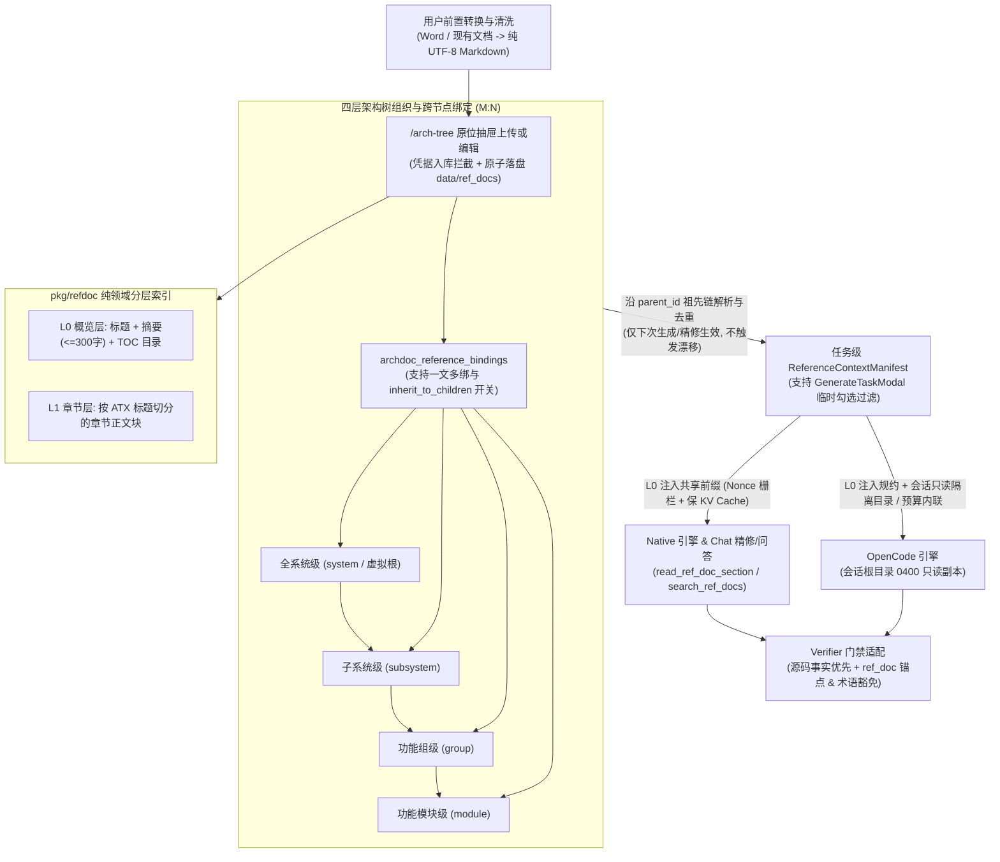

# ADR-10: 基于架构树层级的 Markdown 参考文档组织与双引擎上下文引用架构

- **文档编号**：`10-arch-reference-docs-and-context-injection.md`
- **日期**：2026-11-23
- **状态**：提议待评审 (Proposed — 已对齐核心产品边界，待评审冻结后同步更新 SDD 阶段一~三规范并拆解 M16 作战卡)
- **关联议题**：[`01-feature-matrix.md`](../01-features/01-feature-matrix.md)（拟新增 `F-37`, `SC-24`）；[`02-extraction-and-generation-engine.md`](../02-design/02-extraction-and-generation-engine.md)；[`04-workbench-and-security.md`](../02-design/04-workbench-and-security.md)；[`05-database-schema.md`](../02-design/05-database-schema.md)；[`01-http-api-contract.md`](../03-api/01-http-api-contract.md)；[`02-data-model-and-dto-contract.md`](../03-api/02-data-model-and-dto-contract.md)；[`ADR-01`](./01-microfrontend-and-table-prefix-isolation.md)；[`ADR-03`](./03-evidence-anchor-and-publish-mount.md)；[`ADR-04`](./04-module-scope-discovery-and-hierarchical-docs.md)；[`ADR-06`](./06-document-review-and-refine-studio.md)；[`ADR-08`](./08-dual-engine-doc-generation.md)；[`ADR-09`](./09-arch-tree-primary-view-and-unassigned-repos.md)

---

## 1. 背景与问题陈述 (Context & Problem Statement)

### 1.1 现状实现基线

`code-archdoc` 当前的设计文档反推与局部精修完全围绕「仓库源码 + 单文档审阅记忆」展开，经对现有代码基线核对，关键上下文链路如下：

| 环节 / 组件 | 现状行为与边界 | 代码位置 |
| :--- | :--- | :--- |
| **代码沙箱文件过滤** | `FileWalker.Walk` 与 `MatchLayer1Builtin` 按扩展名黑名单及前 512 字节 `\x00` 嗅探自动跳过二进制文件（含 `.doc` / `.docx` 等非纯文本资产）；仓库内文档类文件亦不作为系统级架构背景主通道。 | `pkg/sandbox/walker.go`、`pkg/sandbox/ignore.go` |
| **L2 生成上下文装配** | `BuildSlotMessages`（Native）与 `BuildDocumentPrompt`（OpenCode）目前仅装配：L1 Code IR（含 `shared_ir_overview` 与各槽位 `IRFacets`）、快照级 `Glossary`、`ADR-04` `ModuleContext` / `ModuleDigests` / `CrossModuleGraph`、Hybrid 历史段落（`PriorHybridMD`）及单文档长期审阅指导（`ReviewGuidance`）。 | `pkg/llm/prompt.go`、`pkg/opencode/prompt.go`、`pkg/llm/chat_refine.go` |
| **架构树主数据与全景主视图** | `ArchitectureElement`（只读映射 `code-bench` 共享表 `architecture_elements`）承载 `subsystem`、`group`、`module` 三层拓扑及 `OwnerID`；`ADR-09` 将 `/arch-tree` 重构为单一 4 列树表日常唯一主入口。 | `models/shared.go`、`services/repo_service.go`、`frontend/src/pages/ArchTreeCoveragePage.tsx`、`frontend/src/components/coverage/ArchTreeView.tsx` |
| **受限只读探索与门禁** | Native 通过 `SandboxSourceToolkit`（`read_file_lines` / `grep_in_sandbox` / `list_dir` / `get_symbol_impl`）按需读取源码；OpenCode 通过隔离配置文件仅对沙箱工作目录开放只读权限；`Verifier` Gate 1 严格校验反引号内路径/符号与 `cited_anchors`。 | `pkg/llm/source_tools.go`、`pkg/opencode/config_bridge.go`、`pkg/verifier/symbol_gate.go`、`pkg/verifier/aligner.go` |

### 1.2 核心痛点与根因剖析 (`P-1` ~ `P-4`)

在实际业务落地中，团队大量关键系统上下文沉淀于既有的 Word 整体架构设计文档、子系统接口说明书与领域术语文档中，现行体系存在 **4 项结构性缺口**：

| 编号 | 问题现象 | 严重度 | 根因分析 |
| :---: | :--- | :---: | :--- |
| **P-1** | **仅从代码反推缺乏上位业务与整体架构上下文** | 🔴 | 单个代码仓或功能模块的代码往往只体现“如何实现”，难以反映整体系统业务定位、跨子系统协作边界、历史演进权衡（为什么这么设计）及非功能性红线，导致反推文档缺乏全局视角与业务语境。 |
| **P-2** | **存量设计文档多为 Word，后端黑盒解析风险高** | 🔴 | 企业内 Word（`.docx` / 老版 `.doc`）常混杂封面、审批修订表、自动目录、复杂合并单元格与嵌入架构截图/Visio 图；若后端直接黑盒解析 Word，极易产生残缺错乱文本（Garbage In, Garbage Out），且在 Go 单二进制内解析旧版 `.doc` 或渲染图表将引入外部进程或复杂 CGO 依赖，违背轻量部署红线。 |
| **P-3** | **缺乏按架构层级复用与继承的上下文管理机制** | 🟠 | 当前唯一的人工背景输入通道是 `ReviewComment`（`persist_for_regen=true`），但它严格绑定单个 `Document` 实例。全系统级、子系统级、功能组级的上位设计无法自动向下覆盖所属功能模块；跨子系统协同设计文档也无法一次维护、多处生效。 |
| **P-4** | **长文档直塞 Prompt 易冲爆上下文并误触 Verifier** | 🟠 | 上位系统设计文档通常长达数千至数万字，若全量硬编码注入 Prompt 会挤占 `slot_ir_facets` 预算并破坏 `BuildSlotMessages` 的稳定前缀 KV Cache；同时，设计文档常包含外部系统名词或略滞后的历史名称，若无隔离约束易触发 `Verifier` Gate 1 符号幻觉拦截。 |

---

## 2. 决策概览与整体架构 (Decision Summary & Architecture)

### 2.1 整体架构图

本 ADR 确立**「纯 Markdown 契约（前端置转换清洗）+ 四层架构树多对多绑定继承 + L0 摘要常驻 / L1 按节检索 + 双引擎隔离注入 + Verifier 防误拦」**的整体方案：



### 2.2 候选方案评估

| 候选方案 | 核心做法 | 优点 | 缺点与风险 | 结论 |
| :--- | :--- | :--- | :--- | :---: |
| **方案 A：纯 Markdown 契约 + 四层架构树 M:N 绑定继承 + 双层检索注入** | 要求用户先将 Word 转换为 Markdown 再上传；通过 `reference_docs` + `reference_bindings` 两张自有表组织全系统/子系统/功能组/功能模块文档并支持跨节点绑定与祖先链继承；L0 摘要/TOC 进共享前缀，L1 按节检索；变更在下次生成/精修生效；UI 一期嵌入 `/arch-tree` 抽屉与 `GenerateTaskModal`。 | 质量把控左移（用户可清理目录/修订/补充架构图文字）；后端零 Word 解析包袱与零额外 CGO；跨节点一处维护多处生效；兼顾 KV Cache 与上下文预算；复用 `ADR-09` 主视图零菜单膨胀。 | 需用户侧预先使用工具（如 `markitdown`/`pandoc`/文档平台导出）转换 Word；需新建 2 张 `archdoc_*` 表及 `pkg/refdoc/` 包。 | ✅ **提议采纳** |
| **方案 B：后端原生解析 `.docx`/`.doc` 并随仓库同步全量注入** | 在后端引入 OOXML/LibreOffice 解析 Word，上传后将全部正文直接拼接到每个槽位 Prompt 中。 | 表面上省去用户手动转格式动作。 | Word 杂音与嵌入架构图缺失直接污染 Prompt；引入重型依赖或外部进程破坏单二进制部署；长文档全文直塞造成 Token 爆炸与 KV Cache 失效。 | ❌ **放弃** |
| **方案 C：复用单文档 `ReviewComment` (`persist_for_regen`) 粘贴系统背景** | 不做新模型与新入口，要求各模块负责人在单篇文档审阅批注里手动粘贴系统设计文档。 | 零代码开发成本。 | 无法按架构树向下继承复用；系统架构变更时需手工逐一修改几十个模块的批注；大篇幅文本塞入槽位尾部直接破坏预算控制且无目录按节检索能力。 | ❌ **放弃** |

### 2.3 核心决策摘要 (`D-1` ~ `D-6`)

| 决策编号 | 决策主题 | 核心要点 | 解决问题 |
| :---: | :--- | :--- | :---: |
| **D-1** | **纯 Markdown 输入契约、四层组织与跨节点继承** | 平台契约严格只接收 UTF-8 Markdown；建立「全系统 (`system`) → 子系统 (`subsystem`) → 功能组 (`group`) → 功能模块 (`module`)」四层归属（预留 `repo` 兜底独立仓），通过 `bindings` 表支持跨节点 M:N 绑定与 `inherit_to_children` 开关；变更仅在下次生成/单槽位重试/Chat 精修时生效，一期不联动双维漂移雷达。 | P-1、P-2、P-3 |
| **D-2** | **自有双表模型、原子落盘与 `pkg/refdoc/` 分层索引** | 严格遵循 `ADR-01` 零改共享表，新增 `archdoc_reference_docs` 与 `archdoc_reference_bindings` 2 张自有表，`archdoc_gen_tasks` 增补 `reference_doc_snapshot_json` 记录生效快照；正文按 `<data_dir>/ref_docs/<doc_id>/v<N>.md` 原子落盘；新增零 DB 依赖纯包 `pkg/refdoc/` 实现 ATX 标题切分、L0 摘要/TOC 提取与入库凭据拦截。 | P-2、P-4 |
| **D-3** | **双引擎隔离注入、Chat 协同与 Verifier 防误拦** | 确立「源码/L1 Code IR > 模块 > 功能组 > 子系统 > 全系统」事实仲裁优先级；L0 摘要/TOC 写入共享前缀保 KV Cache 并包裹随机 `nonce` 数据栅栏；Native 扩展 `read_ref_doc_section` / `search_ref_docs` 只读工具，OpenCode v2 挂载隔离 `0400` 副本并精确白名单放行、v1 走预算内联；Chat 精修/Ask 同步复用；`Verifier` 适配 `ref_doc` 锚点与外部术语豁免。 | P-1、P-4 |
| **D-4** | **分层 RBAC 权限矩阵与跨节点防越权修改** | 查看/引用全员开放；写操作沿架构树 `OwnerID` 下放至各层负责人；对绑定了多个节点的共享文档，强制要求编辑正文/归档须具备全部绑定节点的写权限（否则仅允许从己方节点解绑），严防局部负责人越权篡改上位或兄弟子系统文档。 | P-3 |
| **D-5** | **RESTful API 契约与既有接口兼容扩展** | 新增 `/api/ref-docs` 增删改查、版本与跨节点绑定接口；向后兼容扩展 `GET /api/arch-tree`（返回节点直接/继承参考文档计数）、`POST /api/tasks/generate*`（可选 `exclude_ref_doc_ids`）与 `GET /api/tasks/:id`（返回 `reference_docs` 快照）。 | P-1、P-3 |
| **D-6** | **一期交互收敛：`/arch-tree` 原位抽屉 + 生成弹窗可见** | 保持 `menu.ts` 3 组结构，一期不新增独立侧边栏菜单；在 `/arch-tree` 顶部与 4 列树表行内挂载轻量角标与右侧 `RefDocDrawer` 抽屉完成全部管理与跨节点关联；在 `GenerateTaskModal` 内按四层折叠展示本次生效参考文档清单并支持当次任务临时取消勾选。 | P-3 |

---

## 3. 核心决策详解 (Detailed Decisions)

### 3.1 决策 D-1：纯 Markdown 输入契约、四层架构树组织与跨节点绑定继承

1. **纯 UTF-8 Markdown 输入契约（质量把控左移）**：
   - 平台明确规定仅接收 UTF-8 编码的 Markdown 文件（`.md` / `.markdown`）或在线粘贴/编辑的 Markdown 文本，**不在后端执行 `.doc` / `.docx` 二进制解析**。
   - 用户在上传前通过本地工具（如 `markitdown`、`pandoc`）或在线文档导出功能完成转换，并顺带剔除 Word 封面、版本修订表与页眉页脚噪声，将关键架构图补充为文字说明或 Mermaid 文本。
   - **体积限额**：单篇参考文档原文默认上限 **`512 KB`**（约 15~25 万汉字，可通过 `config.yaml` 的 `storage.ref_doc_max_bytes` 调整），防止误传超大转储文件。

2. **四层架构树作用域与兼容兜底**：
   - 基于 `models/shared.go` 的 `ArchitectureElement`（`type ∈ {"subsystem", "group", "module"}`），在逻辑最顶层补充虚拟节点 **`system`（全系统级）**，形成完整四层结构：
     - `system`：全系统总体架构、系统边界、全局领域术语与公共非功能规范（`arch_element_id = NULL`）；
     - `subsystem`：子系统架构设计、内部模块划分与跨子系统接口契约（绑定 `type="subsystem"` 的 `ArchitectureElement`）；
     - `group`：功能组专题设计、公共机制与组内数据流（绑定 `type="group"` 的 `ArchitectureElement`）；
     - `module`：功能模块详细设计、算法说明与业务规则补充（绑定 `type="module"` 的 `ArchitectureElement`）；
     - `repo`（预留兼容）：支持为尚未归属架构树的「未关联代码仓」（`repo_id` + 规范化 `subdirectory`）直接挂载参考文档，保证 `ADR-09` 补集场景同样受惠。
   - **严守共享表零 DDL 红线**：不修改 `architecture_elements` 表结构，所有挂载关系均存放在模块自有表 `archdoc_reference_bindings` 中。

3. **文档分类标签 (`doc_kind`)**：
   - 为每篇参考文档标记单一语义分类，帮助 LLM 在 L0 目录阶段快速判断检索优先级：
     - `arch_design`：架构设计 / 模块设计（默认）
     - `domain_glossary`：领域术语 / 业务概念字典
     - `interface_spec`：跨系统接口 / 协议契约
     - `adr_constraint`：架构决策 / 非功能与合规约束
     - `other`：其他背景资料

4. **跨节点 M:N 绑定与祖先链继承精确规则**：
   - **一文多绑与同节点多篇**：文档本体（`archdoc_reference_docs`）与挂载关系（`archdoc_reference_bindings`）完全解耦。同一节点可挂载多篇不同主题文档；同一份跨子系统接口/协同文档仅需上传一份，即可同时绑定到多个 `subsystem` / `group` / `module` 节点。
   - **祖先链自动继承解析算法**：当为目标作用域（例如功能模块 `M`）发起文档生成或 Chat 精修时，按以下确定性步骤解析生效参考文档集合：
     1. 若目标作用域关联 `ArchitectureElement` `M`，沿 `parent_id` 向上回溯至根，得到有序祖先节点链 `[S_0, ..., G_k, M]`（加环保护，最大深度 16）；
     2. 查询全部 `status == "active"` 且满足以下任一条件的绑定记录：
        - `scope_level == "system"` 且 `inherit_to_children == true`（除非当前目标本身就是全局系统级预览）；
        - `arch_element_id == M.ID`（本节点直接绑定，无论 `inherit_to_children` 真假均生效）；
        - `arch_element_id` 属于 `M` 的真祖先链且 `inherit_to_children == true`；
        - 若目标为未绑模块的独立仓范围 `(repo_id, subdir)`，匹配 `scope_level == "system"`（`inherit_to_children == true`）及该 `(repo_id, subdir)`（或整仓 `subdir == ""` 且 `inherit_to_children == true`）的 `repo` 级绑定；
     3. **文档类型过滤**：若某条绑定设置了非空的 `doc_type_slugs` 白名单，仅当本次任务的 `doc_type_slug` 在白名单内时纳入；
     4. **跨节点重复命中去重**：若某篇共享文档同时绑定了 `S_0`（可继承）与 `M`（或同时绑定在祖先链两个节点上），按 `doc_id` 去重，**保留作用域最具体（优先级 `module > group > subsystem > repo > system`）的一条元信息**；
     5. **Monorepo 整仓 Roll-up 汇总（`ADR-04`）**：整仓作用域（`subdir == ""` 且非单模块整仓）默认继承 `system` + 该仓库自身绑定 + 其下全部活跃子模块所属架构节点的参考文档并按 `doc_id` 去重，使整仓架构汇总不丢失子系统上下文；
     6. **确定性排序**：最终生效列表固定按 `(scope_rank ASC [system=1, subsystem=2, group=3, module=4, repo=5], sort_order ASC, doc_id ASC)` 排序，确保跨槽位 Prompt 前缀字节完全稳定。

5. **版本变更生效边界（一期不联动漂移）**：
   - 当用户更新某篇参考文档内容（递增 `version_no`）或调整节点绑定关系时，**不触发**下属已发布代码反推文档的 `Spec Drift` 或 `Code Drift`，也不写入 `archdoc_document_drifts`；
   - 更新结果**仅在下次触发生成、重新生成、单槽位重试或 Canvas Studio Chat 精修/Ask 问答时自动生效**。

---

### 3.2 决策 D-2：数据模型、本地原子存储与双层索引 (`pkg/refdoc/`)

1. **新增自有数据表（模块自有表由 20 增至 22）**：
   - 严格遵守 `ADR-01` `archdoc_` 表前缀约束，在 `models/AllOwnModels()` 中新增以下两张表，并在 `models.GenTask` 增补 1 个 JSONB 快照字段（不改动任何共享表）：

```go
// models/reference_doc.go — ADR-10 冻结模型草案

// ReferenceDoc 架构参考 Markdown 文档主实体（第 21 张 archdoc_* 自有表）
type ReferenceDoc struct {
	ID              uint           `gorm:"primaryKey" json:"id"`
	Title           string         `gorm:"size:200;not null" json:"title"`
	DocKind         string         `gorm:"size:32;not null;default:'arch_design';index" json:"doc_kind"` // arch_design | domain_glossary | interface_spec | adr_constraint | other
	Description     string         `gorm:"size:500;default:''" json:"description"`                        // 人工填写的一句话说明
	SummaryMD       string         `gorm:"type:text;not null;default:''" json:"summary_md"`             // L0 精简摘要（<=300字，用户手填或轻量模型自动提炼）
	SummarySource   string         `gorm:"size:16;not null;default:'auto'" json:"summary_source"`       // manual | llm | fallback
	TOCJSON         datatypes.JSON `gorm:"type:jsonb;not null;default:'[]'" json:"toc"`                 // []refdoc.HeadingNode（ATX 标题目录与起止行号）
	DeclaredTerms   datatypes.JSON `gorm:"type:jsonb;not null;default:'[]'" json:"declared_terms"`      // []string（从标题/术语表提取的外部系统名，用于 Verifier 豁免）
	CurrentVersion  int            `gorm:"not null;default:1" json:"current_version"`
	StorageRelPath  string         `gorm:"size:512;not null;default:''" json:"-"`                       // 相对于 RefDocsDir 的路径：<doc_id>/v<ver>.md
	ContentSHA256   string         `gorm:"size:64;not null;default:'';index" json:"content_sha256"`
	ByteSize        int64          `gorm:"not null;default:0" json:"byte_size"`
	LineCount       int            `gorm:"not null;default:0" json:"line_count"`
	Status          string         `gorm:"size:16;not null;default:'active';index" json:"status"`       // active | archived
	CreatedBy       uint           `gorm:"not null;index" json:"created_by"`
	UpdatedBy       uint           `gorm:"not null" json:"updated_by"`
	CreatedAt       time.Time      `json:"created_at"`
	UpdatedAt       time.Time      `json:"updated_at"`
}

func (ReferenceDoc) TableName() string { return config.TablePrefix + "reference_docs" }

// ReferenceDocBinding 参考文档与四层架构作用域的多对多绑定关系（第 22 张 archdoc_* 自有表）
type ReferenceDocBinding struct {
	ID                uint           `gorm:"primaryKey" json:"id"`
	DocID             uint           `gorm:"not null;uniqueIndex:idx_archdoc_ref_bind_unique,priority:1;index" json:"doc_id"`
	ScopeKey          string         `gorm:"size:512;not null;uniqueIndex:idx_archdoc_ref_bind_unique,priority:2" json:"scope_key"` // 规范化防重键: "system" | "arch:<id>" | "repo:<id>:<subdir>"
	ScopeLevel        string         `gorm:"size:16;not null;index" json:"scope_level"`                                                // system | subsystem | group | module | repo
	ArchElementID     *uint          `gorm:"index" json:"arch_element_id"`
	RepoID            *uint          `gorm:"index" json:"repo_id"`
	Subdirectory      string         `gorm:"size:512;not null;default:''" json:"subdirectory"`
	InheritToChildren bool           `gorm:"not null;default:true" json:"inherit_to_children"`
	DocTypeSlugsJSON  datatypes.JSON `gorm:"type:jsonb;not null;default:'[]'" json:"doc_type_slugs"` // 空数组表示适用全部 DocType
	SortOrder         int            `gorm:"not null;default:0" json:"sort_order"`
	CreatedBy         uint           `gorm:"not null" json:"created_by"`
	CreatedAt         time.Time      `json:"created_at"`
	UpdatedAt         time.Time      `json:"updated_at"`
}

func (ReferenceDocBinding) TableName() string { return config.TablePrefix + "reference_bindings" }
```

   - **唯一键设计说明**：PostgreSQL 中包含 `NULL` 列的复合唯一索引无法阻止多条 `system`（`arch_element_id IS NULL`）重复绑定，因此显式引入确定性规范化字符串 `ScopeKey`（`"system"`、`"arch:42"`、`"repo:12:services/pay"`），与 `DocID` 构成严格幂等唯一约束。
   - **任务生效快照追踪**：在 `models.GenTask` 增加 `ReferenceDocSnapshotJSON datatypes.JSON`（列 `reference_doc_snapshot_json`，默认 `'[]'`），记录任务创建时最终生效的参考文档列表（`[{doc_id, title, doc_kind, version_no, content_sha256, scope_level, scope_label}]`），保证即便后续参考文档更新或归档，历史任务仍可精确溯源当时引用了哪一版本。

2. **本地磁盘存储（复用 `StorageSection` 原子落盘规范）**：
   - 在 `config/config.go` 的 `StorageSection` 新增 `RefDocsDir()` 方法，返回 `<data_dir>/ref_docs`（可在 `StorageSection` 增加可选 `RefDocMaxBytes int64`，默认 `524288` 即 `512 KB`）。
   - 每篇文档按 `<RefDocsDir>/<doc_id>/v<version_no>.md` 存储，复用临时文件 + `fsync` + 原子 `rename` 落盘，所有路径访问统一经 `sandbox.SafeJoin` 校验防止目录穿越；保留历史版本文件 `v1.md`、`v2.md`... 以支持版本预览与历史任务溯源。

3. **纯 Go 领域包 `pkg/refdoc/`（零 DB / 零 Gin 依赖）**：
   - 严格遵守 `AGENTS.md` 架构红线（`make lint-arch` 检查）：`pkg/refdoc/` 仅依赖 Go 标准库与 `pkg/security`，负责：
     1. **入库合规校验**：验证有效 UTF-8 文本、体积上限、非空有效内容，并调用 `security.SecretRedactor.RedactText` 检测明文私钥/Token/密码；**若检测到高危凭据，直接拒绝入库并返回结构化脱敏位置提示（HTTP `422 SECRET_DETECTED`）**，从源头杜绝内部凭据进入参考库；
     2. **确定性结构化切片**：状态机扫描 ATX 标题（`#` ~ `####`），自动跳过围栏代码块（```` ``` ```` / `~~~`）内的 `#` 注释行，提取每个节的 `section_id`（如 `sec-1`、`sec-2-1`）、层级 `level`、标题 `title`、`line_start`、`line_end` 与 `char_count`，生成紧凑 `TOCJSON`；
     3. **按节读取与字面量检索**：提供 `ReadSection(rawMD, sectionID, maxChars)` 与 `SearchSections(rawMD, query, maxHits)` 纯函数，按行号范围精准切片并附带翻页提示；
     4. **L0 摘要与声明术语提取**：摘要优先取用户手填 `summary_md`；未填写时由 `services/ref_doc_service.go` 异步/同步调用 `default` 或轻量模型基于脱敏正文提炼 ≤300 字结构化摘要（含核心系统定位、关键模块/外部依赖说明），LLM 不可用时自动降级为「标题大纲 + 首段正文截断」确定性摘要，保证主流程永不因摘要生成失败而阻塞；同时提取标题与粗体/表格中的非文件路径专有术语作为 `DeclaredTerms`。

---

### 3.3 决策 D-3：双引擎上下文注入、Chat 精修协同与 Verifier 防冲突机制

1. **事实冲突仲裁铁律（System Prompt 强制声明）**：
   - 在 `pkg/llm/prompt.go`、`pkg/opencode/prompt.go` 与 `pkg/llm/chat_refine.go` 的系统提示词中增加「上位参考文档约束铁律」：
     - **事实层级顺序**：`当前源码 / L1 Code IR > 功能模块级参考 > 功能组级参考 > 子系统级参考 > 全系统级参考`；
     - **职责边界**：参考文档仅用于补充**业务目标、系统职责定位、跨系统上下游边界、领域术语含义及设计决策背景**；文中所写的所有文件路径、符号名、HTTP/RPC 路由、数据表与配置字段**必须以当前源码与 L1 Code IR 为唯一事实源**；
     - **差异显式标注**：若参考文档描述的架构或接口与当前真实代码存在明显偏差（如规划未落地或代码已重构），以真实代码为准，并在相关章节补充一条简短的「设计与实现差异说明」。

2. **L0 共享前缀注入（保护 KV Cache 与预算平衡）**：
   - 新增统一上下文载荷 `refdoc.ContextManifest`（含生效文档清单：`doc_id`、`title`、`doc_kind`、`scope_level`、`scope_label`、`version_no`、`summary_md`、`toc` 与可选内联正文 `inline_body`）。
   - **KV Cache 友好的共享前缀落位**：
     - **Native 引擎（`pkg/llm/prompt.go`）**：将 `ContextManifest` 序列化并包裹于随机 `nonce` 数据栅栏 `<untrusted_repo_data nonce="..." label="arch_reference_docs">...</untrusted_repo_data>` 中，置于 `BuildSlotMessages` **第 2 段共享 `user` 前缀末尾**（紧随 `ADR-04` 上下文之后、槽位专属尾部之前）。同一任务下所有槽位共享完全相同的字节前缀，**零破坏 vLLM/SGLang Automatic Prefix Caching**；
     - **OpenCode 引擎（`pkg/opencode/prompt.go`）**：写入 `BuildDocumentPrompt` 第 4 节共享上下文末尾，同样以 `nonce` 数据栅栏提示只读参考定位；
     - **Canvas Studio Chat 精修 / 综合精修 / Ask 问答（`pkg/llm/chat_refine.go`）**：统一复用相同的 `ContextManifest` 注入函数，确保生成与精修对系统背景的认知完全一致。
   - **短文档直通优化与 L0 预算裁剪**：
     - 若本次生效的所有参考文档正文总字符数 `<= 4000` 且单篇 `<= 2000` 字符（例如仅有 1~2 篇精炼的模块/子系统说明），直接将全文放入 `inline_body`，免去不必要的工具调用往返；
     - 超过该阈值时，仅保留 `summary_md + toc`（L0），并受总预算 `9000 chars`（约 3000 Tokens）保护：超限时按优先级从低到高（`system` → `subsystem` → `group` → `module`）先折叠 3~4 级子标题，再裁剪低优文档长摘要，保证永远不挤爆 `slot_ir_facets`。

3. **L1 按需章节检索（双引擎差异化安全落位）**：
   - **Native 引擎 & Chat 精修/问答（`pkg/llm/source_tools.go`）**：
     - 当任务存在未内联的长篇参考文档时，在 `SandboxSourceToolkit` 中额外注册 2 个只读工具（同样受 `RunToolLoop` 轮次与累计字节上限约束，返回前二次过 `SecretRedactor`）：
       - `read_ref_doc_section(doc_id, section_id, offset_line?)`：按 `TOC` 返回对应章节 Markdown 正文（单次上限 200 行 / 12 KB）；
       - `search_ref_docs(query, doc_id?)`：在当次任务绑定的生效参考文档范围内执行字面量关键词检索，返回命中的 `doc_id`、`section_id`、`title` 与上下文片段。
   - **OpenCode 引擎（`pkg/opencode/config_bridge.go`）**：
     - OpenCode 默认沙箱工作目录是代码仓，不允许越权访问宿主机 `data/ref_docs/` 全盘。为兼顾安全性与按需读取体验，区分版本采取以下方案：
       1. 在 `prepareSessionEnv` 阶段，仅将当次任务**实际生效且未全量内联**的参考文档经过 `SecretRedactor` 脱敏后，写入本次会话独占的临时目录 `rootDir/ref_docs/<doc_id>_<slug>.md`（权限 `0400`），会话结束后随 `sessionEnv.Cleanup()` 彻底销毁；
       2. **OpenCode v2.x**（支持基于路径粒度的权限数组）：在 `buildOpenCodeV2ConfigJSON` 中维持默认 `*:deny` 与沙箱工作目录只读，额外仅为 `rootDir/ref_docs` 与 `rootDir/ref_docs/*` 添加精确 `read`/`grep`/`list` `"allow"` 规则，其余任何宿主机外部目录仍严格拒绝；并在 Prompt 中告知该只读参考目录绝对路径；
       3. **OpenCode v1.x**（旧版 `permission` 对象仅支持粗粒度 `"external_directory": "deny|allow"`，无目录白名单）：**严禁放开 `"external_directory": "allow"`**！改为降级走**预算内联模式**：按优先级 (`module > group > subsystem > system`) 与总字符上限（默认 `24000 chars`）将核心章节正文直接随 `--file` Prompt 下发，彻底杜绝 v1 越权读取宿主机任意文件。

4. **Verifier 四重门禁防误拦截 (`pkg/verifier/`)**：
   - **Prompt 约束**：明确要求模型勿将参考文档中提到的外部平台名、业务系统名或规划概念放入源码 `cited_anchors`（除非能映射到真实源码/Proto），且纯概念名词勿随意加反引号以防被 Gate 1 识别为未验证符号；
   - **扩展 `ref_doc` 锚点域与外部术语白名单**：
     - 允许模型在需要显式标注上位参考依据时输出 `{"scope": "ref_doc", "file_path": "ref_doc:<doc_id>", "fq_symbol": "<section_id>", "symbol_kind": "ref_doc"}`；
     - `VerifyInput` 接收当次任务的 `RefDocs []refdoc.VerifyRefMeta`（合法 `doc_id` 集合 + `DeclaredTerms`）；
     - `AlignCandidates` 与 `RunSymbolGate` 对 `scope == "ref_doc"` 执行白名单校验：**存在于本次生效集合的 `doc_id` 合法对齐并落入证据锚点；伪造或不在生效清单的 `ref_doc` 引用无条件标为 `error` 阻断 `can_approve`**；
     - 同时将合法参考文档中提取的 `DeclaredTerms` 纳入当次 `IRIndex` 的非源码专有名词豁免集（类似 `commonTechTerms`，仅豁免驼峰词误报，**不豁免带斜杠的伪造文件路径或 `::` 全限定代码符号**），既避免大面积误报警告，又绝不放松对代码路径与符号幻觉的防线。

---

### 3.4 决策 D-4：分层 RBAC 权限矩阵与跨节点写保护

1. **权限矩阵（复用共享表 `ArchitectureElement.OwnerID` 与 `services/rbac.go`）**：

| 作用域层级 | 查看 / 任务引用 | 上传新建参考文档 | 编辑正文 / 更新版本 / 归档 | 绑定至当前节点 / 从当前节点解绑 |
| :--- | :--- | :--- | :--- | :--- |
| **全系统级 (`system`)** | 所有已登录用户 | 仅 `archdoc_admin` / `super_admin` | 仅 `archdoc_admin` / `super_admin` | 仅 `archdoc_admin` / `super_admin` |
| **子系统级 (`subsystem`)** | 所有已登录用户 | 管理员 + 该子系统 `OwnerID` | 管理员 + 该子系统 `OwnerID`（受跨节点规则约束） | 管理员 + 该子系统 `OwnerID` |
| **功能组级 (`group`)** | 所有已登录用户 | 管理员 + 本节点或任意祖先子系统 `OwnerID` | 管理员 + 本节点或任意祖先 `OwnerID`（受跨节点规则约束） | 管理员 + 本节点或任意祖先 `OwnerID` |
| **功能模块级 (`module`)** | 所有已登录用户 | 管理员 + 本/祖先节点 `OwnerID` + 所绑仓库 `IsRepoLevelWriter` | 管理员 + 本/祖先 `OwnerID` + 所绑仓库 `IsRepoLevelWriter`（受跨节点规则约束） | 管理员 + 本/祖先节点 `OwnerID` + 所绑仓库 `IsRepoLevelWriter` |
| **独立仓 (`repo`)** | 所有已登录用户 | 管理员 + 该仓库 `IsRepoLevelWriter` | 管理员 + 该仓库 `IsRepoLevelWriter`（受跨节点规则约束） | 管理员 + 该仓库 `IsRepoLevelWriter` |

2. **跨节点共享文档防越权篡改不变量**：
   - 当一篇文档同时绑定了多个节点（例如同时绑定子系统 A 与子系统 B，或绑定全系统级又被某个子模块复用）时：
     - **绑定/解绑局部自治**：任何对目标节点 `X` 有写权限的用户，均可将自己可见的现有参考文档绑定到 `X`，或将一篇共享文档从 `X` **解绑**（`DELETE /api/ref-docs/:id/bindings/:binding_id`），解绑仅影响 `X`，不破坏文档本体与其他节点的绑定；
     - **修改正文/归档全集校验**：调用 `PUT /api/ref-docs/:id` 更新正文/标题或 `DELETE /api/ref-docs/:id` 归档文档时，调用者必须是 `archdoc_admin`/`super_admin`，**或者对当前该文档全部有效绑定的每一个节点均具备写权限**；否则返回 `403 FORBIDDEN` 并提示「该文档跨多个架构节点共享，如需仅在本节点移除请使用解绑操作，或联系管理员/共享节点负责人修改正文」。
   - **审计闭环**：全部创建、更新版本、归档、绑定与解绑操作统一接入 `commonAudit` 记录操作人、目标 `doc_id`、版本号及绑定作用域变更前后快照。

---

### 3.5 决策 D-5：API 契约草案与既有接口向下兼容扩展

1. **新增参考文档管理与绑定接口 (`/api/ref-docs`)**：

| 方法与路径 | 职责说明 | 权限守卫 | 核心请求 / 响应要点 |
| :--- | :--- | :--- | :--- |
| `GET /api/ref-docs` | 分页检索全局/可见参考文档库（供抽屉「关联已有文档」下拉搜索） | 登录态 | Query: `search`, `doc_kind`, `scope_level`, `arch_element_id`, `status=active\|archived`, `page`, `page_size`；返回列表含绑定的节点摘要标签与当前用户 `can_edit` 标识。 |
| `GET /api/ref-docs/effective` | 查询指定目标作用域最终生效的继承链参考文档清单 | 登录态 | Query: `arch_element_id` 或 `(repo_id, subdirectory)` + 可选 `doc_type_slug`；按 `system -> subsystem -> group -> module` 返回含 `is_inherited`、`source_scope_label`、`summary_md`、`toc` 与 `can_edit`/`can_unbind`。 |
| `GET /api/ref-docs/:id` | 获取单篇参考文档详情、绑定列表及指定版本 Markdown 正文 | 登录态 | Query: `version`（可选，默认当前版本）；返回元信息、`bindings[]`、`content_md`、`toc[]`、`can_edit`。 |
| `POST /api/ref-docs` | 创建参考文档（支持 multipart `.md` 文件或 JSON `content_md`）并完成首个绑定 | 目标初始作用域写权限 | 入参：`title`, `doc_kind`, `description`, `summary_md`, `content_md`(或文件), `initial_binding` (`scope_level`, `arch_element_id`, `repo_id`, `subdirectory`, `inherit_to_children`, `doc_type_slugs`)；命中明文凭据返回 `422 SECRET_DETECTED`。 |
| `PUT /api/ref-docs/:id` | 更新参考文档元信息或发布新版本 Markdown 正文 | 全绑定节点写权限 | 正文 `content_sha256` 变化时原子写入 `v<N+1>.md`、刷新 `toc` 与 `summary_md` 并递增 `current_version`（同时支持更新 `status: active\|archived`）。 |
| `POST /api/ref-docs/:id/bindings` | 将已有参考文档跨节点绑定至新架构节点或独立仓 | 目标节点写权限 | Body: `scope_level`, `arch_element_id`, `repo_id`, `subdirectory`, `inherit_to_children`, `doc_type_slugs`；幂等冲突返回 `409 ALREADY_BOUND`。 |
| `PATCH /api/ref-docs/:id/bindings/:binding_id` | 更新单条绑定的 `inherit_to_children`、`doc_type_slugs` 或 `sort_order` | 该绑定所属节点写权限 | 局部配置更新。 |
| `DELETE /api/ref-docs/:id/bindings/:binding_id` | 从指定节点解除绑定（不删除文档本体） | 该绑定所属节点写权限 | 解绑后若文档零绑定，文档保留为 `active` 未挂载状态供后续复用或归档。 |

2. **既有接口向后兼容扩展**：
   - **`GET /api/arch-tree`**：
     - `ArchTreeResponse.Summary` 新增可选整数 `system_ref_doc_count`（全系统级活跃参考文档数）；
     - `ArchTreeNodeVO` 新增可选字段 `direct_ref_doc_count`（本节点直接绑定数）与 `inherited_ref_doc_count`（从祖先链继承数），均由单次全量查表在内存中聚合完成，**无 N+1 查询**。
   - **`POST /api/tasks/generate`、`POST /api/tasks/generate-batch`、`POST /api/documents/:id/regenerate`**：
     - 请求体新增可选字段 `exclude_ref_doc_ids?: number[]`（允许用户在发起当次任务时临时取消勾选某篇不相关的继承文档）；
     - 任务创建时服务端解析最终生效集合并剔除 `exclude_ref_doc_ids` 后固化至 `GenTask.ReferenceDocSnapshotJSON`。
   - **`GET /api/tasks/:id`**：
     - `GenTaskDetailVO` 新增可选数组 `reference_docs?: TaskReferenceDocSnapshotVO[]`，直接透出该任务实际引用的参考文档标题、版本号与来源层级。

---

### 3.6 决策 D-6：一期前端交互形态（原位抽屉 + 生成弹窗可见，不新增侧边栏菜单）

1. **保持导航极简（零菜单膨胀）**：
   - 一期**不修改 `frontend/src/menu.ts` 的 3 组结构**，不增设独立「参考资料库」侧边栏一级菜单；所有管理与消费均就近融合在 `ADR-09` 确立的两大核心交互点上。

2. **触点 1 & 2：`/arch-tree` 顶部系统栏 + 4 列树表行内角标与原位抽屉 (`RefDocDrawer`)**：
   - **顶部「全系统级参考文档」轻量条**：紧邻 `/arch-tree` 顶部摘要栏放置紧凑胶囊条（例如 `全系统参考文档：3 篇 · 查看与管理 ▸`），点击打开同一 `RefDocDrawer` 查看或（管理员）上传/编辑全系统级文档。
   - **树表行内紧凑角标（零增加列数，不破坏 4 列对齐）**：在 `ArchTreeView.tsx` 第 1 列（`架构层级 / 关联源码`）节点标题行末尾渲染轻量参考文档胶囊：
     - 无论 `subsystem`、`group` 还是 `module` 节点，当 `direct + inherited > 0` 时展示紧凑徽标（如 `参考 1 (+2继承)`），当有写权限且为 `0` 时展示弱化操作入口 `+ 参考文档`；点击胶囊直接打开右侧滑出的 **`RefDocDrawer`**（注意对无权限用户不展示编辑/上传操作）。
   - **`RefDocDrawer` 抽屉双区结构**：
     - **区域 A：本节点直接挂载（可管理）**：展示本节点直接绑定的参考文档列表，支持：
       1. 「上传 / 新建 Markdown」（支持拖拽/选择 `.md` 文件或直接在弹窗内粘贴/编辑 Markdown，附简明 Word 转 Markdown 工具指引如 `markitdown`/`pandoc`）；
       2. 「关联已有文档」（跨节点复用搜索框，从全系统已有参考文档中检索并一键绑定到当前节点）；
       3. 单篇行内控制：`向下继承` 开关（`inherit_to_children`）、适用 `DocType` 限制、预览/编辑新版本、解绑/归档。
     - **区域 B：沿架构树继承自上级（只读速览）**：按 `全系统 → 子系统 → 功能组` 列出自动继承下来的文档及来源标签，支持点击展开预览 Markdown 与目录，清晰回答“这个模块会额外收到哪些背景”。

3. **触点 3：`GenerateTaskModal` 生效参考文档可见与当次临时筛选**：
   - 在 `GenerateTaskModal.tsx`（选中目标范围与 `DocType` 后）异步请求 `GET /api/ref-docs/effective`，渲染可折叠区块 **「将引用的上位参考文档（N 篇）」**：
     - 默认全部勾选生效，按 `全系统 / 子系统 / 功能组 / 功能模块` 分组展示文档标题、分类与版本号（无参考文档时显示极简一行提示并附跳转 `/arch-tree` 管理链接）；
     - 允许发起者在本次任务中临时取消勾选与当前任务无关的参考文档（提交时自动转换为 `exclude_ref_doc_ids`）。
   - 任务监控视图中同步展示本次任务实际固化的参考文档快照徽标（点击可查看引用了哪几篇及对应版本）。

4. **触点 4：Canvas Studio 审校溯源可见**：
   - 在 `CanvasStudioPage` 顶部或文档信息侧栏内展示当前文档最近一次生成/Chat 所引用的参考文档列表（只读，含 `ref_doc:<id>` 证据锚点点击定位至文档原文对应章节），便于架构负责人核对信息来源。

---

## 4. 安全合规、影响范围与风险缓解

### 4.1 安全合规与架构防腐红线检查

| 红线 / 安全项 | 本 ADR 约束与防护措施 |
| :--- | :--- |
| **共享表零 DDL (`ADR-01`)** | 严禁修改 `architecture_elements` / `repositories` / `users` / `departments`；仅在 `models/` 新增 `archdoc_reference_docs` 与 `archdoc_reference_bindings`（20 → 22 表）及 `archdoc_gen_tasks.reference_doc_snapshot_json`。 |
| **核心引擎零 DB 耦合 (`AGENTS.md`)** | `pkg/refdoc/`、`pkg/llm/`、`pkg/opencode/` 与 `pkg/verifier/` 严禁导入 `code-archdoc/models`、`gorm.io/gorm` 或 `gin`，完全通过纯 Go 结构体与接口传递 `ContextManifest` / `VerifyRefMeta`。 |
| **凭据零泄漏双重拦截** | ① 参考文档上传/更新入库前经 `security.SecretRedactor` 扫描，命中明文私钥/Token/密码直接返回 `422` 拒绝落盘；② Native 工具返回与 OpenCode 脱敏副本生成时再次执行 `RedactText` 兜底脱敏。 |
| **不可信数据隔离与防提示词注入 (`SC-13`)** | 用户上传的参考文档 Markdown 同样视为**不可信被动数据**，在 Native `BuildSlotMessages`、OpenCode `BuildDocumentPrompt`、Chat `BuildChatRefineMessages` 及工具返回中一律包裹于当次 128-bit 随机 `nonce` 的 `<untrusted_repo_data>` 栅栏并转义闭合标签，严禁执行文档内任何指令。 |
| **OpenCode 沙箱路径隔离边界** | v2 仅向会话隔离临时目录下的 `rootDir/ref_docs/*` 精确白名单开放只读权限；v1 严禁开启全局 `external_directory: "allow"`，改用受限预算内联方式交付，100% 守住宿主机磁盘隔离红线。 |
| **跨节点越权修改拦截** | 对跨节点共享文档的正文编辑与归档强制校验「调用者对**所有**已绑定节点均具备写权限（或为管理员）」，局部节点负责人仅可从自身节点解绑，杜绝下级越权篡改上位共享规范。 |
| **双模主题与安全渲染** | 前端参考文档抽屉、徽标与 Markdown 预览复用现有安全 Markdown 渲染组件（防 XSS）与 `theme.css` `--color-*` 语义 Token，零硬编码颜色与静态内联样式。 |

### 4.2 预期影响模块清单

| 层级 | 涉及文件 / 模块 | 变更摘要 |
| :--- | :--- | :--- |
| **纯领域包 (`pkg/`)** | `pkg/refdoc/`（新建）、`pkg/llm/prompt.go`、`pkg/llm/source_tools.go`、`pkg/llm/chat_refine.go`、`pkg/opencode/prompt.go`、`pkg/opencode/config_bridge.go`、`pkg/opencode/runner.go`、`pkg/verifier/aligner.go`、`pkg/verifier/symbol_gate.go`、`pkg/verifier/verifier.go` | 新建 `pkg/refdoc/`（Markdown 切片/TOC/检索/凭据检验）；双引擎与 Chat 注入 L0 `ContextManifest` 与 L1 章节读取；OpenCode 会话隔离 `ref_docs/` 挂载与 v1/v2 适配；`Verifier` 支持 `scope="ref_doc"` 与 `DeclaredTerms` 豁免。 |
| **数据模型与配置 (`models/` & `config/`)** | `config/config.go`、`models/reference_doc.go`（新建）、`models/db.go`、`models/task.go`、`models/stores.go` | `StorageSection.RefDocsDir()` 与文件大小配置；新增 `ReferenceDoc` / `ReferenceDocBinding` 2 表及 `ReferenceDocStore`；`GenTask` 增补 `ReferenceDocSnapshotJSON`。 |
| **业务服务 (`services/`)** | `services/ref_doc_service.go`（新建）、`services/rbac.go`、`services/repo_service.go`、`services/generation_service.go`、`services/batch_generation.go`、`services/opencode_execution.go`、`services/chat_service.go` | 实现参考文档 CRUD、原子落盘、L0 摘要提炼、四层祖先链继承去重解析、跨节点写校验、`GetArchTree` 计数聚合、生成/重试/Chat 上下文注入与 `GenTask` 快照固化。 |
| **HTTP 控制器 (`handlers/`)** | `handlers/ref_doc.go`（新建）、`handlers/router.go`、`handlers/task.go`、`handlers/document.go`、`handlers/repo.go` | 注册 `/api/ref-docs*` 路由与 RBAC/审计守卫；扩展生成/重生成接口支持 `exclude_ref_doc_ids` 与任务详情返回 `reference_docs`。 |
| **前端工作台 (`frontend/`)** | `frontend/src/types/domain.ts`、`frontend/src/types/api.ts`、`frontend/src/api/refDocs.ts`（新建）、`frontend/src/components/coverage/RefDocDrawer.tsx`（新建）、`frontend/src/components/coverage/ArchTreeView.tsx`、`frontend/src/pages/ArchTreeCoveragePage.tsx`、`frontend/src/components/GenerateTaskModal.tsx`、`frontend/src/pages/CanvasStudioPage.tsx` | 树表与顶部系统条角标、右侧 `RefDocDrawer` 抽屉（上传/编辑/跨节点关联/继承链只读速览）、`GenerateTaskModal` 参考文档分组勾选清单、Studio 引用清单展示。 |
| **SDD 规范文档 (`docs/`)** | `docs/01-features/01-feature-matrix.md`、`docs/02-design/*`、`docs/03-api/*`、`docs/04-tasks/01-roadmap.md` & `17-m16-*.md` | 在架构组评审确认本 ADR 后，同步更新阶段一~三规范并拆解 `M16` TDD 作战卡。 |

### 4.3 边界场景与风险缓解

| 边界 / 风险点 | 处理策略 |
| :--- | :--- |
| **用户上传超大 Markdown 或数十万字设计文档** | 入库前置校验 `storage.ref_doc_max_bytes`（默认 `512 KB`）；L0 `ContextManifest` 受 `9000 chars` 硬预算渐进裁剪；L1 读取受单次 200 行 / 12 KB 限制，防止单篇参考文档冲爆模型上下文。 |
| **同一篇跨子系统文档在继承链上被重复命中** | 按 `doc_id` 严格去重，并保留作用域最具体（`module > group > subsystem > system`）的来源标记；若需在 Monorepo 整仓生成时汇总多个子模块，同样按 `doc_id` 去重后按规范序输出。 |
| **Word 转换后的 Markdown 仍含过时接口/符号，与当前源码冲突** | 系统指令强制确立「源码 / L1 Code IR 为唯一实现事实源」，参考文档仅贡献业务边界与设计意图；允许模型在文档中显式标出设计与现状实现差异，绝不允许虚构源码符号。 |
| **某篇参考文档被归档或删除绑定后，历史生成任务如何溯源** | `GenTask.ReferenceDocSnapshotJSON` 在任务提交时即固化了当时生效的 `doc_id`、`title`、`version_no` 与 `content_sha256`；且磁盘保留历史 `v<N>.md` 文件，即使后续更新版本或解绑，历史任务详情与已落盘修订仍完全可追溯。 |
| **未关联到架构树的独立代码仓如何补充系统背景** | 自动继承全系统级（`system`）参考文档（当 `inherit_to_children == true`）；同时数据模型与 API 支持 `scope_level="repo"` 挂载到 `(repo_id, subdirectory)`，未关联代码仓也可补充独立参考文档。 |
| **运行环境仅安装 OpenCode v1.x（无细粒度路径白名单）** | 启动或探测阶段识别 OpenCode 版本能力：v2.x 启用隔离临时目录 `rootDir/ref_docs/*` 精确只读白名单；v1.x 严禁开启全局 `external_directory: "allow"`，自动降级为预算内联交付核心章节，确保零逃逸风险。 |

---

## 5. TDD 先行验收测试清单 (`T-ADR10-01` ~ `T-ADR10-12` & `SC-24`)

后续进入 `M16` 实施阶段时，严格遵循先写红测试（Red）再编写实现（Green）的 TDD 规范：

| 用例编号 | 类型 | 验证点与核心断言 | 目标文件 |
| :---: | :---: | :--- | :--- |
| **`T-ADR10-01`** | 纯 Go 单测 | **Markdown ATX 切片与凭据拦截 (`pkg/refdoc`)**：围栏代码块内 `#` 注释不被误识别为标题；正确生成 `TOC` 与按 `section_id` 精确读取；命中私钥/高熵 Token 返回 `ErrSecretDetected` 阻断入库。 | `pkg/refdoc/refdoc_test.go` |
| **`T-ADR10-02`** | 隔离库 API | **参考文档 CRUD、原子落盘与版本递增**：上传 `.md`/文本生成 `v1.md`，`PUT` 修改正文原子生成 `v2.md` 且保留 `v1.md`；`Scale` 空正文/超 512KB/含明文凭据分别返回 `400`/`413`/`422`。 | `handlers/ref_doc_test.go` |
| **`T-ADR10-03`** | 隔离库 API | **四层架构树祖先链继承与跨节点 M:N 去重**：构造 `system` + `subsystem` + `group` + `module` 树，验证下属 `module` 自动继承开启 `inherit_to_children` 的上级文档；同一文档同时绑两个节点时按 `doc_id` 去重并保留最具体层级；`doc_type_slugs` 过滤与关闭继承生效。 | `handlers/ref_doc_test.go` |
| **`T-ADR10-04`** | 隔离库 API | **分层 RBAC 与跨节点防越权修改**：模块负责人可传/改本模块文档但不可创建 `system` 文档（返 `403`）；跨节点共享文档仅部分节点有写权的负责人修改正文/归档返 `403`，但可成功 `DELETE .../bindings/:binding_id` 从己方节点解绑。 | `handlers/ref_doc_test.go` |
| **`T-ADR10-05`** | 隔离库 API | **变更仅下次生效与不触发漂移**：已发布代码反推文档在所继承参考文档发布新版本 `v2` 后，不会变为 `Spec Drift` / `Code Drift`；下一次触发生成时 `GenTask.ReferenceDocSnapshotJSON` 准确记录 `v2`。 | `handlers/ref_doc_test.go` |
| **`T-ADR10-06`** | 隔离库 API | **`GetArchTree` 参考计数与 `GenerateTask` 排除列表**：验证 `GetArchTree` 返回正确的 `system_ref_doc_count`、`direct_ref_doc_count`、`inherited_ref_doc_count`；`POST /api/tasks/generate` 传入 `exclude_ref_doc_ids` 后生效快照精确排除对应文档。 | `handlers/ref_doc_test.go` |
| **`T-ADR10-07`** | 纯 Go 单测 | **Native 共享前缀 KV Cache 稳定性与工具检索 (`pkg/llm`)**：多槽位调用 `BuildSlotMessages` 时包含 `arch_reference_docs` 的 `user` 前缀字节 100% 一致且包含 `nonce` 逃逸防护；`read_ref_doc_section` 与 `search_ref_docs` 工具按节/关键字返回并执行二次脱敏。 | `pkg/llm/llm_test.go` |
| **`T-ADR10-08`** | 纯 Go 单测 | **OpenCode 隔离挂载与 v1/v2 安全分流 (`pkg/opencode`)**：v2 配置精确仅放行 `rootDir/ref_docs/*` 只读、其余外部路径保持 `deny`；v1 保持 `external_directory: "deny"` 并按预算内联参考内容；`Cleanup()` 后临时参考副本彻底清理。 | `pkg/opencode/opencode_test.go` |
| **`T-ADR10-09`** | 纯 Go 单测 | **Verifier `ref_doc` 锚点与外部术语防误拦 (`pkg/verifier`)**：合法 `scope="ref_doc"` 对齐放行，伪造 `ref_doc:9999` 标 `error` 阻断 `can_approve`；参考文档 `DeclaredTerms` 内的外部驼峰系统名不触发 Gate 1 误报，伪造源码路径/符号仍严格拦截。 | `pkg/verifier/verifier_test.go` |
| **`T-ADR10-10`** | 隔离库集成 | **Chat 局部精修、综合精修与 Ask 问答参考文档注入**：Verify `BuildChatRefineMessages` / `BuildChatAskMessages` 注入生效参考文档上下文并允许工具按节读取。 | `services/chat_review_test.go` |
| **`T-ADR10-11`** | 前端纯函数 | **参考文档继承分组、排除集与预算提示纯函数**：验证四层分组展示排序、`exclude_ref_doc_ids` 计算及角标文案格式化（零 React 依赖 `node --test` 运行）。 | `frontend/src/utils/archdocUtils.test.ts` |
| **`T-ADR10-12`** | 全量门禁 | **端到端全量验证 (`SC-24`)**：`make lint-arch && make test && TEST_DB_DSN=... make test && cd frontend && npm test && cd .. && make lint && make build && make clean` 全绿通过。 | 全仓 CI 门禁 |

---

## 6. 提请架构组评审议题 (Architecture Review Checklist)

请架构组确认以下 **4 项关键边界决策**：

1. **【纯 Markdown 契约与上限】** 是否同意平台后端**严格仅接收 UTF-8 Markdown**（单文件默认上限 `512 KB`），由用户前置完成 Word → Markdown 转换与噪声清理？后续若需降低非研发用户门槛，再在纯前端按需增加「浏览器端 `.docx` 转 Markdown 草稿辅助」而不改变后端契约。
2. **【跨节点共享文档修改权】** 是否同意「对绑定了多个架构节点的共享文档，仅管理员或对**全部已绑定节点**均具备写权的用户可修改正文/归档；单一节点负责人仅可执行绑定与解绑」的防越权策略？
3. **【OpenCode v1/v2 隔离策略】** 是否同意 v2 使用会话隔离目录 `0400` 副本 + 路径白名单按需查阅，而 v1 严禁放开全局 `external_directory`、自动降级为预算内联？
4. **【一期交互收敛与零漂移联动】** 是否同意一期暂不增设独立「参考资料库」侧边栏菜单、暂不联动双维漂移雷达（参考文档更新仅在下次生成/精修时生效），优先交付 `/arch-tree` 原位抽屉与 `GenerateTaskModal` 生效清单可见？

---

## 7. 后续实施路径 (Next Steps)

本 ADR 经评审确认后，按工作区 SDD + TDD 四阶段流水线推进：
1. **SDD 阶段一~三规范更新**：
   - 更新 [`01-feature-matrix.md`](../01-features/01-feature-matrix.md)（新增 `F-37` 与 `SC-24`）；
   - 更新 [`02-extraction-and-generation-engine.md`](../02-design/02-extraction-and-generation-engine.md)、[`04-workbench-and-security.md`](../02-design/04-workbench-and-security.md) 与 [`05-database-schema.md`](../02-design/05-database-schema.md)（冻结 22 张 `archdoc_*` 表 ER 与双引擎注入细节）；
   - 更新 [`01-http-api-contract.md`](../03-api/01-http-api-contract.md) 与 [`02-data-model-and-dto-contract.md`](../03-api/02-data-model-and-dto-contract.md)；
   - 更新 [`01-roadmap.md`](../04-tasks/01-roadmap.md) 并拆解 `M16` 作战卡（建议拆为 `M16-A` 存储/领域/API、`M16-B` 双引擎/Chat/Verifier、`M16-C` `/arch-tree` 抽屉与 `GenerateTaskModal` 交互）。
2. **SDD 阶段四 TDD 编码交付**：按 `T-ADR10-01` ~ `T-ADR10-12` 先红后绿分阶段实施并通过全仓质量门禁。
