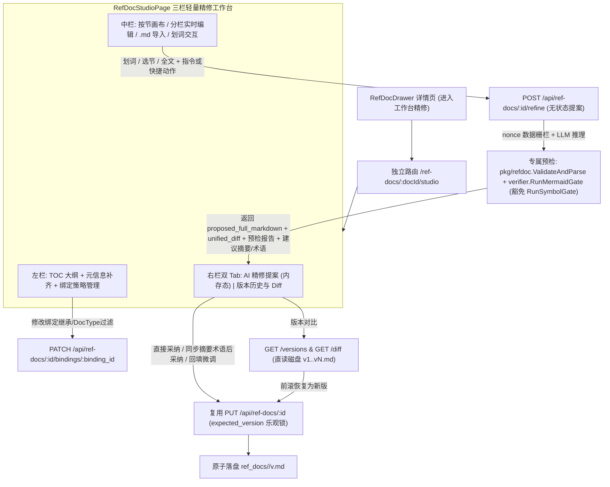

# ADR-11: 架构参考文档精修工作台（一期轻量方案）架构设计

- **文档编号**：`11-ref-doc-refine-studio.md`
- **日期**：2026-11-24
- **状态**：设计已冻结待实施 (Design Frozen — `M17`)
- **关联议题**：[`ADR-06`](./06-document-review-and-refine-studio.md)、[`ADR-09`](./09-arch-tree-primary-view-and-unassigned-repos.md)、[`ADR-10`](./10-arch-reference-docs-and-context-injection.md)、[`01-feature-matrix.md`](../01-features/01-feature-matrix.md) (`v0.11.0`, `F-38`, `SC-25`)、[`04-workbench-and-security.md`](../02-design/04-workbench-and-security.md) (`v1.6.0`)、[`01-http-api-contract.md`](../03-api/01-http-api-contract.md) (`v1.8.0`)、[`02-data-model-and-dto-contract.md`](../03-api/02-data-model-and-dto-contract.md) (`v1.7.0`)、[`18-m17-ref-doc-refine-studio.md`](../04-tasks/18-m17-ref-doc-refine-studio.md)

---

## 1. 背景与问题陈述 (Context & Problem Statement)

### 1.1 现状基线

[`ADR-10`](./10-arch-reference-docs-and-context-injection.md) 已完成基于四层架构树（`system → subsystem → group → repo → module`）的 Markdown 参考文档组织、分级凭据门禁、双引擎上下文引用及独立 `RefCitationsJSON` 溯源体系的落地。当前代码基线已具备以下可复用底座：

| 环节 / 组件 | 现状实现与可用能力 | 代码位置 |
| :--- | :--- | :--- |
| **结构化分节与门禁解析** | `pkg/refdoc/` 已将参考文档解析为带 `section_id`、`start_line`、`end_line`、`level` 的 `TOCJSON`（含无标题/`>250 行` 自动按约 160 行切片的 `sec-chunk-N` 兜底），并提供 `ValidateAndParse` 分级凭据/Base64 大图校验及 `BuildFallbackSummary`。 | `pkg/refdoc/parser.go`、`pkg/refdoc/gate.go`、`pkg/refdoc/types.go` |
| **不可变版本落盘与乐观锁** | `RefDocService.UpdateRefDoc` 已支持按 `doc_id` 互斥锁 + `expected_version` 乐观锁更新；正文变更时先原子落盘 `<RefDocsDir>/<doc_id>/v<N+1>.md`，历史 `v1.md..vN.md` 完整保留，`GetRefDocDetail(docID, version)` 支持读取任意历史版本。 | `services/ref_doc_service.go`、`handlers/ref_doc.go` |
| **当前前端参考文档入口** | `/arch-tree` 通过 `RefDocDrawer.tsx` 提供列表、创建、关联与详情内嵌编辑；`CanvasStudioPage.tsx` 通过 `RefDocPreviewDrawer.tsx` 提供只读版本预览。 | `frontend/src/components/coverage/RefDocDrawer.tsx`、`frontend/src/components/studio/RefDocPreviewDrawer.tsx` |
| **反推文档精修工作台底座** | `CanvasStudioPage.tsx` 已沉淀三栏工作台布局、`SectionMarkdownRenderer`（含 Mermaid 渲染与行号 block 标记）、`SelectionReviewPopover`、统一 Diff 卡片与 `pkg/verifier/mermaid_gate.go`（`RunMermaidGate`）。 | `frontend/src/pages/CanvasStudioPage.tsx`、`frontend/src/components/studio/*`、`pkg/verifier/mermaid_gate.go` |

### 1.2 核心痛点 (`P-1` ~ `P-4`)

| 编号 | 问题现象 | 严重度 | 根因分析 |
| :---: | :--- | :---: | :--- |
| **P-1** | **窄抽屉纯文本编辑体验受限** | 🟠 | `RefDocDrawer.tsx` 仅在侧滑抽屉内提供单一 `<textarea>`，缺少章节大纲跳转、Markdown/Mermaid 分栏实时预览与按节聚焦编辑，难以支撑数千字 Word 转换产物的结构梳理与补图。 |
| **P-2** | **历史版本不可比对、难以安全回滚** | 🟠 | 后端已保留全部 `v1.md..vN.md` 磁盘版本文件，但缺少版本列表与版本间文本 Diff 接口及前端视图，架构师无法对比版本演进或一键基于历史版本恢复。 |
| **P-3** | **抽屉编辑表单未完整覆盖已有后端能力** | 🟡 | `RefDocService.UpdateRefDoc` 与 `UpdateBinding` 已支持修改 `doc_kind`、`description` 及消费绑定配置（`inherit_to_children` / `doc_type_slugs`），但 `RefDocDrawer.tsx` 编辑态尚未暴露，且编辑态不支持重新上传 `.md` 文件覆盖。 |
| **P-4** | **缺乏受控的 AI 辅助精修与摘要术语联动** | 🟠 | Word 转 Markdown 常见排版杂乱、文字流程缺少 Mermaid 图表、正文改版后 `summary_md` 滞后（`summary_stale`）及 `declared_terms` 需手工维护等问题，当前全靠人工纯手改，缺少带门禁预检与 Diff 预览的 AI 精修助手。 |

### 1.3 一期边界与显式 Non-Goals

经需求收敛，本 ADR 明确一期轻量方案的严格边界：

1. **一期不做「以码校文」**：不引入下属模块已发布反推文档或 L1 Code IR 进行代码-参考文档双向一致性校对（留作二期演进）。
2. **一期不做持久化对话与批注篮**：**零新增数据库表**（严格维持 22 张 `archdoc_*` 表不变）；AI 精修采用「单轮无状态提案 + 前端内存审阅」模式，架构师确认采纳后直接通过既有 `PUT /api/ref-docs/:id` 原子落盘为 `v<N+1>.md`。
3. **一期不引入反推工作台专属概念**：不引入 `DocType` 固定槽位契约（`slot_id`、`auto/hybrid/locked`、`OrphanSection`）、审批发布状态机或双维漂移联动；遵循 `ADR-09`/`ADR-10` 约定，不向 `frontend/src/menu.ts` 新增一级菜单项。

---

## 2. 决策概览与整体架构 (Decision Summary & Architecture)

### 2.1 整体架构图

### 2.2 候选方案评估

| 候选方案 | 核心做法 | 优点 | 缺点与风险 | 结论 |
| :--- | :--- | :--- | :--- | :---: |
| **方案 A：独立轻量路由 `/ref-docs/:docId/studio` + 复用 Studio UI 积木 + 无状态提案** | 新建独立页面 `RefDocStudioPage`，复用 `SectionMarkdownRenderer`、`SelectionReviewPopover`、Diff 视图与 Studio 三栏样式；后端新增无状态 `refine` 与只读 `versions`/`diff` 接口，写盘全走既有 `PUT /api/ref-docs/:id`。 | 领域边界清晰，不污染反推 `Document` 槽位与 `ChatService` 状态机；零新增 DB 表；UI 积木高度复用，可独立演进至二期。 | 需新增一个独立前端页面路由及 3 个轻量后端接口。 | ✅ **提议采纳** |
| **方案 B：在 `CanvasStudioPage.tsx` 与 `ChatService` 内硬加双模式分支** | 让 `CanvasStudioPage` 和 `ChatService` 同时支持 `Document` 与 `ReferenceDoc` 两种实体。 | 表面上少建一个页面文件。 | `Document` 强依赖 `slot_id`、`ownership`、`BaseRevisionNo`、`CodeIR` 与 `RunSymbolGate`；强行合流会在组件与服务层引入大量 `if/else`，回归风险极高。 | ❌ **放弃** |
| **方案 C：仅扩展 `RefDocDrawer.tsx` 窄抽屉** | 在抽屉内直接加宽或叠加 AI 润色按钮与版本对比弹窗。 | 无需新增路由。 | 抽屉天然受限于视口宽度与层叠交互，无法舒适地承载「大纲 + 分栏编辑 + Diff 审阅」三栏空间，难以解决 `P-1` 与 `P-2`。 | ❌ **放弃** |
| **方案 D：一期即建持久化对话/批注表并接入以码校文** | 新增参考文档会话/消息/批注表，并拉取下属代码与反推文档做一致性检查。 | 一步到位覆盖多人异步评审与跨仓校对。 | 数据表与后端编排复杂度成倍放大，一期交付周期长；当前架构师核心诉求为单人即时精修，属于过度设计。 | ❌ **延后二期** |

### 2.3 核心决策摘要 (`D-1` ~ `D-5`)

| 决策编号 | 决策主题 | 核心要点 | 解决问题 |
| :---: | :--- | :--- | :---: |
| **D-1** | **独立路由与组件复用边界** | 新增 `/ref-docs/:docId/studio`（不增设一级菜单），从 `RefDocDrawer` 详情页直达；复用渲染器、划词浮层、Diff 样式，不耦合反推 `Document` 模型。 | P-1 |
| **D-2** | **TOC 章节画布、分栏编辑与完整元信息管理** | 左栏补齐 `doc_kind`/`description`/绑定配置（`PATCH`）；中栏支持按 `TOC` 分节或全文分栏实时编辑、`.md` 重新导入预览及划词触发精修。 | P-1、P-3 |
| **D-3** | **无状态 AI 精修提案与专属门禁预检** | `POST /api/ref-docs/:id/refine` 支持 `selection`/`section`/`full` 三级作用域与快捷动作，输出带 `unified_diff`、可选建议 `summary_md`/`declared_terms` 及 `ValidateAndParse + RunMermaidGate` 预检报告（豁免 `RunSymbolGate`）。 | P-4 |
| **D-4** | **基于既有磁盘版本的 Diff 与前滚恢复** | 零新表实现 `GET /versions` 与 `GET /diff`；「恢复旧版 `vK`」采用不可变前滚语义，经 `PUT /api/ref-docs/:id` 发布为 `v<N+1>.md`。 | P-2 |
| **D-5** | **轻量增量 API 与既有前端契约对齐** | 后端仅增 3 个端点；同步修复 `frontend/src/api/refDocs.ts` 中 4 处前后端契约不一致问题。 | P-2、P-3、P-4 |

---

## 3. 核心决策详解 (Detailed Decisions)

### 3.1 决策 D-1：独立路由、零菜单膨胀与 UI 组件复用边界

1. **路由与入口收敛**：
   - 在 `frontend/src/App.tsx` 中同时于 **`EmbeddedRoutes`**（`/ref-docs/:docId/studio` 与 `${MODULE_BASE_PATH}/ref-docs/:docId/studio`）及 **`StandaloneShell`**（`/ref-docs/:docId/studio`，`isRefDocStudio` 顶栏标题为「架构参考文档精修工作台」，侧边栏高亮「架构文档全景」）注册路由，挂载 `RefDocStudioPage`。
   - 保持 `frontend/src/menu.ts` 3 组 8 项结构不变，不增加侧边栏一级菜单。
   - 在 `RefDocDrawer.tsx` 文档详情头部操作区（**置于 `detailDoc.can_edit` 判断之外**）增加 **「进入工作台精修 / 工作台浏览」** 按钮（有 `can_edit` 权限时为 `btn btn-primary btn-small` 主引导按钮，只读用户为 `btn btn-secondary btn-small` 浏览按钮，进入工作台浏览大纲与版本历史 Diff，或对正文发起 `ask` 问答，但编辑/`revise` 精修/保存按钮置为不可写态）；跳转时透传 `state: { from: currentPathWithSearch, fromLabel: '架构文档全景' }`，工作台返回复用 `resolveSafeStudioBackTarget`。
2. **复用与隔离红线**：
   - **可复用**：`SectionMarkdownRenderer`（支持 Markdown 与 Mermaid 实时预览及行号标注）、`SelectionReviewPopover`（做向后兼容可选属性扩展：`showCommentButton?: boolean` 默认 `true`、`canAsk?: boolean` 默认跟随 `canWrite`、`ownership?: SectionOwnership` 默认 `'auto'`、`onAddComment?: () => void`，供精修工作台仅启用「AI 精修 / 问 AI」并允许只读用户发起「问 AI」）、Diff 行高亮样式（`DiffProposalCard` 风格）及工作台三栏 CSS 布局变量。
   - **新建轻量编辑器组件**：新建 `frontend/src/components/refdoc/RefDocSplitEditor.tsx` 独立复用 `SectionMarkdownRenderer` 与 `.code-archdoc-inline-editor*` CSS 样式，不耦合 `SectionVO`/`ownership`/`slot_id`。
   - **严禁耦合**：`RefDocStudioPage` 不依赖 `DocumentDetailVO`、`SectionVO`（槽位模型）、`ReviewCommentVO` 或 `ChatService`；不渲染 `Ownership` 选择器、`OrphanSectionsZone` 与源码证据溯源面板。

---

### 3.2 决策 D-2：基于 `TOC` 的自由章节画布、分栏编辑与完整元信息管理

1. **左栏（大纲、元信息与绑定管理）**：
   - **TOC 章节导航与草稿实时同步**：阅读态及任意本地草稿修改（单节编辑、全文编辑、`.md` 导入、提案回填）均经纯函数 `parseLocalRefDocTOC(markdown)` 与 `splitRefDocIntoDisplaySections(markdown, toc)` 动态重算大纲与章节行区间，点击条目平滑滚动至中栏对应章节，展示起止行号与估算 Token。
   - **前置导言（`__preamble__`）零丢失保护**：针对 `pkg/refdoc/parser.go` 仅在首标题前 `>30` 行才生成导言块的特性，前端 `splitRefDocIntoDisplaySections` 在 `toc[0].start_line > 1` 时自动补齐合成导言节 `{ section_id: '__preamble__', title: '文档导言', level: 1, start_line: 1, end_line: toc[0].start_line - 1, is_preamble: true }`，确保中栏阅读/局部编辑回写时零行丢失。
   - **元信息面板（补齐 `P-3` 缺口）**：在工作台内完整开放编辑 `title`、`doc_kind`（5 类枚举）、`description`（≤500 字）、`summary_md`（显示 `summary_stale` 滞后警告提示）与 `declared_terms`（术语标签编辑）。
   - **绑定策略面板**：展示当前文档 `bindings[]` 列表，标识 `is_home` 主归属节点，允许对当前用户有写权限的绑定行直接修改 `inherit_to_children` 与 `doc_type_slugs`（调用 `PATCH /api/ref-docs/:id/bindings/:binding_id`）。
2. **中栏（分节画布、分栏实时编辑与 `.md` 重新导入）**：
   - **阅读态**：按动态切分展示各章节卡片，每节顶部提供「编辑本节」「AI 精修本节」快捷按钮；若文档尚有未保存的本地草稿变更，顶部显示「未保存草稿 · 含本地改动」状态条并支持一键保存或放弃。
   - **分栏编辑态**：采用 `RefDocSplitEditor` 的「分栏 / 仅编辑 / 仅预览」模式，支持单节编辑（保存回内存草稿时精准替换对应行区间，避免手工定位全文千行位置）与全文编辑两种粒度。
   - **`.md` 重新导入**：支持从本地重新选择 `.md` / `.markdown` 文件，经前端读取为 UTF-8 文本后直接载入中栏草稿区供预览和微调，再由架构师确认提交 `PUT /api/ref-docs/:id`。
   - **划词触发与绝对行号偏置映射**：在阅读态通过 `SelectionReviewPopover` 选中段落文本后，捕获选区原文与相对行号；因 `SectionMarkdownRenderer` 的 `data-line-start`/`data-line-end` 相对单节正文计算，必须经纯函数 `computeAbsoluteSelectionLines(sectionStartLine, relStartLine, relEndLine, sectionEndLine)` 映射为文档全局 1-based 绝对行号后再带入右栏作为 `selection` 上下文。
3. **保存与乐观锁冲突保护（`RefDocConflictMergeModal`）**：
   - 所有落盘保存统一调用 `PUT /api/ref-docs/:id` 并携带当前加载的 `expected_version`；
   - 在 `frontend/src/utils/errorMessages.ts` 的 `FormattedApiError` 扩展提取 `currentVersion?: number`（读取 `details.current_version`）；收到 `409 VERSION_CONFLICT` 时工作台**绝不丢弃用户未保存草稿和右栏内存 AI 提案**，而是弹出 `RefDocConflictMergeModal` 拉取服务端最新 `v<latest>` 并展示对比，提供「用本地草稿覆盖提交（自动更新 `expected_version`）」或「放弃本地改动加载新版」。

---

### 3.3 决策 D-3：无状态 AI 精修提案引擎与专属门禁预检

1. **请求模型（`POST /api/ref-docs/:id/refine`）**：
   - 核心入参：`scope_type`（`selection` | `section` | `full`）、`mode`（`revise` 修订提案 | `ask` 仅问答不改文）、`preset_action`（可选快捷动作：`polish` 润色与结构规范化 | `mermaid` 将流程/架构描述补全为 Mermaid 图 | `refresh_summary` 提炼/更新 L0 摘要与领域术语）、`prompt`（用户指令；传入合法 `preset_action` 时可为空并由后端填充默认中文指令，两者均空返 `400 INVALID_PARAM`）、`section_id`（`section` 模式必填）、`selection`（`selection` 模式含 `start_line`、`end_line`、`quote_text`）、`draft_content_md`（可选，允许基于前端未落盘草稿继续精修）。
   - **未保存草稿动态 TOC 与只读防滥用红线**：
     - 当 `mode == "ask"` 且 `!canEdit`（非归属只读用户）时，后端**忽略**请求体 `draft_content_md`，强制仅基于已落盘 `v<current>.md` 作答，防止未授权用户把该接口当成任意文本免费 LLM 代理；
     - 当 `canEdit == true` 且传入非空 `draft_content_md` 时，先校验 UTF-8 合法性与 `<= s.maxBytes`（超限返 `413 PAYLOAD_TOO_LARGE`），并以 `refdoc.ParseTOC(baseMD)` 动态解析草稿 TOC（绝不用过期 DB `doc.TOCJSON`），避免本地增删行导致 `section_id` 替换错位。
   - **大文档保护与 `refresh_summary` 非破坏性语义**：
     - 当 `scope_type == "full"` 且 `mode == "revise"` 且 `preset_action != "refresh_summary"` 时，若正文按 `refdoc.EstimateTextTokens` 估算超过预算上限（默认 `DefaultFullRefineMaxTokens = 16000`，服务端按 `min(max(llmCfg.MaxTokensPerTask/2, 4000), 16000)` 动态约束），后端拒绝盲目截断并返回 `422 TOKEN_BUDGET_EXCEEDED`（`details: { estimated_tokens, max_full_refine_tokens, suggested_scope: "section" }`），引导切换 `section` 或 `selection` 粒度精修；
     - **`refresh_summary` 专用非破坏性语义**：仅提炼 `answer_md`、`suggested_summary_md`（≤300 字）与 `suggested_declared_terms`，**不修改正文**（`proposed_fragment = ""`、`proposed_full_markdown = baseMD`、`unified_diff = ""`），豁免 `full` 重写预算拦截（超 `24000 Tokens` 时按 TOC + 各节首段拼装浓缩上下文供提炼）；前端点击「采纳摘要与术语」时调用 `PUT /api/ref-docs/:id` 仅提交 `expected_version`、`summary_md`、`declared_terms`（不传 `content_md`），不触发正文升版即可消除 `summary_stale`。
2. **Prompt 安全、叶包无环约束与 Diff 复用**：
   - 在 `pkg/refdoc/refine.go`（**严守叶包零 `pkg/llm`/`pkg/drift`/`models`/`gorm`/`gin` 依赖，仅可导入 Go 标准库与 `pkg/security`**）定义纯 Go 结构体（`RefinePromptMessage{Role, Content}`、`RefinePromptInput`、`RefineSelectionRange`、`RefineLLMOutput`）及纯函数：`BuildRefinePrompt`（128-bit `crypto/rand` 随机 `nonce` + 转义 `<untrusted_ref_doc` / `</untrusted_ref_doc` 防闭合标签逃逸）、`ParseRefineLLMOutput`、`ApplyLineRangeReplacement`（1-based 闭区间行替换，非目标行字节级不变）、`CheckFullRefineBudget`；并导出 `pkg/refdoc.ParseTOC`；
   - 在 `services/ref_doc_refine_service.go` 中直接调用既有 `pkg/drift.ComputeUnifiedDiff(fromMD, toMD)` 计算 `unified_diff`（零复制粘贴）；LLM 调用复用 `services.ResolveLLMEndpoint(ctx, s.govRepo, "")` 与 `llm.Client.ChatCompletion`，用量复用既有 `archdoc_llm_usage_logs`（`TaskID=nil`、`DocumentID=nil`、`RepoID=*doc.OwnerRepoID` 或 `0`、`SlotID="ref_doc:<id>"`、`Engine="native"`、`Stage="ref_doc_refine" | "ref_doc_ask"`）落库，零表变更满足 `F-27` 成本观测。
3. **专属双门禁预检（绝不误用源码强校验）**：
   - 对 `proposed_full_markdown` **独立跑完两项专属检查**（即使 `ValidateAndParse` 命中 `SECRET_CONFIRM_REQUIRED` 或 `SECRET_DETECTED`，仍继续执行 Mermaid 检查一次返回完整报告）：
     1. **`pkg/refdoc.ValidateAndParse`**：校验 UTF-8 合法性、体积 ≤ `ref_doc_max_bytes`（默认 512 KB）、无 `> 4 KB` 内嵌 Base64 大图，并执行分级凭据扫描（若命中硬凭据标记 `gate_error.code = "SECRET_DETECTED"` 且 `can_save = false`；若仅触发 `SECRET_CONFIRM_REQUIRED` 在预检报告标记 `secret_confirm_required = true` 与 `secret_issues[]`，此时 `can_save = true`，采纳时由用户决定手工清理或勾选 `redact_and_save = true`）；
     2. **`pkg/verifier.RunMermaidGate(targetSectionID, proposedFullMD, (&doctype.VerifyPolicy{}).Effective())`**：校验 Mermaid 语法错误与复杂度告警（存在 `severity == "error"` 时置 `can_save = false`，复杂度 `warning` 不阻断 `can_save`）。
   - **明确豁免 `verifier.RunSymbolGate`**：参考文档包含规划态架构概念、外部系统名与高层模块抽象，不强制匹配当前仓库源码符号。
4. **提案审阅与采纳（零持久化表，纯内存流转）**：
   - 后端返回 `{ answer_md, mode, scope_type, target_section_id, original_fragment, proposed_fragment, proposed_full_markdown, unified_diff, preflight, suggested_summary_md?, suggested_declared_terms? }`；
   - 前端右栏在内存会话列表中展示对话与 `Unified Diff` 卡片，提供 4 种处置方式：
     1. **直接采纳并保存新版**：调用 `PUT /api/ref-docs/:id` 落盘为 `v<N+1>.md`（可选勾选同步采纳 `suggested_summary_md` 与 `suggested_declared_terms`，高熵时可选 `redact_and_save=true`）；
     2. **仅采纳摘要与术语**（`refresh_summary` 专属）：调用 `PUT /api/ref-docs/:id` 仅提交 `summary_md`/`declared_terms`（不改 `content_md`、不升正文版本号）消除 `summary_stale`；
     3. **回填至编辑器微调**：将 `proposed_fragment` / `proposed_full_markdown` 应用到中栏草稿区，继续手工编辑或叠加下一轮 AI 精修后再统一保存；
     4. **忽略/丢弃提案**：仅前端标记丢弃，不产生任何后端写操作或数据库垃圾记录。

---

### 3.4 决策 D-4：版本历史对比与不可变前滚恢复

1. **零新表实现版本与 Diff**：
   - 磁盘 `<RefDocsDir>/<doc_id>/v1.md .. vN.md` 已完整保存每次正文更新的不可变快照。
   - `GET /api/ref-docs/:id/versions`：按 `version_no DESC` 枚举 `doc.CurrentVersion .. 1` 的版本清单（结合 `sandbox.SafeJoin` 检查文件存在性、字节大小与 `is_current` 标记；旧版本文件缺失时显式标 `file_exists: false` 而不报错崩溃）。
   - `GET /api/ref-docs/:id/diff?from=A&to=B`：默认 `to = doc.CurrentVersion`、`from = max(1, to-1)`；使用 `sandbox.SafeJoin` 安全读取 `vA.md` 与 `vB.md` 并调用 `drift.ComputeUnifiedDiff` 返回标准 `unified_diff` 与 `added_lines`/`removed_lines`（版本越界或任一版本文件缺失返回明确 `404 NOT_FOUND`）。
2. **不可变前滚恢复语义**：
   - 当架构师在版本历史 Tab 中点击「恢复此版本（vK）为新版」时，**严禁覆盖或回删中间版本文件**；前端调用 `GET /api/ref-docs/:id?version=K` 读取 `vK` 正文载入草稿区预览确认（或一键确认），再调用 `PUT /api/ref-docs/:id` 提交 **`expected_version = doc.CurrentVersion`**（注意绝不是 `K`）与 `vK` 的正文，生成新的 `v<N+1>.md`，确保 `GenTask.ReferenceDocSnapshotJSON` 与历史 `RefDocCitation` 引用的 `v1..vN` 永远可读且不可变。

---

### 3.5 决策 D-5：增量 API 契约与既有契约对齐

1. **新增后端端点（仅 3 个，全部挂在 `protected` 路由组，总计 79 → 82 Endpoints）**：

| # | 方法与路径 | 职责说明 | 权限守卫 | 核心请求 / 响应要点 |
| :-: | :--- | :--- | :--- | :--- |
| 80 | `POST /api/ref-docs/:id/refine` | 无状态 AI 精修提案 / 问答 | `checkDocOwnerWritePermission`（`revise`）；登录态 `JWT`（`ask`，只读用户忽略 `draft_content_md`） | 入参：`scope_type`, `mode`, `preset_action?`, `prompt?`, `section_id?`, `selection?`, `draft_content_md?`；响应：`answer_md`, `mode`, `scope_type`, `target_section_id`, `original_fragment`, `proposed_fragment`, `proposed_full_markdown`, `unified_diff`, `preflight{ can_save, secret_confirm_required, secret_issues[], mermaid_issues[], gate_error? }`, `suggested_summary_md?`, `suggested_declared_terms?`。 |
| 81 | `GET /api/ref-docs/:id/versions` | 获取参考文档历史版本列表 | 登录态 `JWT`（与 `GetRefDocDetail` 一致） | 返回 `doc_id`, `current_version`, `versions: [{ version_no, byte_size, is_current, file_exists }]`（倒序）。 |
| 82 | `GET /api/ref-docs/:id/diff` | 获取任意两版本间 Unified Diff | 登录态 `JWT`（与 `GetRefDocDetail` 一致） | Query：`to`（默认 `current_version`）、`from`（默认 `max(1, to-1)`）；返回 `doc_id`, `from_version`, `to_version`, `unified_diff`, `added_lines`, `removed_lines`。 |

2. **既有接口契约核查与对齐修复（随本 ADR 一并修复 `frontend/src/api/refDocs.ts`）**：
   在走查 `handlers/router.go`、`handlers/ref_doc.go` 与 `frontend/src/api/refDocs.ts` 时发现 4 处前后端不一致，已同步修正：
   - `listRefDocs`：`query.status === 'all'` 原被前端跳过未传递，导致后端按默认 `active` 过滤，无法在全局文档列表看到已归档文档；已改为透传 `status=all`。
   - `createRefDoc`（multipart 上传文件）：前端原使用 `formData.append('metadata', ...)`，后端 `handlers/ref_doc.go` 实际读取 `c.PostForm("payload")`；已对齐为 `payload`。
   - `purgeRefDoc`：前端原请求 `DELETE /ref-docs/${docId}`，后端 `handlers/router.go` 实际注册在 `DELETE /api/admin/ref-docs/${docId}/purge` 且返回 `{ purged_id }`；已对齐路径与返回类型。
   - `updateRefDocBinding`：前端原使用 `PUT`，后端 `handlers/router.go` 实际注册为 `PATCH /ref-docs/:id/bindings/:binding_id`；已对齐为 `PATCH`。

---

## 4. 安全合规、影响范围与风险缓解

### 4.1 安全合规与架构防腐检查

| 红线 / 安全项 | 本 ADR 约束与防护措施 |
| :--- | :--- |
| **共享表零 DDL & 既有表零变更** | 一期零新增表、零表字段变更，严格维持 `ADR-10` 的 22 张 `archdoc_*` 表结构不变。 |
| **核心引擎零 DB / Gin 耦合** | 精修 Prompt 构造与差异合并置于 `pkg/refdoc/refine.go`（零 `models` / `gorm` / `gin` / `pkg/llm` / `pkg/drift` 导入），通过 `make lint-arch` 门禁。 |
| **凭据与不可信数据隔离** | AI 精修 Prompt 中的参考文档原文包裹于随机 `nonce` 栅栏；提案必须经 `pkg/refdoc.ValidateAndParse` 阻断硬凭据与 `>4 KB` Base64 图；只读用户 `ask` 强制忽略 `draft_content_md`；工作台采纳提交复用 `UpdateRefDoc` 原子写盘。 |
| **写权限严格对齐归属作用域** | `revise` 模式 AI 精修与 `PUT` 保存、`PATCH` 绑定修改继续沿用 `ADR-10` 的 `OwnerScopeKey` 与节点祖先链 RBAC，防止未授权用户浪费 LLM 配额或越权修改共享文档。 |
| **不误用源码强校验** | 明确豁免 `RunSymbolGate`，仅执行文本/凭据门禁与 `RunMermaidGate`，避免阻塞包含外部系统与架构概念的参考文档修订。 |

### 4.2 预期影响模块清单（待实施阶段）

| 层级 | 涉及文件 / 模块 | 变更摘要 |
| :--- | :--- | :--- |
| **纯领域包 (`pkg/`)** | `pkg/refdoc/parser.go`、`pkg/refdoc/refine.go`（新建）、`pkg/refdoc/refdoc_test.go` | 导出 `ParseTOC`；实现 `BuildRefinePrompt`（含 `nonce` 栅栏与 `polish`/`mermaid`/`refresh_summary` 模板）、`ParseRefineLLMOutput`、`ApplyLineRangeReplacement`（1-based 行区间替换）、`CheckFullRefineBudget`（叶包零 `pkg/llm`/`pkg/drift` 依赖）。 |
| **业务服务 (`services/`)** | `services/ref_doc_service.go`、`services/ref_doc_refine_service.go`（新建） | 新增 `WithRefineEngine` 注入 `GovernanceRepo` + `*llm.Client`；实现 `RefineRefDoc`（`ResolveLLMEndpoint` + `drift.ComputeUnifiedDiff` + `ValidateAndParse` & `RunMermaidGate` 独立双检 + `archdoc_llm_usage_logs` 埋点）、`ListRefDocVersions`、`DiffRefDocVersions`；零新增仓储与 DB 表。 |
| **HTTP 控制器 (`handlers/`)** | `handlers/error.go`、`handlers/ref_doc.go`、`handlers/router.go`、`main.go` | 补齐 `ErrCodeTokenBudgetExceeded`（422）与 `ErrChatLLMNotConfigured`（400）映射；新增 `RefineRefDoc`、`ListRefDocVersions`、`GetRefDocDiff` 三个处理函数、路由绑定与 `main.go` 装配。 |
| **前端工作台 (`frontend/`)** | `frontend/src/api/refDocs.ts`、`frontend/src/types/domain.ts`、`frontend/src/types/api.ts`、`frontend/src/utils/errorMessages.ts`、`frontend/src/utils/urlQuery.ts`、`frontend/src/utils/refDocStudioUtils.ts`（新建）、`frontend/src/utils/archdocUtils.test.ts`、`frontend/src/App.tsx`、`frontend/src/components/coverage/RefDocDrawer.tsx`、`frontend/src/components/studio/SelectionReviewPopover.tsx`、`frontend/src/pages/RefDocStudioPage.tsx`（新建）、`frontend/src/pages/RefDocStudioPage.css`（新建）、`frontend/src/components/refdoc/*`（新建） | 新增 `/ref-docs/:docId/studio` 双模路由（含 `StandaloneShell`）与三栏工作台页面（含导言节补全、选区绝对行号映射、`RefDocSplitEditor`、AI 精修提案 Diff、`RefDocConflictMergeModal` 409 冲突合并弹窗与版本历史前滚恢复）；`RefDocDrawer` 详情页对编辑与只读用户均开放「进入工作台精修 / 工作台浏览」按钮。 |

### 4.3 边界场景与风险缓解

| 边界 / 风险点 | 处理策略 |
| :--- | :--- |
| **参考文档篇幅较大，全文精修超出模型上下文或触发截断** | 按 `refdoc.EstimateTextTokens` 与 `DefaultFullRefineMaxTokens`（16000，动态钳制在 `[4000, MaxTokensPerTask/2]`）预先评估；超限时返回 `422 TOKEN_BUDGET_EXCEEDED` 并引导改用 `section` 或 `selection` 精修；`refresh_summary` 豁免重写拦截并自动浓缩为 TOC + 各节首段提炼。 |
| **精修期间其他管理员在抽屉更新了参考文档** | 前端每次保存均带 `expected_version`，触发 `409 VERSION_CONFLICT` 时保留本地未保存草稿及 AI 提案，弹出 `RefDocConflictMergeModal` 拉取新版对照合并后再提交。 |
| **只读用户利用 `draft_content_md` 把 `/refine` 当成任意文本免费 LLM 代理** | `mode == "ask"` 且 `!canEdit` 时后端强制忽略 `draft_content_md`，仅基于服务端已落盘 `v<current>.md` 作答。 |
| **LLM 精修生成了残缺 Mermaid 语法或带入示例密钥** | 提案返回前独立跑完 `ValidateAndParse` + `RunMermaidGate` 预检；Mermaid 语法问题直接标红，命中疑似高熵示例时在采纳确认框提供「自动脱敏为 `[REDACTED]` 并保存」选项。 |
| **旧版本文件因历史原因在磁盘缺失** | `GET /versions` 显式返回 `file_exists` 状态，`GET /diff` 返回清晰 `404` 提示，不导致整个版本历史列表崩溃。 |

---

## 5. TDD 先行验收测试规划 (`T-ADR11-01` ~ `T-ADR11-10`)

| 用例编号 | 类型 | 验证点与核心断言 | 目标文件 |
| :---: | :---: | :--- | :--- |
| **`T-ADR11-01`** | 纯 Go 单测 | **精修 Prompt 构造与局部行区间合成 (`pkg/refdoc`)**：`nonce` 栅栏与防标签闭合转义正确包裹正文；`selection` 与 `section` 替换仅修改目标行区间，非目标章节保持字节级不变；`ParseRefineLLMOutput` 兼容纯文本与 JSON 响应。 | `pkg/refdoc/refdoc_test.go` |
| **`T-ADR11-02`** | 纯 Go 单测 | **大文档 Token 预算阈值拦截 (`pkg/refdoc`)**：超限 `full` 请求返回超限诊断与按节精修提示；`section`/`selection` 与 `refresh_summary` 正常放行。 | `pkg/refdoc/refdoc_test.go` |
| **`T-ADR11-03`** | 隔离库 API | **无状态 `POST /api/ref-docs/:id/refine` 权限与预检**：非归属方发起 `revise` 返回 `403`；Mock LLM 返回含规划态外部类名（无源码符号）通过预检；返回非法 Mermaid 或 `sk-` 硬凭据在预检报告准确标错/拦截；复用 `archdoc_llm_usage_logs` 记账。 | `handlers/ref_doc_test.go` |
| **`T-ADR11-04`** | 隔离库 API | **未保存草稿动态 `ParseTOC` 与只读 `ask` 防绕过**：传入增删行后的 `draft_content_md` 时按动态解析 TOC 准确替换目标节并计算 Diff；非归属用户 `mode="ask"` 传入 `draft_content_md` 被强制忽略、仅基于磁盘 `v<current>.md` 回答。 | `handlers/ref_doc_test.go` |
| **`T-ADR11-05`** | 隔离库 API | **`refresh_summary` 非破坏性提炼与采纳发新版/乐观锁冲突**：`preset_action="refresh_summary"` 不改正文并输出 `suggested_summary_md`/`suggested_declared_terms`；仅更新摘要术语消除 `summary_stale` 不升正文版本号；采纳正文 `PUT` 升版至 `v2.md`；过期 `expected_version` 返 `409 VERSION_CONFLICT`。 | `handlers/ref_doc_test.go` |
| **`T-ADR11-06`** | 隔离库 API | **版本枚举与双版本 Diff (`GET /versions` & `GET /diff`)**：升级至 `v3` 后倒序返回完整 3 个版本且 Diff 行增删准确；磁盘缺版本文件时 `file_exists=false` 且 `/diff` 返 `404`；恢复 `v1` 正文（带当前 `expected_version`）前滚发布为 `v4`，`v1..v3` 磁盘文件保持不可变。 | `handlers/ref_doc_test.go` |
| **`T-ADR11-07`** | 前端纯函数 | **前端草稿切片、导言补齐与选区绝对行号偏置 (`node --test`)**：验证 `parseLocalRefDocTOC`、`splitRefDocIntoDisplaySections`（含 `<=30` 行 `__preamble__` 导言零丢失）、`replaceLinesInDraft`、`computeAbsoluteSelectionLines`、`buildRefDocStudioPath` 与 `VERSION_CONFLICT` `currentVersion` 提取。 | `frontend/src/utils/archdocUtils.test.ts` |
| **`T-ADR11-08`** | 前端纯函数 | **提案采纳合并与 `summary_stale` 联动状态**：验证采纳提案合并草稿、仅采纳摘要/术语与 `hasUnsavedRefDocDraft` 判定（`node --test`）。 | `frontend/src/utils/archdocUtils.test.ts` |
| **`T-ADR11-09`** | 契约验证 | **前端 `refDocs.ts` 接口对齐验证**：验证 `status=all`、`payload` 表单字段、`/admin/ref-docs/:id/purge`、`PATCH` 绑定及新增 `refineRefDoc`/`listRefDocVersions`/`getRefDocDiff` 全量对齐后端路由。 | `frontend/src/api/refDocs.ts` |
| **`T-ADR11-10`** | 全量门禁 | **架构防腐与全仓回归**：`make lint-arch`、`make test`、`TEST_DB_DSN=... make test`、`cd frontend && npm run lint && npm test`、`make build && make clean` 全绿通过。 | 全仓 CI 门禁 |

---

## 6. 二期演进预留 (Future Roadmap)

在一期轻量工作台跑通后，后续可按需平滑扩展以下两项能力而无需推翻一期架构：

1. **以码校文（Code-to-Ref Alignment）**：在 `POST /api/ref-docs/:id/refine` 中增加可选 `compare_code_scope` 参数，按需拉取目标架构节点下属已发布的反推文档摘要或 L1 Code IR 作为只读对照上下文，自动识别参考文档中过时的模块边界、接口路径与遗漏约束并生成修订 Diff 提案。
2. **多人协作批注与持久化对话**：若架构文档跨团队异步评审成为高频场景，可新增 `archdoc_ref_doc_chat_sessions` / `messages` / `review_comments` 表，将工作台右栏升级为带持久化批注篮的协作评审台。

---

## 7. 冻结结论与 M17 实施入口 (Frozen Status & Next Steps)

1. 本 ADR 一期轻量方案边界已评审冻结（独立路由 `/ref-docs/:docId/studio`、零新增 DB 表、无状态 AI 精修提案、豁免 `RunSymbolGate`、二期演进「以码校文」与持久化批注）。
2. 全链路 SDD 规范与 TDD 作战卡已完成同步冻结：
   - 阶段一特性矩阵：[`01-feature-matrix.md`](../01-features/01-feature-matrix.md) (`v0.11.0`, `F-38`, `SC-25`)
   - 阶段二架构与工作台设计：[`01-system-architecture.md`](../02-design/01-system-architecture.md) (`v1.3.0`)、[`04-workbench-and-security.md`](../02-design/04-workbench-and-security.md) (`v1.6.0`)
   - 阶段三接口与 DTO 契约：[`01-http-api-contract.md`](../03-api/01-http-api-contract.md) (`v1.8.0`, #80~#82)、[`02-data-model-and-dto-contract.md`](../03-api/02-data-model-and-dto-contract.md) (`v1.7.0`, §14)
   - 阶段三 TDD 作战卡：[`18-m17-ref-doc-refine-studio.md`](../04-tasks/18-m17-ref-doc-refine-studio.md)（`M17-A` / `M17-B` / `M17-C`，`T-ADR11-01` ~ `T-ADR11-10`）
3. 后续编码实施严格按 `M17` 作战卡先红后绿推进，暂不在本设计阶段改写业务源码。
