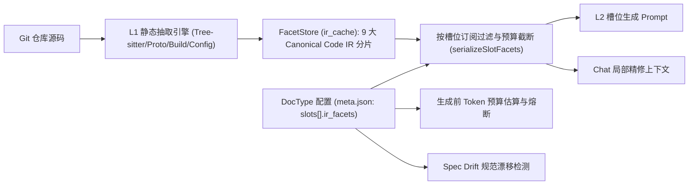

# Code IR 分片订阅 (`ir_facets`) 原理解析与配置使用指南

> **适用范围**：`code-archdoc` 管理员（`archdoc_admin` / `super_admin`）、文档模板作者与架构治理人员。  
> **关联设计**：[`02-extraction-and-generation-engine.md`](../02-design/02-extraction-and-generation-engine.md)、[`03-doctype-drift-and-publishing.md`](../02-design/03-doctype-drift-and-publishing.md)、[`ADR-02`](../05-adr/02-cpp-parser-and-code-ir-storage.md)、[`ADR-04`](../05-adr/04-module-scope-discovery-and-hierarchical-docs.md)、[`ADR-05`](../05-adr/05-doctype-blueprint-dual-mode-editor.md)

---

## 1. 核心概念：什么是“订阅 Code IR 分片”？

在 `code-archdoc` 中，系统**不会**把整个代码仓库的原始源码直接塞给大模型（LLM），而是通过 **L1 静态抽取 → Code IR 分片存储 → L2 按槽位按需注入** 的两阶段流水线生成文档：

1. **Code IR（代码中间表示）**：L1 解析引擎（Tree-sitter / Proto AST / 构建脚本与配置解析器）将仓库静态提炼为结构化、脱敏、带精确源码坐标（`file_path`、`line_start`、`line_end`）与置信度标记（`exact` / `heuristic`）的事实集合，并按职责拆分为 **9 大规范分片（Canonical Facets）**，压缩落盘于 `FacetStore`（`ir_cache/`）。
2. **订阅 Code IR 分片（`ir_facets`）**：在定义文档类型（DocType）或单个章节槽位（Slot）时，**按需声明需要把哪几类静态代码事实分片注入给大模型**，相当于对 LLM 上下文进行精准投喂、降噪与 Token 预算控制。



---

## 2. 9 大规范 Code IR 分片字典

详见源码 [`pkg/codeir/schema.go`](../../pkg/codeir/schema.go)：

| 分片名 (`ir_facets`) | 中文标签 | 提取的静态代码事实 | 体量 / Token 成本 | 典型适用场景 |
| :--- | :--- | :--- | :--- | :--- |
| `tree` | 目录树 | 文件清单、目录层级统计、代码行数（LOC）、语言分布、已跳过的噪音统计 | 轻量 | 系统概览、目录职责地图、改码导航 |
| `build` | 构建 | 构建系统（CMake/Makefile/Bazel/Maven/Gradle 等）、构建目标、编译选项、构建脚本、`add_subdirectory` 子目录、头文件路径 | 轻量 | 构建上手指南、部署产物清单、模块边界 |
| `deps` | 依赖 | 外部三方库依赖、内部模块依赖边、文件级 `import` / `#include` 引用事实 | 中等 | 架构分层拓扑、依赖容错分析、目录关系 |
| `config_keys` | 配置键 | 配置文件键路径、值类型、安全默认值、环境变量绑定（敏感凭据已在 L1 自动脱敏） | 轻量 | 配置清单、部署运维、超时与开关排障 |
| `idl_contracts` | Proto/RPC | `.proto` 服务（Service）、RPC 方法（含流式与扩展 Option）、Message 字段、Enum 枚举 | 中等 | 接口契约、核心链路入口、协议错误码 |
| `http_routes` | HTTP 路由 | HTTP 方法、路径、Handler 全限定符号、请求参数、响应类型、中间件（Spring/FastAPI/Flask/C++ HTTP） | 中等 | Web/API 接口文档、请求入口追踪 |
| `data_models` | 数据模型 | SQL 表/Redis/MQ/共享内存等实体定义、字段列类型与约束、索引与唯一键 | 中等 | 数据存储模型、ER 图、二开加字段清单 |
| `symbols` | 代码符号 | 类、结构体、函数、方法、命名空间、枚举、宏常量的签名、继承关系、字段与 `.h`/`.cpp` 双坐标 | **较重** | 逐跳源码导航、并发/存储细节、错误码宏 |
| `runtime_primitives` | 并发/调度 | 线程、锁、原子操作、共享内存/IPC、信号、定时器、事件循环、调度器、错误码原语 | **较重** | 运行时并发模型、故障影响面、底层排障 |

> **说明（第 10 派生分片 `module_context`）**：在 Monorepo 子模块场景下，系统内部还会派生一个跨模块上下文分片 `module_context`（记录上游/下游模块依赖与外部引用符号）。该分片由 `meta.json` 中的 `context_inputs: ["module_context", "module_digests"]` 自动控制注入，**无需**在 `ir_facets` 中手动勾选。

---

## 3. 订阅配置在系统中的 4 大运行时作用

槽位级 `slot.ir_facets` 会贯穿 `code-archdoc` 的完整生命周期：

1. **决定 L2 生成时的 Prompt 上下文（核心）**
   - 详见 [`pkg/llm/prompt.go`](../../pkg/llm/prompt.go) 中的 `BuildSlotPrompt` 与 `serializeSlotFacets`。
   - 每个槽位只序列化其自身 `slot.ir_facets` 订阅的分片，并受该槽位 `token_budget` 硬限制（最多约 `token_budget * 3` 字符，超限后截断为 `...(truncated_by_slot_budget)`）。
2. **驱动生成前 Token 预算评估与熔断**
   - 详见 [`pkg/llm/budget.go`](../../pkg/llm/budget.go)。
   - 任务提交后会按各非锁定槽位订阅的 `slot.ir_facets` 累加预估 Token 消耗，防止超大仓库或过度订阅触发失控账单或上下文溢出。
3. **支撑工作台 Chat 局部精修**
   - 详见 [`pkg/llm/chat_refine.go`](../../pkg/llm/chat_refine.go)。
   - 用户在工作台针对某个章节发起 AI 局部精修时，系统同样只挂载该槽位订阅的 `slot.ir_facets` 作为事实依据。
4. **触发规范漂移（Spec Drift）检测**
   - 详见 [`pkg/drift/spec_drift.go`](../../pkg/drift/spec_drift.go) 中的 `slotSpecChanged`。
   - 只要某个既有槽位的 `slot.ir_facets` 集合发生变化（顺序无关，集合增删即生效），保存新修订后后台会自动重算已发布文档的 Spec Drift，并在工作台提示对应章节需要刷新。

---

## 4. 关键概念辨析：顶层订阅 vs 槽位订阅 vs 整仓裁剪白名单

在编辑文档类型时，会涉及以下 3 个与 `ir_facets` 相关的配置层级，务必区分清楚：

| 配置位置 | JSON 字段 | 必填 | 运行时职责与配置建议 |
| :--- | :--- | :---: | :--- |
| **基础信息与策略 Tab**<br/>「顶层订阅 Code IR 分片」 | `meta.ir_facets` | 是<br/>（至少 1 项） | 文档类型级别的**总依赖声明与索引**（写入 `archdoc_doc_types.ir_facets_json` 并在列表页展示）。在 `ADR-05` 蓝图融合编辑器中**默认自动聚合自全部章节槽位 `ir_facets` 的并集**（亦支持切换为手动覆写）。 |
| **文档蓝图 Tab**<br/>「可视化编排 / 参数化源码 (`ir_facets`)」 | `meta.slots[].ir_facets` | 推荐必填 | **运行时真正生效的配置**。决定该章节生成 Prompt 注入、Token 预算估算、Chat 局部精修与 Spec Drift 判定。 |
| **基础信息与策略 Tab → 高级治理策略**<br/>（或 `meta.json`） | `meta.repo_ir_facets` | 否 | **多模块大仓“整仓汇总”裁剪白名单**（见 [`services/generation_service.go`](../../services/generation_service.go) `filterSlotSpecForScope`）。当整仓生成且存在子模块摘要（`module_digests`）时，系统会将每个槽位的 `slot.ir_facets` 与 `repo_ir_facets` 取交集，自动剔除 `symbols` / `runtime_primitives` 等重分片，防止撑爆整仓 Prompt。单模块小仓或子模块生成不受其影响。 |

> **常见避坑**：运行时向大模型投喂事实仅取决于每个槽位自身的 `slot.ir_facets`；在融合编辑器中，只需为各章节槽位勾选或编写 `ir_facets`，顶层 `meta.ir_facets` 会默认自动汇总并集，无需手工勾选两遍。

---

## 5. 操作指南：如何配置与使用

### 5.1 方式一：通过 Web 管理端「文档蓝图」双模融合编辑器配置（推荐，[`ADR-05`](../05-adr/05-doctype-blueprint-dual-mode-editor.md)）

需要账号具备 `archdoc_admin` 或 `super_admin` 角色权限：

1. 进入左侧菜单 **「模块治理 → 文档类型管理」**（路由 `/admin/doc-types`）。
2. 选择以下操作之一：
   - **克隆已有模板**（最推荐）：点击最接近目标场景的内置模板右侧 **「克隆」** 按钮，复制出自定义 DocType 后再微调。
   - **新建 / 编辑**：点击右上角 **「新建文档类型」** 或点击既有模板的 **「编辑」** 按钮打开编辑器抽屉（[`DocTypeEditorDrawer.tsx`](../../frontend/src/components/doctype/DocTypeEditorDrawer.tsx)，支持右上角一键切换宽屏编排）。
3. 在 **「文档蓝图 (Blueprint)」** Tab 中，可任选 **「可视化编排」** 或 **「参数化源码 (`DSL v1`)」** 模式（两种模式实时双向无损同步，自动派生 `template.md` 与 `slots[]`）：
   - **可视化编排模式**：
     - 在每张章节槽位卡片（`SlotBlockCard`）中直接点选 **「订阅 Code IR 分片 (`ir_facets`)」** Chip 标签；
     - 按需调整该槽位的 **「Token 预算 (`token_budget`)」**（默认 `8000`）、**「只读源码工具 (`enable_source_tools` & `max_tool_rounds`)」** 与多行 **「章节写作提示 (`instruction_hint`)」**；
   - **参数化源码模式（适合批量编辑或由 LLM 生成后整篇粘贴）**：
     - 直接在 Markdown 标题下方编写 ```` ```slot <slot_id> ```` 围栏块，例如：
       ````markdown
       ## 1. 对外暴露面与鉴权入口

       ```slot attack_surface
       ir_facets: [http_routes, idl_contracts, config_keys]
       token_budget: 10000
       enable_source_tools: true
       max_tool_rounds: 4
       hint: |
         梳理全部外部 HTTP/RPC 入口及其鉴权中间件与敏感配置默认值。
       ```
       ````
     - 编辑器提供 200ms 实时行号级语法校验（若分片名拼写错误如 `symbol`，会自动提示 `是否指 "symbols"？`）。
4. 切换到 **「基础信息与策略」** Tab（可选检查）：
   - **顶层 `ir_facets`**：默认已开启 **「自动聚合自全部章节槽位」**，随蓝图自动更新有序并集，无需重复勾选；
   - **高级治理策略（折叠面板）**：如需面向多模块大仓配置整仓汇总裁剪白名单 `repo_ir_facets`、`context_inputs`、`module_digest_source`、`verify_policy` 或 `scope_profile`，可展开面板可视化配置。
5. 点击 **「创建并落盘」** 或 **「保存并同步修订」**：
   - 若修改或移除了已落盘的既有 `slot_id`，系统会弹出风险确认门禁防止误破坏已发布文档；
   - 确认后后端持有 `slug` 级写锁，原子落盘 `doc_types/<slug>/` 四份资产文件，生成新修订 `Rev vN`，并基于静态骨架归一化精准重算受影响文档的 Spec Drift。

### 5.2 方式二：通过 `meta.json` 文件管理（支持 `repo_ir_facets` 等进阶项）

当需要版本化管理模板或配置 `repo_ir_facets`、`enable_source_tools` 等进阶选项时，可直接编辑 `doc_types/<slug>/meta.json`：

```json
{
  "name": "security-review",
  "display_name": "安全架构评审报告",
  "model_tier": "flagship",
  "ir_facets": ["tree", "deps", "config_keys", "http_routes", "idl_contracts", "symbols"],
  "repo_ir_facets": ["tree", "deps", "config_keys", "http_routes", "idl_contracts"],
  "slots": [
    {
      "slot_id": "attack_surface",
      "title": "1. 对外暴露面与鉴权入口",
      "ownership": "auto",
      "required": true,
      "ir_facets": ["http_routes", "idl_contracts", "config_keys"],
      "token_budget": 10000,
      "min_chars": 40
    }
  ]
}
```

保存文件后，在 **「文档类型管理」** 页面点击 **「从目录同步」**（或重启服务自动执行 `SyncAll`）即可生效。

---

## 6. 推荐搭配矩阵与最佳实践

### 6.1 常见章节类型的推荐分片搭配

| 章节主题 | 推荐 `slot.ir_facets` | 建议 `token_budget` | 说明 |
| :--- | :--- | :---: | :--- |
| 系统定位 / 模块分层与拓扑图 | `tree`, `deps`, `build` | `6000 ~ 8000` | 轻量化视图，足以支撑目录职责与 Mermaid `flowchart` |
| 对外 API / RPC 接口契约 | `idl_contracts`, `http_routes` | `8000 ~ 12000` | 精准覆盖 Proto/RPC 与 HTTP 签名，不混入实现细节噪音 |
| 数据模型 / 表结构与存储设计 | `data_models`, `idl_contracts`, `symbols` | `8000 ~ 10000` | 兼顾数据库表、消息体与内存结构体 |
| 端到端核心业务调用链路 | `idl_contracts`, `http_routes`, `symbols`, `deps` | `10000 ~ 12000` | 建议同时开启 `enable_source_tools: true` 按需核实函数体 |
| 运行时并发 / 锁 / IPC / 调度模型 | `runtime_primitives`, `symbols` | `10000 ~ 12000` | 建议配合 `enable_source_tools: true` 核实关键锁作用域 |
| 脱敏配置清单与环境变量映射 | `config_keys`, `tree` | `6000 ~ 8000` | `config_keys` 已在 L1 脱敏，聚焦配置项即可 |
| 本地构建 / 编译开关与部署拓扑 | `build`, `deps`, `config_keys`, `tree` | `6000 ~ 8000` | 必要时补充 `runtime_primitives` 识别共享内存/信号等系统资源 |
| 容错 / 超时 / 错误码与故障排障 | `deps`, `idl_contracts`, `runtime_primitives`, `config_keys` | `8000 ~ 10000` | 结合配置超时项、错误码原语与外部依赖分析单点故障 |
| 人工锁定章节（ADR / 技术债 / SLA） | `tree`, `deps`（或仅 1 个核心分片） | `3000 ~ 4000` | 仅用于首次生成草拟框架，保持低预算 |

### 6.2 内置 5 大 DocType 的分片订阅参考

以下为系统开箱即用的 5 个内置模板（位于 [`pkg/doctype/builtin/`](../../pkg/doctype/builtin/)）配置对照：

| 内置 DocType (`slug`) | 顶层 `ir_facets` | 整仓裁剪 `repo_ir_facets` | 模型档位 |
| :--- | :--- | :--- | :---: |
| `system-architecture`（系统架构与核心链路） | `tree`, `deps`, `build`, `runtime_primitives`, `symbols`, `idl_contracts`, `http_routes`, `config_keys` | `tree`, `build`, `deps`, `idl_contracts`, `http_routes`, `config_keys` | `flagship` |
| `data-and-contract`（数据模型与接口契约） | `idl_contracts`, `http_routes`, `data_models`, `symbols`, `runtime_primitives` | `idl_contracts`, `http_routes`, `data_models` | `flagship` |
| `ops-and-config`（配置、部署与研发上手） | `config_keys`, `tree`, `build`, `deps`, `runtime_primitives`, `symbols` | `config_keys`, `tree`, `build`, `deps` | `fast` |
| `code-walkthrough`（代码导读与改码指南） | `tree`, `deps`, `idl_contracts`, `http_routes`, `symbols`, `data_models`, `build` | `tree`, `deps`, `build`, `idl_contracts`, `http_routes` | `fast` |
| `agents-context`（AI Coding Agent 上下文包） | `tree`, `build`, `deps`, `config_keys`, `symbols`, `idl_contracts`, `http_routes`, `runtime_primitives` | `tree`, `build`, `deps`, `config_keys`, `idl_contracts`, `http_routes` | `fast`（`max_output_tokens: 4000`） |

### 6.3 实战最佳实践

1. **严格遵循“最小必要订阅”**：不要把 9 个分片全部勾选到同一个槽位。由于 `serializeSlotFacets` 会按分片名字母序拼接并在 `token_budget * 3` 字符处硬截断，冗余的 `build`/`deps`/`tree` 可能把排在后面的 `symbols` 或 `runtime_primitives` 挤出窗口。
2. **重分片配高预算 + 源码工具**：凡是订阅了 `symbols` 或 `runtime_primitives` 的深度分析槽位，建议将 `token_budget` 设为 `10000 ~ 12000`，并在 `meta.json` 中按需启用 `enable_source_tools: true`（`max_tool_rounds: 3~4`），让模型先看 IR 索引再按需精读局部源码。
3. **多模块大仓务必配置 `repo_ir_facets`**：如果新建的自定义 DocType 需要面向多模块 Monorepo 生成“整仓汇总视图”，务必在 `meta.json` 中显式配置 `repo_ir_facets` 并排除 `symbols` 与 `runtime_primitives`。
4. **评估变更既有模板的 Spec Drift 影响**：在线修改已有模板中某槽位的 `ir_facets` 不会破坏已发布文档，也不会覆写人工锁定（`locked`）章节，但会触发相关文档的 Spec Drift 提醒；建议在低峰期或批量升级模板规范时统一调整。
