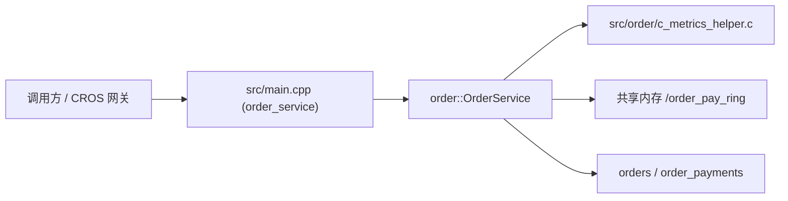
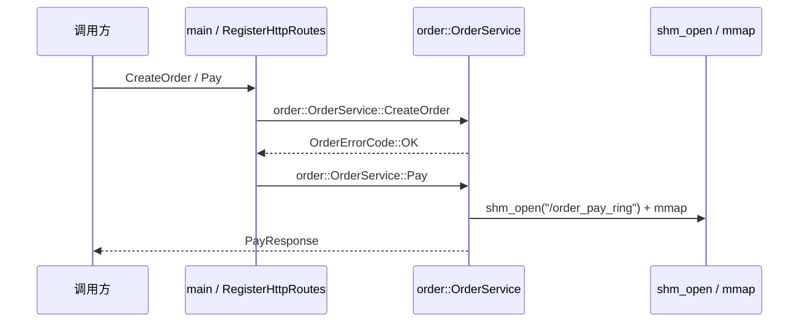

# cpp_order_service 系统架构与核心链路

## 1. 系统定位与模块分层边界
<!-- slot:overview_boundaries -->
`cpp_order_service` 是基于 C++17 与 CMake（`CMakeLists.txt`）构建的核心订单交易服务，包含 `order_core` 静态库与 `order_service` 可执行进程入口（`src/main.cpp`）。模块边界划分为：

- **契约定义层 (`proto/order.proto`)**：定义 `order.v1.OrderService` CROS RPC 协议与消息模型。
- **核心领域层 (`include/order/order_service.h`、`src/order/order_service.cpp`)**：由 `order::OrderService` 承载下单、支付、取消与可选指标聚合能力。
- **C 指标辅助层 (`src/order/c_metrics_helper.c`)**：通过 `MetricBucket`、`metrics_init` 与 `metrics_record_latency` 提供低开销延迟统计。
- **存储与配置层 (`sql/schema.sql`、`config/config.yaml`)**：定义 `orders` / `order_payments` 存储结构与运行期参数。

## 2. 运行时并发、进程/线程、锁与共享内存模型
<!-- slot:runtime_concurrency -->
服务在单进程内采用多线程与事件循环协同模型（均由 `src/order/order_service.cpp` 与 `src/order/c_metrics_helper.c` 抽取）：

- **线程与事件循环**：`order::OrderService::StartBackgroundWorker` 通过 `std::thread` 启动后台事件线程（组合 `epoll_wait` 与 `timerfd_create`），并通过 `pthread_create` 拉起独立工作线程，同时注册 `sigaction` 处理 `SIGTERM`。
- **锁与原子同步**：`order::OrderService` 持有 `std::mutex`（`order_mutex_`）保护订单映射写操作（在 `CreateOrder`、`CancelOrder` 中使用 `std::lock_guard`，在 `Pay` 中使用 `std::unique_lock`）；在 `ENABLE_METRICS` 条件分支下由 `std::shared_mutex` 配合 `std::shared_lock` 读取 `order::OrderService::GetOrderMetrics`；C 层通过 `pthread_mutex_lock` 保护 `MetricBucket`。
- **共享内存 IPC**：`order::OrderService::Pay` 使用 `shm_open` 与 `mmap` 写入 `/order_pay_ring` 共享内存环形区。

## 3. 端到端核心业务链路与时序图
<!-- slot:core_request_flows -->
订单创建与支付请求经 `proto/order.proto` 定义的 `order.v1.OrderService` 或 `src/main.cpp` 注册的 `/v2/orders/pay` 入口进入 `order::OrderService`：

## 4. 外部依赖拓扑、容错机制与故障影响面矩阵
<!-- slot:fault_tolerance_deps -->
- **构建与三方依赖 (`CMakeLists.txt`)**：依赖 `Protobuf`、`glog` 与 `Threads`。
- **错误码与超时边界 (`include/order/error_codes.h`、`proto/order.proto`)**：CROS 服务默认超时 `3000ms`（`Pay` 单独放宽至 `5000ms` 且标注幂等），业务异常统一映射为 `order::OrderErrorCode`（`ERR_ORDER_TIMEOUT`、`ERR_PAYMENT_FAILED`、`ERR_ORDER_NOT_FOUND`）。
- **容错隔离**：`shm_open` 失败时跳过共享内存写入不中断支付主流程；`ENABLE_METRICS` 宏关闭时指标路径静态裁剪不影响核心交易。

## 5. 架构约束、关键 ADR 与已知技术债
<!-- slot:adr_constraints_debt -->
- **架构约束**：所有写订单状态路径必须持有 `order_mutex_`；配置文件中的数据库口令与支付密钥由运行环境注入，严禁进入文档与缓存。
- **已知技术债**：`order::OrderService::StartBackgroundWorker` 中 `std::thread` 采用 `detach()`，后续需改为可控停止令牌以支持优雅退出。
